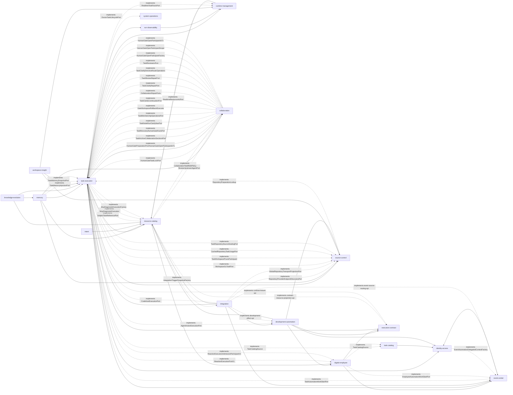

# RFC-294 技术设计：后台最终层次架构

> **2026-10-16 刷新版。** 本文只保留目标合同：原则、物理结构、层次规则、context 依赖、各 context 的边界要点、
> 执行结构、身份模型、部署与存储维度、装配与生命周期、治理模型和终局不变量。精确接口以代码
> （各模块 `public/*.ts`、`application/ports/*.ts`）与后继 RFC 的 design 为准（proposal D13）。
> 刷新理由与源码证据见 [2026-10-16 全面审视](./review-2026-10-16.md)；刷新前全文（含旧 §3.5 的 exact 接口草图、
> 旧 §5～§14 的领域细则与历次 SHA 证据）见 `archive-20261016-design.md`。当前指标见最近一次 dated review 或按需报告；[status.md](./status.md) 为生成说明。
>
> 机器解析约定：`tests/architecture/rfc294-design-parity.test.ts` 读取本文 §3.1 的第一个
> `flowchart LR` mermaid（context DAG）、以 `| IA \`public/types\` type-only`开头的矩阵行，以及 §3.4 表的首列，
与`rfc294Target.ts`的`TARGET_CONTEXT_EDGES`/`TARGET_PUBLIC_CONTEXTS` 对拍。三处内容的增删必须与目标常量同批修改；
> 本次刷新未改动目标边集与 context 集。

## 1. 设计原则

### 1.1 Feature-first，模块内分层

若继续把所有 transport 放 `routes/`、所有业务放 `services/`、所有持久化放 `db/`，一个功能变化必然横穿多个全局目录，
模块 owner 无法从路径判断。目标态先按 bounded context 聚合，再在模块内部区分 domain、application、engine、ports、
infrastructure 与装配入口。

### 1.2 统一机制，不抹平领域差异

- 要统一：可信 authority / command envelope、OCC、事务、outbox、apply 恢复、进程监管、执行装配、资源可见性查询形态、
  后台生命周期、装配图。
- 不强行统一：六类资源各自的不变量、call 与 wrapper、review 与 clarify 的内容模型、workgroup assignment 与 NodeRun 生命周期。

抽象只有同时满足以下条件才进入共享内核：至少两个真实生产 consumer、语义与失败 / 恢复合同相同、旧实现可被删除、
存在阻止第二实现再长出的结构门。否则留在领域模块。

### 1.3 依赖倒置以源码 import 为准

运行时会从 application 调到 engine / infrastructure，但源码依赖方向相反：application 定义 port，外层实现 port，bootstrap 注入。
不能靠动态 import、模块级 setter、`bind*` 侧表或从 public 文件 re-export 内部实现来假装消环。

### 1.4 单写源、可重建读模型

- 每个聚合只有一个 command writer，同一非法输入在任何入口得到同一错误；
- query projection 可独立优化或重建；
- 不以“双写旧表和新表、以后再删”为常态迁移方式；
- schema 迁移需要 expand / backfill 时，新旧读取互为 oracle，并明确删回退判据的时点。

### 1.5 提交与外部效果分相

事务回调只做持久状态、audit 与持久事件。事务成功后再执行：

- `critical`：必须最终发生，持久 outbox + 幂等 consumer；
- `rebuildable`：可从事实表重建，reconcile + 可选即时消费；
- `ephemeral`：WS invalidate / telemetry，提交后 best-effort。

事件类别必须由事件注册表穷尽声明。

### 1.6 文档定方向，代码定接口

总纲描述边界、方向、职责与不变量；它给出的类型名只是说明用的草图。某个跨域接口的确切形状，由实现它的后继 RFC
在其 design 中确定，并以代码中的 `public/*.ts` / `application/ports/*.ts` 为唯一事实源。总纲与代码不一致时，先判断是代码
违反了方向（修代码），还是草图过时（修总纲），不得以“对齐总纲草图”为由引入未被需要的字段或方法。

### 1.7 差异只在边缘：部署与存储

单机与托管、SQLite 与 PostgreSQL 的差异只允许出现在三处：infrastructure 的适配器、`platform/` 的机制与厂商客户端、
bootstrap 的选择。业务算法、状态机与校验规则只写一份。

## 2. 目标物理结构

```text
packages/backend/src/
├── modules/<context>/
│   ├── domain/                 # 纯值对象、规则、状态机；无 IO
│   ├── application/            # 用例（commands / queries）、本域 ports（application/ports/*）
│   │   └── adapters/           # 本域实现他域 consumer-owned required SPI 的领域适配器
│   ├── engine/                 # 仅 task-execution 等有执行引擎的 context：引擎、执行器、机制库
│   ├── infrastructure/
│   │   ├── local/              # 单机 profile 适配器
│   │   ├── crewstation/        # 托管 profile 适配器
│   │   └── *.ts                # 与 profile 无关的持久化 / 跨域 adapter
│   ├── inbound/                # 可选：本域专属的 HTTP / MCP 绑定（只 decode → call → map）
│   ├── public/{commands,queries,participants,events,types,operations}.ts
│   ├── composition/required-ports.ts   # consumer-owned required SPI（仅 bootstrap 与指定 provider adapter 可见）
│   └── composition.ts          # 唯一装配入口：create<Context>Module(deps) → { commands, queries, offered, jobs }
├── platform/                   # 领域中性机制：contracts、persistence、events、background、errors、
│                               # configuration、http、workspace/process 机制、<vendor>/ 厂商协议客户端
└── bootstrap/                  # 唯一模块工厂图、provider 与部署 profile 选择、生命周期程序、各薄入口根
```

- **composition 的含义**：`composition.ts` 与 `composition/required-ports.ts` 是仅有的装配文件。`composition/` 下其余文件
  一律视为待归位的实现，按内容迁往 engine / application / domain / infrastructure；新代码不得再放进去（proposal C1）。
  `public/*` 不得 re-export composition 内部实现；infrastructure 不得 import 本模块或他模块的 composition。
- **legacy 目录的去向**：`services/` 按 owner 迁入模块后删除，只允许一跳无状态 facade；`routes/` 逐步成为各模块
  `inbound/` 或 `adapters/inbound` 的薄绑定；`util/` 中的通用原语归 `platform/`，`util/git` 归 source-control 的 infrastructure
  并恢复为叶子；`auth/` 归 identity-access；`server.ts`、`cli/start.ts`、`cli/postgresqlDaemonApplication.ts` 中的装配收进
  `bootstrap/` 的工厂图，入口文件只剩参数解析与 profile 选择；`db/schema.ts` 目标上按 context 拆分 schema contribution，
  迁移编号与 schema admission 仍由 `platform/persistence` 统一。
- **不建垃圾桶**：不建 `common/`、`misc/`、`helpers/`；共享物必须有 owner 与 consumer。
- `modules/code-capability/` 不是目标 context，是待吸收的兼容岛（§8）。

## 3. 层次与禁止依赖矩阵

| 层                            | 可以依赖                                                                            | 禁止依赖                                                                                                                                      |
| ----------------------------- | ----------------------------------------------------------------------------------- | --------------------------------------------------------------------------------------------------------------------------------------------- |
| module `domain`               | shared 中性值对象、本模块 domain                                                    | Hono、Drizzle / schema、DB client、FS / Git / Runtime / WS、路径与配置、部署平台、其他模块任何文件                                            |
| module `application`          | 本模块 domain / ports、`platform/contracts`、其他模块受控 public 精确入口           | Hono、route / server、具体 DB table、直接 FS / 进程 / 网络 effect、WS broadcaster、platform 实现、本模块或他模块 infrastructure / composition |
| module `engine`               | 本模块 domain、application ports、本模块机制库                                      | route / server / Hono、具体 DB、WS、ambient config、其他模块 internal                                                                         |
| module `infrastructure`       | 本模块 ports、platform 机制与 vendor 库（含 `platform/<vendor>/` 的厂商协议客户端） | route、业务 command 调度、他模块 schema / internal、composition                                                                               |
| module `application/adapters` | 本模块 domain / internal ports + 一个指定的 consumer required SPI                   | 其他 SPI、外域 command / query、DB / schema                                                                                                   |
| module `composition.ts`       | 本模块各层、他模块 public 与 required-ports                                         | DB 查询、业务 if / switch、DTO 翻译、实现代码                                                                                                 |
| inbound adapter               | 模块 public command / query / operations、transport codec                           | DB / schema、模块 internal、领域算法、手写授权 / OCC / saga                                                                                   |
| platform                      | 中性 contract、vendor 库                                                            | **任何 `modules/`**、任何资源 / 任务 / 协作策略                                                                                               |
| bootstrap                     | 所有 public 合同与模块 `composition.ts`、platform 实现                              | 模块 infrastructure 深引用、业务 if / switch、DB 查询、状态迁移                                                                               |

常驻规则：

1. `domain/**` 禁 `hono|drizzle|@/db|node:fs|node:child_process|@/ws|@/routes|@/server` 与路径 / 配置 / 部署平台；
2. `application/**` 禁上述具体 adapter、禁 `infrastructure/**` 与 `composition/**`，并禁直接执行 FS / 进程 / 网络 effect；
3. inbound adapter 禁 `@/db` 与模块 internal；
4. 跨业务模块只 import provider 的 `public/{commands,queries,participants,events,types,operations}` 精确入口；
   consumer-owned required SPI 只能由 bootstrap 与指定 adapter import `composition/required-ports`；
5. bootstrap 之外不得有生产态的模块级可变单例 setter（`set*` / `register*Provider` / `bind*` 侧表 / reset hook）；
   路由与操作描述的注册不属于此类；
6. 事务回调内禁 `publish/broadcast/send`；
7. `platform/**` 禁 import `modules/**`；
8. `composition/**`（除 `composition.ts` 与 `required-ports.ts`）只允许构造与注入；
9. 既有 `no-routes-to-db`、`no-transport-to-db`、`no-services-to-routes`、`no-util-to-upper`、`no-auth-to-services`、
   `no-circular` 保留，只能递减。

`domain` 与 port 是兄弟边界：port 由需要外部能力的 application / engine 拥有，domain 保持纯净。

### 3.1 Bounded-context 允许方向

同步依赖必须服从以下 DAG（实线：左侧消费右侧 offered `public/*`；虚线：左侧的 provider adapter 实现右侧 consumer-owned
required SPI，不是反向同步依赖）：



虚线上的端口名是当时设计的称呼；代码中的实际类型名以实现它的后继 RFC 为准（例如 RFC-368 对 Reaction 两个端口的命名）。

同一对 context 若同时存在 offered 消费与 required-SPI 实现，两条边分别登记，不得折叠成一个万能接口。`platform` 不在业务
DAG 中。所有含 command / query 的 context 还对 `identity-access/public/types` 有一条 type-only authority 边：

| edge class                           | exact consumer contexts                                                                                                                                                                                                                                                                                                    | 约束                                                                                                     |
| ------------------------------------ | -------------------------------------------------------------------------------------------------------------------------------------------------------------------------------------------------------------------------------------------------------------------------------------------------------------------------- | -------------------------------------------------------------------------------------------------------- |
| IA `public/types` type-only          | `task-execution`、`task-catalog`、`collaboration`、`memory`、`intent`、`integration`、`knowledge-evolution`、`workspace-insight`、`development-automation`、`digital-employee`、`event-center`、`execution-contract`、`resource-catalog`、`source-control`、`runtime-management`、`run-observability`、`system-operations` | 只取 `AuthorizationSubjectRef` 与 opaque request/tx authority types；不得取得 role/permission policy     |
| value/offered consumption            | 上图全部实线 edge                                                                                                                                                                                                                                                                                                          | consumer 只能 import provider exact `public/*` symbol                                                    |
| required-SPI provider implementation | 上图全部虚线 edge                                                                                                                                                                                                                                                                                                          | provider adapter 只能 import consumer-owned required SPI 与本域 internal ports；bootstrap 只实例化和注入 |

方向要点：

- `identity-access`、`resource-catalog`、`source-control`、`runtime-management` 不反向依赖上层业务 context。
- task-execution 需要人工门、memory 注入或 code-host 执行时，只依赖**自己定义**的 required 端口；collaboration、memory、
  integration 各自实现。task-execution 不 import 这些模块。
- 必须跨 context 原子完成的用例归发起方 application 所有，经 tx-bound participant 在同一 `DatabaseSession` 事务内调用；
  不把业务顺序塞进 bootstrap。
- DAG 外出现双向同步需要时，默认改为 port / event；确属遗漏的共同聚合须新 RFC 证明。

**现状偏差（2026-10-31）**：RFC-399 已消除原有的两个 context 值级环
（{collaboration, memory, resource-catalog, task-execution} 与 {development-automation, integration}）及越 DAG 的值级依赖对。
RFC-400 进一步把 collaboration → task-execution 的 17 个内部文件对改为 TE 自有参与者，删除人工门装配桥，
并将 public 合同中的 legacy Actor / ActorSource 改为 Identity Access 的 AuthenticatedAuthoritySnapshot。
其余 type-only 越 DAG offered 边与跨 context 内部文件对仍作为 S5/S6 待清偿债；本表与生成器常量是唯一的目标边集。

### 3.2 受控 public entrypoints

每个模块对外只有 `public/commands.ts`、`public/queries.ts`、`public/participants.ts`、`public/events.ts`、`public/types.ts`
与 `public/operations.ts`（OperationCatalog 的操作描述，只供入站绑定使用）。值级 facade 与 type-only surface 分开；
只允许导出 application facade、跨域 DTO / value、tx-bound participant、版本化领域事件与操作描述。禁止导出 Drizzle
table / row、repository 实现、内部 aggregate、Hono 类型、模块单例与 composition 内部实现；禁止 `export *`。

### 3.3 边界接口最小化规则

模块边界以**已知 consumer 完成一个业务目的所需的最小信息**为准，而不是“这个模块目前有哪些函数”。没有生产 consumer 的
symbol / field 不公开；“无 commands / events”是合法且更好的 public surface。

| 出口类型 | 最小合同                                                                                         | 禁止                                                                           |
| -------- | ------------------------------------------------------------------------------------------------ | ------------------------------------------------------------------------------ |
| command  | context 与业务 input 分离；只收目标 id、实际决策、必要 expected revision / 幂等键                | DB client、body 里的 Actor、deps / callback、为未来预留的 optional 袋          |
| result   | 完成当前交互所需的 actor-filtered view 或 opaque receipt                                         | events、continuation、worker / lease id、DB row、stack / cause                 |
| query    | 一个 projection 一个 DTO；filter / page / sort 显式且下推                                        | `Record<string, unknown>`、全表后 JS 过滤、万能 view、以 JSON 字符串作为返回值 |
| port     | required SPI 由 consumer 拥有；offered participant 由不变量 owner 拥有；跨事务能力显式 `...InTx` | generic repository / UoW / service locator、让调用者自己拼授权或状态迁移       |
| event    | id / version / revision / 最小事实；正文用 ref 再经 actor-filtered query 读取                    | 完整 before / after row、private error、把事件当 DTO 总线                      |
| type     | branded id、版本化 tagged union、JSON-safe value                                                 | Drizzle / Hono / vendor 类型、`any`、字符串哨兵代替 tagged union               |

评审经验值（不是账本门）：跨 context port 超过 5 个方法、DTO 顶层超过 12 个字段、多个 consumer 只用到互不相交的方法子集时，
默认应拆分；确有同一状态机 / 协议理由的，在后继 design 中说明。

### 3.4 各模块最小 public surface

下表是目标**上限**与边界要点，不是要求一次实现的占位 API；只有真实 consumer 出现时才落 symbol。精确签名见各模块代码。

| 模块 | 对外提供（要点） | 跨域合同（要点） | 明确不跨界 |
| --- | --- | --- | --- |
| `identity-access` | 认证 / 会话 / token / profile 管理命令；当前身份与 Git commit identity 查询 | direct / delegated operation context 工厂、delegated authority resolver、事务内 current authority；实现 Event Center 的委托上下文 SPI | token / session 行、full Actor / 权限快照、presence 进 prompt、任意 SystemActor 构造 |
| `task-execution` | Launch / Resume / Retry / RetryNode / Cancel / SyncWorkflow；任务 / 执行视图与任务工作区读取 | 来源专属的 launch intent participant、任务决定 participant；required：工作区准备 / 人工门 / memory 注入 / code-host / 工作区读取端口 | scheduler 状态、frontier、ownership token、AbortController、node row、worktree 绝对路径 |
| `task-catalog` | 无 mutation；`ListTaskSources` / `ListTaskCatalogPage` 的 typed 查询 | required `TaskCatalogSource`，由 task-execution 与 digital-employee 各实现一个 | full Actor、JSON 字符串响应、Task / EmployeeCase 行、万能 StartAnything |
| `digital-employee` | 类型 / 工具 / 岗位 / 员工发布；Case launch / resume / terminate | 消费 execution-contract participant 与 Event Center participant；本域 required Reaction 执行与准入端口由 task-execution 实现 | 代码员工 schema、Git / code-host 凭据、Task / NodeRun 行、按类型分支 |
| `event-center` | 幂等 ObserveEvent；来源中性 automation rule 的 typed 命令 | 拆分的 subscription / delivery / observer-control participant；target 专属的 work-start 端口由 task-execution / digital-employee 各自实现 | Webhook endpoint / secret / trigger 行、EmployeeCase、跨 target 启动 union、Task / DE 重试状态 |
| `execution-contract` | Agent 契约托管端口的规整命令 | `ExecutionContractParticipant`（get / list / validate*）；required 资源投影与 Program fixture 端口 | EmployeeCase 路由、开发 schema 字面量、Agent / Workflow 写模型、Script runtime |
| `development-automation` | Mission 生命周期与四类配置的 typed 命令；admission preview 与各投影 | 按用例拆分的 non-optional required SPI（由当前 26 成员可选袋 `ReconcilerPorts` 拆出），provider adapter 各实现一小面 | Task / NodeRun 行、Git / code-host 凭据、绝对路径 / URL、raw prompt / log、provider SDK |
| `resource-catalog/core` | 无 universal CRUD；横向 `ResourceCatalogQuery` 只返 summary | 用途专属的资源快照 participant 与 `ResourceAccessQuery`；统一判据 `none/read/write/own` | ACL 表、owner / grant 行、generic repository、六类 detail union、执行逻辑 |
| `resource 子模块` | 各类资源自己的 Create / Update / Rename / Delete / UpdateAcl | 只有真实跨域需要时才出 participant（如 skill version） | 其他资源的不变量、`switch(resourceType)` CRUD |
| `resource-catalog/package` | 资源包 inspect / admit / apply 命令；预览与回执查询 | 作为 AtomicApply provider 消费各类资源的 typed mutation participant | resource 行、generic repository、apply journal / claim |
| `collaboration` | 提交 clarify 答案 / review 决定 / question 答案 | 实现 task-execution 的人工门准备 / 开门端口；消费 task 的决定 participant | 文档行、continuation intent、worker id |
| `knowledge-evolution` | 发起 / 批准 / 拒绝 / 重试融合、恢复 skill 版本；融合与 provenance 查询 | 消费 task launch 与 skill / memory 的 tx participant | memory / skill 行、task internal、raw artifact / journal |
| `memory` | Create / PatchContent / Move / Promote / Archive / Delete / distill 重试与取消 | 实现 task-execution 的 memory 注入端口；提供 KE 专用的成员关系 participant | prompt consumer 列表、author / ACL 行、fusion 引擎 |
| `intent` | 会话 / turn / working set / ApplyDraft / Archive | 资源提交只经 AtomicApply 端口 | changeset journal / artifact、resource repository、runner 句柄 |
| `integration` | webhook endpoint / trigger / schedule / provider connection 的 typed 命令与查询 | 消费 task launch intent；实现 code-host 执行端口、Event Center source / observer 适配与 source-control 的两个 transport 端口 | 来源中性 EventResponseRule、webhook secret / raw token、Task deps、Hono handler |
| `source-control` | repo / group 与 transport credential 命令；仓库摘要 / 树 / 文件查询 | source seal、launch snapshot、仓库准备、publication、工作区物化与内容 participant；工作区 GC 策略 | raw URL、带凭据 URL、绝对路径、raw token / provider client、可变 worktree 对象、ownership token |
| `run-observability` | 价格版本命令；调用、用量与成本的按需聚合查询 | 只读任务事实与运行时目录（经 owner 的 public 查询） | 执行控制、运行时凭据、以最新价格改写历史成本 |
| `runtime-management` | runtime profile / admin 命令；inventory / status / probe / diagnostic 视图 | 事务内的 runtime 选择 participant | provider secret、进程句柄、vendor SDK 对象 |
| `workspace-insight` | 幂等的叙述生成与取消；结构 diff / symbols 查询 | 消费 task / source-control / runtime 的不可变快照 participant | repo 路径、DB client、live worktree 写、无界文件正文、进程 / 模型句柄 |
| `system-operations` | 备份 / 暂存恢复 / 激活恢复的编排命令；恢复状态与诊断查询 | 执行权端口（standby / active / frozen，语义状态，不含厂商字面量） | 公共 liveness、跨业务统计、任何业务事实表、task limit / GC 策略 |
| `platform/contracts` | 无业务 command | 事务 / 时钟 / id / 事件 / 审计 / 配置 / 作业 / AtomicApply 中性机制 | Actor / 资源 / 任务策略、业务 DTO、任何模块实现 |

### 3.5 接口事实源

旧版本节用约 1,560 行 TypeScript 写出跨模块 exact V1 接口；其中绝大多数类型名从未在代码中出现（review R1），已归档。
现在的规则：

- 跨域接口的事实源是 provider（offered）或 consumer（required）模块的 `public/*.ts` 与 `composition/required-ports.ts`；
  模块内端口的事实源是 `application/ports/*.ts`。
- 新增或修改跨域接口的后继 RFC，在自己的 design 中写清字段的 consumer 与用途、事务归属、幂等与错误语义，并以代码落地；
  总纲不再复制。
- 需要追溯旧草图时，以 `archive-20261016-design.md` 为历史参考，不作为合同。

## 4. 公共应用合同

### 4.1 Operation context 与 authority

- direct / delegated 业务命令都有可信 request authority，由 identity-access 的工厂基于认证结果构造
  （`modules/identity-access/application/operationContext.ts`）；adapter 不从 request body 接受 actor / now / correlation。
- schedule、webhook、call 新启动重读 owner 的当前有效权限；Event Center 自动化启动使用绑定 rule owner、origin 与目标端口的
  event-only 委托上下文；人工 resume / retry / cancel 使用当前请求者；已运行任务的内部续跑使用 ownership epoch +
  窄 capability；outbox consumer 与 apply converger 使用各自 family 的窄 capability。这些语义是现有行为基线，改变它们属于
  独立能力 RFC。
- `operationId` 标识一次 application 调用，`correlationId / causationId` 贯穿 request → task → node → event。

### 4.2 Command / Query / Operation

- 每个 operation 只有一个 `execute`；HTTP 与 MCP 表达同一用例时调用同一 handler（RFC-344 OperationCatalog 已落）。
- RouteMeta 做 transport 粗粒度 admission，资源 / 行级授权、OCC、状态机、事务与 audit / event 在 command 内完成。
- query 返回 actor-filtered projection，分页、过滤与排序下推到查询端口。

### 4.3 事务

- 事务语义只有一份：`platform/persistence/databaseTransaction.ts` 的 `DatabaseSession`（SQLite 写者 lease + BEGIN IMMEDIATE，
  PostgreSQL 同一事务体）。DB 操作必须 await；Git / FS / 网络 / 安装 effect 在事务外，经 journal 做 record-before-act。
- 跨 aggregate 用例定义用途专属的 tx-bound participant，在同一 live transaction 中构造；不得先调一个模块的事务再调另一个，
  也不得为原子性 import 对方 table。participant 不得逃逸出回调。

### 4.4 错误

- domain / application 错误不携带 HTTP status；唯一的 public 映射是 `platform/errors/publicError.ts` 的
  `toPublicError` / `PublicErrorDTO`，由 HTTP / MCP / WS 映射转换 transport status。
- 现有错误码保持兼容；迁移不是重命名错误码的授权。两套实现对同一输入给出不同错误码属于缺陷（review F7）。

## 5. Task Execution 模块

### 5.1 现状结构（2026-10-16，供迁移对照）

```text
TaskDriveCoordinator（application/drive；目前在 5 处构造）
 → 任务引擎编排（composition/taskEngineApplication.ts，一个 731 行函数）
   → runScope ⇄ deriveFrontier（composition + services/dispatchFrontier、services/freshness）
     → NodeExecutionGateway（engine/node：分支判定 + 注册表）
        ├ wrapper → Loop / Git / Fanout 策略（engine/wrapper，唯一真实拥有策略的层）
        │            → scopeDriver ↺ runScope；fanout 分片直接调 runAssembly
        └ leaf → 一行委托壳 → legacyArgs → composition/nodeMechanics.ts 的 run*Node → runAssembly / 人工门 / 子任务
 机制散落：services/schedulerAssembly.ts（runAssembly）、infrastructure/isolatedAgentRun.ts 与 platform/workspace/local/isolation.ts
（隔离 / 合并）、services/{taskWriteLocks,processNodeConcurrency,taskFanoutPools}.ts（许可）、services/nodeRunMint.ts（铸造）
 执行上下文：services/execution/taskMechanicsState.ts 的 22 字段 TaskMechanicsState
```

workgroup 轮次引擎的主体在 `modules/resource-catalog/composition/workgroupTurns.ts`，动态工作流在
`services/dynamicWorkflowRunner.ts`。

### 5.2 目标结构

| 层           | 职责                                                                                                                                           | 目标位置                                   | 不得拥有                                              |
| ------------ | ---------------------------------------------------------------------------------------------------------------------------------------------- | ------------------------------------------ | ----------------------------------------------------- |
| 任务控制面   | 协调器（唯一构造点在 bootstrap）、三类任务引擎（DAG、workgroup 轮次、动态工作流）：任务级推进、暂停 / 恢复 / 取消、终态                        | `application/drive/`、`engine/task/`       | 节点执行细节、WS 发布                                 |
| scope 解释器 | DAG scope、frontier、loop / git / fanout 策略；wrapper 回到 scope 的递归是正式语义                                                             | `engine/scope/`、`engine/wrapper/`         | 进程与工作区机制                                      |
| 节点执行器   | 每种 kind 的执行主体：agent、script、call-workflow / call-workgroup、code-host、review / clarify 的 task 侧请求与 park 结果、workgroup host    | `engine/node/<kind>/`                      | 人工门策略（归 collaboration）、资源授权、fanout 拓扑 |
| 执行机制库   | assembly 顺序（许可获取 → 隔离创建 / 持久 → run-row 解析 → spawn → merge → settle → 清理）、隔离与合并、许可与限流、NodeRun 铸造、进程监管接口 | `engine/kernel/`（机制库，供上面三层调用） | task 状态、WS payload、资源授权、人工门、领域判断     |

规则：

- 每层拥有自己的决策；不允许“engine 里一行委托、composition 里写主体”的形状，也不允许 `legacyArgs` 一类的整体参数桥。
- 执行上下文显式化：`TaskMechanicsState` 拆成按层注入的窄端口（许可、ledger、工作区、进程、事件）；信号量与回调不通过
  一个可变大对象在签名间传递。
- 引擎与执行器只依赖本模块 domain / ports 与机制库；engine 不 import `@/services`（现状已满足，迁移中保持）。
- `NODE_KIND_BEHAVIORS` 仍是 kind 行为单表；执行器注册表从它派生或以穷尽检查锁住。call-workflow 不进入 wrapper；
  workgroup 的轮次 / assignment 状态机独立于 NodeRun 状态机，只在执行单个 host member 时复用节点执行器与机制库。
- workgroup 引擎迁出 resource-catalog，动态工作流引擎迁出 `services/`，二者都归 task-execution。
- 历史 `code-round` 只保留版本化读取与 fail-closed 结算，绝不重建执行器。

### 5.3 Ownership 与生命周期（已落，保持）

RFC-328 已落持久 owner / intent / effect / fence / maintenance / lineage 与 exact-token registry；RFC-341 已落已提交事件与逐
consumer delivery。目标不变：execution-plane 写入在同一事务内验 epoch；FS / Git / 进程 effect 走 record-before-act 与工作区
fence；无法证明旧句柄已停时进入 recovery-required；`abortAll(reason)` 的 reason 非可选并保留 daemon 关停 → interrupted 语义；
人工 cancel / resume / retry 只写 desired-control 或 continuation intent，由 worker 重新 claim。后续 RFC 不得再造第二个
ownership port、registry 或 outbox。

托管部署下，执行权（system-operations 的执行权端口）决定哪一个实例可以执行；任务 ownership 仍以持久 epoch 为准，二者叠加，
不互相替代。

### 5.4 Assembly 边界

assembly 只拥有装配顺序与双模式窗口（每次尝试 / 跨尝试）、默认 merge disposition 与 L1 覆写、clarify park 作为正式结果；
不拥有任务状态、WS payload、资源授权、人工门或 fanout 拓扑。ownership token 从任务引擎一直线程化到 assembly、run ledger、
工作区 fence、spawn 回执与终态提交，assembly 不从全局 Map 猜当前 owner。RFC-287 的 G4～G7 行为（配额设置、公开 `file://`
收缩、仓库准备重试窗口、`__repo_prep__` 可见性）不进入 assembly。

### 5.5 迁移顺序（plan S6）

1. 把 `services/schedulerAssembly.ts`（仅一个类型 import）与隔离、合并、许可一起迁为 `engine/kernel` 机制库，改指现有五个
   调用方，删除回指 task-execution 自身的三个 facade；
2. 以 script 节点试点，把 kind 主体从 `nodeMechanics.ts` 迁入 `engine/node/script/`，显式列出它需要的端口；
3. 依次迁 code-host、input / output、call-workflow / call-workgroup、agent、workgroup host；
4. 迁 `wrapperMechanics.ts` 中的 fanout 分片与聚合装配线、`taskEngineApplication.ts` 的引擎编排；
5. 退出：`nodeMechanics.ts` 删除、`legacyArgs` 消失、`TaskMechanicsState` 只出现在装配、协调器只在 bootstrap 构造。

`services/task.ts` 的旧启动路径只剩一个生产调用方（fusion），在其改走根启动内核后退役；它不在热路径上，排在上述步骤之后。

## 6. NodeRun 身份与 provenance

### 6.1 第一刀：每任务单调序号（W7-A）

- `node_runs` 增加每任务单调的 `seq`，在唯一铸造程序的同一事务中分配，`UNIQUE(taskId, seq)`；
- `isFresherNodeRun`、supersession（domain 与 SQL 两份）、各处 `orderBy(nodeRuns.id)` 与手写 id 比较改为比较 `seq`；
  存量行无 `seq` 时以 id 作兼容回退，并有回填后删除回退的明确时点；
- 不得再新增按 id 判断先后的代码（proposal C5）。

理由：铸造使用普通 `ulid()`，同毫秒内约一半逆序（代码中已有一处因此改用 `retryIndex`），托管部署下铸造进程会跨主机迁移，
id 顺序还依赖主机时钟。显式序号与时钟和随机数都无关。

### 6.2 完整目标模型

在 `seq` 之上，NodeRun 最终显式建模：`RunRole`（node-attempt / container / synthetic，以及 synthetic 的 owner 轴）、
`scopePath` / `containerRunId`、逻辑执行代 `generationSeq`（与重试 `attemptIndex` 分离）、`shardKey`、历史 parent 与当前
selected run 的分离、consumer→producer 的逐边 provenance（消费了哪一个 producer run 的哪一个输出端口）。freshness、resume、
retry、fanout replay 与 aggregator 都消费同一 selected-run / provenance 合同，不再各自拼 SQL + JSON + id 回退。
`__repo_prep__` 是 task 级 synthetic，不得伪造 host；多仓用 `node_run_repos` 一类子表表达。

### 6.3 迁移方式

expand → 写入切换（铸造程序同事务写新列）→ 幂等回填与追平 → shadow 读取对拍（mismatch 必须为 0）→ 读者切换 →
删除回退判据。不能证明的历史行标为 legacy-derived，经版本化 codec 读取，不伪造 scope。迁移编号与并发 RFC 的在制迁移串行。

### 6.4 Fanout 内链（W8，可选）

只有 W7 完成后、另立新号 RFC 并获批，才可解除 `fanout-inner-chain-unsupported`：通过 generation 的 selected-run map 找同
shard 上游、在下游行持久记录实际消费的上游 run、复用同时比较 shard identity 与 consumed fingerprint、validator 只表达真实
可达的不变量。

## 7. Resource Catalog 与 AtomicApply

### 7.1 Resource Catalog

`resource-catalog` 共享的是 ACL / ref / revision / catalog 小内核，不是 `switch(resourceType)` 万能 CRUD。agent / skill / MCP /
plugin / workflow / workgroup 六个聚合各自保留命令与不变量；其他种类的 ACL 资源（capability template、开发配置、数字员工
资源、定时任务等）复用 ACL 与 grant 机制但由各自业务 owner 写。resource-catalog 不拥有执行：workgroup 轮次引擎迁回
task-execution（§5.2）。跨模块授权经 public 授权查询，不暴露 ACL 表。

### 7.2 AtomicApply

- `platform/atomic-apply` 唯一拥有状态机：幂等重放 → claim（持久，写 prepared）→ 预置（artifact journal）→ CAS
  prepared→applying → 领域提交 → CAS committed → 前滚或补偿 → 终态或可重试；
- 场景（ResourcePackage、Intent、fusion approve、skill restore）只提供 provider：前置条件、幂等键、journal 适配、基线重验、
  versioned artifact codec；
- **只保留一套资源写入栈**：资源包、Intent 与普通 CRUD 对同一资源使用同一组 typed mutation participant，同一非法输入同一
  错误码；
- 收敛保护使用持久 claim / lease（epoch CAS），不依赖进程内活跃集合与年龄判定；三处收敛循环合为一个注册在生命周期程序里的
  作业；
- 回滚只把**新 admission** 切回旧路径；已归属新引擎的行由新引擎收敛；journal 永久向前兼容。

RFC-310 的 development effect journal 是领域恢复，不计作 AtomicApply 场景。

## 8. 其他 context 要点

- **collaboration**：拥有三类人工门的开门 / 决定 / 续跑（RFC-333 / 341 已落）。task-execution 的 review / clarify 执行器只做
  task 侧请求与 park 结果。collaboration 不 import task-execution 的 infrastructure / application；需要的 node / task 迁移经
  task 拥有的 tx-bound 决定 participant。`services/humanGateComposition.ts` 一类为避环而绕道的组合收进 collaboration 自己的
  装配入口。
- **knowledge-evolution**：融合聚合、决定与 provenance；skill version 与 memory 成员关系在同一 typed 事务维护（RFC-353 已落）；
  目标上以 AtomicApply provider 接入。
- **memory**：内容 / move / query 分离、双 scope 同事务授权（RFC-342 / 352 已落）；只经 task 的注入端口进入 prompt。
- **intent**：会话 / draft / working set（RFC-355 已落）；资源提交只经 AtomicApply。
- **integration**：webhook / schedule / code-host / adapter connection；WebhookTrigger 与 Event Center 的 EventResponseRule 只共享
  授权词汇，不合并 aggregate。`services/developmentDeliveryDeps.ts` 一类跨域翻译迁为 integration 的 provider adapter。
- **source-control**：repo / cache / group / worktree / submodule / publication / credential 与工作区 GC 策略；`util/git` 迁为本域
  infrastructure 叶子；对外只给 opaque `WorkspaceRef` 一类引用，不暴露绝对路径。
- **runtime-management**：profile / probe / diagnostic 与 runtime 选择（RFC-360 已落）。
- **run-observability**：按 RFC-371 v2 形态保持：一次调用一行、按需聚合；它消费的任务事实端口作为 required 端口登记。
- **workspace-insight**：从 `services/structuralDiff/`、`services/codeIntel/`、`services/changeNarrative.ts` 抽成模块，并接管
  `code-capability` 的 `codeWorkspaceRead` 端口。
- **system-operations**：备份 / 恢复编排与执行权端口；物理恢复 generation 协议（W9-E）按 provider 能力分别实现。
- **digital-employee / event-center / execution-contract / development-automation**：保持 RFC-310 的四域分工；development-automation
  的真实 SPI 由可选袋拆为按用例、非可选的 required 端口；无实现无调用的声明删除。
- **task-catalog**：public 查询改为 typed query / page，不接 full Actor、不返回 JSON 字符串（W4-E10）。
- **code-capability**（兼容岛）：历史查询与 capability template 写入（`routes/capabilityTemplates.ts` 的增删改由
  `modules/code-capability/application/capabilityTemplateOperations.ts` 提供）目标上并入 development-automation；在此之前不新增能力，
  不恢复 code-round。

## 9. 部署 profile

### 9.1 概念

- **profile**：`standalone`（单机）与 `crewstation`（托管）。profile 决定每个端口选用哪个适配器，不决定业务路径。
- **进程角色**：单机下一个 daemon（可带 Worker 线程）；托管下有服务槽（蓝绿两槽）、迁移作业、任务镜像内的 `workspace`
  助手。每个角色是一个薄入口根，共用同一张模块工厂图（§10）。

### 9.2 端口与适配器落位

- 端口按语义定义在拥有方 context 的 `application/ports/`，不按进程或平台定义；端口类型中不出现厂商字面量
  （例如执行权端口只暴露 standby / active / frozen 与 fence，不暴露 `'standalone' | 'crewstation'`）。
- 适配器放 `modules/<context>/infrastructure/<profile>/`；厂商协议客户端（HTTP / SSE / 对象存储等）放 `platform/<vendor>/`。
- 文件路径、PID、厂商 DTO 只出现在适配器内。
- 部署能力差异（某 profile 暂不支持某能力）由 profile 提供的能力描述表达，入口统一返回同一错误；不在业务层判断 profile。

### 9.3 选择点

- 选择只在 bootstrap 发生一次：每个模块从 profile 得到一份类型化的适配器集合，装配图据此构造；
- 取代当前“`cli/deployment.ts` 读环境变量 → `bootstrap/crewstation.ts` 返回 `StartOptions` 覆盖 → 各模块 `select*` 助手
  `selected ?? createLocal…()`”的形状；`cli/` 与 `bootstrap/` 不得互相依赖；
- SPA 部署标记等展示信息来自 profile 描述，不读端口上的模式字面量。

### 9.4 进程内不变量

flock 单实例锁、进程内活跃集合、进程内锁、内存缓存等，在设计中必须标明适用 profile：只在单机成立的，声明为
standalone-only 并在托管装配中不可用或替换；需要跨实例成立的，改为持久 claim / lease。

### 9.5 跨进程协议

控制面与任务镜像之间的调用使用类型化的操作合同（每个操作有确定的输入 / 输出类型与错误码），不以 `operation: string` +
`input: unknown` 的通用信道传递；协议载荷类型归协议本身，不从本地适配器借用。

### 9.6 与 RFC-370 的关系

RFC-370 v2 的原则（同一业务路径、端口按语义、崩溃即退出的执行权、托管装配集中到 bootstrap）与本节一致。HEAD 上的偏离
（review F10：端口厂商字面量、composition 中带逻辑的执行适配器与 RPC 分派、未类型化协议、入口根按部署分支、
语义执行端口未落、选择点位置）由 RFC-370 在收口前对账；确需保留的偏离在其 design 中列明并呈用户确认。

## 10. 装配根与生命周期

### 10.1 薄入口根

允许多个入口根：daemon（服务槽）、Worker 线程、CLI 命令、任务镜像助手、迁移作业。入口根只做参数解析、profile 选择、
调用 bootstrap 的工厂图并启动对应生命周期；不写业务判断、不查 DB、不单独构造模块。

### 10.2 唯一模块工厂图

- bootstrap 持有每个模块的工厂与它们之间的依赖；每个模块在一个进程内**只构造一次**，HTTP、MCP、CLI 与 worker 共用同一实例；
- SQLite / PostgreSQL 与 standalone / crewstation 都是图内的适配器选择；不存在“SQLite 根”“PostgreSQL 根”“HTTP 根”三份装配；
- 现有 `server.ts` 的 provider 无关挂载表是可复用的起点，`composeSqliteApplicationDeps` 一类 provider 专属装配与
  `deps.x ?? composeX(...)` 形态的测试回退构造退役；
- 测试通过工厂图注入实例 port，不在生产装配里保留测试回退。

### 10.3 唯一生命周期程序

- 启动恢复步骤、runtime 工厂、后台作业工厂与 close participant 由**一份** provider-neutral 程序给出，两种 provider 与两种
  profile 共同消费；两种 provider 产生的有序作业 id 清单必须相同（测试锁定）；
- 建在已接线的 provider runtime session 上（`cli/daemonProviderRuntimeSession.ts` 的有序启动、逆序停止与排空），补齐阶段
  （boot-recovery / pre-listen / pre-ready / post-ready）、依赖、就绪、健康与停止回执；
- 周期作业只声明 cadence / overlap / run，常驻 worker 只声明 start / stop，不得在内部私设 timer；
- 执行局部的 timer（如节点运行中的心跳）归其 aggregate 生命周期，不进入 daemon 注册表，但必须有 owner 与 stop；
- 托管 profile 下，后台作业集在实例首次成为 active 时启动，失去执行权即退出进程（RFC-370 的崩溃即退出语义）。

## 11. 存储 provider

- 事务语义只有一份（§4.3）；业务算法、状态机与校验规则只写一份，不得在两个 provider 的装配或适配器里各实现一遍；
- 方言差异只在 infrastructure 的持久化适配器、迁移与 logical copy 中；
- 已被两个 provider 共用、但文件名仍带 `postgresql*` 的中立实现，随所在后继改名到中立名称；
- 两条迁移链（SQLite 与 PostgreSQL）由 schema contract 对拍；新迁移编号与并发 RFC 的在制迁移串行分配。

## 12. Platform 合同

- **配置**：bootstrap 解析全量配置后按 consumer 注入窄投影（boot 快照 / 操作快照 / 热读三种模式）；模块不取得全局配置或任意
  key reader；迁移保持原热生效时机。
- **后台**：见 §10.3。
- **观测与审计**：`operationId / correlationId / causationId / taskId / nodeRunId` 贯穿结构化日志、指标与审计；HTTP requestId 只在
  入站适配器映射；机器恢复不读日志文案。
- **测试边界**：模块可有 `testing/` 工厂与 fake，但不从 public 导出、不进入生产装配；跨模块集成测试只走双方 public 合同或
  工厂图的测试装配。
- **持久化 schema**：每个模块的 infrastructure 拥有自己的 table / mapper；跨 context 不 import 对方 table 做 join，需要联合
  投影时由读模型 adapter 明确拥有；迁移编号、schema admission 与连接 / 事务由 `platform/persistence` 统一。
- **单向**：platform 不依赖任何模块；领域状态机（例如任务生命周期写入序列）归其模块的 infrastructure。

## 13. 架构治理模型

### 13.1 硬结构门

每条门都必须有能证明会红的变异测试，不设增长许可；确需例外时在规则旁登记具体条目与清偿后继，例外只能减少。

- 值级环：depcheck `no-circular` 与 `KNOWN_VIOLATIONS`（双向：新增违规红、过期条目红）；
- route / transport→DB、services→routes、util→upper、auth→services；
- 模块内分层（§3 常驻规则 1～3、8），其中 application 的直接 FS / 进程 / 网络 effect 也在门内；
- 跨 context 只经 public 精确入口：一条依赖规则 + 一份只能减少的文件对 allowlist（初值由 RFC-376 阶段 B 从当时已提交 HEAD 重算；
  其他可行动债分别由 depcheck 与分层门承载）；context 级值依赖无环；
  observed offered 边 ⊆ §3.1 DAG；
- `platform/**` 不 import `modules/**`（存量以只能减少的 allowlist 过渡）；
- `node_runs` 唯一 INSERT 站点；
- 业务层（domain / application / engine / inbound / platform / 入口根）零部署模式分支；
- 两种 provider 的生命周期程序产生相同的有序作业清单。

另保留一份很小的已提交计数文件（`KNOWN_VIOLATIONS` 数、值级 SCC、route / transport→DB、legacy 文件数、facade 数、
可行动跨 context 边数等）：下降由检查自动接受，上升必须在同一提交里显式改数并写明原因，供评审一眼看到；不设过期、
不做 provenance pin。它是“减速带”，不是门。

### 13.2 按需报告

模块形状、跨 context 边分布、public symbol 与 consumer、后台作业、模块级可变单例、facade 等库存由生成器从任意已提交源码
**按需**生成，用于排期与审视；默认不提交，不要求 provenance pin，不作为任何波次的退出条件。计数口径必须测其名所指：
模块级可变单例不含路由 / 操作注册；后台作业不含常量与 schema。

### 13.3 过渡

RFC-376 阶段 B 将治理切换为硬结构门、文件内双向精确例外与 `architecture/counts.json` 减速带。
普通生产改动不再需要 census、provenance pin、增长许可或投影伴随提交。报告命令为
`bun run architecture:report --source-ref HEAD`，默认输出到忽略的 `.architecture-report/`；加 `--gates` 可重算清单与计数。
`architecture:write` 暂留为非零退出墓碑；旧库存与生成器已删除，保留的主题清单仅在主题变化时手维护。
生命周期清单一致门 G12 留给 S2a；C7 零 consumer public 符号只进报告。新增例外须在后继 RFC 中列明、经用户确认，
同一提交提高对应 max 并写含 `max=<N>` 的 reason；下降自动通过，无历史比较。

## 14. 架构不变量与终局判据

当前值见最近一次 dated review 或按需报告（命令见 [status.md](./status.md)）；本表只保留“不变量 → 终局”。

| 不变量                                                               | 终局                                            |
| -------------------------------------------------------------------- | ----------------------------------------------- |
| 后端 / 全仓值级 SCC                                                  | 0 / 0                                           |
| `KNOWN_VIOLATIONS`                                                   | 0                                               |
| route→DB、transport→DB                                               | 0                                               |
| context 级值依赖                                                     | 无环，且 ⊆ §3.1 DAG                             |
| 跨 context 内部 import（infrastructure / application / composition） | 0                                               |
| `platform/` → `modules/`                                             | 0                                               |
| composition 内实现（除装配）                                         | 0                                               |
| 业务层部署模式分支                                                   | 0                                               |
| 装配                                                                 | 唯一模块工厂图；每模块每进程构造一次            |
| 后台作业                                                             | 全部经唯一生命周期程序，均有 stop；无私设 timer |
| 模块级可变单例（生产态，bootstrap 外）                               | 0                                               |
| NodeRun 先后判据                                                     | 只用 `seq`；生产路径无 id 顺序比较              |
| `node_runs INSERT` 站点                                              | 1                                               |
| AtomicApply lifecycle / 资源写入栈                                   | 1 / 1                                           |
| task ownership authority                                             | 1（持久 epoch / lease）                         |
| 事务内外发事件                                                       | 0                                               |
| services/ 下的业务实现                                               | 0（只允许到期删除的一跳 facade）                |

## 15. 现有能力到目标 owner 的映射

| 现有能力 / 散点                                                     | 目标唯一 owner                                                      | 后继                                                 |
| ------------------------------------------------------------------- | ------------------------------------------------------------------- | ---------------------------------------------------- |
| frontier / scope / drive、任务引擎编排                              | task-execution 任务控制面与 scope 解释器                            | S6                                                   |
| `nodeMechanics.ts` / `wrapperMechanics.ts` 中各 kind 与 fanout 主体 | task-execution 节点执行器与 wrapper 策略                            | S6                                                   |
| `runAssembly`、隔离 / 合并、许可、铸造                              | task-execution 执行机制库                                           | S6                                                   |
| workgroup 轮次引擎（现在 resource-catalog composition）             | task-execution 任务控制面                                           | S6                                                   |
| 动态工作流（现在 services）                                         | task-execution 任务控制面                                           | S6                                                   |
| NodeRun 新旧判据（ULID）                                            | task-execution run identity（`seq`）                                | S1                                                   |
| 装配根、provider 专属装配、`StartOptions` 覆盖                      | bootstrap 工厂图与 profile                                          | S2                                                   |
| 后台作业的六套机制                                                  | bootstrap 生命周期程序 + platform 机制                              | S2                                                   |
| 任务生命周期写入序列（现在 platform/persistence/sqlite）            | task-execution infrastructure                                       | S2 / S5                                              |
| 工作区 GC 策略（现在 platform）                                     | source-control / task-execution                                     | S5                                                   |
| human gate 组合（现在 services）                                    | collaboration 装配                                                  | S5                                                   |
| Intent 与 ResourcePackage 两套 apply、两套资源写入栈                | platform/atomic-apply + 各资源 participant                          | S7                                                   |
| `util/git` 及 git cache / submodule / version                       | source-control infrastructure                                       | S8（RFC-377）叶子化；物理迁入归 W5 余项（plan §4.3） |
| structuralDiff / codeIntel / changeNarrative                        | workspace-insight                                                   | W4 余项                                              |
| capability template 写入与历史查询（code-capability）               | development-automation                                              | W4-E8                                                |
| `ReconcilerPorts` 可选袋、`developmentDeliveryDeps`                 | development-automation required 端口 + integration provider adapter | W4-E8                                                |
| Task Catalog 的 full Actor / JSON 字符串接口                        | task-catalog typed query                                            | W4-E10                                               |
| 死代码与投机合同（review F8）                                       | 删除                                                                | S3                                                   |
| 全量账本与 provenance 协议                                          | 硬结构门 + 按需报告                                                 | S4                                                   |
| HTTP 耦合错误、散点 log / audit                                     | platform/errors、platform 观测                                      | W9-C                                                 |
| 物理恢复 generation                                                 | platform/persistence + system-operations 编排                       | W9-E                                                 |

新增能力如果无法落到某一行的 owner，必须先补设计；不得暂存到 `services/` 或 `composition/`。

## 16. 兼容与回滚模型

- **API / MCP / WS**：切换前后保持 endpoint、wire schema、错误码、404 同形、WS payload 与顺序；旧 handler 可调用新 command，
  新 command 不回调旧 route。
- **DB / 在途任务**：schema 只 additive；回填有数量 / 校验 / mismatch oracle；在途 task / resume 先读旧形态，直到新写入与双读
  对拍稳定；cutover 以持久的格式版本判定；迁移后异常只能向前修复。
- **Facade**：只许 re-export 或参数形状适配，禁止 DB 查询、授权、状态、重试、广播或回退；生产与测试 consumer 归零后删除。
- **单批回滚**：纯代码切换保留一个未被写入的旧实现提交边界，失败时 revert 当批，不在运行时加开关双跑；schema 批次停用新读者、
  保留已写字段并向前修；能力变化按其独立 RFC 的回滚合同。
- **不可倒退的已发布数据**：`0207` 移除入口自报 Git identity、`0208` 的 transport credential 与“个人凭据认证失败不回退全局”、
  `0209` 的分级 grant、RFC-323 的不可变 `development@9/@10` 与冻结 adapter binding、RFC-326 的批量全量预校验与 review 持久事务；
  细节见 `archive-20261016-design.md` §19.5。

## 附录 A. 旧版章节去向

| 旧版位置                                                      | 去向                                               |
| ------------------------------------------------------------- | -------------------------------------------------- |
| §2 的 current module 表、历次 SHA / digest                    | 历史证据，见归档；当前值见 dated review 或按需报告 |
| §3.3 public-surface 账本 schema、§3.5 exact 接口              | 归档；接口事实源见本文 §3.5                        |
| §4 的类型桩（OperationContext、Command / Query / Tx / Error） | 原则保留于本文 §4，类型以代码为准                  |
| §5.1～§5.5 四级执行结构与 ownership 伪代码                    | 本文 §5（如实重写）；伪代码归档                    |
| §6 NodeRun 身份                                               | 本文 §6（新增 W7-A）                               |
| §7～§14 各领域细则                                            | 本文 §7、§8 要点；细则归档                         |
| §15 Platform 合同                                             | 本文 §10、§12                                      |
| §16 RFC-287/288/289 承接                                      | proposal §11                                       |
| §17 不变量表、§18 owner 映射                                  | 本文 §14、§15                                      |
| §19 兼容与回滚                                                | 本文 §16                                           |
