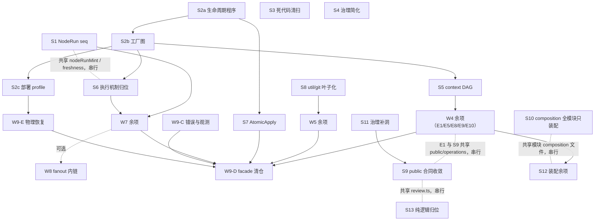

# RFC-294 实施路径：从散点 services 到分层 bounded contexts

> **当前入口（2026-10-16 刷新）**：本 RFC 按用户要求作为长期架构重构总纲维护，整体迁移仍为 In Progress。
> 本次全面审视见 [review-2026-10-16](./review-2026-10-16.md)；下一批后继见 §3。刷新前的完整实施记录（N1～N25 执行队列、
> 各波任务清单、历次 SHA 与 hosted 证据、账本重分桶记录）见 `archive-20261016-plan.md`。当前指标见 dated review 或按需报告；命令见 [status.md](./status.md)。
> **2026-10-30 进度对账**：S1、S2a、S2b、S2c 前两步与 RFC-395 关闭后的剩余范围见 [review-2026-10-30](./review-2026-10-30.md)；§1.1、§1.2、§3、§4、§8 已按其更新。
> **2026-10-31 W7 余项核销**：逐条核对记录见 [w7-closure-2026-10-31](./w7-closure-2026-10-31.md)；§1.1、§4.5、§8 已按其更新。
> **2026-10-31 S5 第一步**：[RFC-399](../RFC-399-context-dag-platform-one-way/proposal.md) 达成 S5 三条退出门规则；S5 范围余下三项由 [RFC-400](../RFC-400-collaboration-task-participants-actor/proposal.md) 承担；§1.2、§3 S5、§8 已更新。
> **2026-10-31 S5 Done**：[RFC-400](../RFC-400-collaboration-task-participants-actor/proposal.md) 完成 S5 余下三项（collaboration → task-execution 内部文件对 17 → 0、`services/humanGateComposition.ts` 删除、模块 public 合同去 legacy `Actor`）；§1.2、§3 S5、§8 已更新。
> **2026-11-03 S2 Done**：[RFC-433](../RFC-433-explicit-presence-selections/proposal.md)（Done）完成 S2c 余项第 1 项第四步——部署选择项 62 项全部由两个 profile 显式给出（51 必填 + 11 必填可空、无可选），装配层不再按「有没有给」分叉；S2 退出门核对见 §3 S2，§1.1、§1.2、§4.6、§8 已更新。
>
> **2026-11-02 S7 Done**：[RFC-401](../RFC-401-single-resource-write-stack/proposal.md)（Done）完成 S7——六类资源各一个写入参与者、三入口错误收敛、AtomicApply 持久 claim / lease、技能 / fusion / restore 接入、旧技能 operation 生命周期与零调用 legacy 写函数删除；退出门核对见 §3 S7，§1.1、§1.2、§8 已更新。
>
> **2026-11-09 独立对账**：按用户要求独立调研并修订总纲，证据见 [review-2026-11-09](./review-2026-11-09.md)。结构阶段（S1～S8）完成；
> 新增实质阶段后继 S9～S13（§3）、阶段划分（§1.3）、W9-D 余项的成批方式（§4.7）与三条纪律（§0 第 8～10 条）；§5、§6、§8 相应更新。

- 目标架构状态：Approved（D1～D8 沿用；D9 修订、D10～D13 新增；2026-11-09 新增 D14～D17，见 proposal §9）。本文刷新不授权任何未立项的后继。
- 迁移状态：In Progress（长期推进）。P0、W2、W3、W4-A/C/E0/E2/E3/E4a/E4b/E6/E7 已关闭；后继 S1（RFC-374）、S2a（RFC-379）、S2b（RFC-380～392）、S2c（RFC-393 / 394 与余项 RFC-425～433）、S3（RFC-375）、S4（RFC-376）、S8（RFC-377）已关闭（S2 于 2026-11-03 Done）；RFC-395 承接 S1b、S5 两步、S7 状态机合一与 W7 身份模型；W7 余项 2026-10-31 核销；S5 由 RFC-399 / RFC-400 两步完成（2026-10-31 Done）；S6 由 RFC-402～424 完成（2026-11-02 Done）；S7 由 RFC-401 完成（2026-11-02 Done）。其余见 §1.1（2026-10-30 对账）与 §1.3（2026-11-09 对账）。
- 规划单位：已关闭波次（保留结论）+ 立即整改后继 S1～S8（已全部关闭）+ 实质阶段后继 S9～S13（2026-11-09 新增）+ 余下波次
  （W4 余项、W5、W9-C/D/E，W8 可选）。

## 0. 批准边界与实施纪律

1. 批准 RFC-294 只表示批准目标架构与路线；每个后继都须按 CLAUDE.md 先落三件套并获用户批准。
2. RFC-287 已交付的行为是受保护基线；RFC-288 / 289 保持 CLOSED，旧 plan 不得执行。
3. 任何涉及 schema、行为、错误码、恢复或能力面的批次，按范围拆独立 RFC 并列能力影响。
4. 同一冲突面同时只允许一个在制高冲突批（装配根、`nodeRunMint` / freshness、迁移目录、架构生成器）；共享 `main` 上按路径精确
   暂存与提交，不建分支、不用 stash / worktree。
5. 目录迁移逐域进行：旧路径只留一跳无状态 facade，consumer 归零后删除。
6. proposal §6 的立即生效约束 C1～C13 对所有新代码生效（C10～C13 自 2026-11-09 起）；在制 RFC 收口前对账，偏离项逐条呈用户确认。
7. 开发、测试与验证纪律服从 CLAUDE.md 文首硬规则：先完成后继的全部实现与用例，再集中验证；CI 以 GitHub Actions 为准。
8. （2026-11-09）搬迁类余项按 owner 族成批立 RFC，一个 RFC 可以含多步；不再一文件一 RFC（proposal D17，§4.7）。进度以结构规则
   与 design §14 的不变量报告，不以文件数或 `R1` 条数为主口径。
9. （2026-11-09）后继以结构锁证明退出门时，在其 plan 与本文的记录里写明锁覆盖的是全仓还是指定模块；收口时把所触及的减速带
   上限收紧到实测值（proposal C12、C13）。
10. （2026-11-09）距上一次 dated review 满 14 天或其后已关闭 20 个后继（以先到者为准），做一次独立对账（design §13.5），由没有
    实施被抽查后继的会话执行。任何会话开工新的后继前先看这两个条件，到期则在当前会话向用户说明。下一次不晚于 2026-11-23。

## 1. 当前基线与量化口径

当前指标以最近一次 dated review 或 `bun run architecture:report --source-ref <rev>` 的按需报告为准；
[status.md](./status.md) 只保留生成说明。RFC-376 阶段 B 起不再提交全量库存或 provenance 投影。

**architecture-significance filter**：只在 production context owner、public / required 合同、schema / 单写、装配根、
跨 context 边或 worker / lifecycle owner 发生变化时按需审视架构报告；普通提交不要求运行生成器。纯测试 / e2e / fixture、文档、
视觉原语和边角功能只更新质量与行为证据，不给任何波次计 credit。

**退出门的口径（D9 修订后）**：后继的退出门写成“某条结构规则成立”（例如“context 值级依赖无环”“`platform` 不 import
`modules`”“每模块每进程构造一次”），而不是“某份账本的 exact id 计数降到某个数”。RFC-376 阶段 B 后由硬门与文件内精确清单执行；
`counts.json` 允许 measured <= max，抬高 max 须同一提交写明原因，不设增长许可与下一笔退役。

### 1.1 逐波判定（2026-10-16；2026-10-30 对账更新）

| 区域    | 判定                                                            | 已落 / 剩余                                                                                                                                                                                                                                                                                                             |
| ------- | --------------------------------------------------------------- | ----------------------------------------------------------------------------------------------------------------------------------------------------------------------------------------------------------------------------------------------------------------------------------------------------------------------- |
| P0-A～E | Done                                                            | RFC-342（memory scope move）、RFC-343（Intent apply 恢复）、RFC-333（人工门原子性）、RFC-328（持久 ownership）；RFC-287 Done、RFC-288/289 CLOSED                                                                                                                                                                        |
| W0-R    | 治理基线 Done；**模型修订**                                     | N1 账本与守卫已落；按 D9 改为硬结构门 + 按需报告，由 S4 实施                                                                                                                                                                                                                                                            |
| W1      | 行为基线保持                                                    | RFC-287 的 assembly 与 G4～G7 行为；assembly 物理归位随 S6 完成（RFC-402，2026-11-02 S6 Done）                                                                                                                                                                                                                          |
| W2      | Done（协调器、三路引擎注册、14 类节点注册、WrapperRuntime）     | 引擎与执行器层已由 S6 成为真实层，composition 只剩装配（RFC-402～424，2026-11-02 S6 Done）                                                                                                                                                                                                                              |
| W3      | Done（RFC-341）                                                 | 无                                                                                                                                                                                                                                                                                                                      |
| W4      | A/B/C/D/E0/E1/E2/E3/E4a/E4b/E6/E7 Done；E5/E9/E10 部分；E8 开放 | 见 §4.1；B/D 的原计数已归零，退出门改为入站适配器不再深引 legacy 与模块内部。2026-10-30：`routes/` 仍有 29 个文件 import `services/`、11 个深引模块内部（与 10-16 相同）；E9 的 Event observer 已进生命周期程序。2026-11-03（RFC-434～438 后）：23 个 import `services/`、2 个深引模块内部；2026-11-04（RFC-439 后）：23 个 import `services/`、0 个深引模块内部；2026-11-04（RFC-440 后）：18 个 import `services/`；RFC-441 后 15 个，`mcp/` 清零；RFC-442～444 后 9 个；RFC-445、RFC-446 后 6 个；RFC-447 后 5 个；RFC-448 后 4 个；RFC-450 后 2 个；RFC-451 后 1 个；RFC-452 后仍 1 个（`tasks` 余 workspace-insight 7 处）；RFC-453 后 0 个——B / D 退出门达成（`routes/`、`mcp/`、`ws/` 都不 import `services/`、不深引模块内部）；2026-11-12 RFC-486（`b69dfabe8`）：W4-E1 余下的 `infrastructure/taskRouteLaunchOperations.ts` 按内容分层归 application，E1 关闭（`services/task.ts` 已由 RFC-478 退役） |
| W5      | 部分纵切                                                        | RFC-308/310/321/363 已落 source-control 纵切；`util/git` 环族与 7 条 KNOWN（RFC-370 `166e918bd` 改变环形状时已删一条）由 S8（[RFC-377](../RFC-377-util-git-leaf/proposal.md)）处理；repo / cache / worktree owner 余项见 §4.3。2026-10-30：指向 source-control 的跨 context 内部文件对 5 个，`util/git.ts` 仍在 `util/` |
| W6      | Done（2026-11-02，S7）                                         | RFC-395 T10 合成唯一状态机 `platform/atomic-apply`；RFC-401 合一资源写入栈（六类资源各一个写入参与者）、三入口错误收敛、持久 claim / lease，技能 / fusion / restore 接入，旧技能 operation 生命周期删除 |
| W7      | Done（2026-10-31 核销）                                         | S1：每任务单调 `seq`（RFC-374，S1b 并入 RFC-395 D4）；身份轴由 RFC-395 交付，逐条核对见 [w7-closure-2026-10-31](./w7-closure-2026-10-31.md)                                                                                                                                                                             |
| W8      | 可选、延后                                                      | 仅 W7 后新号 RFC 获批才进入                                                                                                                                                                                                                                                                                             |
| W9      | A/B 由 S2 关闭（2026-11-03 S2 Done）；C/E 开放；D 部分          | S2 承接 W9-A/B（唯一模块工厂图与生命周期程序）；W9-C/E/D 见 §4.6；2026-11-05 RFC-454（W9-D 第一步）：`services/` 的一跳转出 36 → 6、`services/` 153 → 123；2026-11-06 RFC-455（W9-D 第二步）：资源包一族 16 个文件归 resource-catalog、`services/` 123 → 107；2026-11-06 RFC-456（W9-D 第三步）：单一 owner 的 14 个文件按层归位、`services/` 107 → 93；2026-11-06 RFC-457（W9-D 第四步）：平台机制 9 个文件归 `platform`、`services/` 93 → 84；2026-11-06 RFC-458（W9-D 第五步）：信封解析器归 shared、`services/` 84 → 82；2026-11-06 RFC-459（W9-D 第六步）：owner 作用域名与代理启动保留归 resource-catalog、`services/` 82 → 79；2026-11-06 RFC-460（W9-D 第七步）：调用目标选择与运行期引用解析归 shared 的 `ref/`、信封 nonce 归 `platform/contracts`、`services/` 79 → 77；2026-11-06 RFC-461（W9-D 第八步）：application 层的 WS 推送改经端口、`R2` 17 → 11；2026-11-07 RFC-462（W9-D 第九步）：运行时观测词汇归 runtime-management、`R2` 11 → 7；2026-11-07 RFC-463（W9-D 第十步）：启动核验与清单观测的判定归 shared、空运行参数归 runtime-management、`R2` 7 → 3、`services/` 77 → 75；2026-11-07 RFC-464（W9-D 第十一步）：无实时捕获按缺席处理、intent 自持轮次事件 sink 合同、`R2` 3 → 1；2026-11-07 RFC-465（W9-D 第十二步）：会话捕获的持久化端口与请求合同归 runtime-management、`R2` 1 → 0、`R1` 99 → 96；2026-11-07 RFC-466（W9-D 第十三步）：退役 resourceAcl 与 workgroups 兼容 facade、`R1` 96 → 86、`services/` 75 → 73；2026-11-07 RFC-467（W9-D 第十四步）：注入预言一族迁入用例树、`R1` 86 → 79、`services/` 73 → 68、不可达生产文件 24 → 18；2026-11-07 RFC-468（W9-D 第十五步）：拆分 nodeRunMint、`R1` 79 → 71、`services/` 68 → 67、跨 context 内部文件对 47 → 46；2026-11-07 RFC-469（W9-D 第十六步）：退役三个薄转出、`R1` 71 → 66、`services/` 67 → 64；2026-11-08 RFC-470（W9-D 第十七步）：退役最后两个薄转出与 taskLaunchGate、`R1` 66 → 64、`services/` 64 → 61、跨 context 内部文件对 46 → 43；2026-11-08 RFC-471（W9-D 第十八步）：开发交付的代码托管桥归 integration、`R1` 64 → 57、`services/` 61 → 60；2026-11-08 RFC-472（W9-D 第十九步）：退役 identity-access 的兼容转出 `auth/session`、`R1` 57 → 53；2026-11-08 RFC-473（W9-D 第二十步）：执行结果投影与资源会话归 task-execution、`R1` 53 → 49、`services/` 60 → 57；2026-11-08 RFC-474（W9-D 第二十一步）：入口适配器经 bootstrap 装配、`R1` 49 → 38；2026-11-09 RFC-475（W9-D 第二十二步）：自动提交推送按 owner 拆开（git 发布归 source-control、提交行记账归 task-execution）、`R1` 38 → 34、`services/` 57 → 55；2026-11-10 §4.7 的 task-execution 一族关闭（RFC-477、RFC-478，第二十四、二十五步；其间 RFC-476 第二十三步）：`R1` 34 → 18、`services/` 55 → 47；2026-11-13 §4.7 的运行时驱动一族关闭（RFC-487～RFC-489、RFC-491、RFC-492，运行时驱动一族第一至五步）：`R1` 18 → 0、`services/` 47 → 6                     |

### 1.2 已关闭后继索引

| 波次                             | 后继                                                                                                          | 范围                                                                                                                                                   | 结构锁 / 覆盖范围 |
| -------------------------------- | ------------------------------------------------------------------------------------------------------------- | ------------------------------------------------------------------------------------------------------------------------------------------------------ | --- |
| P0-D                             | [RFC-328](../RFC-328-durable-task-execution-ownership-fence/proposal.md)                                      | 持久 owner / intent / effect / fence 与 exact-token registry                                                                                           | `rfc328-architecture-guards`（任务执行持久写入的权威分类账本闭合、跨 context import = 28 条桥接债账本、10 个 effect 边界保留 act + observer）：全 src（≥801）+ 指定文件；负对照 ✓ |
| W2-A                             | [RFC-331](../RFC-331-task-execution-topology-cut/proposal.md)                                                 | task↔scheduler 拓扑与 task SCC 族                                                                                                                      | `rfc331-task-execution-topology`（生产代码不取测试拓扑 helper，全 src；6 个指定 legacy 文件不深引 task-execution；唯一 `drive({…})` 请求形）：负对照 ✓；未登记 guard-manifest，task ↔ scheduler 两条规则指向已删文件 |
| W2-B                             | [RFC-332](../RFC-332-task-engine-decomposition/proposal.md)                                                   | 唯一协调器、仓库准备第 0 步、三路引擎                                                                                                                  | `rfc332-task-engine-contracts`（drive 合同与端口不带 DbClient / AbortController 等形状、协调器工厂唯一装配）：指定 10 + 5 个文件、无负对照；全 src 由 `rfc386-drive-factory`（唯一协调器构造与装配点，≥2000，负对照 ✓）接替 |
| P0-C                             | [RFC-333](../RFC-333-human-gate-atomic-park-and-continuation/proposal.md)                                     | 人工门原子停驻与持久续跑                                                                                                                               | `rfc333-human-gate-source-locks`（三条人工门路由各调一个领域命令、零 `resumeTask`；prepare → 一次 park → 提交后 finalize 的次序；四个 provider 孪生不在）：指定 20 个文件（含前端 3）+ 5 个继任文件；无 fixture 负对照（一处对真实文件的内联变异） |
| W2-C                             | [RFC-334](../RFC-334-node-executor-registry/proposal.md)                                                      | 14 类节点执行器注册表                                                                                                                                  | `rfc334-node-executor-boundary`（engine 不取 `services/` / `composition/`、不带 DB 句柄与调度器形状，20 个执行器 / 内核文件在场）：`task-execution/engine/**` 递归（≥40）+ 12 个指定文件，负对照 ✓；值级 `rfc334-node-kind-inventory`（14 类节点三处键集相等） |
| W2-D                             | [RFC-339](../RFC-339-wrapper-runtime-cutover/proposal.md)                                                     | WrapperRuntime 与 Loop / Git / Fanout 策略                                                                                                             | `rfc339-wrapper-runtime-cutover`（五个组合器的调用文件集精确账本、task-execution 内 `.nodeIds` 直读只在 `executionScope.ts`、wrapper engine / domain 不带调度器与 DB 形状）：全 src（不含 `migration/`）+ 约 40 个指定文件，无语料下限与源码负对照、未登记 guard-manifest；全 src 由 `rfc413-wrapper-workspace-merge-recovery`（≥2000，负对照 ✓）接替 |
| W3                               | [RFC-341](../RFC-341-lifecycle-committed-events-collaboration-commands/proposal.md)                           | 生命周期已提交事件与协作命令                                                                                                                           | `rfc341-collaboration-source-locks`（六个请求面不直接广播 / 不直唤续跑、提交屏障先于已提交事件发布、维护目录无 humanGateRecovery）：指定约 34 个文件，无扫描、下限与负对照；全 src 只有 `wakeHumanGateContinuation` 由 `rfc386-drive-factory` 的退役名单兜底 |
| P0-A                             | [RFC-342](../RFC-342-memory-scope-move-correctness/proposal.md)                                               | memory scope move 事务正确性                                                                                                                           | 无专属结构锁（行为用例 `rfc342-memory-scope-move`、`routes-memories-patch` 等）；`memoryScopeMoveEvents` 的表归属由通用的 `rfc317-table-ownership`（跨 context 表引用 = 精确账本，全 src ≥701，负对照 ✓）覆盖 |
| P0-B                             | [RFC-343](../RFC-343-intent-apply-recovery-correctness/proposal.md)                                           | Intent apply 恢复正确性                                                                                                                                | 无专属结构锁（行为用例 `rfc343-intent-apply-correctness`）；后来的 `rfc395-a6-atomic-apply`（Intent 场景经 `createAtomicApply(`、不写生命周期态；指定文件，负对照 ✓）部分接替 |
| W4-A                             | [RFC-344](../RFC-344-operation-catalog-transport-cutover/proposal.md)                                         | OperationCatalog 与 transport                                                                                                                          | `rfc344-operation-catalog` 的「single inbound root」一组（MCP 与 API 文档只经 operation catalog、不回调 HTTP、无路由字面量；53 个 MCP 工具各一个绑定）：指定 24 个文件 + 2 个不在；无扫描与源码负对照、未登记 guard-manifest |
| W4-C                             | [RFC-345](../RFC-345-resource-catalog-contract-cutover/proposal.md)                                           | Resource Catalog 与 ResourcePackage 合同                                                                                                               | `rfc345-resource-catalog-contracts`（public 只 6 个入口且不取 db / services / drizzle / hono / fs、application 不取 infrastructure、类型级合同键集由 `tsc` 检查）+ `rfc345-resource-acl-facade-retirement`（兼容转出账本：在用边为空、24 个退役 facade 零消费）：全 src AST；无语料下限与 fixture 负对照、未登记 guard-manifest |
| W4-E7                            | [RFC-346](../RFC-346-system-operations-adapter-cutover/proposal.md)                                           | System Operations 管理编排                                                                                                                             | `rfc346-system-operations-contracts`（domain / public / application 不取 fs / hono / db / services / routes、public 恰 5 个文件、两个协调端口的 importer 精确集合）+ `rfc346-system-operations-cli`：三层递归（62 个文件，无下限）+ importer 规则全 src（负对照 ✓）+ 8 个指定文件；未登记 guard-manifest |
| W4-E0                            | [RFC-347](../RFC-347-identity-access-authority-presence-cutover/proposal.md)                                  | identity-access authority / presence                                                                                                                   | `rfc347-identity-access-runtime` 的「exact production source locks」（`composeIdentityAccess(` / `createIdentityAccessRuntime(`、IA composition 的 importer、准入与继承入口各自的精确文件清单；`buildCurrentActor(` 等不在；`ws/**` 不取 IA composition）：全 src 子串扫描（去注释，无语料下限）+ 5 个指定文件，无负对照、未登记 guard-manifest；分层规则由 `rfc294-review-module-layer-rules` 与 G7 全仓覆盖 |
| W4-E2                            | [RFC-352](../RFC-352-memory-context-cutover/proposal.md)                                                      | memory context                                                                                                                                         | `rfc352-memory-candidate-visibility`（路由不手写 candidate 收窄、只用 memory public 的单一谓词、不取 `services/resourceAcl`）：1 个指定文件，无负对照；已删 facade 的路径没有专门的锁，由 G3 / G4 的精确基线与 `legacy-*` 减速带兜底 |
| W4-E3                            | [RFC-353](../RFC-353-knowledge-evolution-context-cutover/proposal.md)                                         | knowledge-evolution context                                                                                                                            | `rfc353-fusion-inbound` 等 4 个文件的源码段（`routes/fusions.ts` 不在、KE 入站不内联可见性判定、fusion 仓储不直写 skills / memories、复合前置条件只在 RC 的 `skillMutationParticipant.ts`）：10 个指定文件 + 1 个不在，正则匹配、无负对照；全仓由 G2（RC → memory / KE 不在目标 DAG）与 G3 / G4 精确基线接替 |
| W4-E4a                           | [RFC-355](../RFC-355-intent-context-cutover/proposal.md)                                                      | intent context                                                                                                                                         | `rfc355-intent-session-events-port`（intent 里只有 `intentSessionWsProjector.ts` 触及 `@/ws/`）+ `rfc355-intent-provider-parity`（35 个 `intent-*` 错误码的精确集合、对 resource-catalog 内部的深引账本）：`modules/intent/**`（91 个文件，下限 >30）+ 8 / 4 / 2 个指定文件，无合成负对照；登记 guard-manifest 的只有行为类的 `rfc355-intent-session-event-callsites`；5 条 intent → RC 内部对由 `cross-context-internal-file-pairs` 精确锁住 |
| W4-E4b                           | [RFC-360](../RFC-360-runtime-management-context-cutover/proposal.md)                                          | runtime-management                                                                                                                                     | 无以 RFC-360 命名的锁；`rfc349-runtime-registry-provider` 里的 RFC-360 用例（8 个退役路径不在、RM registry composition 不取 RC composition、TE `nodeRunRuntime.ts` 不取 RM composition）：8 个不在的路径 + 约 10 个指定文件，无负对照、未登记 guard-manifest；全仓由 G2 与 G3 / G4 精确基线（进入 RM 的 19 条内部对登记为债）接替 |
| W4-E9（EC provider）             | [RFC-361](../RFC-361-execution-contract-provider-cutover/proposal.md)                                         | Execution Contract provider                                                                                                                            | `rfc361-execution-contract-providers` 末条（`taskExecutionAdapter.ts` 不在；EC `composition.ts` 不带 DbClient / appHome / 两个适配器工厂 / `??`）：3 个指定文件 + 1 个不在，无负对照；「无反向值边」由 `rfc399-context-dag-platform`（全 src ≥2000，合成负对照）全仓兜住 |
| W4-E1（合同准备）                | [RFC-362](../RFC-362-task-source-control-launch-contracts/proposal.md)                                        | Task / SC 启动合同                                                                                                                                     | 无专属结构锁（`rfc362-launch-contracts` 是真 provider 行为用例与一个 codec 单测）；三个端口类型的能力形状（私有 brand、readonly、只由 owner 工厂构造）由 `rfc294-architecture-preflight` 的 AST 扫描（`modules/**` + platform + shared，≥120，精确债单，合成变异负对照）覆盖 |
| W4-E1 / W5（纵切）               | [RFC-363](../RFC-363-task-source-control-launch-cutover/proposal.md)                                          | Task / SC 启动与工作区生产切换                                                                                                                         | `rfc363-launch-application` 末条（`services/task.ts` 的继任文件不导出 `materializeSpace` 等、`taskRouteWorkspaceParticipant.ts` 不取 `@/services/task` 与 SC composition）：6 个指定文件，无负对照；延后准备在 effect 观察者下调用两种准备由 `rfc328-architecture-guards` 的 act 现场表（有负对照）锁，唯一 node_runs 插入点由 `rfc359-w6-node-run-insert-lineage-completeness`（全 src ≥500，负对照 ✓）锁；AC-5（根装配的 4 个 SC 缝）无源码锁 |
| W4-E6                            | [RFC-364](../RFC-364-mcp-runtime-diagnostics-cutover/proposal.md)                                             | MCP runtime diagnostics                                                                                                                                | `rfc364-diagnostics-bindings`（AST：`mcpDiagnostics(` 恰一次且属性精确、7 个 `registerRoute` 不含 `runExclusive` / `loadVisibleMcp`、两个旧服务文件不在）+ `rfc364-diagnostics-policy`（诊断 application 不取 fs / path / child_process / `@/config` / `@/db`）+ `rfc201-mcp-operation-source-ratchet`（7 处 `coordinator.runExclusive`）：11 + 2 + 5 个指定文件，无负对照；全仓重叠 G6 `application-direct-effect-files` 与 `direct-setinterval-sites` |
| W4-E9（Event target）            | [RFC-365](../RFC-365-event-automation-target-providers/proposal.md)                                           | Event target providers                                                                                                                                 | 无以 RFC-365 命名的锁；`rfc310-digital-employee-os-architecture` 里随 RFC-365 加入的断言（integration 的 webhook 派发端口无 `dispatchEventTarget`、EC required-ports 声明两类自动化工作启动端口、TE / DE 适配器含 provider 工厂）：4 个指定文件，该文件登记了 guard-manifest 但负对照只测 import 匹配器；`.forEventAutomation(` 由 `rfc347` 钉为全仓一处；全仓由 G2 接替 |
| W4-E9（Reaction）                | [RFC-368](../RFC-368-reaction-execution-cutover/proposal.md)                                                  | Reaction 执行切换                                                                                                                                      | `rfc368-reaction-execution-adapter` / `rfc368-implementation-gate` / `rfc368-reaction-settlement` 的源码段（启动内核用预分配的 task id、DE 执行的三个 TE 文件不按轮去重、`resource-reaped` 取消原因贯通）：4 + 5 + 1 个指定文件，无负对照；AC-6（DE ↔ TE 不互 import）由 G2 与 G3 / G4 基线全仓兜住，AC-1 无锁 |
| （W7 前置）                      | [RFC-369](../RFC-369-node-run-supersession-derived/proposal.md)                                               | supersession 推导与唯一铸造的语义改善；不抵扣 W7 身份                                                                                                  | `rfc369-workgroup-internal-error`（AC-5，1 个文件）+ RFC-369 改写的两份 RFC-144 锁：`rfc144-stale-replay-regression`（铸行程序不写 `nodeRuns` / `mergeState`、各只一处读与插入，1 个文件）与 `rfc144-merge-state-blind-write-inventory`（`merge_state` 写入只在 `nodeRunWriteProtocol.ts`，全 src + 合成负对照）+ `rfc287-t8`；均未登记 guard-manifest；全仓唯一插入点另由 W6 清单锁 |
| S3                               | [RFC-375](../RFC-375-backend-dead-code-sweep/proposal.md)                                                     | 后端死代码清扫（66 个生产文件）                                                                                                                        | 无以 RFC-375 命名的用例；由 RFC-376 G14 `unreachable-production-files`（`rfc376-structural-guards`：从 `scripts/build-binary.ts` 的 7 个入口按全部 import 形式与 worker URL 求不可达的生产文件，精确集合 18 个、各带 RFC-375 §4 或后继理由）锁住：全 src（含 `.mjs`，≥1500），负对照 ✓（清单两向变异 + 各 import 形式的合成死文件） |
| S4（W0-R 模型修订）              | [RFC-376](../RFC-376-architecture-hard-gates/proposal.md)                                                     | 硬结构门 + 按需报告 + counts.json；全量账本与投影提交退役                                                                                              | `rfc376-structural-guards`（9 个门与提交的例外清单双向相等；`counts.json` 每项实测 = `max`，低于也红〔RFC-479 起〕；`architecture/` 只留 8 个文件）+ `rfc376-report`（同一提交两次报告逐字节相同、CLI 不写投影）+ `rfc294-design-parity`：全 src TS + JS（≥1500）+ shared / frontend / system-mocks src；负对照 ✓ |
| S8（W5 一部分）                  | [RFC-377](../RFC-377-util-git-leaf/proposal.md)                                                               | util/git 叶子化；KNOWN_VIOLATIONS 7 → 0                                                                                                                | `rfc377-util-git-leaf-lock`（`util/git.ts` 只取 shared、`@/util/*` 与相对文件；`KNOWN_VIOLATIONS` 无环与上行项）：1 个指定文件 + depcheck 常量，负对照 ✓；全仓由 CI 的 `depcheck`（`no-util-to-upper` / `no-circular`）与减速带三项 SCC = 0 兜住 |
| S1（W7-A）                       | [RFC-374](../RFC-374-node-run-sequence/proposal.md)                                                           | NodeRun 每任务单调 `seq`；S1b 并入 RFC-395 D4                                                                                                          | `rfc374-node-run-order-guard`（`nodeRuns.id` 不作排序 / 比较键，除非 `seq` 在先；5 个文件的精确例外）：backend + shared + frontend src 一个类型检查程序（≥2500），负对照 ✓；S1b 由 `rfc395-d4-mint-order-boundary`（≥3000）锁 |
| S2a                              | [RFC-379](../RFC-379-daemon-lifecycle-program/proposal.md)                                                    | 唯一生命周期程序与 G12                                                                                                                                 | `rfc379-daemon-lifecycle-guard`（四个 `DAEMON_*` 清单只在生命周期程序声明、`composeDaemonLifecycle(` 全仓恰一处、入口根不带工厂清单）：L2 / L3 全 src（≥2000）+ L1 指定 9 个入口根，负对照 ✓；G12 provider 对等只有行为用例 |
| S2b                              | [RFC-380](../RFC-380-daemon-module-bundles/proposal.md)～[RFC-392](../RFC-392-unified-test-entry/proposal.md) | 每模块每进程构造一次、中立应用图 / 会话图、统一测试入口（逐个见 §3 S2）                                                                                | 8 个守卫：`rfc380`（12 个 bundle 各在 `composeDaemonApplication` 里构造一次）、`rfc385`、`rfc386`（唯一协调器构造 / 装配，全 src）、`rfc388`、`rfc389`（唯一被动 Worker 图）、`rfc390`、`rfc391`（唯一应用 / 会话图对，全 src）、`rfc392`（唯一测试入口）；均有负对照；rfc380 的「一次」、rfc385、rfc390、rfc392 只读指定文件；381～384、387 无自己的锁 |
| S2c 第一步                       | [RFC-393](../RFC-393-cli-bootstrap-separation/proposal.md)                                                    | `cli/` 与 `bootstrap/` 分离                                                                                                                            | `rfc393-cli-bootstrap-separation`（`cli/` 与 `bootstrap/` 互不 import、`server.ts` 不取两者；26 个迁移文件旧路径不在）：全 src（≥2000）+ 26 对指定路径；负对照 ✓（15 种 import 写法 × 两向） |
| S2c 第二步                       | [RFC-394](../RFC-394-typed-deployment-profile/proposal.md)                                                    | 类型化部署 profile                                                                                                                                     | `rfc394-deployment-profile`（8 个退役名不在、`DeploymentSelections` 唯一声明、键表 `satisfies`、选择项只展开一次）：退役名与三个接口声明全 src（≥2000），其余 8 个指定文件；34 处真实文件变异 + 编译检查；全仓伴随门 `deployment-mode-branch-sites` |
| S2c 余项                         | [RFC-425](../RFC-425-execution-authority-without-deployment-literal/proposal.md)～RFC-433                     | 执行权去部署字面量、定时备份来源、入口根瘦身、部署选择项全部显式（无可选）                                                                             | `rfc425` / `rfc426` / `rfc427` / `rfc428` / `rfc431`（执行权端口无 mode、定时备份经 system-operations、入口根只取 `cli/` 与 `bootstrap/`、11 个退役选择项不在、62 个部署选择项全部显式且无可选）：各载全 src（≥2000）但多数只读 2～6 个指定文件（431 另读 `bootstrap/*.ts` 并报缺文件），负对照 ✓；全仓门 `deployment-mode-branch-sites`（max=1，13 + 13 个 fixture） |
| S1b、S5 两步、S7 状态机、W7 身份 | [RFC-395](../RFC-395-database-target-schema-rebuild/proposal.md)                                              | 数据库目标模型与一次迁移；不代表 RFC-294 全部退出                                                                                                      | 29 个登记守卫 + `rfc317-table-ownership` 的 A7 段，按主题：schema / 注册表 / 中立持久化 5、一次性迁移隔离 6、NodeRun seq / 身份 / 运行选择 3、任务端口与仓储 4、跨 context 表闭包 3、内容 / 引用 / 澄清 3、AtomicApply 1、测试树与删除卫生 4；15 个扫语料（backend src ≥1000，d4 ≥3000，跨模块表引用 = 121 条账本），14 个读指定文件，26 个有负对照 |
| S5 第一步                        | [RFC-399](../RFC-399-context-dag-platform-one-way/proposal.md)                                                | context 值级 DAG（SCC 2 → 0、越界值级对 9 → 0）、`platform` → `modules` 19 → 0、删除 drizzle 再导出桶                                                  | `rfc399-context-dag-platform`（无 context 值级 SCC、无越 DAG 值对、无 platform → modules 边，8 个迁移路径无转出）+ 全仓门 `context-value-sccs` / `context-value-pairs-off-dag` / `platform-to-modules-file-pairs`（max=0）与 `export-star-barrels`：全 src（≥2000，只看直接边；经 `services/` 的绕行只在合成负对照里），负对照 ✓ |
| S5 第二步                        | [RFC-400](../RFC-400-collaboration-task-participants-actor/proposal.md)                                       | collaboration → task-execution 内部文件对 17 → 0（改经 TE 自有 tx 参与者）、删除 `services/humanGateComposition.ts`、模块 public 合同去 legacy `Actor` | `rfc400-collaboration-task-participants`（collaboration → task-execution 内部文件对 = 0、public 导出签名不带 `Actor`、11 个 owner 工厂不经 TE public 漏出）+ `rfc400-top-level-await-guard`：全 src（≥2000）与全部模块 public 文件（≥500 个导出），负对照 ✓；另有全仓门 `cross-context-internal-file-pairs` 的精确基线 |
| S7（W6）                         | [RFC-401](../RFC-401-single-resource-write-stack/proposal.md)                                                 | 唯一资源写入栈与三入口错误收敛、AtomicApply 持久 claim / lease、技能 / fusion / restore 接入、旧技能 operation 生命周期与零调用 legacy 写函数删除 | `rfc401-resource-write-participants`（六类资源各一个写入参与者，只有它与 5 个技能恢复文件取写入程序或直写行，7 个退役码不在）：全 src（≥2000，只认顶层具名 import）+ 20 个场景函数，负对照 ✓；另有 `rfc395-a6-atomic-apply`（指定文件）与 `rfc317-table-ownership`（`atomicApplyClaims` 唯一 owner）；lease 与错误收敛只有行为用例 |
| S11 | [RFC-479](../RFC-479-governance-gap-fill/proposal.md) | 减速带上限收紧到实测（当时另把低于上限也判红，由 RFC-484 撤回）、public 合同两项计数、composition 控制流临时入带、本表增覆盖范围列 | `rfc376-structural-guards`（`counts.json` 42 项实测 = `max`；高于上限红，RFC-484 起低于上限只报不红；全 src TS + JS ≥1500 + shared / frontend / system-mocks src）+ `rfc479-governance-gap-fill`（composition 控制流的 fixture 变异与 F13 逐行对账、public 合同两项的 fixture 变异；全 src ≥2000）+ `rfc376-report`（两项 public 合同计数与报告章节逐条相同，提交的源码）；负对照 ✓ |
| S9 第一步 | [RFC-480](../RFC-480-te-collaboration-public-unconsumed-sweep/proposal.md) | task-execution 与 collaboration 的未消费 public 符号清零（撤出 218 个名字、49 个声明按内容挪进模块内部）、task-execution `public/operations` 退役、未消费符号按 context 分项入带 | `rfc480-te-collaboration-public-lock`（`public/operations.ts` 不在、零 import；218 个撤出名逐个不在原 public 文件的导出与运行时命名空间，每个 public 文件带正对照；挪走的声明在新位置导出；三处模块外使用取新位置；报告类型遍历的 fixture 回归）：全 src（≥1500）+ 用例 + backend 与仓根脚本，负对照 ✓；全仓门 `unconsumed-public-symbols-<context>` 19 项（两个模块 max=0）与 `public-surface-deviations`（max=77），`rfc376-report` 逐 context 断言分项与报告章节相等；capability owner 的私有登记由 preflight fixture 锁住 |
| S9 第二步 | [RFC-481](../RFC-481-te-owned-human-gate-ports/proposal.md) | 人工门三组端口类型（`PreparedHumanGateRef`、`CollaborationRuntimeMechanics`、`TaskDagCollaborationOperations`）改由 task-execution 声明并从 `public/types` 交出，路由依赖删去转手的协作上下文，两个帧函数的回调参数收成闭合接口，collaboration 的删除工厂改由 composition 交给 bootstrap | `rfc481-te-human-gate-port-boundary`（task-execution 全部生产文件指向 collaboration 的引用精确等于 required-SPI 一条，静态 / re-export / type / 动态 import / require 都认；端口在新位置声明与交出、collaboration 不再声明与交出；两个帧函数无函数类型参数；删除工厂来源与路由依赖无 `collaboration` 字段）：task-execution 全部生产文件（≥500）+ collaboration（≥150），负对照 ✓；全仓门 `off-dag-offered-file-context-pairs`（max=47）与 `public-surface-deviations`（max=74），逐条清单在 `OFF_DAG_OFFERED_EDGE_DEBT`、`rfc376-structural-guards` 的 committed baselines 与 `PUBLIC_SURFACE_DEBT` |
| S9 第三步 | [RFC-482](../RFC-482-te-participant-bindings-small-families/proposal.md) | collaboration 取 task-execution 的三个事务参与者、clarify 指令持久化、任务主题查询与 run selection 读取改经 RFC-400 的装配期绑定，task-execution 的 public 撤出六个符号、只交接口（run selection 收成闭合接口），空操作 `reselectRunInTx` 删除，引擎直接读自己的 clarify 指令表、collaboration 的指令转发文件删除 | `rfc482-te-participant-bindings-boundary`（task-execution 的 public 文件不导出六个名字，值与类型、转出与运行时命名空间都认；collaboration 的生产文件不从 task-execution 的任何入口取它们；绑定的五个工厂成员与 bootstrap 的来源；`reselectRunInTx` 与指令转发文件不在；`CollaborationRuntimeMechanics` 无 `getNodeClarifyDirective`、引擎端口接持久化包；`TaskRunSelectionReads` 只有方法签名；双引擎的指令读取行为用例）：task-execution 的 public 文件 + collaboration 全部生产文件（≥150）+ bootstrap 的绑定，负对照 ✓；全仓门 `public-surface-deviations`（max=68），逐条清单在 `PUBLIC_SURFACE_DEBT` |
| S11 修正 | [RFC-484](../RFC-484-count-gate-not-above-max/proposal.md) | 减速带判据回到 design §13.4 的「不高于上限即过」：`checkCounts` 撤回 RFC-479 的低于即红，低于上限只列入 `decreases`（带应收紧到的值），上限 = 实测仍由后继收口时收紧（C13） | `rfc376-structural-guards`（`checkCounts` 单元用例：等于与低于上限通过、低于的列入 `decreases`，高于上限、未知 / 缺失 id、非法数值、`reason` 不符报错；counts 用例在全 src 语料上实测 `counts.json` 的每一项）：全 src TS + JS ≥1500 + shared / frontend / system-mocks src，负对照 ✓ |
| S9 第四步 | [RFC-485](../RFC-485-te-row-query-bindings/proposal.md) | collaboration 与 memory 取 task-execution 的三个行形状查询工厂改经装配期注入：collaboration 经 RFC-400 的装配期绑定取工厂（调用点照旧传原来的句柄），memory 的装配输入收 bootstrap 在根 db 上建好的两个只读端口，开门参与者的 node-run 读取由 task-execution 按事务交入；task-execution 的 public 撤出三个工厂与只经它们可达的全量接口名，只交出闭合读取接口 | `rfc485-te-row-query-bindings-boundary`（task-execution 的 public 文件不导出三个工厂与 `NodeRunQueries`、`NodeOutputQueries`、`NodeOutputContent`，转出与本地声明、值与类型都认，带正对照；collaboration 与 memory 的生产文件不从 task-execution 的任何入口取三个工厂，命名 import、别名、相对路径、命名空间成员与 re-export 都认；绑定的三个成员与 bootstrap 的来源、memory 装配输入的两个端口；`TaskNodeRunReads`、`TaskNodeOutputReads` 只有方法签名、方法集合逐个钉住；开门参与者按事务收 `nodeRuns`；双引擎的经绑定读取行为用例）：task-execution 的 public 文件 + collaboration 与 memory 全部生产文件（≥150）+ bootstrap 的绑定与 memory 模块装配，负对照 ✓；全仓门 `public-surface-deviations`（max=65），逐条清单在 `PUBLIC_SURFACE_DEBT` |
| S9 第五步 | [RFC-483](../RFC-483-human-gate-badge-read-model/proposal.md) | 评审与澄清徽标的联合投影归 collaboration 的徽标读模型：`nodeRunStatusCondition`、`taskGateOpenCondition`、`taskGateVisibleCondition` 撤出 task-execution 的 public，改经 RFC-400 的装配期绑定交给读模型；查看者判定（看全部任务 / 按任务成员）与两个徽标用例迁入 collaboration 的 application，读模型端口只收 DTO；两条计数仍各发一条语句（RFC-359 AC-11）；task-execution ↔ collaboration 这一对收口 | `rfc483-human-gate-badge-read-model-boundary`（task-execution 的 public 文件不导出三个片段，带正对照；collaboration 的生产文件不从 task-execution 取它们，两条计数经绑定调用，带负对照；绑定的三个成员与 bootstrap 的来源；读模型端口只有 DTO 签名、方法集合钉住；两个路由操作经 application 的徽标用例；查看者判定与双引擎的经用例计数行为用例）：task-execution 的 public 文件 + collaboration 全部生产文件（≥150）+ bootstrap 的绑定与 application 的徽标端口，负对照 ✓；全仓门 `public-surface-deviations`（max=57），逐条清单在 `PUBLIC_SURFACE_DEBT` |
| W4-E1 余项 | [RFC-486](../RFC-486-task-route-launch-application/proposal.md) | `infrastructure/taskRouteLaunchOperations.ts` 按内容分层后删除：根启动内核、两条启动臂、路由启动操作与启动参与者迁入 `application/launch/`，依赖改收端口（准入、上传落地、授权查询、上传上限、直接启动人），不再收裸 `db` 与配置路径；准入事务（次序不变）、`projectLaunchedTask` 与自动化回执查询在 infrastructure 适配器，工作组运行时配置的构建函数进 domain；启动守卫收成 task-execution 自有的 `TaskLaunchGuard`（`public/types`，integration 的守卫扩展它），task-execution → integration 的越 DAG 文件对销账；W4-E1 收口 | `rfc486-task-route-launch-application-boundary`（旧文件删除、四个用例文件就位；`application/launch/` 不 import infrastructure、inbound、表与发布 runtime，带负对照；依赖接口不收 `db` 与 `configPath`；准入适配器里投影先于事务、事务内调用按原次序各一次；工作组运行时配置只在 domain 声明；composition 用 inbound 函数装配直接启动人；task-execution 生产文件不取 `ProtectedMrLaunchGuard`，带负对照；守卫成员集合钉住）：`application/launch/` 全部文件 + task-execution 全部生产文件（≥700）+ 准入适配器、composition 与 integration 的守卫，负对照 ✓；全仓门 `off-dag-offered-file-context-pairs`（max=46），逐对清单在 `rfc376-structural-guards` 与 `rfc294-review-offered-edge-dag` |
| 运行时驱动一族第一步 | [RFC-487](../RFC-487-runtime-family-forbidden-consumers/proposal.md) | DAG 上不消费 runtime-management 的四个 context 不再经 `services/` 取运行时驱动一族：memory 删除复制 `resolveInternalAgentRuntime` 的蒸馏运行时解析器（直接读 `runtimes` 表，表归属债 121 → 120），装配改收 `runtimeProfiles` 端口、由 bootstrap 绑定，在 memory 的边界投影回端口字段；doctor 的运行时探测经 system-operations 自有端口，由 bootstrap 绑定 runtime-management 的默认二进制探测（standalone 的软探测共用，`windows-platform.yml` 两份路径过滤登记新位置）；`resolveBoundaryMounts` 进 source-control 的 domain（`public/queries`）；`SkillSource`、`RuntimePlugin` 与只有数据成员的 `NativeSkillContent` 进 resource-catalog 的 domain（`public/types`，一族的 `ResolvedSkill` 扩展它）；resource-catalog 本机 MCP 诊断的执行体另立 | `rfc487-runtime-family-forbidden-consumers-boundary`（四个 context 的生产文件不 import 一族，本机 MCP 诊断执行体的三条边逐条钉住，import 识别带负对照：相对路径、别名、re-export、动态 import；memory 不读 `runtimes`、解析器删除、装配取 `runtimeProfiles`、bootstrap 绑定、投影字段；doctor 与 standalone 取默认二进制探测、两份 Windows 路径过滤登记；挂载规则与原生内容类型只在 owner 的 domain 声明一次；两种 provider 下的解析与探测行为）：四个 context 全部生产文件（≥600）+ 全部生产文件里的同名声明 + 指定的 bootstrap、composition 与 workflow 文件，负对照 ✓ |
| 运行时驱动一族第二步 | [RFC-488](../RFC-488-local-mcp-diagnostic-execution-port/proposal.md) | resource-catalog 本机 MCP 诊断的运行时工作改经自有端口 `LocalMcpDiagnosticExecution`（`application/ports`，经 `required-ports` 转出）：跨轮会话支持、原生会话号、可执行文件与一轮诊断的运行（含启动校验）由 task-execution 的本机实现做（`infrastructure/local/mcpDiagnosticRunner.ts`，composition 交出，与托管形态对称），测试夹具随实现走；bootstrap 绑定，守护进程阶段给了夹具时选本机装配，CrewStation 的诊断装配不再按夹具分支；design §3.1 增虚线；DAG 外四个 context 对一族的 import 归零 | `rfc488-local-mcp-diagnostic-execution-boundary`（resource-catalog 的生产文件不 import 一族，import 识别带负对照：相对路径、别名、re-export、动态 import；本机执行体没有驱动、启动上下文、假运行与启动校验的标识符，依赖收必填的 `execution`、不收 `runFn`；端口与观测类型只声明一次；实现与 composition 的位置、bootstrap 的两处绑定、resource-catalog 不出现 `runFn`、两份 Windows 路径过滤登记；本机实现与原组装逐项对拍）：resource-catalog 全部生产文件（≥350）+ 全部生产文件里的同名声明 + 指定的 bootstrap、composition 与 workflow 文件，负对照 ✓；RFC-487 用例 ① 的例外清单为空 |
| 运行时驱动一族第三步 | [RFC-489](../RFC-489-run-family-providers-bound-by-bootstrap/proposal.md) | task-execution 的运行族不再取 runtime-management 内部：本机与托管的运行时管理装配迁入 runtime-management 的 composition（`composeLocalRuntimeManagement`、`composeCrewStationRuntimeManagement`），task-execution 的探测族经效果自有的探测端口注入；系统代理、任务代理与探测的根只装 task-execution 自己的部分（绑定适配、配置冻结、产出校验、夹具选择），runtime-management、resource-catalog、source-control 的实现作为提供者由 `bootstrap/runFamilyProviders.ts` 交入；本机探测族与本机调用的协议、运行证据与材料引用取自材料定义（`evidence(scope)`、`materialReference(plan)`）；design §3.1 增 4 条虚线（目标边 100 → 104）；task-execution → runtime-management 的 18 个跨 context 内部文件对与本机任务代理根指向 resource-catalog 1 对、source-control 2 对销账（43 → 22），task-execution 对一族的使用 17 → 16 | `rfc489-run-family-providers-boundary`（task-execution 的生产文件对 runtime-management 只取 `public/`，唯一例外是实现 runtime-management 自有端口的 adapter 取 `composition/required-ports`，运行族的根不取 resource-catalog、source-control 的内部，import 识别带负对照：相对路径、别名、re-export、动态 import、type-only；运行时管理的两个装配只在 runtime-management 的 composition 声明一次；本机探测族不取驱动、`NativeProtocolBinding` 不再声明，本机调用收 `evidence` 与 `materialReference`、材料定义的成员集合钉住；bootstrap 的绑定、task-execution 的两个运行时管理根删除、两份 Windows 路径过滤登记；材料定义的运行证据、材料引用与协议与原构造对拍，运行时管理装配把诊断目标交给探测族、只交一次）：task-execution 全部生产文件（≥700）+ 全部生产文件里的同名声明 + 指定的 bootstrap、composition 与 workflow 文件，负对照 ✓；全仓门 `cross-context-internal-file-pairs`（max=22），逐对清单在 `rfc328-architecture-guards`、`rfc376-structural-guards` 与 `rfc294-architecture-preflight` |
| 运行时驱动一族第四步 | [RFC-491](../RFC-491-te-runtime-family-decoupling/proposal.md) | task-execution 与运行时驱动一族互不 import：类型改取 owner 的出处（归一化事件、运行时种类、插件与技能内容）与 task-execution 自有类型；种类判定、驱动能力与续会话目标不存在的判据经 runtime-management 的 `public/queries`（`isKnownRuntimeKind`、`runtimeDriverCapabilities`、`detectRuntimeSessionNotFound`）；声明清单的四个纯构造与错误类归 shared（`declaredInjection.ts`）；启动清单读取与插件加载失败识别归 runtime-management、由 bootstrap 绑定（前者实现 task-execution 自有的 `TaskRuntimeInventoryContent`，design §3.1 增 1 条虚线，目标边 104 → 105）；`services/systemAgentRun.ts` 迁为 task-execution 的本机系统代理运行（`infrastructure/local/nativeSystemAgentRun.ts`），驱动、材料工作区与材料定义作为提供者由 bootstrap 交入，MCP 诊断的本机执行体收同一组提供者；只供用例的 `services/runtimeSmoke.ts` 与两个本机任务运行文件迁入 `tests/helpers/`（偏离 §4.7 的表，RFC-491 design §6 第 4 条）；task-execution import 一族的生产文件 16 → 0，一族指向 task-execution 的文件 2 → 0，跨 context 内部文件对 22 → 21，越 DAG 的 offered 文件对 46 → 45，不可达生产文件 18 → 16 | `rfc491-te-runtime-family-decoupling-boundary`（task-execution 的生产文件不取一族、一族不取 task-execution，import 识别带负对照：相对路径、别名、re-export、动态 import、type-only；两个运行器与两个本机任务运行文件不在 `src/`、在 `tests/helpers/`；三个查询只在 runtime-management 声明、经 `public/queries` 交出，task-execution 的四个使用方从那里取；声明清单的构造只在 shared 声明；启动清单读取与插件加载失败识别在 runtime-management、由 bootstrap 绑定；本机系统代理运行不取 runtime-management 内部与一族，MCP 诊断的本机执行体收提供者，两份 Windows 路径过滤登记新位置；三个查询、材料引用的来源计划形式与驱动直取对拍，提供者与 runtime-management 的函数引用相等）：task-execution 全部生产文件（≥700）+ 一族全部文件（≥30）+ 全部生产文件里的同名声明 + 指定的 runtime-management、shared、bootstrap 与 workflow 文件，负对照 ✓；全仓门 `cross-context-internal-file-pairs`（max=21）、`off-dag-offered-file-context-pairs`（max=45）、`unreachable-production-files`（max=16），逐对清单在 `rfc328-architecture-guards`、`rfc376-structural-guards`、`rfc294-architecture-preflight` 与 `rfc294-review-offered-edge-dag` |
| 运行时驱动一族第五步 | [RFC-492](../RFC-492-runtime-driver-family-into-runtime-management/proposal.md) | 运行时驱动一族整族迁入 runtime-management 的 `infrastructure/drivers/`：`services/runtime/**`（36 个文件）与 `services/execution/{agentInjection,workspaceBoundary}.ts` 原样迁入（目录结构不变），一族取本模块的改为模块内相对路径与声明处，`public/participants` 撤下只供一族的 14 个出口（public surface 1,209 → 1,195，public 类型偏差 57 → 56）；bootstrap 经 `composition/runtimeDrivers.ts`（只转出）取启动自检与托管注入同名冲突判定，资源策略束迁为 `bootstrap/taskExecutionResourceDependencies.ts`；RFC-108 的驱动租约兼容夹具移入 `tests/helpers/`（偏离 §4.7 的表，RFC-492 design §6 第 4 条）；eslint 围栏、单二进制的插件目录、三份 workflow 的路径过滤与发布登记的探测布局表跟随新位置；`services/` 45 → 6、`R1` 9 → 0、legacy 服务实现 46 → 6、legacy 横向文件 165 → 125、不可达生产文件 16 → 15 | `rfc492-runtime-driver-family-in-runtime-management-boundary`（一族不在 `services/`、在 runtime-management 的 `infrastructure/drivers/`，驱动租约夹具在 `tests/helpers/`；生产代码里只有 runtime-management 自己 import 一族、bootstrap 经 composition，import 识别带负对照：相对路径、别名、re-export、动态 import、type-only；没有指向旧位置的 import，一族不取本模块的 `public/participants`；撤下的 14 个出口各在声明处只声明一次、仍有模块外读者的照旧交出；composition 只转出、与一族的函数引用相等，策略束三个字段引用相等；构建的插件目录、插件入口取嵌入表、eslint 围栏、三份 workflow 的路径过滤与发布登记的布局表指向新位置）：全部生产文件（≥3,000）+ 全部生产文件里的同名声明 + 指定的 runtime-management、bootstrap、构建脚本、eslint 配置与 workflow 文件 + 全仓的探测文件名，负对照 ✓；全仓门 `legacy-service-implementations`（max=6）、`legacy-horizontal-files`（max=125）、`unreachable-production-files`（max=15）、`public-surface-deviations`（max=56） |
| S13 | [RFC-493](../RFC-493-pure-logic-out-of-infrastructure/proposal.md) | 纯逻辑归位：resource-catalog `infrastructure/legacy/workflow.validator.ts` 的纯函数部分（校验上下文与输入类型、候选覆盖层、上下文投影与哈希、`validateWorkflowDefinition` / `validateWorkflowDef` 本体与辅助、调用闭包的两个选择函数）原样迁入 `domain/workflowValidator.ts`，原文件只留读库的三个加载器入口；collaboration `infrastructure/review.ts` 的锚点规范化、决定策略表与轮次规则迁入 `domain/reviewCommentAnchor.ts`、`domain/reviewDecisionPolicy.ts`、`domain/reviewRounds.ts`；原位置不留转出（`review.ts` 也不再转出 shared 的 `findAllOccurrences`）；清单 31 个名字，看过但不进清单的项与理由见 RFC-493 design §5 | `rfc493-pure-logic-out-of-infrastructure-boundary`（清单里的名字只在新的 domain 文件声明，早有的同名类型逐个钉住；两个旧文件不声明、不转出，加载器文件只交出三个入口；全部生产文件与用例不从旧位置取，import / export-from / type-only / 动态 import 的解构都认，带负对照；新文件不取 infrastructure、IO 包与进程全局、无 async / await）：全部生产文件（≥3,000）+ 全部用例（≥2,500）+ 两个旧文件与四个新文件，负对照 ✓；另由 RFC-294 模块分层门覆盖新文件 |
| S10 第一步 | [RFC-494](../RFC-494-development-employee-type-package-out-of-composition/proposal.md) | 开发员工类型包的合同与编解码迁出 composition：development-automation `composition/employeeTypePackage.ts`（5,478 行）除登记对象 `developmentEmployeeTypePackage` 外的内容（工具合同表与执行合同登记、包语义、上下文 schema、两个运行时编解码器）原样迁入 `application/employeeTypePackage.ts`，它依赖的工具合同登记（改名 `digitalEmployeeToolContractRegistrationsV2.ts`）与旧程序升级一起迁入 application；落 application 而非 domain（内容按 execution-contract 与 digital-employee 的 public 合同定型，design §3 的矩阵只许 application 取其他模块的 public 精确入口，RFC-494 design §6 取舍 1）；composition 只留登记对象与给 bootstrap 的三个转出，原位置不留转出；`composition-control-flow-development-automation` 660 → 491 | `rfc494-development-employee-type-package-out-of-composition-boundary`（清单里的名字只在三个新的 application 文件声明；composition 的登记文件交出的恰好是登记对象与三个转出、不声明清单里的名字；迁走的两个文件不在；全部生产文件、用例与 e2e 不从旧位置取迁出的名字，import / type-only / re-export / 动态 import 的解构都认，登记对象、新位置与 bootstrap 的转出不算，带负对照；三个新文件只取 zod、shared、`@/util/gitRef`、其他模块 public 精确入口与本模块 domain / application，越界 import、async / await 与进程全局都认、模板字符串里的 import 文本不算，带负对照）：全部生产文件（≥3,000）+ 全部用例（≥2,500）+ e2e + composition 的登记文件与三个新文件，负对照 ✓；另由 RFC-294 模块分层门与 `rfc310-architecture-lock` 覆盖新文件；全仓门 `composition-control-flow-development-automation`（max=491） |
| S10 第二步 | [RFC-495](../RFC-495-development-platform-work-items-out-of-composition/proposal.md) | 开发自动化的平台工作项用例迁出 composition：development-automation `composition/digitalEmployeePlatformWorkItems.ts`（2,324 行）的工作项用例（按 `plan.workItemRef` 分派的 `execute`）、它的 schema、辅助函数与输入接口原样迁入 `application/employeePlatformWorkItems.ts`（`createDevelopmentEmployeePlatformWorkItems`）；四处 infrastructure（选定工作区效果、懒建证据存储、业务树摘要、基线读取）与默认时钟改由 composition 注入；composition 只留组合输入类型（形状不变）与两个装配函数、没有控制流语句，使用方不改；`composition-control-flow-development-automation` 491 → 371 | `rfc495-development-platform-work-items-out-of-composition-boundary`（清单里的名字只在新的 application 文件声明，早已存在的两个同名声明逐个钉住；composition 文件的声明与交出恰好是四个 / 三个、没有控制流语句，装配函数把输入连同五个绑定交给 application 的用例、恰好一次；全部生产文件、用例与 e2e 从 composition 文件只取三个组合名字，命名 import、type-only、re-export、命名空间成员与动态 import 的解构都认，带负对照；新文件只取 zod、shared、`@/util/hash`、`@/util/gitRef`、digital-employee 的 `public/types` 与本模块 domain / application，越界 import 与进程全局都认，带负对照）：全部生产文件（≥3,000）+ 全部用例（≥2,500）+ e2e + composition 文件与新文件，负对照 ✓；另由 RFC-294 模块分层门与 `rfc310-architecture-lock` 覆盖新文件；全仓门 `composition-control-flow-development-automation`（max=371） |
| S10 第三步 | [RFC-496](../RFC-496-development-employee-workspace-out-of-composition/proposal.md) | 开发自动化的员工工作区用例迁出 composition：development-automation `composition/digitalEmployeeWorkspace.ts`（1,418 行）的工作区用例、它的 schema、辅助函数、读侧类型与输入接口原样迁入 `application/employeeWorkspace.ts`（`createDevelopmentEmployeeWorkspace`、`createEmployeeCaseWorkspaceDetailReader`）；它依赖的受保护根快照与工作区结果校验迁入 application（`protectedSnapshot.ts`、`workspaceValidator.ts`；infrastructure 的同名文件只留缺省选本机实现的三个包装与 `taskImageWorkspace` 要用的三个转出），三组 git 元数据前缀常量迁入 `domain/gitMetadataOwnership.ts`；工作区效果的选定与默认时钟由 composition 给，composition 只留组合输入类型（形状不变）、读侧的数据库绑定与两个装配函数、没有控制流语句，使用方不改；`composition-control-flow-development-automation` 371 → 274 | `rfc496-development-employee-workspace-out-of-composition-boundary`（清单里的名字只在清单列的文件声明，早已存在的同名声明与 infrastructure 的三个包装逐个钉住；composition 文件的声明与交出恰好是五个 / 三个、没有控制流语句，装配函数把输入连同选定的工作区效果与默认时钟交给 application 的用例、恰好一次；infrastructure 的快照 / 校验文件只声明包装、只另外转出三个名字、没有控制流，每个包装只把工厂交给 application 的同名函数，带负对照；全部生产文件、用例与 e2e 不从旧位置取迁出的名字，命名 import、type-only、re-export、命名空间成员与动态 import 的解构都认，带负对照；三个 application 文件只取 zod、shared、`@/util/hash`、`@/util/gitRef`、digital-employee 的 `public/types` 与本模块 domain / application，domain 文件没有 import，越界 import 与进程全局都认，带负对照）：全部生产文件（≥3,000）+ 全部用例（≥2,500）+ e2e + composition 文件、infrastructure 的两个包装文件与新文件，负对照 ✓；另由 RFC-294 模块分层门与 `rfc310-architecture-lock` 覆盖新文件；全仓门 `composition-control-flow-development-automation`（max=274） |
| S10 第四步 | [RFC-497](../RFC-497-development-mission-and-config-operations-out-of-composition/proposal.md) | 开发自动化的 mission 与配置操作用例迁出 composition：development-automation `composition/missionOperations.ts`（722 行）与 `composition/configOperations.ts`（684 行）里两组操作的实现（合同早在 application）原样迁入 `application/missionOperationHandlers.ts`（`createDevelopmentMissionOperations`）与 `application/configOperationHandlers.ts`（`createDevelopmentConfigOperations`）；mission 用例要用的模块参与方成员成为 application 端口（`application/ports/developmentMissionAutomation.ts`），`DevelopmentAutomationModule` 改为继承它、只另外声明 6 个成员；上传准入的基线解析与默认时钟由 composition 给，两个 composition 文件只留组合输入类型（形状不变）、准入开关的查询投影与装配函数（配置一侧另外转出 ACL 参与方类型）、没有控制流语句，使用方不改；`composition-control-flow-development-automation` 274 → 195 | `rfc497-development-mission-and-config-operations-out-of-composition-boundary`（清单里的名字只在清单列的文件声明，早已存在的同名声明逐个钉住；两个 composition 文件的声明、交出与转出恰好是 design §3 所列、没有控制流语句，装配函数恰好一次调用 application 的用例——mission 一侧按原次序绑定 7 个持久化、交出按 `persistence.repositories` 与 `deps.repositoryBaselines` 建的基线解析与默认时钟，配置一侧交出 `deps.now ?? Date.now`，带负对照；`DevelopmentAutomationModule` 继承端口、只声明其余 6 个成员，端口恰好 10 个成员，带负对照；全部生产文件、用例与 e2e 不从旧位置取迁出的名字，命名 import、type-only、re-export、命名空间成员与动态 import 的解构都认，带负对照；三个新文件的依赖面是闭集、不用进程全局，越界 import 与进程全局都认，带负对照）：全部生产文件（≥3,000）+ 全部用例（≥2,500）+ e2e + 两个 composition 文件、`composition.ts` 与新文件，负对照 ✓；另由 RFC-294 模块分层门覆盖新文件；全仓门 `composition-control-flow-development-automation`（max=195） |
| S10 第五步 | [RFC-498](../RFC-498-development-graph-delivery-bridge-out-of-composition/proposal.md) | 开发自动化的图交付桥用例迁出 composition：development-automation `composition/graphDeliveryBridge.ts`（704 行）的交付用例 `createGraphDeliveryBridge` 连同交出的 `GraphMrHandoffResult`、私有类型与两个辅助函数原样迁入 `application/graph-development/deliveryBridge.ts`；临时上传的搬运改用 application 的 `withSelectedAutomationWorkspaceEffects`（交来的就是 bootstrap 选定的工厂），时钟改为必填、由装配给；`composition/graphDeliveryBridge.ts` 删除，`graphDevelopment.ts` 与装配其余图开发用例一样直接从 application 取它、多交 `now: Date.now`；全仓零引用的 `GraphDeliveryBridge` 类型不随迁；`composition-control-flow-development-automation` 195 → 133 | `rfc498-development-graph-delivery-bridge-out-of-composition-boundary`（清单里的名字只在新文件声明；`composition/graphDeliveryBridge.ts` 不存在，`graphDevelopment.ts` 从新文件取用例、恰好调用一次，字段恰好是原来的 10 个加 `now: Date.now`，带负对照；全部生产文件、用例与 e2e 不从旧位置取名字，命名 import、type-only、re-export、命名空间成员与动态 import 的解构都认，带负对照；新文件的依赖面是闭集、开作用域恰好一处且用 `withSelectedAutomationWorkspaceEffects`、不用进程全局，越界 import 与进程全局都认，带负对照）：全部生产文件（≥3,000）+ 全部用例（≥2,500）+ e2e + `graphDevelopment.ts` 与新文件，负对照 ✓；另由 RFC-294 模块分层门覆盖新文件；全仓门 `composition-control-flow-development-automation`（max=133） |
| S10 第六步 | [RFC-499](../RFC-499-source-control-transport-and-preparation-effects-into-infrastructure/proposal.md) | 源代码管理的发布传输与仓库准备的 effect 实现归 infrastructure：source-control `composition/repositoryPublicationTransport.ts`（379 行）的第 1～353 行（`createRepositoryPublicationTransport` 与 7 个私有辅助函数）原样迁入 `infrastructure/repositoryPublicationTransport.ts`，`composition.ts` 改从新文件转出；传输文件与 `composition.ts` 里两个全仓零调用方的密钥文件解析删除，`composition.ts` 不再取 `node:fs`；`composition/repositoryPreparation.ts`（374 行）的输入接口与两个本机工厂迁入 `infrastructure/local/repositoryPreparation.ts`，准备绑定迁入 `infrastructure/repositoryPreparationBridge.ts`（`createRepositoryPreparationBridge`，两组 effect 必填）；装配文件只留 `composeRepositoryPreparation`（两处回落到本机工厂，留给 S12 的锁）与转出，26 个使用方不改；`composition-control-flow-source-control` 198 → 148、`composition-forbidden-import-files` 14 → 12 | `rfc499-source-control-transport-and-preparation-into-infrastructure-boundary`（清单里的名字只在清单列的文件声明、早已存在的无关同名声明逐个钉住，两个被删的函数在全部生产文件、用例与 e2e 里没有声明、import 与调用；传输的旧文件不存在，`composition.ts` 从新文件只转出 `createRepositoryPublicationTransport`、不取 `node:fs`，全部生产文件、用例与 e2e 不从旧位置取任何东西，命名、type-only、默认与副作用 import、re-export、命名空间成员与动态 import 都认；装配文件只从本机文件转出三个名字、没有控制流语句，恰好一次建绑定、两处回落各对应本机工厂，绑定里两组 effect 必填、不出现本机工厂；三个新文件只以 type-only 取本模块的 `composition/required-ports`，传输不取 `node:fs`；各带负对照）：全部生产文件（≥3,000）+ 全部用例（≥2,500）+ e2e + `composition.ts`、装配文件与三个新文件，负对照 ✓；另由 RFC-294 模块分层门覆盖新文件；全仓门 `composition-control-flow-source-control`（max=148）、`composition-forbidden-import-files`（max=12） |
| S10 第七步 | [RFC-500](../RFC-500-integration-development-event-observers-out-of-composition/proposal.md) | 集成的开发员工事件观察者迁出 composition：integration `composition/digitalEmployeeEventObserver.ts`（428 行）的纯投影、游标与代码托管 / 外部审批观察者及分派器原样迁入 `application/developmentEventObservers.ts`（三个用例改名为 `createDevelopment…EventObserver`，时钟与激活标识必填）；composition 的同名文件只留装配函数 `composeDevelopmentEmployeeEventObserver`（交进程时钟与 `randomUUID`），bootstrap 改为调它；`composition-control-flow-integration` 101 → 74 | `rfc500-integration-development-event-observers-out-of-composition-boundary`（清单里的名字只在清单列的文件声明、改名前的两个观察者没有声明；装配文件只取 `node:crypto` 与新文件、没有控制流与回落，三个构造各恰好一次、交进程时钟与 `randomUUID`，bootstrap 只取装配函数、调用一次；全部生产文件、用例与 e2e 不从旧位置取迁走的名字，命名、type-only、默认与副作用 import、re-export、命名空间成员与动态 import 都认；新文件的依赖面是闭集、不用进程全局，三个用例的时钟与激活标识必填；各带负对照）：全部生产文件（≥3,000）+ 全部用例（≥2,500）+ e2e + 装配文件、bootstrap 文件与新文件，负对照 ✓；`rfc500-integration-development-event-observers-behavior`（对系统模拟的 GitLab 跑代码托管观察者，钉住分派与装配）；另由 RFC-294 模块分层门覆盖新文件；全仓门 `composition-control-flow-integration`（max=74） |
| S10 第八步 | [RFC-501](../RFC-501-integration-webhook-admission-out-of-composition/proposal.md) | 集成的 webhook 启动准入与触发器校验迁出 composition：integration `composition/webhookAdmission.ts`（191 行）的启动准入、触发器保存校验与校验器工厂原样迁入 `application/webhookAdmission.ts`（两个工厂改名为 `createWebhookLaunchAdmission` / `createWebhookTriggerValidation`），composition 的这个文件删除；`infrastructure/webhookDispatchRuntime.ts` 里只转手它的函数删除（infrastructure 不再取 composition），`composition/webhookDispatch.ts` 直接取 application，bootstrap 经 integration `composition.ts` 的转出取校验器工厂；`composition-control-flow-integration` 74 → 57 | `rfc501-integration-webhook-admission-out-of-composition-boundary`（清单里的三个名字只在新文件声明、改名前的两个工厂没有声明；旧文件不存在，派发运行时不声明转手函数、不取 composition，`webhookDispatch.ts` 从新文件取启动准入，`composition.ts` 从新文件转出校验器工厂、bootstrap 只经它取并调用一次；全部生产文件、用例与 e2e 不从旧位置取任何东西，命名、type-only、默认与副作用 import、re-export、命名空间成员与动态 import 都认；新文件的依赖面是闭集、不用进程全局；各带负对照）：全部生产文件（≥3,000）+ 全部用例（≥2,500）+ e2e + 派发运行时、`webhookDispatch.ts`、`composition.ts`、bootstrap 文件与新文件，负对照 ✓；另由 RFC-294 模块分层门覆盖新文件；全仓门 `composition-control-flow-integration`（max=57） |
| S10 第九步 | [RFC-502](../RFC-502-integration-development-use-cases-out-of-composition/proposal.md) | 集成的开发适配器配置、代码托管交付、审批网关与工具连接目录迁出 composition：integration 四个组合文件（`developmentAdapterConfigOperations.ts`、`codeHostEffects.ts`、`approvalGateway.ts`、`digitalEmployeeToolConnections.ts`）的用例原样迁入 application 的 `developmentAdapterConfigOperations.ts`、`developmentCodeHostDelivery.ts`、`developmentApprovalGateway.ts`、`developmentToolConnectionCatalog.ts`（工厂改名为 `create…`，配置操作的时钟必填），审批的两份逐字相同的回执投影合为一份，工具连接 store 的接口迁入 `application/ports/developmentToolConnectionStore.ts`；组合文件只留五个装配入口，bootstrap 不改；`composition-control-flow-integration` 57 → 17 | `rfc502-integration-development-use-cases-out-of-composition-boundary`（清单里的名字只在各自的新文件声明、改名前的四个名字没有声明，每个新文件恰好声明并交出清单列的名字；四个组合文件只声明并交出装配入口、没有 if / for / while / do / switch / try / throw 语句、各自从新文件取工厂，审批的两条装配各把执行适配器交给同一份投影，工具连接 store 从端口文件取接口，bootstrap 取的装配入口照旧；全部生产文件、用例与 e2e 从四个组合文件只取装配入口，命名、type-only、默认与副作用 import、re-export、命名空间成员与动态 import 都认；新文件的依赖面是闭集、不用进程全局；各带负对照）：全部生产文件（≥3,000）+ 全部用例（≥2,500）+ e2e + 四个组合文件、工具连接 store、bootstrap 的三个文件与新文件，负对照 ✓；另由 RFC-294 模块分层门覆盖新文件；全仓门 `composition-control-flow-integration`（max=17） |
| S10 第十步 | [RFC-503](../RFC-503-intent-use-cases-out-of-composition/proposal.md) | 意图的平台清单、图校验与维护命令迁出 composition：intent 的平台清单参与者（`composition/platformInventory.ts`）、图校验端口的实现（`composition/graphValidation.ts`）与两条维护命令（`composition/maintenance.ts` 的 `composeIntentMaintenanceCommands`）原样迁入 application 的 `platformInventoryParticipant.ts`、`workflowGraphValidationProvider.ts`、`maintenanceCommands.ts`（工厂改名为 `create…`，维护命令的时钟由装配传入）；两个组合文件删除，两个工厂经 intent `composition.ts` 转出给 bootstrap；`composeIntentMaintenanceCommands` 只交时钟，`dispatch.ts` 去掉多余的判空；`composition-control-flow-intent` 23 → 5 | `rfc503-intent-use-cases-out-of-composition-boundary`（清单里的名字只在各自的新文件声明、改名前的三个名字没有声明，每个新文件恰好声明并交出清单列的名字；两个组合文件不存在，`maintenance.ts` 与 `dispatch.ts` 没有 if / for / while / do / switch / try / throw 语句、前者从新文件取工厂，intent `composition.ts` 从新文件转出两个工厂、bootstrap 只经它取并各调用一次；全部生产文件、用例与 e2e 不从两个删除的位置取任何东西，命名、type-only、默认与副作用 import、re-export、命名空间成员与动态 import 都认；新文件的依赖面是闭集、不用进程全局；各带负对照）：全部生产文件（≥3,000）+ 全部用例（≥2,500）+ e2e + `maintenance.ts`、`dispatch.ts`、intent `composition.ts`、bootstrap 文件与新文件，负对照 ✓；另由 RFC-294 模块分层门覆盖新文件；全仓门 `composition-control-flow-intent`（max=5） |
| S10 第十一步 | [RFC-504](../RFC-504-resource-catalog-use-cases-out-of-composition/proposal.md) | 资源目录的内建工作流、资源包暂存、任务房协作、意图上下文授权与 MCP 测试失效迁出 composition：resource-catalog 的资源包暂存执行（`composition/resourcePackageOperations.ts`）、任务房的活跃用户与动态工作流协作（`composition/workgroupTaskRoom.ts`，连同 infrastructure 里的两个端口接口）与意图上下文的当前授权核对（`composition/intentContextAuthorization.ts`）原样迁入 application 的 `package/stagedExecution.ts`、`workgroups/taskRoomCollaborators.ts`（端口接口进 `workgroups/ports.ts`）与 `participants/intentContextResourceAuthorization.ts`；内建工作流目录（`composition/builtinWorkflowCatalog.ts`）与 MCP 的 ACL 测试失效生命周期（`composition/mcpOperations.ts`）迁入 infrastructure 的 `builtinWorkflowCatalog.ts` 与 `mcpRuntimeTestTransitions.ts`（工厂改名为 `create…`，资源包暂存的 id 由装配传入）；内建工作流的组合文件删除、新工厂经 resource-catalog `composition.ts` 转出给 bootstrap，其余四个组合文件只留装配与转出；`composition-control-flow-resource-catalog` 92 → 77 | `rfc504-resource-catalog-use-cases-out-of-composition-boundary`（清单里的名字只在各自的新位置声明、同名类型钉在原处、改名前的四个名字没有声明，每个新文件恰好声明并交出清单列的名字；`composition/builtinWorkflowCatalog.ts` 不存在，四个组合文件没有 if / for / while / do / switch / try / throw 语句、各自从新位置取实现，resource-catalog `composition.ts` 转出 `createBuiltinWorkflowCatalog`、bootstrap 只经它取并调用一次，任务房的两个工厂只在 `daemonHttpComposition.ts` 各调用一次；全部生产文件、用例与 e2e 不从删除的位置取任何东西，命名、type-only、默认与副作用 import、re-export、命名空间成员与动态 import 都认；application 新位置的依赖面是闭集、不用进程全局，infrastructure 的新文件不取 composition；各带负对照）：全部生产文件（≥3,000）+ 全部用例（≥2,500）+ e2e + 四个组合文件、resource-catalog `composition.ts`、bootstrap 的两个文件与新位置，负对照 ✓；另由 RFC-294 模块分层门覆盖新位置；全仓门 `composition-control-flow-resource-catalog`（max=77） |
| S10 第十二步 | [RFC-505](../RFC-505-employee-jobs-disk-report-runtime-snapshots-out-of-composition/proposal.md) | 数字员工的内建作业、PostgreSQL 磁盘报告与运行时选择快照迁出 composition：digital-employee 内建作业模板的确保（`composition/builtinJobTemplates.ts`）迁入 application 的 `builtinEmployeeJobs.ts`（`createBuiltinEmployeeJobs`，作者面持久化、发布与时钟由装配传入）；runtime-management 冻结运行时的快照表（`composition/runtimeSelection.ts`）并入 application 的 `runtimeSelection.ts`（`createRuntimeSelectionSnapshotsInTx`）；system-operations 的 PostgreSQL 磁盘报告（`composition/maintenanceDisk.ts`）拆成方言读进 platform 的 `persistence/postgresqlStorageFootprint.ts`（`readPostgresqlStorageFootprint`）与拼装进 infrastructure 的 `local/systemMaintenanceDisk.ts`（`reportMeasuredDiskReclaimable`）；三个装配入口的名字、签名与位置不变；`composition-control-flow-digital-employee` 19 → 13、`composition-control-flow-system-operations` 28 → 26、`composition-control-flow-runtime-management` 23 → 22 | `rfc505-employee-jobs-disk-report-runtime-snapshots-out-of-composition-boundary`（清单里的名字只在各自的新位置声明，`nonNegativeInteger` 在 system-operations 与 platform/persistence 里只在新文件声明；两个新文件恰好声明并交出清单列的名字，两个既有文件交出清单列的名字，三个组合文件只声明并导出原有的四个装配入口；三个组合文件没有 if / for / while / do / switch / try / throw 语句、不发 SQL、不建 `Map`，四个实现在生产代码里都只在各自的组合文件调用一次，时钟以函数交出，磁盘报告的库用量取自 PostgreSQL 的那次读；digital-employee 的新文件只取 shared、本模块 domain 与 `application/ports`，两个既有文件的 import 不变，platform 的新文件只取同层的 PostgreSQL 运行时类型，新代码不用进程全局；各带负对照）：全部生产文件（≥3,000）+ 全部用例（≥2,500）+ e2e + 三个组合文件与四个新位置，负对照 ✓；另由 RFC-294 模块分层门与 RFC-359 W5-T17 的 provider 命名文件落位账本覆盖新位置；全仓门 `composition-control-flow-digital-employee`（max=13）、`composition-control-flow-system-operations`（max=26）、`composition-control-flow-runtime-management`（max=22） |
| S10 第十三步 | [RFC-506](../RFC-506-password-reset-and-catalog-actor-binding-out-of-composition/proposal.md) | 身份访问的改密用例与意图目录的演员绑定迁出 composition：identity-access 的管理员改密（`composition/userOperations.ts`）迁入 application 的 `commands/resetUserPassword.ts`（`createResetUserPassword`，系统用户 id、认证运行时的两次凭据写、哈希与时钟由装配传入）；intent 目录的演员绑定（`composition/resourceCatalog.ts` 的 `WeakMap`）并入 application 的 `resourceCatalog.ts`（`createIntentCatalogActorBinding`）；两个装配入口的名字、签名与位置不变；`composition-control-flow-identity-access` 2 → 0、`composition-control-flow-intent` 5 → 4 | `rfc506-password-reset-catalog-actor-binding-out-of-composition-boundary`（清单里的名字只在各自的新位置声明；新文件恰好声明并交出清单列的名字，既有文件交出清单列的名字，两个组合文件只声明并导出原有的装配入口；两个组合文件没有 if / for / while / do / switch / try / throw 语句、不建 `WeakMap`，两个实现在生产代码里都只在各自的组合文件调用一次，时钟以函数交出，系统用户 id 与认证运行时原样交入；identity-access 的新文件只取 `@/util/errors` 的 `ValidationError`，intent 的 application 文件 import 不变，新代码不用进程全局；直接调用新位置的改密与演员绑定行为；组合文件形状与依赖面两组带负对照）：全部生产文件（≥3,000）+ 全部用例（≥2,500）+ e2e + 两个组合文件与两个新位置，负对照 ✓；另由 RFC-294 模块分层门、`rfc349-auth-caller-closure`（两次凭据写仍须 `await`）与 RFC-359 W5-T19b 的组合根占位账本（少一行）覆盖；全仓门 `composition-control-flow-identity-access`（max=0）、`composition-control-flow-intent`（max=4） |
| S10 第十四步 | [RFC-507](../RFC-507-graph-development-evidence-and-acceptance-out-of-composition/proposal.md) | 开发自动化的图开发执行端口、证据与验收迁出 composition：development-automation `composition/graphDevelopment.ts` 的装配入口里内联的设计执行端口实现迁入 `application/graph-development/designExecution.ts`（`createGraphDesignExecution`，晚建的执行消费、员工工作区与交付桥以转发函数交入），证据、人工验收、请求验证、导出依据与两种验证档案列表迁入 `application/graph-development/evidenceAcceptance.ts`（`createGraphEvidenceAcceptance`、`listGraphVerificationProfileContents`），函数体逐字不变；`composeGraphDevelopment` 的名字、签名、交出的对象与位置不变；`composition-control-flow-development-automation` 133 → 119 | `rfc507-graph-development-evidence-acceptance-out-of-composition-boundary`（清单里的名字只在各自的新位置声明；两个新文件恰好声明并交出清单列的名字，组合文件只声明并导出原有的装配入口与类型、转出的五个名字不变；组合文件没有 if / for / while / do / switch / try / throw 语句、不再用迁走的代码要的名字，交出的对象字段与次序不变，三个新入口在生产代码里都只在组合文件调用一次、实参逐字钉住；两个新文件的 import 逐条与清单相同、不用进程全局；直接调用新位置的执行端口、证据、验收、当前证据目标、请求验证与档案列表的行为；组合文件形状与依赖面两组带负对照）：全部生产文件（≥3,000）+ 全部用例（≥2,500）+ e2e + 组合文件与两个新位置，负对照 ✓；另由 RFC-294 模块分层门覆盖新文件，`rfc396-current-evidence` 与 `rfc396-current-evidence-git` 经装配入口对拍证据与验收；全仓门 `composition-control-flow-development-automation`（max=119） |
| S10 第十五步 | [RFC-508](../RFC-508-delivery-pipeline-evidence-and-mr-facts-out-of-composition/proposal.md) | 开发自动化的流水线证据端口与 MR 事实采集迁出 composition：development-automation `composition/pipelineEvidence.ts` 的装配入口里内联的流水线证据端口选定实现迁入 `application/selectedPipelineEvidence.ts`（`createSelectedPipelineEvidence`；integration 的执行面以结构同形的端口 `SelectedPipelineEvidenceRunnerPort` 表达，application 不取 integration），`composition/developmentDelivery.ts` 里的 MR 事实读取与采集迁入 `application/developmentMrFacts.ts`（`createDevelopmentMrFacts`、`createDevelopmentMrFactsCollector`，采集的时钟由装配传入），函数体逐字不变；四个装配入口的名字、签名、交出的对象与位置不变；`composition-control-flow-development-automation` 119 → 102 | `rfc508-delivery-pipeline-evidence-mr-facts-out-of-composition-boundary`（清单里的名字只在各自的位置声明；两个新文件恰好声明并交出清单列的名字，两个组合文件只声明并导出原有的装配入口与类型、转出的名字不变；组合文件没有 if / for / while / do / switch / try / throw 语句、不再用迁走的代码要的名字，时钟只交给采集一次，三个新入口在生产代码里都只在组合文件调用一次、实参逐字钉住，交出的对象字段不变；两个新文件的 import 逐条与清单相同、不用进程全局，端口文件不取 integration；直接调用新位置的流水线证据端口、MR 事实读取与采集的行为；形状与依赖面两组带负对照）：全部生产文件（≥3,000）+ 全部用例（≥2,500）+ e2e + 两个组合文件、两个新位置与端口文件，负对照 ✓；另由 RFC-294 模块分层门覆盖新文件，`rfc471-development-delivery-code-host-bridge` 经装配入口对拍交付桥与 MR 事实；全仓门 `composition-control-flow-development-automation`（max=102） |
| S10 第十六步 | [RFC-509](../RFC-509-development-automation-composition-remainder/proposal.md) | 开发自动化组合层的非 RFC-370 余项迁出 composition：development-automation `composition/` 里余下的实现原样归位——graph@2 的 MR 交付类型包与编解码、内建作业模板进 `application/graph-development/`（`deliveryLifecycle.ts`、`deliveryJobs.ts`；开发员工类型包的登记对象由装配传入），案例详情投影与执行终态唤醒各成 application 文件（`employeeCaseDetailProjection.ts`、`executionTerminalObserver.ts`；id 与时钟由装配传入），活动周期与选定内容核对并入既有的 `application/activityOperations.ts` 与 `application/evidenceStaging.ts`，函数体逐字不变；6 个组合文件的装配入口与转出的名字不变，只留两处装配期选择；`composition-control-flow-development-automation` 102 → 82 | `rfc509-development-automation-composition-remainder-boundary`（清单里的名字只在各自的位置声明；新文件恰好声明并交出清单列的名字，组合文件只声明并导出原有的装配入口与转出，`activityOperations.ts` 运行时只导出装配入口；组合文件的控制流只剩一处装配期选择、不再用迁走的代码要的名字，id 与时钟各交出一次，新入口在生产代码里只在各自的组合文件调用一次、实参逐字钉住；新代码的 import 逐条与清单相同、不用进程全局；直接调用新位置的活动周期、终态唤醒、选定内容核对、案例详情投影、作业模板、类型包与编解码；形状与依赖面两组带负对照）：全部生产文件（≥3,000）+ 全部用例（≥2,500）+ e2e + 6 个组合文件与 6 个新位置，负对照 ✓；另由 RFC-294 模块分层门、RFC-310 的 OS 架构清单（`rfc310-digital-employee-os-architecture`）覆盖新文件，RFC-396 的三个用例、`rfc337`、`rfc344` 与 `rfc359-w14` 经装配入口对拍；全仓门 `composition-control-flow-development-automation`（max=82） |
| S10 第十七步 | [RFC-510](../RFC-510-task-execution-port-completeness-checks-out-of-composition/proposal.md) | 任务执行组合层的端口完整性核对迁出 composition：task-execution `composition/` 里 7 组端口的装配期完整性核对（内容收发、操作、读取器、删除效果、运行选择、每次驱动的配置引用、启动配置读取器与选定的运行绑定）原样迁入 application（`portArtifacts.ts`、`nodeRunPrompt.ts`、`portOutputValidation.ts`、`launchConfiguration.ts` 增名字，新增 `taskDeletionEffects.ts` 与 `taskRunSelection.ts`），3 个运行选择接口挪到 `application/ports/taskRunSelection.ts`；7 个组合文件的装配入口、选择与转出的名字不变；`composition-control-flow-task-execution` 43 → 17，`rfc423-composition-assembly-only` 的 throw 账本收紧为 3 个文件各 1 条 | `rfc510-task-execution-port-completeness-checks-out-of-composition-boundary`（清单里的名字只在各自的位置声明；新文件恰好声明并交出清单列的名字，组合文件不再声明它们、转出的名字不变；组合文件里没有 TypeError 的构造，余下的控制流逐个钉住，每个核对的调用方与实参钉住；新代码只取本模块的 application 与端口、不用进程全局；直接调用每个核对的接受与拒绝；形状与依赖面两组带负对照）：全部生产文件（≥3,000）+ 全部用例（≥2,500）+ e2e + 7 个组合文件与新位置，负对照 ✓；另由 `rfc423-composition-assembly-only`（组合层 throw 账本）与 RFC-370 的端口用例经装配入口对拍；全仓门 `composition-control-flow-task-execution`（max=17） |
| S10 第十八步 | [RFC-511](../RFC-511-source-control-port-completeness-checks-out-of-composition/proposal.md) | 源码控制组合层的端口完整性核对迁出 composition：source-control `composition/` 里 7 组端口的装配期完整性核对（隔离工作区、仓库 Git 工作区、上传内容、排除配置、工作区只读查询、冲突合并效果与候选效果工厂）原样迁入 application（新增 `workspacePorts.ts` 与 `repositoryCandidateEffects.ts`，`conflictMerge.ts` 增 `requireConflictMergeWorkspaceEffects`）；7 个组合文件的装配入口、选择与转出的名字不变；`composition-control-flow-source-control` 148 → 120，`rfc294-architecture-preflight` 的允许清单两条随声明位置改到新文件 | `rfc511-source-control-port-completeness-checks-out-of-composition-boundary`（清单里的名字只在各自的位置声明；新文件恰好声明并交出清单列的名字，组合文件不再声明它们、转出的名字不变；组合文件里没有 TypeError / Error 的构造，余下的控制流逐个钉住，每个核对的调用方与实参钉住；新代码只取本模块的端口与 public participants 的类型、不用进程全局；直接调用每个核对的接受与拒绝；形状与依赖面两组带负对照）：全部生产文件（≥3,000）+ 全部用例（≥2,500）+ e2e + 7 个组合文件与新位置，负对照 ✓；另由 RFC-370 的工作区、上传、隔离、冲突与候选用例经装配入口对拍；全仓门 `composition-control-flow-source-control`（max=120） |
| S10 第十九步 | [RFC-512](../RFC-512-source-control-repository-mirror-use-cases-out-of-composition/proposal.md) | 源码控制的已登记仓库读取与远端登记用例迁出 composition：source-control `composition/repositoryMirrors.ts` 装配入口里内联的已登记仓库读取、远端登记与刷新（RFC-370 §10 V17）迁入新的 `application/repositoryMirrors.ts`（`readRegisteredRepository`、单机与托管各一个工厂），镜像缓存的四个操作以 `RepositoryMirrorCache` 端口注入；装配入口只做一次选择，名字、入参与返回形状不变；`composition-control-flow-source-control` 120 → 110 | `rfc512-source-control-repository-mirror-use-cases-out-of-composition-boundary`（清单里的名字只在各自的位置声明；组合文件只剩一处选择、不构造错误、不再取用例的词汇，两个工厂各被它调用一次；新文件的依赖面是闭集、不用进程全局；单机与托管两个工厂的结果、错误与 effect 次序；形状与依赖面两组带负对照）：全部生产文件（≥3,000）+ 全部用例（≥2,500）+ e2e + 组合文件与新位置，负对照 ✓；另由 `rfc370-v4-repository-mirrors`（托管）与 `rfc446`（单机）经装配入口对拍；全仓门 `composition-control-flow-source-control`（max=110） |
| S10 第二十步 | [RFC-513](../RFC-513-code-history-and-package-recovery-throws-out-of-composition/proposal.md) | 代码能力与资源目录组合层余下的 throw 迁出 composition：code-capability `composition/historyQueries.ts` 里未绑定安装时的空历史读取器迁入新的 `application/unboundHistoryReader.ts`，resource-catalog `composition/resourcePackageMaintenance.ts` 里恢复选择的互斥核对并入 `application/resourcePackageMaintenance.ts`；两个装配入口的名字、入参与返回形状不变；`composition-control-flow-code-capability` 2 → 0、`composition-control-flow-resource-catalog` 77 → 75 | `rfc513-code-history-and-package-recovery-throws-out-of-composition-boundary`（清单里的名字只在各自的位置声明；code-capability 组合层的每个文件与 `resourcePackageMaintenance.ts` 没有控制流、不构造错误，两个名字只被各自的组合文件调用一次；新位置的依赖面是闭集、不用进程全局；空读取器与互斥核对的行为；形状与依赖面两组带负对照）：全部生产文件（≥3,000）+ 全部用例（≥2,500）+ e2e + 两个模块的组合文件与新位置，负对照 ✓；另由按错误串断言的 `rfc395-history-response-parity`、`rfc370-resource-package-recovery-effects` 与读组合文件原文的 `rfc349-resource-package-maintenance` 经装配入口对拍；全仓门 `composition-control-flow-code-capability`（max=0）与 `composition-control-flow-resource-catalog`（max=75） |
| S10 第二十一步 | [RFC-514](../RFC-514-task-execution-composition-try-throw-out/proposal.md) | 任务执行组合层余下的 try / throw 迁出 composition：task-execution `composition/` 里驱动入口的 `try` / `finally` 与执行上下文选择迁入新的 `engine/task/driveTaskRun.ts`，动态工作流操作的 fail-closed（新的 `application/dynamicWorkflowOperations.ts`）、单机配置引用的登记与找回（`application/taskRunSelection.ts`）与取消后读回（`application/digitalEmployeeExecution.ts`）迁入 application；三个组合文件的装配入口与导出的名字不变；`composition-control-flow-task-execution` 17 → 11，`rfc423-composition-assembly-only` 的 throw 账本清空、驱动入口不再是 try 豁免 | `rfc514-task-execution-composition-try-throw-out-boundary`（清单里的名字只在各自的位置声明；task-execution `composition/` 目录的每个文件没有 try / throw、不构造错误，四个名字只被预期的组合文件调用；新文件的依赖面是闭集、不用进程全局；驱动在上下文里外、成功、抛错与端口构造抛错时的回收，三处 fail-closed 的行为；形状与依赖面两组带负对照）：全部生产文件（≥3,000）+ 全部用例（≥2,500）+ e2e + `composition/` 目录与新位置，负对照 ✓；另由 `rfc408-task-control-plane`、`rfc332-task-engine-contracts`、`rfc266-task-fanout-pools`（改钉新位置）与 `rfc408-port-bindings` 经装配入口对拍；全仓门 `composition-control-flow-task-execution`（max=11） |
| S10 第二十二步 | [RFC-515](../RFC-515-composition-assembly-only-gate/proposal.md) | 组合层只装配的全模块门：新增 `architecture/rfc515-composition-assembly-only` 覆盖全部模块的 `composition/` 目录与模块根 `composition.ts`（无循环与 switch、无 `try` / `throw`、不取 RFC-414 清单里的 DB / FS / 进程 / git 模块、不调 `tablesOf` 与 `Bun.spawn`），例外清单逐文件登记 33 个（RFC-370 的 27 个与模块根 6 个）；resource-catalog 组合层自己读库的 `loadSkillOperationState` 迁入 `infrastructure/skillOperationStateQuery.ts`；RFC-414 与 RFC-423 的锁只留归属检查；分支上限按 `counts.json` 现值写明 | `rfc515-composition-assembly-only`（全部模块的组合层 ≥350 个文件；例外清单与实测逐文件相等，清单外违反与陈旧例外都红；每类违反、模块根、非组合层与例外文件各有负对照；另钉 `loadSkillOperationState` 的归位）；`rfc414-composition-io-out` 与 `rfc423-composition-assembly-only` 各留归属检查与一例只用伪造源码的负对照 |
| S10 第二十三步 | [RFC-516](../RFC-516-module-root-runtime-logic-out-1/proposal.md) | 模块根装配文件的运行期逻辑迁出（一）：event-center 的缺省观察者迁入新的 `application/unavailableObserverProgram.ts`，identity-access 的在线状态登记表类迁入新的 `application/runtimePresenceConnections.ts`，source-control 的连接投影收敛与员工案例操作宿主核对并入两个既有 application 文件；三个模块根只装配，导出的名字不变；RFC-515 门的例外清单 33 → 30 | `rfc516-module-root-runtime-logic-out-boundary`（清单里的名字只在各自的位置声明；三个模块根没有循环、try / throw、不构造错误，名字只被预期的模块根调用；新文件的依赖面是闭集、不用进程全局；缺省观察者、登记表、收敛与核对的行为；形状与依赖面两组带负对照）；全模块门 `rfc515-composition-assembly-only`（例外 30） |
| S10 第二十四步 | [RFC-517](../RFC-517-module-root-runtime-logic-out-2/proposal.md) | 模块根装配文件的运行期逻辑迁出（二）：digital-employee 的平台清单参与者与员工定义视图投影迁入两个新的 application 文件，system-operations 的文件库启动持锁段迁入 `infrastructure/local/fileDatabaseProviderBoot.ts`、schema 计划核对与暂存还原后的工件释放迁入两个新的 application 文件，task-execution 的任务执行模块两个类与关停控制器迁入 `infrastructure/taskExecutionModule.ts`；三个模块根只装配，导出的名字不变；RFC-515 门的例外清单 30 → 27 | `rfc517-module-root-runtime-logic-out-boundary`（清单里的名字只在各自的位置声明；三个模块根没有循环、try / throw、不构造错误；新名字的调用方与实参；六个新文件的 import 闭集与层次、进程全局；各段行为；形状、层次与进程全局各带负对照）；全模块门 `rfc515-composition-assembly-only`（例外 27） |
| S10 第二十五步 | [RFC-518](../RFC-518-hosted-implementations-out-of-composition-1/proposal.md) | 托管实现迁出组合层（一）：RFC-370 余项里 23 个不取别的组合文件的 `crewstation*` / `taskImage*` 托管实现原样迁入 9 个模块的 `infrastructure/crewstation/`（只重算相对 import），bootstrap 改经模块根取、模块根照旧名转出；RFC-515 门的例外清单 27 → 4，`composition-forbidden-import-files` 12 → 0，九个模块的组合层控制流上限收紧到实测（合计 354 → 68） | `rfc518-hosted-implementations-out-of-composition-boundary`（旧路径不存在、导出名钉住；没有 import 指向旧路径，bootstrap 不深引用模块 infrastructure，模块根转出与新位置是同一对象；新位置不取组合层，例外只有两处本模块 `required-ports` 的类型 import，带负对照）；`rfc376-structural-guards` 的 forbidden-import 名单清零 |
| S10 第二十六步 | [RFC-519](../RFC-519-hosted-implementations-out-of-composition-2/proposal.md) | 托管实现迁出组合层（二）：余下 4 个 RFC-370 托管文件拆开装配与实现，托管实现原样迁入五个新的 `infrastructure/crewstation/` 文件（两处装配闭包改为参数），组合文件只留装配、导出的名字与 HEAD 相同；RFC-515 门的例外清单 4 → 0，四个模块的组合层控制流上限收紧到实测（合计 56 → 5） | `rfc519-hosted-implementations-out-of-composition-boundary`（清单名字的唯一声明位置；组合文件导出与 HEAD 相同、转出同一对象；组合文件只装配；新位置不取组合层；三段行为；带负对照）；全模块门 `rfc515-composition-assembly-only`（例外 0） |
| S12 第一步 | [RFC-520](../RFC-520-shared-resource-package-runtime/proposal.md) | 资源包装配共用一个模块工厂：CLI 包命令根与 daemon 的资源包绑定改调 resource-catalog 新增的 `composeResourcePackageRuntime`（provider、原子 apply、catalog 与授权登记一处装配），授权登记 `createResourceAuthorityRegistry` 归 application；按 bootstrap 全文复核，没有第二处并行手写的装配图 | `rfc520-shared-resource-package-runtime-boundary`（四个资源包工厂只在模块工厂里各被调用一次；两处 bootstrap 各调一次模块工厂；实参钉住；登记的行为；带负对照）；`rfc349-postgresql-resource-package-bootstrap`、`rfc271-cli`、`rfc370-storage-and-worker-root-bindings`（改钉新工厂） |
| S12 第二步 | [RFC-521](../RFC-521-composition-adapter-fallback-gate/proposal.md) | 组合层适配器回落的全模块门与清单：按语法树找出全部模块组合层里回落一侧是调用或 `new` 的位置（`??` 一类、缺失判断的条件表达式、守卫返回、`if` 块里的赋值、缺省值；114 处、59 个文件），与登记表逐条相等——31 处中性默认带类别（封闭 9 类），83 处适配器回落按模块指定后继、总数只减不增；不改生产代码 | `rfc521-composition-adapter-fallbacks`（全部模块的组合层；清单外与陈旧两向报红；类别封闭；总数与后继逐个相等；每种写法带负对照） |
| S12 第三步 | [RFC-522](../RFC-522-employee-and-event-center-required-selections/proposal.md) | 数字员工与事件中心的适配器回落改为必填注入：`composeDigitalEmployee` 的输入工件库、程序工件库与写入切换，`composeEventCenter` 的观察者与自定义观察者程序工厂由调用方给出，删去 5 处回落、只为回落存在的 `writerInstallation` 选项与 `selectLocalCustomObserverProgramFactory`，只剩用例在用的空观察者移进测试助手；适配器回落 83 → 78，余下各步按改动面重排 | `rfc522-employee-and-event-center-required-selections-boundary`（选项必填；生产代码里没有删除的助手与空观察者；event-center 的 infrastructure 不取组合层的值；测试助手与此前缺省相同；带负对照）；`rfc521-composition-adapter-fallbacks`（登记 78 条） |
| S12 第四步 | [RFC-523](../RFC-523-intent-code-history-memory-required-selections/proposal.md) | 意图、代码历史与记忆的适配器回落改为必填注入：intent apply 只收已经装好的资源会话绑定与工件生命周期（daemon 在 bootstrap 里显式构造，此前在生产路径上由回落造），恢复场景与维护命令的工件生命周期与草稿区必填（维护 worker 取托管的或 intent 新增的单机选择），`composeCodeHistoryQueries` 的读取器与 `composeMemoryOperationsFor` 的注入查询必填，删去 11 处回落与只为回落存在的 `composeIntentMaintenanceCommandsForAppHome`；只给用例用的 `applyIntentChangeset` 与未绑定的代码历史读取器移进测试助手；适配器回落 78 → 67，`cross-context-internal-file-pairs` 上限按实测 21 → 18 | `rfc523-intent-code-history-memory-required-selections-boundary`（选项必填；生产代码里没有移走的助手；bootstrap 不深取模块的 infrastructure；daemon 与维护 worker 的显式构造与两个单机选择钉住；带负对照）；`rfc521-composition-adapter-fallbacks`（登记 67 条） |
| S12 第五步 | [RFC-524](../RFC-524-system-operations-development-automation-required-selections/proposal.md) | 系统运维与开发自动化的适配器回落改为必填注入：本机系统运维的配置与 provider 运行期、迁移模块与手动迁移的配置必填（命令根、daemon 会话与 `migrate` 显式给出本机配置文件），daemon 的数据库准备按 `kind` 显式选托管安装或本机文件一支（删去把部署选择的 `null` 转回 `undefined`），删去宿主与运行期查询的两个 `select*` 助手（运行期查询必填到应用与 HTTP 装配）；开发自动化的证据库、准入查询、需求物化器的写入器与暂存、平台工作项与任务输入上传的证据库必填；没有使用方的旧版流水线证据桥、懒建证据库与 integration public 里只有那座桥用的类型转出删去，打开前恢复的入口与 application 用例移进测试助手；适配器回落 67 → 51，两项计数按实测收紧 | `rfc524-system-operations-development-automation-required-selections-boundary`（选项必填；生产代码里没有删去的名字；bootstrap 不深取两个模块的 infrastructure；装配处的显式构造钉住；测试助手的构造时机；带负对照）；`rfc521-composition-adapter-fallbacks`（登记 51 条） |
| S12 第六步 | [RFC-525](../RFC-525-resource-catalog-required-selections/proposal.md) | 资源目录的适配器回落改为必填注入：技能内容绑定的包读取与树存储必填（两种绑定本来都给），选择助手只收绑定，删去缺省根目录与 `skillContentRoot`；技能目录的六项内容存储、内容可用性的版本查询与版本推进的选择必填；资源包 provider 的包内容与两个工件属主必填（删去只为回落存在的 `pluginInstaller` / `pluginsDir`），资源包命令显式给出本机实现；维护场景的工件恢复必填，维护 worker 选托管的或组合层新增的本机工件恢复（冲突检查留在选择处）；插件安装器与 MCP 探测执行器必填，单机 MCP 诊断显式选进程内执行器；适配器回落 51 → 35，一项计数按实测收紧 | `rfc525-resource-catalog-required-selections-boundary`（选项必填；生产代码里没有删去的选项；bootstrap 不深取 resource-catalog 的 infrastructure；装配处的显式构造钉住；进程内执行器与测试助手的行为；带负对照）；`rfc521-composition-adapter-fallbacks`（登记 35 条） |
| S12 第七步 | [RFC-526](../RFC-526-task-execution-required-selections/proposal.md) | 任务执行的适配器回落改为必填注入：启动恢复的执行恢复工厂与数字员工执行的程序工具源必填（删去只为回落存在的 `appHome`）；任务的操作配置由 daemon 构造一次、交给唯一的驱动入口，提交排除模式与可执行文件冻结只取给的配置；启动配置按 `kind` 显式装配两支；节点提示与端口工件的组合层只收内容效果、单机部署显式构造，删去内部三个 `select*`，调用方（含任务路由操作与它的 node-runs 投影）的选择必填；provider 运行期的排除档案与归档必填，维护 worker 显式给本机归档内容；运行生命周期的工作区存在性必填，维护 worker、任务取消与人审停靠显式给出；适配器回落 35 → 19，一项计数按实测收紧 | `rfc526-task-execution-required-selections-boundary`（选项必填；删去的 `select*` 不在生产代码里；bootstrap 不深取 task-execution 的 infrastructure；装配处的显式构造钉住；启动配置与操作配置的行为；带负对照）；`rfc521-composition-adapter-fallbacks`（登记 19 条） |
| S12 第八步 | [RFC-527](../RFC-527-source-control-required-selections/proposal.md) | 源代码管理的适配器回落改为必填注入：四个 `select*` 的选择必填、只做核对，没有调用方的排除档案选择删去，task-execution 的消费方随之必填；员工案例、冲突合并与两个候选绑定的 effect 必填，单机部署给本机实现（本机候选工厂带推送用的夹具会话）；仓库镜像拆成本机与托管两个组合入口、登记方式显式，bootstrap 按远端选一支；仓库准备与工作区维护的 effect 必填，维护 worker 单机时显式给本机实现；没有作用域时提交预览要求给出索引，进程内提交用例按 `option` 登记；托管的输入文件留存、任务恢复与 webhook 入口的 CrewStation 事件入口可空、必给，bootstrap 不再把部署选择的 `null` 转回 `undefined`；工作区上传的写入方二选一；适配器回落 19 → 0、`SUCCESSORS` 清空，三项计数按实测收紧 | `rfc527-source-control-required-selections-boundary`（选项必填，写入方的二选一与 webhook 入口的可空项逐支钉；bootstrap 不深取 source-control 的 infrastructure、不再把部署选择的 `null` 转回 `undefined`；删去的名字与选项不在生产代码里；装配处的显式构造钉住；镜像登记、候选推送的夹具会话与预览索引的行为；带负对照）；`rfc521-composition-adapter-fallbacks`（适配器回落 0 条） |
| S12 第九步 | [RFC-528](../RFC-528-standalone-maintenance-worker-effects/proposal.md) | 维护 worker 的单机效果收进单机 profile：单机 worker 由装配图逐项回落造的 7 族本机效果（9 处构造）改由单机 profile 的 worker 部分 `bootstrap/standaloneMaintenanceWorker.ts` 给出；worker 打开数据库后在一处选一次（描述符没给的族取单机部分，惰性），装配图只读选好的完整效果；生产的托管描述符列全这 7 族；计数不变 | `rfc528-standalone-maintenance-worker-effects-boundary`（装配图不构造本机效果；单机 worker 部分每族构造一次、实参与此前回落相同；选择逐族惰性、覆盖全部族；生产的托管描述符列全 7 族；worker 线程不加载 `bootstrap/standalone.ts`；带负对照）；`rfc389-maintenance-worker-root`（惰性回落改钉选择处） |
| S12 第十步 | [RFC-529](../RFC-529-module-interval-timers/proposal.md) | 业务模块的周期定时器改走平台定时原语：`platform/background/intervalTimer.ts` 的 `startInterval`（带 owner 与 stop，语义同 `setInterval`），业务模块里直接调全局 `setInterval` 的 8 处改调它；`rfc376` 的 `KNOWN` 删 8 加 1、`direct-setinterval-sites` 14 → 7，架构报告的后台作业清单认出原语，RFC-404 的叶子规则放行原语 | `rfc529-module-interval-timers-boundary`（直接调全局 `setInterval` / `clearInterval` 的文件与清单逐条相等；owner 是字面量；业务模块不声明定时器句柄类型；原语的行为；带负对照） |
| S12 第十一步 | [RFC-530](../RFC-530-task-execution-module-construction/proposal.md) | 任务执行模块不在 import 期构造：SQLite 的执行绑定按 bootstrap 交入的代次在绑定时构造执行模块（每个会话一份，与 PostgreSQL 一致），组合层删去单例；只服务用例的驱动生命周期导出、任务取消组合与数字员工执行端口里被覆盖的 `tasks` 删去或移进测试助手，源终止参与者的登记表必填；顺带消除单例的一处缺陷（会话关停封存闸门后，同一进程里新建的 SQLite 会话拿到已封存的同一份） | `rfc530-task-execution-module-construction-boundary`（生产代码里执行模块只在函数体里构造；删去的名字不在；绑定每次构造一份；关停一个会话只封存它自己的模块；带负对照） |
| S12 第十二步 | [RFC-531](../RFC-531-deployment-selection-semantic-slots/proposal.md) | 部署选择合同的槽位改为语义类型、镜像与子仓刷新由 profile 选择：合同里以本地工厂签名定型的 7 个槽位改为拥有方模块导出的具名选择类型，托管工厂与 daemon 的观察装配随之按语义类型定型；可空的 `repositoryRemote` 换成必填的仓库镜像（两种部署都按会话构造）与镜像刷新（RFC-432 的会话工厂，托管交冻结的空闲句柄），daemon 的两处 `null` 分支删去 | `rfc531-deployment-selection-semantic-slots-boundary`（合同里没有类型查询；托管一族与 daemon 不按本地工厂定型；daemon 不读 `repositoryRemote`；两个 profile 都给出两个新选择；托管刷新什么都不做；带负对照） |
| S12 第十三步 | [RFC-532](../RFC-532-deployment-database-installation-selection/proposal.md) | 数据库安装由部署选择给出：合同的 `databaseInstallation` 改为必填的 `DaemonDatabaseInstallation`（`admit` / `prepare`）；单机给本机安装（本机 epoch 路径的判断原样从 daemon 搬进 system-operations 的 `application/epochBootAdmission.ts`，effect 交入，升级子进程由单机 profile 交入），托管给按 release 安装端口的安装；daemon 不再按安装是否为 `null` 分支 | `rfc532-deployment-database-installation-selection-boundary`（daemon 不按 null 分支、不取本机 epoch 路径；合同的槽位必填且是具名类型；两个 profile 以对应的组合函数给出；托管的 admit 不碰端口，单机按安装状态给出指引或起子进程；带负对照） |
| S12 第十四步 | [RFC-533](../RFC-533-session-child-task-budget/proposal.md) | 子任务预算由会话构造：task-execution `infrastructure/childBudget.ts` 的模块级状态（进程级单例与其查询对象、子任务缓存、实时容量与实时深度及其 setter / reset，8 条）改为 `createChildTaskBudgetRuntime`，每个 daemon 会话在执行许可登记表旁构造一份，经运行期选项交给子调用节点，会话的生命周期放行与设置热应用调这一份；热应用一并推调用链深度（恢复 2026-09-01 起丢失的“保存后立即生效”） | `rfc533-session-child-task-budget-boundary`（childBudget.ts 没有顶层 let 与导出的 setter / reset，生产不再引用删去的名字，热应用只在 HTTP 装配里调 applyLimits 且带容量与深度；两份运行期互不相通、未建时放行什么都不做、调大容量当场放行；带负对照）与 `rfc266` 的深度回归用例 |
| S12 第十五步 | [RFC-534](../RFC-534-session-process-registrations/proposal.md) | 两条进程登记的策略由会话交入：daemon 的 `process-registrations` 启动步把 task-execution 的终态工作区回收策略与 memory 的蒸馏准入策略写进进程级模块状态（5 条），并在每次恢复前重跑；改为回收策略是 task-execution 持久化（与源终止、遗留写者、延迟仓库准备）的必填依赖，daemon 组合一次交给 task-execution 与 integration 的装配，维护 Worker 交具名的从不回收；蒸馏策略是 memory 组合的必填输入；删去该启动步与恢复前的重登记钩子 | `rfc534-session-process-registrations-boundary`（两个文件没有顶层 let 与导出的 register / set / reset，生产不再引用删去的名字，启动步清单没有该步、运行期会话没有 beforeResume，daemon 把同一份回收策略交给两处装配、蒸馏策略交给 memory，维护 Worker 交从不回收；两份持久化与两份 memory 组合各用各的策略；带负对照） |
| S12 第十六步 | [RFC-535](../RFC-535-session-terminal-watch-and-instance-side-tables/proposal.md) | 终态看门由会话构造、按对象挂的侧表归各自实例：task-execution 进程级的终态看门表（子调用节点与动作执行等在上面、会话的已提交事件消费者唤醒）改为 `createTaskTerminalWatch()`，每个 daemon 会话在子任务预算旁建一份，交给运行期参与者、`hostTasks` 与模块集合；本机执行参与者改为带私有字段的实例，迁移对照范围盖在快照自己的行数组上，工作区读取能力的登记表归每个读取作用域，本机材料引用表归每份材料定义（5 条） | `rfc535-session-terminal-watch-and-instance-side-tables-boundary`（五个文件没有模块级 let 与集合、架构报告的模块级可变单例判据为空、删去的名字不在，看门只建一份并交给三处、会话消费者唤醒那一份，材料定义自带引用表；两份看门互不唤醒、参与者只认签发者、对照范围随数组走、关闭后的工作区读取能力被拒、两张引用表互不相通；带负对照）与 `rfc404` 的子调用端口经会话看门等待的断言 |
| S12 第十七步 | [RFC-536](../RFC-536-platform-registrations/proposal.md) | 配置生效监听、执行可用性与事务观察不再挂进程级登记：按配置路径的监听表改为 `createConfigAppliedListeners()`，每份应用配置绑定一组（保存后的通知、daemon 会话的镜像刷新与维护服务的时间表用同一组）；执行状态读取器与事务耗时观察者记在各自的 app / 客户端对象上（3 条） | `rfc536-platform-registrations-boundary`（三个文件没有模块级登记、删去的名字不在、绑定只建一组并只通知它、daemon 会话与维护服务登记在那一组上；两组监听互不通知、两份绑定即使键相同也各通知各的、两个 app / 两个客户端各读各的；带负对照） |
| S12 第十八步 | [RFC-537](../RFC-537-database-after-commit-pump/proposal.md) | 已提交事件的即时投递泵随数据库句柄走：进程级的 `activePump` 与登记 / 释放函数删去，泵挂在数据库句柄上下文的一格槽上（客户端、事务与原生会话共用），daemon 会话的泵句柄挂在会话自己的库上、停止时只摘自己挂的；25 处写方按提交所用的库投递（2 条） | `rfc537-database-after-commit-pump-boundary`（运行时没有模块级状态与登记函数、删去的名字不在、每处投递带句柄、daemon 会话只在泵句柄里挂在自己的库上；两个库各投各的、派生句柄取到客户端挂的泵、摘除只摘自己的、未绑定的对象不能挂泵；两个引擎上的真库与真事务句柄；带负对照） |
| S12 第十九步 | [RFC-538](../RFC-538-mcp-probe-environment/proposal.md) | MCP 探测的选项与时钟随应用走：进程级的探测测试接缝（`probeOptionsOverride`、`__setMcpProbeOptionsForTesting` 与 `mcpProbeNow`）删去，组合根为每份应用建一份 MCP 探测环境（`createMcpProbeEnvironment`，选项经应用的测试接缝交进来），进程内探测、探测用例与 MCP 写入时钟用同一份（1 条） | `rfc538-mcp-probe-environment-boundary`（探测文件没有模块级状态、删去的名字不在、环境只在组合根建一次且取应用的测试接缝、执行器与探测用例都取这份环境；两份环境各用各的选项与时钟、选项每次读取、没有选项时取 `Date.now`；带负对照）与 `rfc448` 的装配用例（探测的开始时间取交进来的时钟） |
| S12 第二十步 | [RFC-539](../RFC-539-database-file-snapshots/proposal.md) | SQLite 文件快照的在途计数随数据库句柄走：进程级的快照在途计数（`activeDbSnapshots` 与 `isDbSnapshotInProgress`）删去，计数器挂在数据库句柄的上下文上（`fileSnapshotTrackerOf`），备份按所快照的库计数，daemon 会话把自己库的那一份交给迁移安全备份与维护服务的 checkpoint 门，命令行与启动恢复各建一份（1 条） | `rfc539-database-file-snapshots-boundary`（两个文件没有模块级状态、删去的名字不在、快照都带计数器、备份取所快照库的那一份、协调器用交进来的、会话把自己库的交给迁移与 checkpoint 门；计数器的在途与撤销、checkpoint 只让自己库的快照、派生句柄共用；两个引擎上的真库；带负对照）与 `rfc311` 的快照期间 checkpoint 让路 |
| S12 第二十一步 | [RFC-540](../RFC-540-sqlite-logical-source-worker-state/proposal.md) | SQLite 逻辑源 Worker 的状态归每个 Worker 的处理器：迁移读源 Worker 的请求处理与三份模块级状态（逻辑源、契约、初始化标志）搬进 `createSqliteLogicalSourceWorkerHandler(io)` 的闭包，Worker 入口只建一个处理器（3 条） | `rfc540-sqlite-logical-source-worker-state-boundary`（入口与处理器文件没有模块级状态、入口只建一个处理器并把消息交给它；两个处理器在进程内各管各的状态；带负对照）与经监工起真 Worker 的 `rfc349-sqlite-logical-source` |

「结构锁 / 覆盖范围」列（2026-11-10，RFC-479 / S11）：G1～G14 指 RFC-376 的硬结构门（`tests/architecture/rfc376-structural-guards.test.ts`，G2 context 值级 DAG、G3 / G4 public 边界、G6 application 直接 effect、G7 模块分层、G9 部署分支、G14 入口可达）；「全 src」= `packages/backend/src` 的全部源文件，括号里是用例断言的语料下限；「指定 N 个文件」= 只读点名的文件；负对照指合成 fixture 或对真实文件的变异；「未登记 guard-manifest」的锁不受 RFC-317 的语料下限与负对照普查约束。逐行依据是各锁的源码与 `architecture/guard-manifest.json`。

各后继的 exact-SHA 与 hosted 证据以其自身三件套为准；本总纲的历史汇总见 `archive-20261016-plan.md` §1、§3.2。

### 1.3 阶段划分（2026-11-09）

按 [review-2026-11-09](./review-2026-11-09.md) 的对账与 proposal D17，迁移分两段记账：

| 阶段     | 内容                                                                                                                         | 状态            | 进度口径                                                                   |
| -------- | ---------------------------------------------------------------------------------------------------------------------------- | --------------- | -------------------------------------------------------------------------- |
| 结构阶段 | 依赖方向、装配根、执行链、NodeRun 身份、apply 生命周期（P0、W2、W3、S1～S8）                                                 | 2026-11-03 完成 | 各后继的结构规则退出门                                                     |
| 实质阶段 | public 合同、`composition/` 全模块只装配、治理补洞、装配余项、纯逻辑归位（S9～S13），以及 W4 / W5 / W9-C / W9-D / W9-E 余项 | 进行中          | design §14 的不变量与各后继退出门；搬迁计数只是 W9-D 的退出门之一          |

design §14 的当前值：原有 17 条判据中 9 条达标、3 条接近、4 条未达、1 条没有可靠度量；2026-11-09 新增的 5 条均未达
（review §3 的两张表）。结构阶段“完成”指上表所列后继各自的退出门成立，不等于相关的全仓判据都已成立，读者留意三处：

- S6 的退出门本就限定 task-execution；design §14 的全仓判据“composition 内实现 = 0”由 S10 承接。
- S2 的“装配层无隐式缺省”在 profile 合同层成立；模块 composition 的本地适配器回退由 S12 承接。
- S5 留给“S6 及后继各域 RFC”的 43 个跨 context 内部文件对与 55 对 type-only 越 DAG 边，分给运行时驱动一族（§4.7）、W5 与 S9。

## 2. 每个后继的统一切换协议

1. **Baseline / Oracle**：先锁当前 API、状态、事件顺序、恢复、依赖与异常路径；
2. **Additive contract**：落 domain / application port 与未接线实现，不改生产 writer；
3. **Single-consumer cutover**：一个 consumer / 纵切原子切到新实现；
4. **Facade stabilization**：旧 import 只剩一跳无状态适配，新代码禁止依赖旧路径；
5. **Contract**：consumer 归零且稳定后删除 facade / 旧读者，结构门收紧。

禁止两套独立业务 writer 双写；schema expand 兼容期允许同一 writer 在同一事务维护新字段与确定性的旧投影。禁止以运行时
feature flag 长期双跑新旧引擎。

Schema 批次规则：只 expand，不在同批 drop / rename；回填幂等、可中断、可重复；新旧 oracle mismatch 必须为 0；读者切换可
`git revert`，已应用迁移不回滚；收缩前证明在途 task / resume 兼容；两种 provider 都做 fresh / upgrade 与 schema admission
验证，并覆盖适用平台。已发布的不可倒退数据见 design §16。

Facade 只许 re-export 或参数形状适配；不得含 DB 查询、状态、授权、重试、分支、广播、回退或模块级可变状态。

## 3. 下一批后继：立即整改队列

排序依据见 [review §6](./review-2026-10-16.md#6-刷新后的后继顺序)。每项都是独立 RFC，开工前须用户批准；括号内是
它承接的原波次。

### S1 NodeRun 每任务单调序号（W7-A）

> 后继：[RFC-374](../RFC-374-node-run-sequence/proposal.md)（Done，2026-10-19，`291a5c3f3`）。S1b（所有受支持二进制都晚于 RFC-374 后删除 id 回退）待立项。2026-10-17 研究发现：PostgreSQL 迁移链今天不能给已有表加列，需新增升级种类 V8；`max+1` 与 tasks 计数器都会重开 RFC-369 的同任务冲突，分配改用 identity 分配表；迁移只能接在 RFC-370 未发布的 0259 / 0035 之后，执行时机待用户决定。
>
> 2026-10-23：S1b 不再单独立项，由 RFC-395 II-b 删除清单 D4（nullable seq 与 ID 兜底退出新执行读取）承担，见 RFC-395 plan §6.13。

- **目标**：消除“ULID 字典序 = 先后”的判据（review F6）。
- **范围**：两种 provider 的 `node_runs` 增加 `seq`；唯一铸造程序在同一事务内分配每任务单调值并保证 `UNIQUE(task_id, seq)`；
  存量行按现有 id 序回填（保持历史判定不变）；`isFresherNodeRun`、domain 与 SQL 两份 supersession、各处 `orderBy(nodeRuns.id)`
  与手写 id 比较改为比较 `seq`；回填完成并稳定后删除 id 回退。
- **退出门**：生产路径不存在按 node_run id 判断先后的比较（结构门锁定）；同毫秒连续铸造与“后铸造行 id 更小”的用例按 `seq`
  得到正确结果；在途任务 resume 兼容；两种 provider 迁移 fresh / upgrade 通过。
- **前置 / 冲突**：迁移编号排在 RFC-370 在制迁移落地之后；与 S6 共享 `nodeRunMint` / freshness，二者串行。
- **能力影响**：无产品能力变化；新旧判定只在原判据出错的情形下不同。

### S2 唯一模块工厂图与生命周期程序（W9-A/B 提前）

> 后继：S2a → [RFC-379](../RFC-379-daemon-lifecycle-program/proposal.md)（Done，2026-10-20，`1faae97cd` + `24b91ba6e`；G12 由程序与 `rfc379-daemon-lifecycle-guard` 落实）。四路只读研究确认：两个 provider 的作业 id 集合相同而后台顺序不同；PostgreSQL 现行启动顺序有四个功能缺陷（MR 终止对账先于孤儿收割、内置工具目录先于模板、托管升级结算早于执行权、运行时注册表与定向续跑竞争）；关停 30 秒宽限从未生效。S2b 拆为七个 RFC 依次推进：[RFC-380](../RFC-380-daemon-module-bundles/proposal.md)（同构模块组每会话构造一次，Done，`99944c201`）→ [RFC-381](../RFC-381-daemon-integration-bundles/proposal.md)（集成、定时任务、融合，Done，`682018fd4`）→ [RFC-382](../RFC-382-daemon-task-execution-bundle/proposal.md)（任务执行组，每会话唯一的任务驱动协调器与实时运行配置，Done，`fddf8bf74`）→ [RFC-383](../RFC-383-daemon-employee-automation-bundles/proposal.md)（数字员工、开发自动化，Done，`e9fcfc58a`）→ [RFC-384](../RFC-384-daemon-intent-bundle/proposal.md)（意图，Done，`1f60faa5d`）→ [RFC-385](../RFC-385-daemon-execution-generation/proposal.md)（执行世代按进程划分，修单机 PostgreSQL 重启后的执行恢复，Done，`f495e8e76`）→ [RFC-386](../RFC-386-task-drive-coordinator-factory/proposal.md)（每次调用的协调器改经工厂：子任务启动与续跑、按意图类型重建工作区排除配置、统一按认领世代的失败上报、子任务沿用会话运行配置，Done，`3450e6872`）→ [RFC-387](../RFC-387-task-continuation-semantics/proposal.md)（门控唤醒、房间续跑、仓库准备重试、融合适配器语义统一，驱动释放收尾，`createTaskDriveCoordinator` 删除，Done，`684972dbb`）→ [RFC-388](../RFC-388-task-execution-runtime-merge/proposal.md)（两个 provider 运行时函数合一，纯重构，Done，`8186c9852`）→ [RFC-389](../RFC-389-maintenance-worker-root-bootstrap/proposal.md)（维护 Worker 根迁入 bootstrap，线程内一张中立图，Done，`2b2919cee`）→ [RFC-390](../RFC-390-neutral-http-binding/proposal.md)（中立 HTTP 绑定：SQLite 改走 `composeProviderAppDeps`，Done，`02dae8e7f`）→ [RFC-391](../RFC-391-neutral-daemon-graph/proposal.md)（中立应用图：`bootstrap/` 下一张应用图 + 一张会话图 + 适配表，Done，`b1799e6bc`）→ [RFC-392](../RFC-392-unified-test-entry/proposal.md)（统一测试入口：删除 `server.ts` 的 SQLite 测试路径与回退，HTTP 组合迁入 `bootstrap/`，Done，`64dd81e8d`）。S2b 完成；S2c 进展见下方「S2c 部署 profile」条。

- **目标**：止住装配根的复制与同进程重复构造（review F2、F4），并为托管 profile 提供唯一落点。
- **建议拆分**：
  - **S2a 生命周期程序**：一份 provider-neutral 程序给出启动恢复步骤、runtime / 后台作业工厂与 close participant，两种
    provider 共同消费；测试锁定两者的有序作业 id 清单相同；补阶段、依赖、就绪、健康与停止回执字段；同批删除无生产调用方的
    8 个 timer 启动函数。
  - **S2b 工厂图**：每个模块在一个进程内只构造一次，HTTP / MCP / CLI / worker 共用；SQLite 与 PostgreSQL 的应用装配合并为
    一张 provider-neutral 图（以 `server.ts` 现有的 provider 无关挂载表为起点）；`DefaultTaskDriveCoordinator` 只在 bootstrap
    构造；移除 `deps.x ?? composeX(...)` 形态的测试回退；Worker 根迁出 `platform/`。
  - **S2c 部署 profile**（后继：[RFC-393](../RFC-393-cli-bootstrap-separation/proposal.md) `cli/` 与 `bootstrap/` 分离，Done，`a1a37759e` + `d31298011`；[RFC-394](../RFC-394-typed-deployment-profile/proposal.md) 类型化部署 profile，Done，`b84ff545e`；
    `StartOptions` 实测已有 77 槽，后继 RFC 见 RFC-393 proposal §7）：以类型化的 profile 取代 55 槽 `StartOptions` 覆盖与各模块的 `select*` 助手；消除 `cli/` ↔
    `bootstrap/` 互相依赖；入口根不再按部署模式分支。
    2026-10-21 起余项（单机默认值集中、执行权端口去部署字面量、入口根瘦身）因与 RFC-395 改动面冲突暂停；RFC-395 已于
    2026-10-29 Done，阻塞解除，待立项（编号届时另取）。2026-10-30 现状：`ExecutionAuthorityPort.mode` 仍在，业务层部署分支 5 处，
    `migrate` / `verify-database-restore` 仍是 `main.ts` 的命令分支。
    余项第 2 项（执行权端口去部署字面量）：[RFC-425](../RFC-425-execution-authority-without-deployment-literal/proposal.md)（Done）——删除
    `ExecutionAuthorityPort.mode`，部署种类与 SPA 标记由 profile 下传，部署分支 5 → 2。
    余项第 2 项余下部分（定时备份来源移出 provider 适配表、执行可用性的单机回落）：
    [RFC-426](../RFC-426-scheduled-backup-source-and-unbound-execution-status/proposal.md)（Done）——定时备份经系统运维模块的备份
    协调端口，顺带修复单机 PostgreSQL 定时备份落成手动家族且带工作树；部署分支 2 → 1。
    余项第 3 项（入口根瘦身）：[RFC-427](../RFC-427-entry-root-command-assembly/proposal.md)（Done）——`main.ts` 的命令依赖装配迁入
    `bootstrap/`，`migrate` / 两个校验命令成为部署描述的操作。
    余项第 1 项（单机默认值集中、选择项改必填、死槽清理）：72 项盘点见
    [RFC-428 inventory](../RFC-428-dead-deployment-selections/inventory.md)，分四步推进；第一步
    [RFC-428](../RFC-428-dead-deployment-selections/proposal.md)（Done）删去四个死槽 / 被遮蔽槽（72 → 68）；第二步
    [RFC-429](../RFC-429-evidence-deployment-selections/proposal.md)（Done）把 evidence 一组收拢到 `evidenceArtifacts`（68 → 64）；第三步
    [RFC-430](../RFC-430-derivable-deployment-selections/proposal.md)（Done）删余下三个可派生项（64 → 61）。盘点第 1 步（死槽 / 被遮蔽 /
    可派生 11 项）至此完成。第二步 [RFC-431](../RFC-431-standalone-selection-defaults/proposal.md)（Done，`90e1d0974`）把单机默认值集中到
    单机 profile：`standaloneSelections({ appHome })` 给出 39 项必填与 6 项托管独有能力（单机 `null`），装配层不再补缺省；新增
    `graphDevelopmentArtifacts`（61 → 62）保住单机图开发证据的根目录。第三步 [RFC-432](../RFC-432-session-selection-factories/proposal.md)
    （Done，`b4b24cff1`）把需要会话图的 10 项改为两侧都给的工厂（单机给本地构造函数、托管给闭包），合同变为 49 必填 + 6 必填可空 + 7 可选。
    第四步 [RFC-433](../RFC-433-explicit-presence-selections/proposal.md)（Done，`7dfa6454d`）把按有无区分部署的 7 项改为显式：执行权威单机给本地权威，
    `secretBox` 改为启动锁之后调用的工厂，5 项托管独有能力单机 `null`；合同 62 项 = 51 必填 + 11 必填可空、无可选。S2c 至此完成。
- **退出门**：每模块每进程构造一次；不存在 provider 专属或部署专属的装配函数；入口根只做参数解析与 profile 选择；
  后台作业全部经唯一生命周期程序且都有 stop；两种 provider 的作业清单一致。
- **前置 / 冲突**：`server.ts`、`cli/start.ts`、`cli/postgresqlDaemonApplication.ts` 正在被 RFC-370 改动，S2 须在其当前在制品
  落地后串行开工；RFC-370 后续的托管装配直接落在工厂图上。
- **能力影响**：无；以启动 / 关停 / 恢复行为对拍。
- **S2 Done（2026-11-03，RFC-433 `7dfa6454d` 主 CI 全绿后按源码核对；attempt 1 一个 e2e 分片超时被取消、无日志，重跑 attempt 2 全绿）**：退出门全部成立——
  - 每模块每进程构造一次：模块组按会话构造、应用图对每个模块组只构造一次（`rfc380-daemon-module-bundles`）；部署选择项由 profile 每进程
    给一次，需要会话图的由工厂每会话调用一次（RFC-432）；单机 SQLite → PostgreSQL 迁移后旧会话关闭、新会话在新库上重组。
  - 不存在 provider 专属或部署专属的装配函数：一张应用图、一张会话图、唯一 provider 适配表（`rfc391-neutral-daemon-graph`）；部署差异只在
    两个 profile（`bootstrap/standalone.ts`、`bootstrap/crewstation*.ts`），合同 62 项全部显式、装配层无隐式缺省与有无分支
    （`rfc431-standalone-selections`）；`bootstrap/` 之外的部署分支站点只剩 CrewStation 事件收件箱端口的通道字面量
    （RFC-376 `deployment-mode-branch-sites` = 1）。
  - 入口根只做参数解析与 profile 选择：`rfc427-entry-root`，以及 RFC-394 锁「入口不按部署种类分叉」。
  - 后台作业全部经唯一生命周期程序且都有 stop：`rfc379-daemon-lifecycle-guard`；运行时句柄的 `stop` 是必填
    （`bootstrap/daemonProviderRuntimeSession.ts:51`）。
  - 两种 provider 的作业清单一致：`rfc379-daemon-lifecycle` 的 G12 用例（完整 provider 记录得到相同的单机清单，托管只多声明过的项）。

### S3 死代码清扫

> 后继：[RFC-375](../RFC-375-backend-dead-code-sweep/proposal.md)（Done，2026-10-17，`0360e116d`）。仍不可达的生产文件只剩 RFC-375 design §4 保留清单（27 个，由 RFC-376 的 G14 入口可达性门锁定）。

- **范围**（逐项以 HEAD 复核后删除，改指相关测试）：development-automation 的 `composition/required-ports.ts` 与
  `ReconcilerPorts.effectExecutor`；digital-employee 的投机 command / query 端口与仅被它们引用的 DTO；collaboration 无人使用的
  public 符号（仅本模块使用的移入 application）；`services/` 中零生产 import 的文件（如 `taskArchive.ts`、`capabilityTemplates.ts`、
  `accountAuthPolicy.ts`）与只被测试使用的再导出；`services/scheduler.ts` 的 `failTask` / `cancelTaskRow`；
  `prepareWorkflowTriggerLaunch`；从入口不可达的生产文件。
- **退出门**：清单内条目删除；从 `main.ts` 与 Worker 入口不可达的生产文件只剩有明确理由保留的条目。
- **前置 / 冲突**：逐文件避让 RFC-370 在制文件。**能力影响**：无。

### S4 治理简化（W0-R 模型修订）

> 后继：[RFC-376](../RFC-376-architecture-hard-gates/proposal.md)（Done，2026-10-17，`3a81b7551` + `19ad368d1`）。G12（两 provider 生命周期清单一致）按设计留 S2a。

- **范围**：落 design §13.1 的硬结构门（新增 context 值级无环、`platform` 不 import `modules`、application 直接 effect、
  composition 禁 drizzle / schema / `node:fs` / `child_process` 的值依赖与 SQL、业务层零部署分支；生命周期清单一致 G12 留给 S2a。
  全部门的初始 allowlist 在 RFC-376 阶段 B 从当时已提交 HEAD 重算，以文件对或符号根计）；把全量库存账本（owner、跨 context 边与 exception、public surface、mutation、
  background / ambient、事务外效、facade、commons、status 投影）降为本地按需报告并停止提交（不新增 CI workflow）；撤销 provenance
  两笔提交协议与 CI 的全历史 checkout 需求；删除增长许可（T17）与按行号编号的条目；修正模块级可变单例与后台作业的计数口径；
  引入 design §13.1 所述的小计数文件。
- **退出门**：普通生产改动不再需要账本伴随提交；每条硬门都有会红的变异测试；报告可从任意已提交源码按需重新生成；
  `docs/dev-gotchas.md` 中只为旧账本机制存在的条目标为历史。
- **前置 / 冲突**：阶段 B 以 RFC-375 / RFC-377 已提交为前置，按 RFC-376 design §9 避让他人 WIP；不再运行旧 census。
  design §3.1 DAG 与 `rfc294Target.ts` 常量同批维护。**能力影响**：无（只改测试与 CI）。

### S5 恢复 context DAG 与 platform 单向依赖

- **范围**：拆除 {collaboration, memory, resource-catalog, task-execution} 与 {development-automation, integration} 两个值级环；
  collaboration 对 task-execution 内部的引用改经 task 拥有的 tx-bound participant；`services/humanGateComposition.ts` 收进
  collaboration 装配；任务生命周期写入序列从 `platform/persistence/sqlite/` 迁回 task-execution infrastructure；工作区 GC 策略归
  source-control / task-execution；退役 `legacySqliteTransportMechanisms.ts` 这类 drizzle / schema 再导出桶；legacy `Actor`
  不再出现在模块 public 合同中。
- **退出门**：context 值级依赖无环且 ⊆ design §3.1；`platform` → `modules` = 0；无 drizzle / schema 再导出桶。
- **前置 / 冲突**：S2b 之后更便宜。**能力影响**：无。
- **2026-10-23**：「工作区 GC 策略归 source-control / task-execution」与「任务生命周期写入序列迁回 task-execution」两步由 RFC-395 II-b 的跨域收口承担（RFC-395 plan §6.13、design §14）。
- **2026-10-30 对账**：退出门未成立——context 值级 SCC 仍为 2（同上两组）、off-DAG 9 对；`platform` → `modules` 19 个文件对；
  `legacySqliteTransportMechanisms.ts` 与 `services/humanGateComposition.ts` 仍在；9 个模块 `public/` 文件仍 import legacy `Actor`。
  见 [review-2026-10-30](./review-2026-10-30.md) §3。
- **2026-10-31 第一步（[RFC-399](../RFC-399-context-dag-platform-one-way/proposal.md)，Done）**：退出门三条规则成立——context 值级 SCC 2 → 0、
  越出 DAG 的值级 context 对 9 → 0、`platform` → `modules` 19 → 0、`legacySqliteTransportMechanisms.ts` 删除；新增 17 条 required-SPI 虚线。
- **2026-10-31 第二步（[RFC-400](../RFC-400-collaboration-task-participants-actor/proposal.md)，Done）**：collaboration 对 task-execution
  内部的 17 个文件对改经 TE 自有 tx 参与者（跨 context 内部文件对 73 → 56）、`services/humanGateComposition.ts` 删除、模块 public
  合同去 legacy `Actor`（8 个 public 文件 + 5 个经 public 转出的声明源；`PUBLIC_SURFACE_DEBT` 137 → 120、
  `CAPABILITY_COMPATIBILITY_DEBT` 22 → 18、RFC-317 R1 229 → 220）。提交 `8ebd3e1e9` + `01d3788e0`，CI `41220303849` 全绿。
  **S5 Done**；余下的跨 context 内部文件对（56）与 type-only 越 DAG offered 边归 S6 及后继各域 RFC。

### S6 task-execution 执行机制归位

- **范围与顺序**：见 design §5.5（kernel 机制库 → script 试点 → 其余 kind → fanout / 聚合装配线与引擎编排 → workgroup 与动态
  工作流引擎迁入 task-execution）。
- **退出门**：`nodeMechanics.ts` 删除、`legacyArgs` 消失、`TaskMechanicsState` 只出现在装配、engine 不 import `@/services`、
  `runAssembly` 不再位于 `services/`、协调器只在 bootstrap 构造；task-execution `composition/` 只剩装配。
- **前置 / 冲突**：S2b 之后；与 S1 串行。**能力影响**：无；以现有执行矩阵与恢复 oracle 对拍。
- **2026-10-30 对账**：前置已满足，退出门均未成立（`nodeMechanics.ts` 5,698 行、`runAssembly` 仍在 `services/schedulerAssembly.ts`、
  `legacyArgs` 11 处）；已成立的只有 engine 不 import `@/services`，协调器构造已收敛到 `taskDriveCoordinatorFactory.ts` 一处。
- **第一步（[RFC-402](../RFC-402-task-execution-kernel-script-pilot/proposal.md)，Done 2026-10-31，`da5ad65b8`）**：design §5.5 第 1、2 步——执行机制库
  `engine/kernel/`（assembly、隔离 / 合并 / 清理、许可、NodeRun ledger）、删除 `services/` 下七个文件、许可注册表显式实例化、script 节点试点。
  退出门中「`runAssembly` 不再位于 `services/`」成立；`nodeMechanics.ts` 4,621 行，其余退出门未成立。
- **design §5.5 第 3 步（按生命周期拆为四个 RFC）**：
  - [RFC-403](../RFC-403-task-execution-small-leaf-executors/proposal.md)（Done 2026-11-01，`2874dd182` + `d18850d35`）：code-host-call、
    input、output、review、clarify、clarify-cross-agent 迁入 `engine/node/<kind>/`，分支判定 / 跳过与端口读取归 `application/`；
    `nodeMechanics.ts` 4,621 → 3,656 行；
  - [RFC-404](../RFC-404-task-execution-child-call-executors/proposal.md)（Done）：call-workflow / call-workgroup 的共享主体迁入
    `engine/node/shared/child-call/`，两个执行器各在 registry key 目录；
  - [RFC-405](../RFC-405-task-execution-agent-single-executor/proposal.md)（Done）：agent-single 主体迁入 `engine/node/agent-single/`，
    经 task-execution 自有端口执行，`legacyArgs` 消失；`nodeMechanics.ts` 2,496 → 598 行，只剩工作组主机线；
  - [RFC-406](../RFC-406-task-execution-workgroup-host-executor/proposal.md)（Done）：workgroup host 主体迁入 `engine/node/agent-single/`，
    执行器两条 lane 共用端口；`nodeMechanics.ts` 删除，退出门「`nodeMechanics.ts` 删除」成立。design §5.5 第 3 步至此全部落地。
- **design §5.5 第 4 步（两件互不依赖，分两个 RFC）**：
  - [RFC-407](../RFC-407-task-execution-fanout-assembly-lines/proposal.md)（Done）：`wrapperMechanics.ts` 的 fanout 分片 / 聚合装配线迁入
    `engine/node/agent-single/`，与 agent 线共用端口，`FanoutAttemptPort` 的实现在 engine；`wrapperMechanics.ts` 1,954 → 730 行，只剩 wrapper
    的 data / scopeDriver / workspace 绑定与 git wrapper 的工作区 helper；
  - [RFC-408](../RFC-408-task-execution-task-control-plane/proposal.md)（Done）：`taskEngineApplication.ts` 的任务控制面迁入
    `engine/task/runTask.ts` 与 `taskSettlement.ts`，composition 只剩端口绑定与执行状态装配；DAG 结构图迁为 `engine/scope/dagGraph.ts`
    （scope 解释器层的第一个文件）。三个引擎类仍委托给 composition 绑定的主体：DAG scope 解释器迁入 `engine/scope/`、workgroup 轮次与
    动态工作流引擎迁入 task-execution 各待立 RFC。
- **scope 解释器**：[RFC-409](../RFC-409-task-execution-dag-scope-interpreter/proposal.md)（Done）：`runScope` 与 `deriveFrontier` 迁入
  `engine/scope/`，`services/dispatchFrontier.ts` 删除（frontier 判定进 `engine/scope/`，wrapper 定义图进 `domain/`）；composition 的
  `taskDagScope.ts` 只剩端口绑定。workgroup 轮次与动态工作流引擎迁入 task-execution 仍待立 RFC。
- **动态工作流生成引擎**：[RFC-410](../RFC-410-task-execution-dynamic-workflow-engine/proposal.md)（Done）：生成 pass 迁入
  `engine/task/dynamicWorkflowGenerate.ts`，编排代理与生成判定迁入 `domain/`，第二层校验迁入 shared，第一层校验经端口注入；删除
  `services/dynamicWorkflowRunner.ts` 与 `services/orchestratorAgent.ts`。workgroup 轮次引擎迁入 task-execution 仍待立 RFC。
- **workgroup 轮次引擎**：[RFC-411](../RFC-411-task-execution-workgroup-turns-engine/proposal.md)（Done）：轮次驱动迁入
  `engine/task/workgroup/`，端口进 `application/ports/`，纯函数进 `domain/workgroup/`，持久化适配器随表回到 task-execution `infrastructure/`；
  resource-catalog 下的轮次文件删除，两类 SPI 退役。
- **scheduler 残余**：[RFC-412](../RFC-412-task-execution-scheduler-residue/proposal.md)（Done）：自动提交推送迁入
  `engine/node/commit-push/`、只读巡检迁入 `engine/task/`，`TaskMechanicsState` 迁入 composition，删除 `services/scheduler.ts`。
- **composition 只剩装配（第一步）**：[RFC-413](../RFC-413-task-execution-wrapper-workspace-merge-recovery/proposal.md)（Done）：
  续跑前合并恢复与 wrapper 隔离工作区的建立 / 重建 / 合回迁入 `engine/kernel/`，wrapper 工作区端口实现与 wrapper 运行账本迁入
  `engine/wrapper/`；composition 的 `executionMergeRecovery.ts` / `wrapperRunLifecycle.ts` 删除，`wrapperMechanics.ts` 只剩绑定。
  协调器构造核对：生产只在 bootstrap 构造（RFC-386 / 387 守卫），`services/task.ts` 的测试专用装配随 W4 E1 退役。composition 其余
  非装配逻辑（数字员工执行核心、托管代理调用准备、动作执行运行器、provider 后台循环等）逐个核对后另立 RFC。
- **composition 只剩装配（第二步）**：[RFC-414](../RFC-414-task-execution-composition-io-out/proposal.md)（Done）：composition 不再直接读写
  数据库、文件系统与 git——八处 I/O 迁入 `infrastructure/`（RFC-376 `composition-forbidden-import-files` 中 task-execution 的七条随之销账，
  21 → 14），新结构锁补上持久化 helper 与 `util/git`。仍留在 composition 的应用逻辑（数字员工执行核心、动作执行运行器编排、托管代理调用
  准备、provider 后台循环）另立 RFC。
- **composition 只剩装配（第三步）**：[RFC-415](../RFC-415-task-execution-digital-employee-action-application/proposal.md)（Done）：
  数字员工 Reaction 执行核心与 agent / script 动作执行器迁入 `application/`，宿主任务启动收为窄端口 `launchHost`（到根启动内核请求的映射留在
  composition 绑定），状态读与工作区入口检查经环境端口；`composition/actionExecutionRunners.ts` 删除。
- **composition 盘点（2026-11-01）**：RFC-415 后逐文件核对 task-execution `composition/` 全部 108 个文件（9,197 行）：约 11 个文件各含 40 行以上的
  应用 / 适配器逻辑，另有少量小块；按 design §2「composition/ 下其余文件一律视为待归位的实现」与常驻规则 8 分批另立 RFC，顺序见
  [RFC-416 proposal §7](../RFC-416-task-execution-hosted-agent-invocation-infrastructure/proposal.md)。
- **composition 只剩装配（第四步）**：[RFC-416](../RFC-416-task-execution-hosted-agent-invocation-infrastructure/proposal.md)（Done）：
  托管（CrewStation）agent 调用准备迁入 `infrastructure/crewstation/agentInvocationPreparation.ts`（review F10 点名的偏差），composition 的
  `crewstationAgentInvocation.ts` 删除；托管 MCP 诊断会话迁入 `infrastructure/crewstation/mcpDiagnosticSessions.ts`，composition 只把系统代理核心
  与会话接在一起。
- **composition 只剩装配（第五步）**：[RFC-417](../RFC-417-task-execution-hosted-run-execution-infrastructure/proposal.md)（Done）：
  托管 agent 运行范围与托管材料引用、执行 owner 里的工作区 owner 判定 / owner 改写 helper / 能力缓存与判定 / 恢复证明 / 命令对账循环 / Intent
  scratch 释放迁入 `infrastructure/crewstation/`，provider 中立的任务材料准备迁入 `application/`；`crewstationTaskRunSelection.ts` 与
  `crewstationExecution.ts` 只剩构造与注入。
- **composition 只剩装配（第六步）**：[RFC-418](../RFC-418-task-execution-provider-background-application/proposal.md)（Done）：
  provider 后台循环与会话控制迁入 `application/providerBackground.ts`，legacy 清扫、节奏常量、文件配置源与定时任务执行经端口由 composition
  绑定（RFC-416 §7 原第 3 项提前，本地 agent 调用适配器待 runtime-management public 合同）。
- **composition 只剩装配（第七步）**：[RFC-419](../RFC-419-task-execution-host-launch-recovery-infrastructure/proposal.md)（Done）：
  数字员工与动作执行的宿主任务启动适配、借用工作区参与者迁入 `infrastructure/hostTaskLaunch.ts`，恢复管理面迁入
  `infrastructure/taskRecoveryAdministration.ts`（推翻 RFC-415 §6.1 把启动映射留在 composition 的落位）。
- **composition 只剩装配（第八步）**：[RFC-420](../RFC-420-task-execution-execution-state-residue/proposal.md)（Done）：
  执行状态绑定里的残余逻辑迁出——闭包端口读、上一次 fan-out 尝试的消费记录、fan-out agent / 源端口种类解析与子调用的继承面迁入
  `application/`，wrapper body 的进入与调用行 iso 的重建迁入 `engine/`，协作者投影迁入 `domain/`（RFC-416 §7 第 4 项；不把
  `TaskMechanicsState` 整体收为端口，改用窄入参与泛型状态）。
- **composition 只剩装配（第九步）**：[RFC-421](../RFC-421-task-execution-agent-invocation-stack/proposal.md)（Done）：
  agent 调用栈的中立部分（两段式准备、系统代理与冒烟核心）迁入 `application/`，本地 agent 调用适配器与本地调用准备迁入
  `infrastructure/local/`（RFC-416 §7 第 2 项第一段；各运行 family 的打开逻辑另立 RFC）。
- **composition 只剩装配（第十步）**：[RFC-422](../RFC-422-task-execution-run-family-openers/proposal.md)（Done）：
  五个运行 family 的打开逻辑迁入 `infrastructure/local/` 与 `infrastructure/crewstation/`，别的模块的实现经 task-execution 自有端口注入，
  composition 只选取 provider 并注入（RFC-416 §7 第 2 项第二段）。
- **composition 只剩装配（第十一步，收口）**：[RFC-423](../RFC-423-task-execution-composition-assembly-only/proposal.md)（Done）：
  定时任务启动 / 触发器参与者、托管恢复选择、准备 GC 的阶段分派与 worker 维护迁入 `infrastructure/`；收口锁钉住 `composition/` 的装配形状。
- **协调器只在 bootstrap 构造**：[RFC-424](../RFC-424-retire-test-only-task-drive-entries/proposal.md)（Done）：
  `services/task.ts` 的测试专用驱动入口（工厂装配、人工门唤醒、动态工作流续跑准入、仓库准备重试）删除或迁入 `tests/helpers/`，两个动态工作流
  用例改走生产确认命令；src 中协调器工厂只在 bootstrap 装配（RFC-386 盘点锁）。
- **S6 Done（2026-11-02，RFC-424 `556a45573` 主 CI 70/70 与 windows-platform 全绿后按源码核对）**：退出门全部成立——`nodeMechanics.ts`
  已删（RFC-406）、`legacyArgs` 0 处（RFC-405）、`TaskMechanicsState` 只出现在 task-execution `composition/`（RFC-412 起）、engine 不 import
  `@/services`、`runAssembly` 不在 `services/`（RFC-402）、src 中协调器工厂只在 `bootstrap/daemonModules/taskExecution.ts` 装配（RFC-424，
  RFC-386 盘点锁）、`composition/` 只剩装配（RFC-423 收口锁）。余项另立、不属本波退出门：`services/task.ts` 余下的生产部分（延后仓库准备、
  同步预览等）随 W4-E1 余项；测试侧 legacy 工作组状态模块（`tests/helpers/legacyWorkgroupState.ts`）的使用方改指或删除。

### S7 唯一 AtomicApply 引擎（W6）

- **范围**：`platform/atomic-apply` 提取唯一状态机（以 ResourcePackage 合同为基线），Intent 以 provider 接入；合并两套资源写入栈；
  收敛改为持久 claim / lease 并作为一个作业注册进生命周期程序；fusion approve / skill restore 做故障点对拍后接入或证明不适配。
- **退出门**：lifecycle 实现 1、资源写入栈 1、收敛循环 1；同一非法输入在 Intent、资源包与普通 CRUD 得到同一错误码；
  旧 nonterminal journal 归零后删除旧引擎。
- **前置 / 冲突**：S2a 之后（收敛作业落在生命周期程序上）。**能力影响**：错误码收敛属用户可见变化，须列入口与错误码呈批。
- **2026-10-30 对账**：RFC-395 T10 交付唯一状态机 `platform/atomic-apply`（Intent 与资源包为场景适配器，一个恢复作业挂两个场景），
  两份进程内锁已删，10-16 记录的错误码分叉已消失（两条写入路径共用 `domain/agentDependencies.ts`）；仍不成立的是资源写入栈两份。
  收敛持久 claim、fusion approve / skill restore 接入未核。
- **2026-10-31 核对（[RFC-401](../RFC-401-single-resource-write-stack/proposal.md)，Draft）**：上条有两处需要更正。①错误码没有收敛：
  `domain/agentDependencies.ts` 带 `intent / application / catalog` 三种语义参数，三条入口对名称冲突、缺失引用、自依赖、循环、runtime 与
  成员校验仍返回不同错误，资源包内循环会落成 `internal-error`。②写入栈不止两份：普通 CRUD、技能 operation 生命周期、种子与模板入口
  各有编排。另两项核实：收敛只有一个作业，但 apply 没有持久 lease / fencing（`platform/atomic-apply/convergence.ts:7-9`）；fusion approve
  与 skill restore 适合接入 AtomicApply。RFC-401 的用户可见变化（proposal §5）待用户确认；含 schema 的 Part B 排在 RFC-398 之后。
- **2026-11-02**：用户确认 RFC-401 proposal §5 的 12 项与 §7 两项，全部按推荐（记录见 RFC-401 proposal §7）。RFC-401 转 In Progress；
  RFC-398 已 Done，Part B 的前置满足。
- **2026-11-02 RFC-401 A1**：agent 的写入栈合一（唯一写入参与者，普通 CRUD / Intent / 资源包 / 模板 / 种子都经它），三入口错误收敛；
  其余五类按 A2～A4 分步。
- **2026-11-02 RFC-401 A2**：MCP 与 plugin 的写入栈合一；资源包覆盖保持规格不变不再重装插件。
- **2026-11-02 RFC-401 A3a**：workflow 的写入栈合一（普通 CRUD / Intent / 资源包 / 内建目录 / 种子都经唯一参与者）；Intent 允许 workflow
  重名，提交不再跑完整图校验（草稿期图校验只提示）。
- **2026-11-02 RFC-401 A3b**：workgroup 的写入栈合一（普通 CRUD / Intent / 资源包都经唯一参与者）；Intent 的成员与重名错误收敛到普通编辑。
- **2026-11-02 RFC-401 Part B**：AtomicApply 持久 claim / lease / fencing（`atomic_apply_claims`，owner `platform/atomic-apply`）；skill 的写入栈合一
  （唯一 skill 写入参与者，普通 CRUD / ZIP / restore / fusion / Intent / 资源包都经它）与 skill 写入场景（`skill_apply_journal`，resource-catalog），
  fusion 不再经 tx-bound capability 直写技能版本；旧技能 operation 的写入生命周期删除，启动兼容执行器保留。六类资源各一个写入参与者。
- **2026-11-02 RFC-401 T6 收尾（RFC-401 Done）**：agent / workflow / workgroup 的零生产调用 legacy 写函数与 YAML 导入写入者删除
  （连同不可达的 `agentReferences.ts`、`legacy/importRefs.ts`），用例夹具只走生产写入入口；AC-1 结构锁的这三类旧导入方清空。
- **S7 Done（2026-11-02，RFC-401 收口提交 `cb33528ec` 主 CI 全绿后按源码核对）**：退出门全部成立——lifecycle 实现 1（`platform/atomic-apply`
  一套状态机，Intent / 资源包 / 技能三个场景都经 `createAtomicApply`，`rfc395-a6-atomic-apply` 锁定）；资源写入栈 1（六类资源各一个写入参与者，
  `rfc401-resource-write-participants` 锁定，技能一类余下的旧导入方只做旧格式记录的启动排空与簿记）；收敛循环 1（维护作业里唯一一处
  `atomicApply.converge` 收敛三个场景，另有启动步骤 `skill-operation-recovery` 的一次性收敛，claim 持久且带 lease / fencing）；同一非法输入
  三入口同一错误（RFC-401 六类错误矩阵）；旧技能 operation 生命周期删除，旧格式记录由启动兼容执行器排空（RFC-401 AC-5）。

### S8 `util/git` 叶子化与剩余 KNOWN（W5 一部分）

> 后继：[RFC-377](../RFC-377-util-git-leaf/proposal.md)（Done，2026-10-17，`8e09ca089`）：KNOWN_VIOLATIONS 7 → 0，后端 / 全仓值级 SCC 0 / 0。`util/git` 物理迁入 source-control infrastructure 不在 S8，归 §4.3 W5 余项。

- **范围**：把 `util/git.ts` 对 `services/git*` 的动态反向 import 改为参数注入，销 git 环族与两条 util→upper；shared
  `outputKinds` 注册改为注入、frontend 递归渲染改 children / render callback，可作为同批或独立小批。
- **退出门**：后端值级 SCC = 0；`KNOWN_VIOLATIONS` 中上述条目删除。**能力影响**：无。

**实质阶段后继（2026-11-09 新增）。** 排序与证据见 [review-2026-11-09](./review-2026-11-09.md) §5～§7。每项都是独立 RFC，
开工前须用户批准。文中的数字取自 HEAD `361945023`，开工前按当时的 HEAD 复核。

### S9 public 合同收敛

> 后继：task-execution ↔ collaboration 第一步 [RFC-480](../RFC-480-te-collaboration-public-unconsumed-sweep/proposal.md)（Done，2026-11-10，`bb7da0e8d` + `489526d4a`）：两个模块的未消费 public 符号清零（181 + 24 → 0；减速带按 context 分项，两项上限 0，其他 context 合计 91）、task-execution `public/operations` 退役（有该入口的模块 8 → 7）、public 类型偏差 88 → 77。第二步 [RFC-481](../RFC-481-te-owned-human-gate-ports/proposal.md)（Done，2026-11-11，`fdc78adf8`）：人工门的三组端口类型改由 task-execution 声明并从 `public/types` 交出，task-execution → collaboration 的 8 条越 DAG 类型边清零（越 DAG 的 offered 文件对 55 → 47），两个帧函数的开放类型与 collaboration 删除工厂的持久化句柄销账（public 类型偏差 77 → 74）。第三步 [RFC-482](../RFC-482-te-participant-bindings-small-families/proposal.md)（Done，2026-11-11，`42b52316d`）：三个事务参与者、clarify 指令持久化、任务主题查询与 run selection 读取改经 RFC-400 的装配期绑定，task-execution 的 public 撤出六个符号（run selection 的读取收成闭合接口 `TaskRunSelectionReads`，空操作 `reselectRunInTx` 删除），引擎直接读自己的 clarify 指令表（public 类型偏差 74 → 68）。第四步 [RFC-485](../RFC-485-te-row-query-bindings/proposal.md)（Done，2026-11-11，`9699ad3fd`）：`createNodeRunQueries`、`createTaskGateQueries`、`createNodeOutputQueries` 三个行形状查询工厂撤出 task-execution 的 public——collaboration 经同一份装配期绑定取工厂，memory 的装配输入收 bootstrap 在根 db 上建好的两个只读端口，开门参与者的 node-run 读取由 task-execution 按事务交入，task-execution 只交出闭合读取接口 `TaskNodeRunReads`、`TaskNodeOutputReads`（public 类型偏差 68 → 65）。第五步 [RFC-483](../RFC-483-human-gate-badge-read-model/proposal.md)（Done，2026-11-11，`8f7463f57`）：`nodeRunStatusCondition`、`taskGateOpenCondition`、`taskGateVisibleCondition` 撤出 task-execution 的 public，评审与澄清徽标的联合投影归 collaboration 的徽标读模型，谓词经同一份装配期绑定交入，查看者判定与两个徽标用例迁入 application（public 类型偏差 65 → 57）。task-execution ↔ collaboration 这一对至此收口：collaboration 消费的 task-execution 类型污染与两个模块的未消费 public 符号都为 0，两者之间没有越 DAG 的 offered 文件对与跨 context 内部文件对，三个片段不再从任何 `public/*` 导出；剩下的 11 条 public 类型偏差都在 task-execution 的 public、由其他 context 消费，随各自的 context 对处理；S9 与 S13 在 `review.ts` 上的串行约束随之解除。

- **目标**：让“跨模块只走 public”在内容上成立（proposal D15，review R10 / F12 / F19）。先做 task-execution ↔ collaboration：
  类型污染清单的 94 条里 47 条属于这一对，它也是最宽的一条边界（collaboration 取 task-execution 65 个符号）。
- **范围**：
  1. `public/operations` 收口：task-execution 的兼容写原子（`setTaskStatus`、`setNodeRunStatus`、`transitionNodeRunStatusTx`、
     `mintNodeRun` 等；模块外 5 个使用文件）改走 task 拥有的决定 participant 或端口；identity-access 的
     `DrizzleOidcProviderRepository`、source-control 的 `invalidateRepositoryWorkspaceFacetCaches` 与仓储记录类型撤出或改为端口；
     knowledge-evolution 的 5 个运维函数移到 commands / participants。架构检测器对 `public/operations` 的整体豁免收窄为
     操作描述及其句柄合同（design §3.2 的定义）。
  2. 清偿类型污染清单（`PUBLIC_SURFACE_DEBT`，94 条）：持久化句柄与 drizzle 类型 43 条（SQL 条件片段 `nodeRunStatusCondition`、
     `taskGateOpenCondition`、`taskGateVisibleCondition`、`workflowNameExpression`，与收裸 db 句柄的查询工厂）换成 owner 提供的
     业务查询，tx-bound participant 的构造方式由后继 design 给出；开放类型 39 条收成闭合接口；日志器类型 6 条与其余 6 条逐条
     处理。确属合同的形态先改检测规则并经用户确认（proposal D15），不留例外清单。
  3. 未消费 public 符号清零（322 个，其中 task-execution 181 个）：没有消费方的撤回；只被本模块使用的移回内部。
  4. collaboration 不再把 task-execution 的 SQL 片段拼进自己的查询，评审 / 澄清读取 task 事实改经业务查询；由此牵动的用例按
     proposal D14 迁入 application。2026-11-11 RFC-483 裁决（可推翻）：两条徽标计数受 RFC-359 AC-11 的单语句预算约束，不改成
     返回 DTO 的业务查询；谓词撤出 public、经 consumer 自有的装配期绑定交入，联合投影由 collaboration 的徽标读模型明确拥有
     （design §3.3），查看者判定与两个徽标用例迁入 application。见 RFC-483 design §7。
  5. 认领 S5 / S6 留下的余债：43 个跨 context 内部文件对中，除 task-execution → runtime-management 的 18 对（随运行时驱动一族，
     §4.7）与指向 source-control 的 5 对（随 W5）外的 20 对；55 对 type-only 越 DAG offered 边逐对清偿，或经用户确认并入
     design §3.1 的目标 DAG。2026-11-12 RFC-489 销去 task-execution → runtime-management 的 18 对，并销去本机任务代理根
     指向 source-control 的 2 对与 resource-catalog 的 1 对（后者原属本项的 20 对）；精确清单余 22 对：本项 19 对、指向
     source-control 的 3 对。2026-11-13 RFC-491 把只供契约用例的本机兼容运行移出生产，销去它指向 source-control 的 1 对；
     精确清单余 21 对：本项 19 对、指向 source-control 的 2 对。它的入参取 memory 的 public 查询，那一个越 DAG 的 offered 文件对随之
     销账（46 → 45）。
- **退出门**（都可从源码判定）：`PUBLIC_SURFACE_DEBT` 为空；检测器不再整体豁免 `public/operations`，且该入口在全部模块只含
  操作描述及其句柄合同；未消费 public 符号 = 0，减速带上限为 0；`nodeRunStatusCondition`、`taskGateOpenCondition`、
  `taskGateVisibleCondition`、`workflowNameExpression` 不再从任何 `public/*` 导出；第 5 项认领的 20 个内部文件对从精确清单中
  销账，越 DAG offered 边的精确清单为空或与修订后的目标 DAG 一致。
- **前置 / 冲突**：未消费符号的减速带计数由 S11 提供（S9 的第一个 RFC 也可自带）；与 W4-E1 共享
  `task-execution/public/operations.ts`，二者串行（E1 先做可直接去掉 `services/task.ts` 这一个使用方）；与 S13 共享
  `collaboration/infrastructure/review.ts`，串行。可按 context 对拆为多个 RFC（task-execution ↔ collaboration、resource-catalog ↔
  task-execution、其余），每个 RFC 的退出门是上述各项在它所认领的那一对上成立。
- **能力影响**：无；查询结果、分页与错误码不变，以现有 review / clarify / 启动用例对拍。

### S10 `composition/` 只装配：全模块收口

> 后继：development-automation 第一步 [RFC-494](../RFC-494-development-employee-type-package-out-of-composition/proposal.md)（Done，2026-11-13，`e11313b6b`）：`employeeTypePackage.ts` 除登记对象外的合同与编解码、它依赖的工具合同登记与旧程序升级迁入 development-automation 的 application，composition 只留登记对象与给 bootstrap 的三个转出，`composition-control-flow-development-automation` 660 → 491。落 application 而非下面“归 domain”的字面：内容按 execution-contract 与 digital-employee 的 public 合同定型，design §3 的矩阵不许 domain 取其他模块的文件（RFC-494 design §6 取舍 1）；其中只依赖 zod 与 shared 的上下文 schema 与工作范围规则可再分进 domain（RFC-494 design §8）。S10 的其余范围由后继步骤承接。
>
> 后继：development-automation 第二步 [RFC-495](../RFC-495-development-platform-work-items-out-of-composition/proposal.md)（Done，2026-11-14，`c08c4db2e`）：`digitalEmployeePlatformWorkItems.ts` 的工作项用例、schema、辅助函数与输入接口迁入 development-automation 的 application（`employeePlatformWorkItems.ts`），四处 infrastructure 与默认时钟改由 composition 注入，composition 这个文件只剩装配，`composition-control-flow-development-automation` 491 → 371；按工作项拆分用例另立（RFC-495 design §8）。S10 的其余范围（`digitalEmployeeWorkspace.ts` 的工作区策略、`missionOperations.ts` / `configOperations.ts` / `graphDeliveryBridge.ts` 的命令处理）由后继步骤承接。
>
> 后继：development-automation 第三步 [RFC-496](../RFC-496-development-employee-workspace-out-of-composition/proposal.md)（Done，2026-11-15，`9688abfd3`）：`digitalEmployeeWorkspace.ts` 的工作区用例、schema、辅助函数与输入接口迁入 development-automation 的 application（`employeeWorkspace.ts`），它依赖的受保护根快照与工作区结果校验一起迁入 application（infrastructure 只留缺省选本机实现的三个包装与给 `taskImageWorkspace` 的三个转出），git 元数据前缀常量迁入 domain，composition 这个文件只剩装配，`composition-control-flow-development-automation` 371 → 274。留下的（RFC-496 design §8）：`taskImageWorkspace` 待 RFC-370 余项释放后改取 application、撤下三个转出；`attemptSupport.ts` 与 `graph-development/employeeWorkspace.ts` 的归位另立；S10 收口时，RFC-495 与 RFC-496 各留的只剩装配的同名文件并入模块装配或改名。S10 的其余范围（`graphDeliveryBridge.ts` / `missionOperations.ts` / `configOperations.ts` 的命令处理）由后继步骤承接。
>
> 后继：development-automation 第四步 [RFC-497](../RFC-497-development-mission-and-config-operations-out-of-composition/proposal.md)（Done，2026-11-15，`b01642940`）：`missionOperations.ts` 与 `configOperations.ts` 两组操作的实现迁入 development-automation 的 application（`missionOperationHandlers.ts`、`configOperationHandlers.ts`），mission 用例要用的模块参与方成员成为 application 端口、`DevelopmentAutomationModule` 继承它，两个 composition 文件只剩装配，`composition-control-flow-development-automation` 274 → 195。留下的（RFC-497 design §8）：`graphDeliveryBridge.ts` 的命令处理（S10 下一步）与 `activityOperations.ts` 的实现；S10 收口时，RFC-495、RFC-496 与本 RFC 各留的只剩装配的同名文件并入模块装配或改名；`DevelopmentAutomationModule` 其余成员与它的装配仍在 `composition.ts`，随 S10 收口与 S12 处理。
>
> 后继：development-automation 第五步 [RFC-498](../RFC-498-development-graph-delivery-bridge-out-of-composition/proposal.md)（Done，2026-11-15，`1aafddf1c`）：`graphDeliveryBridge.ts` 的交付用例连同它的类型与辅助函数迁入 development-automation 的 application（`graph-development/deliveryBridge.ts`），开作用域改用 application 的 `withSelectedAutomationWorkspaceEffects`、时钟由装配给，composition 的这个文件删除，`composition-control-flow-development-automation` 195 → 133。S10 点名的三个文件里，`graphDeliveryBridge.ts` 由此离开 `composition/`；另两个由 RFC-497 迁走实现、只剩装配。留下的（RFC-498 design §8）：其余组合文件的控制流（`graphDevelopment.ts` 14 行、`pipelineEvidence.ts` 9 行、`developmentDelivery.ts` 8 行等；`taskImage*` / `crewstation*` 待 RFC-370 余项）；S10 收口时，RFC-495～497 各留的只剩装配的同名文件并入模块装配或改名；`DevelopmentAutomationModule` 其余成员与它的装配仍在 `composition.ts`，随 S10 收口与 S12 处理。S10 在 source-control 的点名范围（`repositoryPublicationTransport.ts`、`repositoryPreparation.ts` 的 effect 实现归 infrastructure）由后继步骤承接。
>
> 后继：source-control 第一步 [RFC-499](../RFC-499-source-control-transport-and-preparation-effects-into-infrastructure/proposal.md)（Done，2026-11-16，`797bd884e`）：`repositoryPublicationTransport.ts` 的传输实现原样迁入 source-control 的 infrastructure（`infrastructure/repositoryPublicationTransport.ts`），composition 的这个文件删除；`repositoryPreparation.ts` 的输入接口与本机 effect 工厂迁入 `infrastructure/local/repositoryPreparation.ts`，准备绑定迁入 `infrastructure/repositoryPreparationBridge.ts`（两组 effect 必填），composition 的同名文件只留装配与转出；两个全仓零调用方的密钥文件解析删除，`composition.ts` 不再取 `node:fs`；`composition-control-flow-source-control` 198 → 148，`composition-forbidden-import-files` 14 → 12。S10 在 source-control 点名的两个文件里，`repositoryPublicationTransport.ts` 由此离开 `composition/`，`repositoryPreparation.ts` 只剩装配。留下的（RFC-499 design §8）：装配文件的两处本机回落随 S12 第 1 项改为必填注入，文件本身随 S10 收口并入模块装配或改名；`deploymentProfile.ts` 以 `typeof` 本机工厂定型的两个槽位与传输的槽位随 S12 第 6 项改为语义端口，传输内部建凭据供给随之改为注入；source-control 其余组合文件的控制流（`repositoryCandidate.ts`、`repositoryMirrors.ts` 各 11 行等）；`taskImage*` / `crewstation*` 待 RFC-370 余项，`composition-forbidden-import-files` 余下的 12 个都属这一族；`composition.ts` 的模块级缓存与连接投影随 S10 收口与 S12 处理。S10 的其余模块（integration、resource-catalog、system-operations、intent、runtime-management、digital-employee 的余项）与收口由后继步骤承接。
>
> 后继：integration 第一步 [RFC-500](../RFC-500-integration-development-event-observers-out-of-composition/proposal.md)（Done，2026-11-16，`81bb9a42b`）：`digitalEmployeeEventObserver.ts` 的纯投影、游标与三个观察者用例迁入 integration 的 application（`developmentEventObservers.ts`，时钟与激活标识必填），composition 的同名文件只留装配函数（交进程时钟与 `randomUUID`），bootstrap 改为调它；`composition-control-flow-integration` 101 → 74。集中验证时补上代码托管观察者的行为用例（此前没有用例跑它的 `run`）。留下的（RFC-500 design §8）：integration 其余组合文件的控制流（`webhookAdmission.ts` 17 行、`developmentAdapterConfigOperations.ts` 12 行、`codeHostEffects.ts` 11 行、`approvalGateway.ts` 10 行、`digitalEmployeeToolConnections.ts` 7 行、`webhookIngress.ts` 1 行）；`taskImageDevelopmentAdapter.ts` 与 `crewstationDevelopmentAdapters.ts` 待 RFC-370 余项；纯投影与游标随 `MrFactsSnapshot` 迁 domain 时一并下沉；只剩装配的文件随 S10 收口并入模块装配或改名。S10 的其余模块（resource-catalog、system-operations、intent、runtime-management、digital-employee 的余项与 integration 的其余文件）与收口由后继步骤承接。
>
> 后继：integration 第二步 [RFC-501](../RFC-501-integration-webhook-admission-out-of-composition/proposal.md)（Done，2026-11-16，`1ac43b89b`）：`webhookAdmission.ts` 的启动准入、触发器保存校验与校验器工厂迁入 integration 的 application（`webhookAdmission.ts`），composition 的这个文件删除；infrastructure 里只转手它的函数删除，一条 infrastructure → composition 的反向边消失；`composition-control-flow-integration` 74 → 57。留下的（RFC-501 design §8）：integration 其余组合文件的控制流（`developmentAdapterConfigOperations.ts` 12 行、`codeHostEffects.ts` 11 行、`approvalGateway.ts` 10 行、`digitalEmployeeToolConnections.ts` 7 行、`webhookIngress.ts` 1 行）；`taskImageDevelopmentAdapter.ts` 与 `crewstationDevelopmentAdapters.ts` 待 RFC-370 余项；`webhookDispatch.ts` 其余的装配随 S10 收口与 S12 处理。S10 的其余模块（resource-catalog、system-operations、intent、runtime-management、digital-employee 的余项与 integration 的其余文件）与收口由后继步骤承接。
>
> 后继：integration 第三步 [RFC-502](../RFC-502-integration-development-use-cases-out-of-composition/proposal.md)（Done，2026-11-17，`7953576df`）：开发适配器配置操作、代码托管交付桥、审批网关的回执投影与工具连接目录迁入 integration 的 application（`developmentAdapterConfigOperations.ts`、`developmentCodeHostDelivery.ts`、`developmentApprovalGateway.ts`、`developmentToolConnectionCatalog.ts`），组合文件只留装配入口；审批的两份逐字相同的投影合为一份，工具连接 store 的接口归 application；`composition-control-flow-integration` 57 → 17。留下的（RFC-502 design §8）：`webhookIngress.ts` 的一行可用性判断；`taskImageDevelopmentAdapter.ts` 与 `crewstationDevelopmentAdapters.ts` 待 RFC-370 余项；旧的审批装配 `composeApprovalGatewayRunnerFor` 与只有它在用的旧执行适配器（删除要先把系统 mock E2E 改到选定绑定的装配）；组合文件里读 `process.env` 与时钟缺省的位置随 S12 处理。S10 的其余模块（resource-catalog、system-operations、intent、runtime-management、digital-employee 的余项）与收口由后继步骤承接。
>
> 后继：intent 第一步 [RFC-503](../RFC-503-intent-use-cases-out-of-composition/proposal.md)（Done，2026-11-17，`448e40c78`）：平台清单参与者、图校验端口的实现与两条维护命令迁入 intent 的 application（`platformInventoryParticipant.ts`、`workflowGraphValidationProvider.ts`、`maintenanceCommands.ts`），`composition/platformInventory.ts` 与 `composition/graphValidation.ts` 删除，两个工厂经 intent `composition.ts` 转出；`composeIntentMaintenanceCommands` 只交时钟，`dispatch.ts` 去掉多余的判空；`composition-control-flow-intent` 23 → 5。留下的（RFC-503 design §8）：`resourceCatalog.ts` 解析 actor 时的 `throw`（装配期的绑定守卫，随 S10 收口的登记清单或 S12）；`crewstationArtifacts.ts` 与 `crewstationScratch.ts` 待 RFC-370 余项；`maintenance.ts` 回落到文件草稿目录的 `??` 随 S12；`application/maintenance.ts` 的旧函数另立。S10 的其余模块（resource-catalog、system-operations、runtime-management、digital-employee 的余项）与收口由后继步骤承接。
>
> 后继：resource-catalog 第一步 [RFC-504](../RFC-504-resource-catalog-use-cases-out-of-composition/proposal.md)（Done，2026-11-18，`96e678719`）：资源包暂存、任务房协作（连同两个端口接口）与意图上下文的当前授权核对迁入 resource-catalog 的 application（`package/stagedExecution.ts`、`workgroups/taskRoomCollaborators.ts` 与 `workgroups/ports.ts`、`participants/intentContextResourceAuthorization.ts`），内建工作流目录与 MCP 的 ACL 测试失效迁入 infrastructure（`builtinWorkflowCatalog.ts`、`mcpRuntimeTestTransitions.ts`）；`composition/builtinWorkflowCatalog.ts` 删除，新工厂经 resource-catalog `composition.ts` 转出，其余四个组合文件只留装配与转出；`composition-control-flow-resource-catalog` 92 → 77。留下的（RFC-504 design §8）：`resourceAcl.ts` 另立；`resourcePackageMaintenance.ts` 的装配期冲突守卫随 S10 收口的登记清单；`skillContentBinding.ts` 与 `skillVersionCommit.ts` 的缺省选择随 S12；`composition/resourcePackageExecution.ts` 里私有的执行类型与 `routes/resourcePackages.ts` 的围栏副本另立合并；`composeResourcePackageOperations` 的原样转交随 S10 收口；`taskImage*` / `crewstation*` 待 RFC-370 余项。S10 的其余模块（system-operations、runtime-management、digital-employee 的余项）与收口由后继步骤承接。
>
> 后继：digital-employee、system-operations 与 runtime-management 第一步 [RFC-505](../RFC-505-employee-jobs-disk-report-runtime-snapshots-out-of-composition/proposal.md)（Done，2026-11-18，`490d75e04`）：内建作业模板的确保迁入 digital-employee 的 application（`builtinEmployeeJobs.ts`），冻结运行时的快照表并入 runtime-management 的 application（`runtimeSelection.ts`），PostgreSQL 磁盘报告拆成方言读（platform 的 `persistence/postgresqlStorageFootprint.ts`）与拼装（system-operations infrastructure 的 `local/systemMaintenanceDisk.ts`）；三个组合文件只装配；`composition-control-flow-digital-employee` 19 → 13、`composition-control-flow-system-operations` 28 → 26、`composition-control-flow-runtime-management` 23 → 22。三个模块组合层余下的都是 RFC-370 余项，只有 system-operations 的两处装配期路径选择例外。留下的（RFC-505 design §8）：`daemonDatabase.ts` 与 `manualDatabaseMigration.ts` 的路径选择（S10 收口的门允许装配期选择时随上限登记；缺省回落随 S12）；`crewstation*` / `taskImage*` 待 RFC-370 余项；identity-access 的改密用例、code-capability 的未绑定缺省与 integration 的可选装配另立或随 S12。S10 的其余模块（identity-access、source-control、development-automation、task-execution 与 resource-catalog 的 `resourceAcl.ts` 等）与收口由后继步骤承接。
>
> 后继：identity-access 第一步与 intent 第二步 [RFC-506](../RFC-506-password-reset-and-catalog-actor-binding-out-of-composition/proposal.md)（Done，2026-11-18，`88011e010`）：管理员改密迁入 identity-access 的 application（`commands/resetUserPassword.ts`），目录的演员绑定并入 intent 的 application（`resourceCatalog.ts`）；两个组合文件只装配；`composition-control-flow-identity-access` 2 → 0、`composition-control-flow-intent` 5 → 4。identity-access 组合层控制流归零；intent 组合层余下的都是 RFC-370 余项（`crewstationArtifacts.ts` 3 行、`crewstationScratch.ts` 1 行）。留下的（RFC-506 design §8）：code-capability 的未绑定缺省、integration 的可选装配与 system-operations 的装配期路径选择（S10 收口的门允许装配期选择时随上限登记；缺省回落随 S12）；resource-catalog 的 `resourceAcl.ts` 另立；`crewstation*` / `taskImage*` 待 RFC-370 余项。S10 的其余模块（task-execution、source-control、development-automation 与 resource-catalog 的 `resourceAcl.ts` 等）与收口由后继步骤承接。
>
> 后继：development-automation 第六步 [RFC-507](../RFC-507-graph-development-evidence-and-acceptance-out-of-composition/proposal.md)（Done，2026-11-19，`fa4398837`）：`graphDevelopment.ts` 装配入口里内联的设计执行端口实现、证据与人工验收等用例迁入 development-automation 的 application（`graph-development/designExecution.ts` 与 `graph-development/evidenceAcceptance.ts`），组合文件只装配，`composition-control-flow-development-automation` 133 → 119；组合层余下的循环只剩 `pipelineEvidence.ts` 一处。留下的（RFC-507 design §8）：`detailProjection` 与它依赖的 `employeeCaseDetailProjection.ts`、`digitalEmployeeWorkspace.ts`；非 RFC-370 的其余组合文件共 9 个 39 行（`pipelineEvidence.ts` 9 行、`developmentDelivery.ts` 8 行、`graphDeliveryLifecycle.ts` 6 行、`activityOperations.ts` 5 行、`graphDeliveryJob.ts` 4 行、`evidenceStaging.ts` 3 行、`employeeCaseDetailProjection.ts` 2 行、`executionTerminalObserver.ts` 与 `repositoryFactsScanner.ts` 各 1 行）；`crewstation*` / `taskImage*` 待 RFC-370 余项。S10 的其余模块（task-execution、source-control 与 resource-catalog 的 `resourceAcl.ts` 等）与收口由后继步骤承接。
>
> 后继：development-automation 第七步 [RFC-508](../RFC-508-delivery-pipeline-evidence-and-mr-facts-out-of-composition/proposal.md)（Done，2026-11-19，`f07489c9c`）：`pipelineEvidence.ts` 装配入口里内联的流水线证据端口选定实现与 `developmentDelivery.ts` 里的 MR 事实读取、采集迁入 development-automation 的 application（`selectedPipelineEvidence.ts` 与 `developmentMrFacts.ts`；integration 的执行面以结构同形的端口表达），两个组合文件只装配，`composition-control-flow-development-automation` 119 → 102；组合层的非 RFC-370 部分已没有循环。留下的（RFC-508 design §8）：非 RFC-370 的其余组合文件共 7 个 22 行（`graphDeliveryLifecycle.ts` 6 行、`activityOperations.ts` 5 行、`graphDeliveryJob.ts` 4 行、`evidenceStaging.ts` 3 行、`employeeCaseDetailProjection.ts` 2 行、`executionTerminalObserver.ts` 与 `repositoryFactsScanner.ts` 各 1 行）；流水线证据的旧实现；`crewstation*` / `taskImage*` 待 RFC-370 余项。S10 的其余模块（task-execution、source-control 与 resource-catalog 的 `resourceAcl.ts` 等）与收口由后继步骤承接。
>
> 后继：development-automation 第八步 [RFC-509](../RFC-509-development-automation-composition-remainder/proposal.md)（Done，2026-11-19，`de25526b7`）：组合层里余下的非 RFC-370 实现（graph@2 的 MR 交付类型包与编解码、内建作业模板、案例详情投影、活动周期、执行终态唤醒与选定内容核对）迁入 development-automation 的 application，6 个组合文件只装配，`composition-control-flow-development-automation` 102 → 82；非 RFC-370 部分只剩两处装配期选择（`evidenceStaging.ts`、`repositoryFactsScanner.ts` 各 1 行，计入上限）。留下的（RFC-509 design §8）：`graphDevelopment.ts` 的 `detailProjection` 与 `digitalEmployeeWorkspace.ts`（没有控制流，随 S10 收口复核）；`crewstation*` / `taskImage*` 待 RFC-370 余项。S10 的其余模块（task-execution、source-control 与 resource-catalog 的 `resourceAcl.ts` 等）与收口由后继步骤承接。
>
> 后继：task-execution 第一步 [RFC-510](../RFC-510-task-execution-port-completeness-checks-out-of-composition/proposal.md)（Done，2026-11-19，`90c631993`）：组合层里 7 组端口的装配期完整性核对迁入 task-execution 的 application，`composition-control-flow-task-execution` 43 → 17，`rfc423-composition-assembly-only` 的 throw 账本收紧为 3 个文件各 1 条。留下的（RFC-510 design §8）：装配期选择 4 行；运行时绑定与引擎（`taskEngineApplication.ts` 5 行、`humanGate.ts` 2 行、本地配置桥、本地启动配置、`digitalEmployeeExecution.ts`、`nodeExecution.ts`、`executionWorkspaceBinding.ts` 与 `sqliteTaskExecutionContext.ts` 各 1 行）由后继承接；`crewstation*` 待 RFC-370 余项。S10 的其余模块（source-control、resource-catalog 的 `resourceAcl.ts` 等）与收口由后继步骤承接。
>
> 后继：source-control 第二步 [RFC-511](../RFC-511-source-control-port-completeness-checks-out-of-composition/proposal.md)（Done，2026-11-19，`6006cf70a`）：组合层里 7 组端口的装配期完整性核对迁入 source-control 的 application，`composition-control-flow-source-control` 148 → 120。留下的（RFC-511 design §8）：装配期选择与 `repositoryMirrors.ts` 的已登记仓库读取与远端登记用例由后继承接；`crewstation*` / `taskImage*` 待 RFC-370 余项。
>
> 后继：source-control 第三步 [RFC-512](../RFC-512-source-control-repository-mirror-use-cases-out-of-composition/proposal.md)（Done，2026-11-19，`b0fa6513a`）：`repositoryMirrors.ts` 的已登记仓库读取、远端登记与刷新迁入 source-control 的 application，`composition-control-flow-source-control` 120 → 110。留下的（RFC-512 design §8）：装配期选择 9 行按 S10 的分支上限处理；`crewstation*` / `taskImage*` 待 RFC-370 余项。
>
> 后继：code-capability 第一步与 resource-catalog 第二步 [RFC-513](../RFC-513-code-history-and-package-recovery-throws-out-of-composition/proposal.md)（Done，2026-11-19，`57f755178`）：未绑定的空历史读取器与恢复选择的互斥核对迁入两个模块的 application，`composition-control-flow-code-capability` 2 → 0、`composition-control-flow-resource-catalog` 77 → 75。留下的（RFC-513 design §8）：task-execution 组合层的运行时判断由后继承接；装配期选择按 S10 的分支上限处理；`crewstation*` / `taskImage*` 待 RFC-370 余项。
>
> 后继：task-execution 第二步 [RFC-514](../RFC-514-task-execution-composition-try-throw-out/proposal.md)（Done，2026-11-19，`6be6ac4e3`）：驱动入口的 `try` / `finally` 迁入 `engine/task/driveTaskRun.ts`，三处运行期 fail-closed 迁入 application，`composition-control-flow-task-execution` 17 → 11，`rfc423-composition-assembly-only` 的 throw 账本清空。至此 RFC-370 之外的各模块 `composition/` 目录都没有 `try` / `throw`。留下的（RFC-514 design §8）：模块根 `composition.ts` 的模块生命周期、装配期选择按 S10 的分支上限处理。
>
> 后继：S10 的门 [RFC-515](../RFC-515-composition-assembly-only-gate/proposal.md)（Done，2026-11-19，`6c1d87747`）：`architecture/rfc515-composition-assembly-only` 把 RFC-414 / RFC-423 的组合层规则推广到全部模块的 `composition/` 目录与模块根 `composition.ts`，例外清单逐文件登记 33 个；分支上限即 `counts.json` 现值（RFC-515 design D4）。S10 关闭的余项：例外清单清空（RFC-370 的 27 个文件待 RFC-370 余项，模块根的 6 个另立后继）与 `composition-forbidden-import-files` 12 → 0（都是 RFC-370 文件）。
>
> 后继：模块根第一步 [RFC-516](../RFC-516-module-root-runtime-logic-out-1/proposal.md)（Done，2026-11-19，`48dcc1cd0`）：event-center、identity-access 与 source-control 的模块根只装配，运行期部件与用例归 application，RFC-515 门的例外清单 33 → 30。留下的：digital-employee、system-operations 与 task-execution 的模块根（RFC-517）。
>
> 后继：模块根第二步 [RFC-517](../RFC-517-module-root-runtime-logic-out-2/proposal.md)（Done，2026-11-19，`dd2d1b24a`）：digital-employee、system-operations 与 task-execution 的模块根只装配，运行期部件与用例按层归 application 或 infrastructure，至此全部模块根只装配；RFC-515 门的例外清单 30 → 27，只剩 RFC-370 的托管实现（RFC-518 起逐批迁出）。
>
> 后继：RFC-370 余项第一步 [RFC-518](../RFC-518-hosted-implementations-out-of-composition-1/proposal.md)（Done，2026-11-19，`623baace0`）：23 个自足的托管实现原样迁入各模块的 `infrastructure/crewstation/`，`composition-forbidden-import-files` 归零，RFC-515 门的例外清单 27 → 4（余下 4 个调用了本模块的组合助手，由 RFC-519 拆开装配与实现）。
>
> 后继：RFC-370 余项第二步 [RFC-519](../RFC-519-hosted-implementations-out-of-composition-2/proposal.md)（Done，2026-11-19，`8d6797ece`）：余下 4 个托管文件拆开装配与实现，RFC-515 门的例外清单清零。**S10 关闭**：全部模块的 `composition/` 与模块根 `composition.ts` 只装配（RFC-515 门无例外），`composition-forbidden-import-files` 为 0；组合层里余下的是装配期的选择分支，由 `composition-control-flow-*` 上限按实测锁住，其去处随 S12（装配余项）。

- **目标**：把 S6 在 task-execution 上达成的状态推广到全部模块，使 design §14 “composition 内实现 = 0”有覆盖全仓的门
  （proposal D16，review R11 / F13）。
- **范围**：
  - development-automation（32 个文件 / 1.53 万行）：`employeeTypePackage.ts` 的合同 schema 与 codec 归 domain（10-16 review F1 已
    点名）；`digitalEmployeePlatformWorkItems.ts` 的工作项用例归 application；`digitalEmployeeWorkspace.ts` 的工作区策略与
    `missionOperations.ts` / `configOperations.ts` / `graphDeliveryBridge.ts` 的命令处理按层归位；
  - source-control（31 个文件 / 0.32 万行）：`taskImage*` 的分派与 effect 实现归 `infrastructure/crewstation/`，跨进程操作按
    design §9.5 类型化；`repositoryPublicationTransport.ts`、`repositoryPreparation.ts` 的 effect 实现归 infrastructure；
  - integration、resource-catalog、system-operations、intent、runtime-management、digital-employee 的余项；
  - `composition-forbidden-import-files` 14 → 0；
  - 把 RFC-414 / RFC-423 的收口锁改写为一条覆盖全部模块的门：无循环与 switch，`try` 与 `throw` 只出现在登记清单内，不做
    DB / FS / 进程 / git 工作。
- **退出门**：上述门对全部模块为绿、例外清单为空；`composition-forbidden-import-files` = 0；上面点名的文件不再位于
  `composition/`；各模块 `composition/` 的分支计数（review F13 的口径）不高于后继 design 给出并经用户确认的上限，该上限写入
  减速带。
- **减速带接口**（2026-11-10，RFC-479）：各模块 `composition/` 的控制流已按 F13 口径（按语法树计数）以
  `composition-control-flow-<module>` 写入 `architecture/counts.json`（`max` = 实测，后继收口时收紧；RFC-484 起低于上限只报不红）；本后继经用户确认的上限直接改这些项，
  新门落地后由它取代。
- **前置 / 冲突**：与 S12 共享模块 composition 文件（同一文件同批只允许一个）；与 RFC-370 余项涉及的 `taskImage*` /
  `crewstation*` 文件逐个避让；development-automation 一块规模最大，可单独立 RFC 先做。
- **能力影响**：无；以数字员工 / 开发自动化的现有用例与托管 E2E 对拍。

### S11 治理补洞

> 后继：[RFC-479](../RFC-479-governance-gap-fill/proposal.md)（Done，2026-11-10，`0d591604b`）：减速带 42 项每项 `max` = 实测（4 项收紧；当时另把低于上限也判红，与 design §13.4 相悖，2026-11-11 由 [RFC-484](../RFC-484-count-gate-not-above-max/proposal.md) 撤回，Done，`067169518`）；未消费 public 符号 322、public 类型偏差 88 与 19 个模块的 composition 控制流（F13 口径、按语法树计数，合计 1,197 行，临时至 S10）入带；§1.2 增「结构锁 / 覆盖范围」列。

- **范围**：`architecture/counts.json` 六项高于实测的 `max` 收紧到实测值；未消费 public 符号与 public 类型污染条数进入减速带；
  S10 的门落地前临时纳入各模块 `composition/` 的控制流计数（review F13 的口径：行首 `if / for / while / switch / try` 与 `throw`
  的行数）；§1.2 的表增一列“结构锁 / 覆盖范围”并逐行填写；`docs/dev-gotchas.md` 补“收口时收紧上限”一条。
- **退出门**：减速带每项 `max` = 实测值；新计数各有会红的变异测试；§1.2 的新列没有空格。
- **前置 / 冲突**：只改测试、`architecture/counts.json` 与文档，可与任何后继并行。**能力影响**：无。

### S12 装配余项

> 后继：第 2 项 [RFC-520](../RFC-520-shared-resource-package-runtime/proposal.md)（Done，2026-11-20，`b01de1179`）：CLI 包命令根与 daemon 的资源包绑定改调 resource-catalog 的 `composeResourcePackageRuntime`，生产代码里四个资源包工厂只在这个模块工厂里各被调用一次，授权登记归 application。按 bootstrap 全文复核，第 2 项记载的这一处就是全部（身份访问运行时、用户操作、MCP 事务生命周期与诊断早已共用模块工厂）：第 2 项与退出门里对应的一条关闭。其余各项另立后继。
>
> 后继：第 1 项第一步 [RFC-521](../RFC-521-composition-adapter-fallback-gate/proposal.md)（Done，2026-11-20，`bf0eb6971`，补正 `9afd1539d`）：全模块门 `rfc521-composition-adapter-fallbacks` 立起，plan 要求后继 design 列明的那份清单落在门里——组合层的回落构造 114 处，31 处中性默认带类别，83 处适配器回落按模块指定后继、总数只减不增（plan 的按名字基线 50 / 14 / 1 漏掉不以 create / compose 起名的与守卫返回、条件回落的写法）。
>
> 后继：第 1 项第二步 [RFC-522](../RFC-522-employee-and-event-center-required-selections/proposal.md)（Done，2026-11-20，`83edbd8bf`，补正 `fc2ca2ab2`）：digital-employee 与 event-center 的 5 处适配器回落改为必填注入，daemon 的两种部署本来就显式给出这些对象；只剩用例在用的空观察者移进测试助手（留在生产代码里会成为不可达文件）。适配器回落 83 → 78；余下各步按改动面重排：intent / code-capability / memory、system-operations / development-automation、resource-catalog、task-execution、source-control（它的 `select*` 助手接在 task-execution 的运行选项上，放最后）。
>
> 后继：第 1 项第三步 [RFC-523](../RFC-523-intent-code-history-memory-required-selections/proposal.md)（Done，2026-11-20，`20fcbd1dc`）：intent、code-capability 与 memory 的 11 处适配器回落改为必填注入；intent apply 的资源会话绑定与旧版兼容绑定此前在 daemon 的生产路径上一直由回落造，现由 bootstrap 显式构造，维护 worker 取 intent 新增的两个单机选择（维护 worker 的单机效果整体收成一份另立后继）；只剩用例在用的 `applyIntentChangeset` 与未绑定的代码历史读取器移进测试助手（后者留在生产代码里会成为不可达文件）。适配器回落 78 → 67；intent 组合层不再取 resource-catalog 的 infrastructure，`cross-context-internal-file-pairs` 上限按实测 21 → 18。余下：system-operations / development-automation、resource-catalog、task-execution、source-control。
>
> 后继：第 1 项第四步 [RFC-524](../RFC-524-system-operations-development-automation-required-selections/proposal.md)（Done，2026-11-20，`fa52dfdfc`，补正 `8223581fc`）：system-operations 的 9 处与 development-automation 的 7 处适配器回落改为必填注入；`backup` / `restore`、CLI 迁移与种子标记的配置此前在生产路径上一直由回落造，现由 bootstrap 在原来的位置显式给出；daemon 的数据库准备按 `kind` 选一支，S12 点名的“把可空选择转回 `undefined`”在这里删去。删去没有使用方的旧版流水线证据桥后，它是 integration public 一个类型唯一的读者，那条转出随之删去；组合层的打开前恢复入口移走后，application 的同名用例成了不可达文件，一并移进测试助手（daemon 自 RFC-395 II-b 起不再调用）。适配器回落 67 → 51；两项计数按实测收紧。余下：resource-catalog、task-execution、source-control。
>
> 后继：第 1 项第五步 [RFC-525](../RFC-525-resource-catalog-required-selections/proposal.md)（Done，2026-11-20，`b7c1ad51c`）：resource-catalog 的 16 处适配器回落改为必填注入；资源包命令（CLI）的技能内容与两个工件属主、单机维护 worker 的工件恢复与单机 MCP 诊断的探测执行器此前在生产路径上一直由回落造，现由 bootstrap 在原来的位置显式给出（组合层转出本机实现）；技能内容一族的回落只服务用例，四处 daemon 模块装配的用例改给单机部署的生产绑定。集中验证查出两条不写回落原文的锁（按 AST 数回落调用、把本机实现列进“必须调用”清单），按名字与原文片段都扫不到——受影响用例此后还要按被改文件的路径筛出读取其源码的全部用例（`docs/dev-gotchas.md`）。适配器回落 51 → 35；一项计数按实测收紧。余下：task-execution、source-control。
>
> 后继：第 1 项第六步 [RFC-526](../RFC-526-task-execution-required-selections/proposal.md)（Done，2026-11-21，`4de910ff9`）：task-execution 的 16 处适配器回落改为必填注入；任务的操作配置（提交排除模式与可执行文件冻结）此前没有任何调用方给出、两种部署都由回落读本机配置文件，现由 daemon 构造一次交给唯一的驱动入口；单机维护 worker 的归档内容、维护 worker 与数字员工执行的任务取消和人审停靠的工作区存在性、单机部署的节点提示与端口工件现由 bootstrap 显式给出。集中验证查出三类本人缺陷：按 AST 钉单机装配实参的锁；跨上下文文件对的四份逐条清单（`counts.json`、`KNOWN`、preflight 与 rfc328 的桥清单）只改了两份；把 `select*(x?)` 换成会抛错的 `require*` 时入参类型还是可选，`tsc` 看不出没给的调用——后两条记进 `docs/dev-gotchas.md`。适配器回落 35 → 19；一项计数按实测收紧。余下：source-control（第 1 项最后一步，RFC-527）。
>
> 后继：第 1 项第七步 [RFC-527](../RFC-527-source-control-required-selections/proposal.md)（Done，2026-11-21，`49c302647`，补正 `1551dda63`）：source-control 的 19 处适配器回落改为必填注入；单机部署的候选交付与冲突合并此前由回落按请求造本机 effect（部署选择是 `null`、daemon 转回 `undefined`），现由单机选择给本机实现，本机候选工厂带推送用的夹具会话；仓库镜像由 bootstrap 按部署选择的远端显式选本机或托管一支；维护 worker 单机时显式给本机的准备、草稿区与维护文件系统；托管的输入文件留存、任务恢复与 webhook 入口的 CrewStation 事件入口可空、必给。集中验证查出本人缺陷，三条教训记进 `docs/dev-gotchas.md`（codemod 的规则表只认自有键；补必填成员撞上“二选一、都给就拒”的输入，写入方改为联合类型；按 import 选受影响用例漏掉子进程夹具与经未改助手到达的用例，改按 `tests/` 内的传递闭包选）；推送后 CI 又查出一处：用例经没改的提交推送绑定调到改为必填的选择、输入以强转伪造，补正并记进同一文档（契约收紧时再按被改函数在 `src/` 里的调用方选一遍）。适配器回落 19 → 0、`SUCCESSORS` 清空：**退出门里第 1 项的一条成立**（模块组合层没有回落到适配器工厂的写法），bootstrap 里不再有把部署选择的 `null` 转回 `undefined` 的写法。范围里“单机默认值只留在单机 profile”的余项：维护 worker 的单机效果由 [RFC-528](../RFC-528-standalone-maintenance-worker-effects/proposal.md) 收进单机 profile，daemon 一侧按托管能力是否为 `null` 选本机实现的几处随第 6 项。
>
> 后继：第 1 项余项里维护 worker 的一半 [RFC-528](../RFC-528-standalone-maintenance-worker-effects/proposal.md)（Done，2026-11-21，`b675fc097`）：单机维护 worker 的 7 族本机效果由单机 profile 的 worker 部分 `bootstrap/standaloneMaintenanceWorker.ts` 给出（worker 线程不加载 daemon 的单机选择，单机 profile 因此由两个文件构成，第 1 项的措辞随之改写）；worker 打开数据库后只选一次，装配图不再构造本机实现；生产的托管描述符列全这 7 族，托管不混入本机实现。集中验证查出本人一处缺陷（新用例的写法）并修正。第 1 项余下 daemon 一侧按托管能力是否为 `null` 选本机实现的几处（仓库镜像、数据库安装、子仓刷新），随第 6 项。
>
> 后继：第 5 项 [RFC-529](../RFC-529-module-interval-timers/proposal.md)（Done，2026-11-21，`e031a55dd`）：业务模块里直接调全局 `setInterval` 的 8 处（plan 点名的 4 处，另有执行局部的 4 处）改走平台定时原语 `startInterval`，回调、周期、`unref` 与停止时机不变；已有账本只数 `setInterval`、不区分模块与平台，按实测收紧 14 → 7，RFC-529 用例另锁 `clearInterval` 与 `globalThis.` 的写法。集中验证查出本人两处缺陷（新用例的负对照碰了真实语料、子调用共享体撞 RFC-404 的叶子规则）并修正。**退出门里第 5 项的一条成立**（直接 `setInterval` 只出现在平台定时原语）。
>
> 后继：第 3 项 [RFC-530](../RFC-530-task-execution-module-construction/proposal.md)（Done，2026-11-21，`2bd4c9959`，补正 `998ecb1b3`）：task-execution 组合层不再在 import 期构造进程级的执行模块，SQLite 的执行绑定按交入的代次每个会话构造一份；只服务用例的入口移进测试助手。顺带消除单例的一处缺陷：会话关停一次性封存闸门，此前同一进程里由会话工厂新建的 SQLite 会话拿到已封存的同一份。集中验证查出本人两处缺陷（钉着删去参数的锁、把测试助手的取消组合用在已装配会话上的用例）并修正；CI 又查出一处（按名字钉 `cancelAndReadTask` 唯一生产调用方的锁），补正让任务路由的取消改调这个用例。**退出门里第 3 项的一条成立**（`taskExecutionModule` 不在 import 期构造）。
>
> 后继：第 6 项与第 1 项余项的一半 [RFC-531](../RFC-531-deployment-selection-semantic-slots/proposal.md)（Done，2026-11-21，`ac9ebf7ba`）：部署选择合同里以 `typeof <本地工厂>` 定型的 7 个槽位改为拥有方模块导出的具名选择类型（运行时管理、System Agent 运行族、MCP 诊断与 source-control 的 4 个），托管工厂与 daemon 装配不再按本地工厂签名定型；可空的 `repositoryRemote` 换成必填的仓库镜像与镜像刷新，daemon 不再按它是否为 `null` 选镜像与子仓刷新。选择分组随之多一组“两种部署都按会话构造”（托管的镜像按调用它的会话的仓库存储构造）。集中验证查出本人两处缺陷（`rfc394` 的键数、其后露出的 RFC-432 会话工厂同一对象断言）并修正。**退出门里第 6 项的一条成立**（选择合同里没有 `typeof <本地工厂>` 定型的槽位）；是否按模块分组由后继判断。
>
> 后继：第 1 项余项的另一半 [RFC-532](../RFC-532-deployment-database-installation-selection/proposal.md)（Done，2026-11-21，`6a911ae34`）：部署选择合同的数据库安装由可空的安装端口改为必填的 `DaemonDatabaseInstallation`，单机的本机 epoch 路径从 daemon 启动程序搬进 system-operations 的 application（组合层只装配；daemon 够得到的用例不放进只给 CLI 的 V3 迁移面），托管按 release 的安装端口准备。集中验证查出本人五处缺陷并修正（判断原样搬进组合文件使组合层控制流计数 2 → 11 等）。**第 1 项在 daemon 侧的余项收完**（daemon 不再按部署能力是否为 `null` 分支；组合层的适配器回落在 RFC-527 已为 0）。
>
> 后继：第 4 项（模块级可变单例）第一步 [RFC-533](../RFC-533-session-child-task-budget/proposal.md)（Done，2026-11-22，`4d938230a`）：task-execution 的子任务预算不再是进程级单例，每个 daemon 会话装配时构造一份，子调用节点、生命周期放行与设置热应用调同一份；顺带恢复调用链最大深度的热应用（2026-09-01 起丢失，回归用例的断言在 HEAD 上以临时探针复现）。模块级可变单例 79 → 71。集中验证查出本人一处缺陷并修正（以 `as unknown as` 伪造状态的用例缺会话预算，`tsc` 看不到）；推送后 CI 又红出一处（新用例的直线式睡眠，`test-suite-policy`），补正 `b9d0486f5`。
>
> 后继：第 4 项第二步 [RFC-534](../RFC-534-session-process-registrations/proposal.md)（Done，2026-11-22，`252c54a28`）：终态工作区回收策略与记忆蒸馏策略不再是进程级登记，每个 daemon 会话装配时交入（维护 Worker 交具名的从不回收）；删去 `process-registrations` 启动步与恢复前的重登记钩子。模块级可变单例 71 → 66。集中验证查出本人五处缺陷并修正（都是钉旧形状的用例没随改：账本、启动步计数与“每步只跑一次”的判据、字段相邻正则、实参清单），`docs/dev-gotchas.md` 记两条。
>
> 后继：第 4 项第三步 [RFC-535](../RFC-535-session-terminal-watch-and-instance-side-tables/proposal.md)（Done，2026-11-22，`8b625e2a8`）：task-execution 的终态看门不再是进程级登记，每个 daemon 会话建一份、子调用节点、动作执行与已提交事件消费者用同一份；本机执行参与者、迁移对照范围与本机材料引用不再挂进程级侧表，工作区读取能力的登记表归每个读取作用域。模块级可变单例 66 → 61。集中验证没有查出本人缺陷，看门的变异（表挪回模块级）被新用例的语料锁与“两份看门互不唤醒”两条同时认出；推送后 CI 又红出一处（初版把工作区读取能力的私有登记表当成多余删了，RFC-294 的能力伪造门要求它，这条用例在本机两边都撞时限、违例被盖住），补正 `bd3b4a323`。
>
> 后继：第 4 项第四步 [RFC-536](../RFC-536-platform-registrations/proposal.md)（Done，2026-11-22，`577db8ccd`）：配置生效监听、执行状态读取器与事务耗时观察者不再挂进程级登记。模块级可变单例 61 → 58。集中验证没有查出本人缺陷，按 RFC-535 的教训把两个长扫描用例在两边副本里放大时限跑到底再比。其余 58 条：可迁移的登记与绑定 22 条继续拆；凭据 / 访问 / 完整性相邻的 9 条只审功能地单独处理；进程级缓存与计数器 27 条须经用户确认是否保留并修订 design §14 口径（第 4 项的约定）。
>
> 后继：第 4 项第五步 [RFC-537](../RFC-537-database-after-commit-pump/proposal.md)（Done，2026-11-22，`c06e6adab`）：已提交事件的即时投递泵不再挂进程级登记，泵挂在数据库句柄的上下文上、写方按提交所用的库投递。模块级可变单例 58 → 56。集中验证查出一处本人缺陷（RFC-395 的调用方摘要锁钉着被改写方 `clarify/seal.ts` 的全文摘要，补上新摘要与复核说明）；选用例时漏了经测试助手读被改源码的用例，补跑 113 个。其余 56 条：可迁移的登记与绑定 20 条继续拆；凭据 / 访问 / 完整性相邻的 9 条只审功能地单独处理；进程级缓存与计数器 27 条须经用户确认是否保留并修订 design §14 口径（第 4 项的约定）。
>
> 后继：第 4 项第六步 [RFC-538](../RFC-538-mcp-probe-environment/proposal.md)（Done，2026-11-22，`d2bd30700`）：MCP 探测的选项与时钟不再挂进程级的测试接缝，组合根每份应用建一份 MCP 探测环境。模块级可变单例 56 → 55。集中验证查出两处本人缺陷（`rfc392` 钉测试接缝成员清单；环境的时钟成员原叫 `now`，被架构报告按整词记成两个公开面同名字段的消费，改名 `clock`）。其余 55 条：可迁移的登记与绑定 19 条继续拆；凭据 / 访问 / 完整性相邻的 9 条只审功能地单独处理；进程级缓存与计数器 27 条须经用户确认是否保留并修订 design §14 口径（第 4 项的约定）。
>
> 后继：第 4 项第七步 [RFC-539](../RFC-539-database-file-snapshots/proposal.md)（Done，2026-11-22，`bf1ed4716`）：SQLite 文件快照的在途计数不再是进程级状态，挂在数据库句柄的上下文上，备份按所快照的库计数，daemon 会话把自己库的那一份交给迁移安全备份与维护服务的 checkpoint 门。模块级可变单例 55 → 54。集中验证没有查出本人缺陷（准备变异时补强了新用例的语料锁）。其余 54 条：可迁移的登记与绑定 18 条继续拆；凭据 / 访问 / 完整性相邻的 9 条只审功能地单独处理；进程级缓存与计数器 27 条须经用户确认是否保留并修订 design §14 口径（第 4 项的约定）。
>
> 后继：第 4 项第八步 [RFC-540](../RFC-540-sqlite-logical-source-worker-state/proposal.md)（Done，2026-11-22，`2f685c9e4`）：SQLite 逻辑源 Worker 的状态不再是模块级状态，请求处理与逻辑源、契约、初始化标志归每个 Worker 的处理器。模块级可变单例 54 → 51。集中验证没有查出本人缺陷。其余 51 条：可迁移的登记与绑定 15 条继续拆；凭据 / 访问 / 完整性相邻的 9 条只审功能地单独处理；进程级缓存与计数器 27 条须经用户确认是否保留并修订 design §14 口径（第 4 项的约定）。

- **范围**（design §9.3、§10.2 的现状偏差，review F14）：
  1. 模块 composition 的 `select*` 助手与适配器回退改为必填注入，单机默认值只留在单机 profile（`bootstrap/standalone.ts` 与维护 worker 的单机部分
     `bootstrap/standaloneMaintenanceWorker.ts`，RFC-528）；装配处把可空
     选择项转回 `undefined` 的写法随之删除。基线：`x ?? create… / compose…(…)` 50 处（31 处回落到名字带 File / Local / Native
     的工厂），`x === undefined ? create…(` 14 处，`?? new X(` 1 处；日志器一类中性默认不在清理之列，由后继 design 列明；
  2. CLI 命令根与 daemon HTTP 装配并行手写的工厂改为共用同一模块工厂：已核实的一处是资源包 provider / catalog
     （`bootstrap/commandBootstraps.ts` 与 `bootstrap/daemonHttpComposition.ts`），其余由后继 design 列出精确清单；
  3. `taskExecutionModule` 不在 import 期构造，由工厂图构造并注入（依赖 `services/task.ts` 退役）；
  4. 模块级可变单例（报告口径 79 处）按 design §3 常驻规则 5 逐项核对：生产态的 setter / 侧表清除；确属进程级缓存、需要保留的，
     由后继 design 提出并经用户确认后修订 design §14 该行的口径；
  5. 业务模块内 4 处直接 `setInterval`（integration 的 MR 终止控制 worker、resource-catalog 两处 MCP 诊断 effect、task-execution
     的子任务预算告警）改用平台定时原语，或登记为有 owner / stop 的执行局部计时；
  6. 部署选择合同里以本地工厂签名定型的槽位（`typeof compose… / create…`）改为语义端口类型；是否按模块分组为适配器集合由后继
     design 判断。
- **退出门**：模块 `composition/` 与 `composition.ts` 里没有回落到适配器工厂的 `??` / `=== undefined ?` 写法（结构锁，覆盖全部
  模块，中性默认以清单登记）；`bootstrap/commandBootstraps.ts` 不再自行构造资源包 provider / catalog，后继 design 所列的其余
  并行接线同样消除；`taskExecutionModule` 不在 import 期构造；直接 `setInterval` 只出现在平台定时原语与登记的执行局部计时；
  模块级可变单例按 design §14 该行（或经确认修订后）的口径为 0；选择合同里没有 `typeof <本地工厂>` 定型的槽位。
- **前置 / 冲突**：第 3 项在 W4-E1 之后；与 S10 共享模块 composition 文件，串行。**能力影响**：无；以启动 / 关停 / 恢复行为对拍。

### S13 纯逻辑归位

> 后继：[RFC-493](../RFC-493-pure-logic-out-of-infrastructure/proposal.md)（Done，2026-11-13，`489b30bf6`）：清单 31 个名字迁入 resource-catalog 与 collaboration 的 domain（校验本体约 3,100 行，评审的锚点规范化、决定策略表与轮次规则），原位置不留转出；读这些内容的源码锁与 intent 教学登记的读点随之改指。清单之外的规则按 D14 随 S9 与功能 RFC 归位，看过但不进清单的项与理由见 RFC-493 design §5。

- **目标**：模块内分层里便宜的一段——不做 IO 的规则 / 校验 / 策略从 infrastructure 整块迁到 domain 或 application
  （proposal D14，review R9 / F11）。
- **范围**：后继 design 按“函数体内没有 `await`、不取 db / fs / 进程”的判据给出精确清单，清单必含 resource-catalog
  `infrastructure/legacy/workflow.validator.ts` 的 `validateWorkflowDef`（约 2.5k 行同步纯函数）与 collaboration
  `infrastructure/review.ts` 的决策策略表、锚点规范化。
- **退出门**：清单内条目迁出，原位置不留转出。清单即退出门；“规则拒绝所在层”的分布只在 dated review 里跟踪，不是本后继的
  退出条件。
- **前置 / 冲突**：与 S9 共享 `collaboration/infrastructure/review.ts`，串行；其余逐文件避让在制改动。**能力影响**：无；纯函数
  搬迁，以现有用例对拍。

存量模块的其余用例（collaboration 的评审 / 提问、task-execution 的路由操作等）不设整体归位的波次：随 S9 与功能 RFC 归位
（proposal D14）。是否另立波次整体归位由用户决定（review §9）。

## 4. 余下波次与退出门

### 4.1 W4 余项

- **B / D（重新定义）**：route→DB 与 `AppDeps` 反向依赖已为 0，原计数退出门失效。新的退出门：入站适配器（`routes/`、`mcp/`、
  `ws/`）不 import `services/`、不 import 模块 application / infrastructure / domain / engine / composition，只调用模块 public
  command / query / operations。2026-10-16 时 59 个 route 文件中仍有 29 个 import `services/`、11 个深引模块内部，按 context 随下面各子波收口。
  2026-11-03 第一步 [RFC-434](../RFC-434-inbound-adapter-public-contracts/proposal.md)（Done，`1f0da4ca7`）：
  - 全仓最后 3 个非精确 public 文件并入精确入口；
  - 8 条模块外深引改走精确 public 入口（`R1-inbound-module-internals` 210 → 202，跨 context 内部边 56 → 48），深引模块内部的路由 11 → 7。
  - 余下 7 个路由需要重写句柄合同或去掉签名里的遗留 `Actor`：数字员工、事件中心、stage 合同、定时任务、能力模板（E8）、任务目录（E10）、
    Webhook 投递运行时。
  2026-11-03 第二步：[RFC-435](../RFC-435-task-catalog-typed-queries/proposal.md)（Done，`b3a1daa98`）收掉任务目录（7 → 6，见 E10）；
  [RFC-436](../RFC-436-module-inbound-http-bindings/proposal.md)（Done，`3cb987341`）把事件中心与数字员工的 HTTP 绑定归入各自模块的
  `inbound/http`，管理句柄合同留在 `application/ports` 不扩 public，development-automation 自己挂载案例范围路由：
  - 深引模块内部的路由 6 → 4，`R1-inbound-module-internals` 201 → 198，import `services/` 的路由 29 → 28；
  - 余下 4 个：stage 合同与能力模板（E8）、定时任务、Webhook 投递运行时。
  2026-11-03 第三步：[RFC-437](../RFC-437-integration-webhook-family/proposal.md)（Done，`450abf2ca`）把代码平台 Webhook 家族
  （`services/webhook/*`、端点与触发器服务、四个 Webhook 路由）整体迁入 integration，`services/webhook/` 删除；入站接收与投递重放抽成应用用例：
  - 深引模块内部的路由 4 → 3，`R1-inbound-module-internals` 198 → 178，import `services/` 的路由 28 → 24；
  - 余下 3 个：stage 合同与能力模板（E8）、定时任务（RFC-438）。
  2026-11-03 第四步：[RFC-438](../RFC-438-scheduled-tasks-into-integration/proposal.md)（Done，`0606b2597`）把定时任务（服务、节拍、路由）
  迁入 integration，并倒转 task-execution 对定时任务的依赖（后台循环只收 `runDue` 端口、启动端口由 integration 声明、bootstrap 连接）：
  - 深引模块内部的路由 3 → 2，`R1-inbound-module-internals` 178 → 176，import `services/` 的路由 24 → 23；
  - 余下 2 个：stage 合同与能力模板（E8）。
  2026-11-04 第五步：[RFC-439](../RFC-439-code-capability-inbound-bindings/proposal.md)（Done，`ce164ed44`）把 `routes/code` 与
  `routes/capabilityTemplates` 迁入 code-capability 兼容岛自己的 `inbound/http`，挂载经 `composition/routes` 转出：
  - 深引模块内部的路由 2 → 0，`R1-inbound-module-internals` 176 → 170，import `services/` 的路由仍 23；
  - 退出门的「不深引模块内部」已达成：R1 里来自 `routes/`、`mcp/`、`ws/` 的边为 0（余下 170 条来自 `services/` 157、`cli/` 7、
    `auth/` 4、`server.ts` 2）；
  - 余下「不 import `services/`」：`routes/` 23 个、`mcp/server.ts` 1 个，按 context 随各子波收口。
  2026-11-04 第六步：[RFC-440](../RFC-440-transport-helpers-out-of-services/proposal.md)（Done，`452673a11`）按 legacy 归属表把
  RFC-222 / RFC-247 的三个 HTTP 助手移出 `services/`：删除确认与删除快照进 `platform/http`，token 读视图进 identity-access 的
  `auth/`，生产零调用的 token 审计兼容层删除：
  - import `services/` 的路由 23 → 18（skills、memories、workgroups、workflows、plugins）；platform 与模块对这三个助手的依赖清零；
  - 余下「不 import `services/`」：`routes/` 18 个、`mcp/server.ts` 1 个（`services/mcpSurface`）。
  2026-11-04 第七步：[RFC-441](../RFC-441-platform-helpers-out-of-services/proposal.md)（Done，`19ba4671b`）把 API 文档、PlantUML
  渲染与外部入口开关移入 platform（`operations` / `http` / `configuration`）：
  - import `services/` 的路由 18 → 15（`auth`、`docs`、`plantuml`）；`mcp/` 不再 import `services/`，入站适配器里只剩 `routes/`；
  - 余下 15 个路由按 context 收口（collaboration、source-control、identity-access OIDC、resource-catalog、任务相关）。
  2026-11-04 第八步：[RFC-442](../RFC-442-collaboration-facades-out-of-services/proposal.md)（Done，`9c1a6f2a9`）删除 collaboration 的
  两层 legacy 转出，提问节点判定与任务问题冲突码进 domain、经 exact public 给路由：路由 15 → 12，`R1` 170 → 169。
  2026-11-04 第九步：[RFC-443](../RFC-443-oidc-into-auth/proposal.md)（Done，`21ae7afa3`）OIDC 提供方服务与开通策略原样迁入
  `auth/oidc/`：路由 12 → 10，`auth/` 不再 import `services/`。
  2026-11-04 第十步：[RFC-444](../RFC-444-builtin-resources-into-resource-catalog/proposal.md)（Done，`98cd1706f`）内建资源清单迁入
  resource-catalog domain、经 `public/types` 给模块外，清偿 W4-C 遗留的 KE-03 两条 R2 边：路由 10 → 9，`R2` 41 → 39。
  - 余下 9 个路由：source-control（`repos`、`repoGroups`、`cached-repos`）、integration 的代码平台连接（`codeHosts`、
    `accountRepositoryTransportCredentials`）、resource-catalog（`agents`、`mcps`）、task-execution（`health`、`tasks`）。
  2026-11-04 第十一步：[RFC-445](../RFC-445-launch-multipart-and-recovery-counters/proposal.md)（Done，`16465e382`）启动 multipart
  信封迁入 `platform/http`、其余上传助手按层迁入 task-execution，自启动以来的恢复计数迁入 `platform/health`，`services/launchMultipart`
  与兼容转出 `services/upload` 删除：路由 9 → 7（`agents`、`health`），`R1` 169 → 166。
  2026-11-04 第十二步：[RFC-446](../RFC-446-repository-reads-into-source-control/proposal.md)（Done，`a85eeebb6`）仓库 refs / files
  读取与已登记镜像目录判定迁入 source-control `infrastructure/local`，判定随 `RepositoryMirrors.local` 装配：路由 7 → 6，路由不再收仓库存储。
  - 余下 6 个路由：source-control（`repoGroups`、`cached-repos`）、integration 的代码平台连接（`codeHosts`、
    `accountRepositoryTransportCredentials`）、resource-catalog（`mcps`）、task-execution（`tasks`）。
  2026-11-05 第十三步：[RFC-447](../RFC-447-repository-groups-into-source-control/proposal.md)（Done，`531566b35`）仓库组用例迁入
  source-control `application`，URL 现场登记改为注入、由装配层按部署形态选择，路由只经 public 合同 `RepositoryGroups`：路由 6 → 5。
  - 余下 5 个路由：source-control（`cached-repos`）、integration 的代码平台连接（`codeHosts`、
    `accountRepositoryTransportCredentials`）、resource-catalog（`mcps`）、task-execution（`tasks`）。
  2026-11-05 第十四步：[RFC-448](../RFC-448-mcp-probe-into-resource-catalog/proposal.md)（Done，`df2cb6e26`）MCP 探测三个端点的
  编排迁入 resource-catalog `application/mcps`，探测与协调器进 infrastructure、两个进程级实例进 composition，装配根不再 import 路由：
  路由 5 → 4。
  - 余下 4 个路由：source-control（`cached-repos`）、integration 的代码平台连接（`codeHosts`、
    `accountRepositoryTransportCredentials`）、task-execution（`tasks`）。
  2026-11-05 准备步：[RFC-449](../RFC-449-code-host-requests-injected/proposal.md)（Done，`2f8d491cd`）task-execution 的代码平台节点只经
  运行时选项注入的请求端口调用、连接只认本模块端口，development-automation 的交付 provider 只认本地连接端口，装配根注入实现：
  两个模块不再 import `services/codeHost/*`（迁入 integration 时不产生 DAG 外的边）；路由仍 4，模块里 import `services/` 的文件 141 → 140。
  2026-11-05 第十五步：[RFC-450](../RFC-450-code-host-family-into-integration/proposal.md)（Done，`d29f951e0`）`services/codeHost/*` 按层
  迁入 integration（URL、TLS 选项判据、project 定位段进 domain，数据形状与端口进 application/ports，执行器、连接服务与恢复探测进
  infrastructure），「测试连接」编排迁入用例，两个路由只经 `public/types` 的合同，MR 用例经绑定里的 `requests` 发请求：路由 4 → 2，
  `R2` 39 → 35。
  - 余下 2 个路由：source-control（`cached-repos`）、task-execution（`tasks`）。
  2026-11-05 第十六步：[RFC-451](../RFC-451-repository-mirror-cache-into-source-control/proposal.md)（Done，`79867699c`）镜像缓存、批量导入、
  后台子模块保鲜与开发工作区仓库准备原样迁入 source-control `infrastructure/local`，子模块参数解析归 `platform/workspace/local`（平台 → 模块
  仍 0），`cached-repos` 路由只经 `public/types` 的 `CachedRepositoryOperations`：路由 2 → 1，`services/` 208 → 205。
  - 余下 1 个路由：task-execution（`tasks`）。
  2026-11-05 第十七步：[RFC-452](../RFC-452-task-recovery-and-diagnostics-into-task-execution/proposal.md)（Done，`4f0ede4c5`）任务恢复与诊断
  家族 17 个文件原样迁入 task-execution（只经端口决策的进 `application/recovery`、`application/lifecycleAlerts`，碰本机进程或文件的进
  `infrastructure`），`tasks` 路由的 7 个诊断 / 恢复端点只经 `public/types` 的 `TaskDiagnostics`（响应类型取 shared schema），路由里的两段
  编排迁入 `application/taskDiagnostics`：`services/` 205 → 187，`R1` 166 → 148，`R2` 35 → 33。
  - 余下 1 个路由：task-execution（`tasks`，余 workspace-insight 一族 7 处）。
  2026-11-05 第十八步：[RFC-453](../RFC-453-workspace-insight-module/proposal.md)（Done，`6fb219f5b`）workspace-insight 一族 32 个文件抽成
  新模块 `modules/workspace-insight`（纯分析进 `domain`，tree-sitter 引擎进 `engine`，面向任务的用例进 `application`，起子进程的 SCIP 深度
  索引进 `infrastructure/deep`、用例经 `application/ports` 的端口调用），code-capability 的 code-review 产物存储一并迁入，`tasks` 路由的
  7 个端点只经 `public/types` 的 `TaskWorkspaceInsight`：路由 1 → 0，`services/` 187 → 153，`R1` / `R2` 不变。
  - B / D 退出门达成：`routes/`、`mcp/`、`ws/` 都不 import `services/`、不深引模块内部（`R1` 余下 148 条全部出自 `services/`、`cli/`、
    `auth/` 与 `server.ts`）。
- **E1 task launch admission**：在 RFC-363 已落的启动 / 工作区纵切基础上，统一 `launch_origin` / 子任务继承、来源终止快照、
  catalog membership 铸造与 `__repo_prep__` 行为；`services/task.ts` 的旧启动路径随 fusion 改走根启动内核后退役。2026-11-12 关闭：
  `services/task.ts` 由 [RFC-478](../RFC-478-task-service-retirement/proposal.md)（Done，`0133385a8`）退役；余下的
  `infrastructure/taskRouteLaunchOperations.ts` 由 [RFC-486](../RFC-486-task-route-launch-application/proposal.md)（Done，`b69dfabe8`）
  按内容分层：启动用例进 `application/launch/`，准入事务留在 infrastructure 适配器，启动守卫收成 task-execution 自有的 `TaskLaunchGuard`。
- **E5 / workspace-insight**（2026-11-05 模块抽取由 [RFC-453](../RFC-453-workspace-insight-module/proposal.md) Done，`6fb219f5b`：
  一族 32 个文件与 code-capability 的 code-review 产物存储进 `modules/workspace-insight`，`tasks` 路由只经 `public/types`；原文所说的
  `codeWorkspaceRead` 端口已不存在，任务代码工作区查询由 task-execution 的 `TaskCodeWorkspaceQueries` 提供，本模块经它读）：把
  `services/structuralDiff/`、`services/codeIntel/`、`services/changeNarrative.ts` 抽成 `modules/workspace-insight`；余项是 design §3 的目标
  合同——幂等的叙述生成与取消（现为进程内单飞）、只消费 task / source-control / runtime 的不可变快照 participant；生产切换与
  source-control 快照一起完成。
- **E8 development-automation**（2026-11-04 入站绑定部分由 [RFC-439](../RFC-439-code-capability-inbound-bindings/proposal.md)
  Done，`ce164ed44`：两个 HTTP 绑定归入兼容岛自己的 `inbound/http`；整体吸收仍开放）：把 26 成员可选袋拆为按用例、非可选的 required 端口与 exact provider adapter；
  `services/developmentDeliveryDeps.ts` 迁为 integration 的 provider adapter；mission / config / activity 路由只调 public；
  `code-capability` 的 capability template 写入与历史查询并入 development-automation 后删除该兼容岛。
- **E9 digital-employee / event-center / execution-contract**（2026-11-03 路由部分由 [RFC-436](../RFC-436-module-inbound-http-bindings/proposal.md)
  Done，`3cb987341`：两个 HTTP 绑定归入各自模块 `inbound/http`，句柄合同留在 `application/ports`；XC 兼容 seam 仍开放）：在 RFC-361/365/368 已落切片之上，完成路由到 public command / query、
  Event observer 进入生命周期程序、XC 对 legacy agent / workflow / scriptRun 的兼容 seam 退役。
- **E10 task-catalog**（2026-11-03 public 合同部分由 [RFC-435](../RFC-435-task-catalog-typed-queries/proposal.md) Done，`b3a1daa98`：
  `TaskCatalogQueries` 在 `application/ports`、经 `public/queries` 导出，返回类型化文档与页，接自有的 `TaskCatalogViewer`；深引路由 7 → 6）：
  public 查询接 typed query、返回 typed page，不接 full Actor、不返回 JSON 字符串；来源经
  `TaskCatalogSource` 注入。

每个子波的退出门：该 context 的入站适配器与 consumer 不再深引 legacy / 内部；该 context 的 public 合同无投机符号；
全局结构门不回退。

2026-10-30 对账：入站适配器计数未变（`routes/` 59 个文件中 29 个 import `services/`、11 个深引模块内部）；E1 的 `services/task.ts`
仍 2,617 行；E5、E8、E10 未开工；E9 的 Event observer 已进生命周期程序，三个 route 仍深引 DE / EC / XC 内部。逐项证据见
[review-2026-10-30](./review-2026-10-30.md) §3。

### W4-A Operation catalog 与 adapter parity

Done（RFC-344）：transport 中立的 operation descriptor、HTTP RouteMeta 与 MCP 工具引用同一 operation、API docs 从描述派生、
HTTP / MCP 同输入同结果。细节见归档 plan §8。

### W4-C Resource Catalog

Done（RFC-345）：`ResourceCatalogQuery` summary、四个用途专属 participant、六类聚合命令化、资源包合同。细节见归档 plan §8。

### 4.2 W6

由 S7 承接；退出门见 §3 S7。

### 4.3 W5 source-control 边界

S8 之外的余项：repo / cache / group / worktree / submodule 收编到 source-control；对外只给 opaque `WorkspaceRef` 与快照引用，
删除 composition 路径 binder；task 拥有 prune candidate / claim / final stamp，source-control 只执行物理删除并返回幂等回执；
development-automation 的 candidate / delivery / conflict adapter 改用 opaque 引用。退出门：source-control 相关的跨 context
内部 import = 0，绝对路径不穿 public 合同。
2026-10-30：指向 source-control 的跨 context 内部文件对 5 个（均为 task-execution → `source-control/composition*`），
`util/git.ts` 仍在 `util/`。

### 4.4 W8（可选）

仅在 W7 完成且新号 fanout RFC 获批后进入；未获批时保留 `fanout-inner-chain-unsupported` 挡板。合同要点见 design §6.4。

### 4.5 W7 余项

S1 之后：`RunRole`、scope / container、`generationSeq`、`attemptIndex`、`shardKey` 与逐边 provenance 的 expand → 写入 →
回填 → shadow → 读者切换 → 删回退（design §6.3）；prompt 正文外置的版本化双读、DevelopmentMission→…→NodeRun 的 provenance
矩阵与 RFC-306 `skipped` / consumed 语义纳入对拍。退出门：每个输入的 producer run 可解释；生产 freshness 不依赖 id 或
nullable parent；两种 provider 迁移通过。前置：W2（已满足）、S1；与 S6 串行。
2026-10-30：RFC-395 以离线转换 + 一次切换承接本节身份模型（角色、容器、逻辑代、尝试、selected run、实际消费边；其 AC-3），
D4 销账后生产读取不再有 NULL / ID 回退。本节另列的 prompt 正文外置双读、DevelopmentMission→…→NodeRun provenance 矩阵与
RFC-306 语义对拍未见对应记录；核销前逐条确认，见 [review-2026-10-30](./review-2026-10-30.md) §3。
**2026-10-31 核销**：三条退出门与另列三项逐条满足，不需要生产改动，记录见 [w7-closure-2026-10-31](./w7-closure-2026-10-31.md)。
新输入边一律 `recorded` 且外键指向真实 producer run，历史行以 `inputs_recorded=false` / `legacy-derived` + 证据显式标注，逐端口
provenance 按 RFC-395 design §5.1 不建列；先后判据只用 `seq`（RFC-374 与 D4 两道守卫）；角色与槽位由写者给出，
`historical_parent_id` 是显式写入的归属事实，仍用于 RFC-369 结构取代与顶层筛选并由选择表对拍锁定——第二条门里的
「nullable parent」按归档原文「删除 nullable-parent freshness 推断」判定满足（本会话依用户授权判定，可推翻；推翻时另立新号 RFC
把顶层判定改由角色 / 容器事实表达）。托管 PostgreSQL 实例真实迁移、SQLite 以真实数据副本演练及双 provider 切换矩阵通过
（本机实例为归档后全新安装）；prompt 外置（RFC-311 T21 → ContentRef）、DevelopmentMission→Task 引用链与 RFC-306
`skipped` / consumed 语义均有对应实现与测试。

### 4.6 W9 余项

- **W9-A / W9-B**：由 S2 承接；S2 于 2026-11-03 Done（退出门核对见 §3 S2）。
- **W9-C 错误、OperationContext 与审计**：domain / application 错误去 HTTP status、唯一 adapter 映射；operation / correlation /
  causation id 贯穿 task / node / event；logger / metrics / audit 端口。
- **W9-E 物理恢复 generation**（独立 RFC）：按 provider 能力分别实现 checkpoint / stage / replace / verify，补齐两种 provider 的
  恢复与失败矩阵；托管 profile 的恢复路径由 RFC-370 承接的部分与之对齐。
- **W9-D facade 清仓**：所有 facade 的生产与测试 consumer 归零后删除；`services/` 只剩到期删除的一跳 facade；更新 code map 与
  onboarding。前置：S2、W9-C、W9-E（2026-11-09 说明：这是最终收口的前置；逐族搬迁已先行推进，不受其约束，见 §5 的补充）。
- **2026-10-30**：W9-A / W9-B 已由 S2a / S2b 关闭；W9-C（domain / application 仍带 HTTP 状态、无 `OperationContext`）、
  W9-E（`services/backup.ts` / `restore.ts` / `pendingRestore.ts` 仍在）、W9-D（facade 45、`services/` 业务实现 219）开放。
- **2026-11-05 W9-D 第一步**（[RFC-454](../RFC-454-services-one-hop-facade-sweep/proposal.md)）：删除 30 个 `services/` 一跳转出
  （`legacy-thin-facades` 36 → 6、`services/` 153 → 123、`R1` 148 → 121、`R2` 33 → 29；W9-E 点名的 `backup` / `restore` /
  `pendingRestore` 三个转出随之删除，实现早已在 `platform/persistence/sqlite` 与 system-operations）；被转出藏住的 6 处越界依赖按
  真实使用者下沉，不加 DAG 边。余下 6 个转出：`sessionEventSink`（随运行时驱动归位）、`workflow` / `workgroups`（resource-catalog
  执行期查询端口）、`workflow.validator`（随 E1）、`skillBootVerify` / `skillIdentityPaths`（技能注入端口；与注入 oracle 一起退役）。
  架构计数 `legacy-service-implementations` 118 不变（下一步是这些实现文件按 owner 归位）。
- **2026-11-06 W9-D 第二步**（[RFC-455](../RFC-455-resource-package-family-to-resource-catalog/proposal.md)）：资源包一族 16 个文件
  （`services/resourcePackage/**`、`services/bundle/provider.ts`、两个操作修订摘要）归 resource-catalog——算法层进 `application/package`，
  依赖规划与回执、修订摘要与 zip 解码进 `domain`，两个装配绑定进 `composition`；`services/` 123 → 107、`legacy-service-implementations`
  118 → 102、`R1` 121 → 119、`R2` 29 → 27，越界类计数不变。下一步：运行时驱动一族（`services/runtime/**`）归 runtime-management。
- **2026-11-06 W9-D 第三步**（[RFC-456](../RFC-456-services-single-owner-placement/proposal.md)）：只有一个 owner、整体能走的 14 个
  文件按层归位——task-execution 5 个（续接回退判定进 `domain`、人工门续跑步骤进 `application/drive`、配置冻结进 `composition`、子任务
  预算与终态等待进 `infrastructure`，三个进程级钩子经 `composition.ts` 给装配根），resource-catalog 4 个纯件进 `domain`、插件代际 GC
  包装并入它的 composition，collaboration 的 e2e 屏障进 `infrastructure`，守护进程代际与停机控制通道进 `platform/execution`、通用定时
  作业进 `platform/background`；`services/` 107 → 93、`legacy-service-implementations` 102 → 88、`R1` 119 → 108、`R2` 27 不变，越界类
  计数不变，装配根继续零取模块 `infrastructure/`。`agentDeps` 是 RFC-345 登记的兼容债，留给 W4-E1 按继任合同还。
  下一步：`services/` 里只服务平台机制的一批（维护节拍与相位表、维护 ticker、原始库快照、工作树备份、可移植备份包、备份 VACUUM
  worker〔二进制额外入口〕、git 版本探测、配置生效监听、进程启动器兼容入口）归 `platform`；随后是运行时驱动一族（`services/runtime/**`，
  先重画 task-execution ↔ runtime-management 的驱动接缝，解开 memory / intent / resource-catalog / system-operations / source-control
  经 `services/` 取驱动的地方）与 task-execution 独占的执行一族（`commitPush*`、`envelope`、`execution/outcome`、`ref/runtimeRef` 等，
  含 `services/task.ts`，E1）；余下 6 个转出随各自端口退役。
- **2026-11-06 W9-D 第四步**（[RFC-457](../RFC-457-services-platform-mechanisms/proposal.md)）：与业务无关、只被平台 / 装配根 / 模块
  infrastructure 与 composition 使用的 9 个文件归 `platform`——后台节奏与相位表、维护 ticker 进 `platform/background`，备份一族（原始库
  快照、备份 VACUUM worker〔二进制额外入口，四处路径同步〕、可移植备份包、工作树备份）进 `platform/persistence`，git 版本探测进
  `platform/workspace/local`，配置生效监听进 `platform/configuration`，进程启动器兼容入口删除；`services/` 93 → 84、`legacy-service-implementations`
  88 → 79、`platform/` 取 `services/` 16 → 3（余 `gitSubmodule` / `mergeAgent`，随 source-control 一族），`R1` / `R2` 不变，越界类计数不变。
  下一步：拆 `services/envelope.ts`（解析器归 shared，端口内容包装回 task-execution）。
- **2026-11-06 W9-D 第五步**（[RFC-458](../RFC-458-envelope-parser-to-shared/proposal.md)）：`services/envelope.ts` 拆开——workflow-output
  信封解析器进 `packages/shared`（与协议的渲染半边同处），端口内容包装与校验失败形状回 task-execution；`scriptPorts` 进 task-execution
  domain。`services/` 84 → 82、`legacy-service-implementations` 79 → 77、`R1` 108 → 101、`R2` 27 → 23，越界类计数与 public surface 不变。
  下一步按 `R1` 大头：`resourceAcl`（RFC-345 继任合同）、`nodeRunMint` / `systemAgentRun`（系统 agent 运行端口）、`developmentDeliveryDeps`、
  `commitPushRunner`（source-control public）、`nodeRollback`（task-execution 回滚 participant）。
- **2026-11-06 W9-D 第六步**（[RFC-459](../RFC-459-resource-catalog-owner-name-and-launch-reservation/proposal.md)）：owner
  作用域名的谓词与冲突判定从 identity-access / `services/` 收回唯一的生产使用者 resource-catalog，代理启动保留表进 resource-catalog
  application、task-execution 经 `public/participants` 取，只剩用例在用的身份门面迁入用例 helper。`services/` 82 → 79、
  `legacy-service-implementations` 77 → 74、`R1` 101 → 99、`R2` 23 不变、不可达生产文件 27 → 26，越界类计数不变（public surface
  identity-access −1、resource-catalog +2，偏差数不变）。下一步：intent / memory application 层经 `services/` 转手的纯件（调用目标
  选择、运行期引用解析、信封 nonce）。
- **2026-11-06 W9-D 第七步**（[RFC-460](../RFC-460-shared-ref-resolvers-and-envelope-nonce/proposal.md)）：call 选择器的绑定
  判据与 RFC-271 的 RuntimeRef 域 resolver 迁入 shared 的 `ref/`（与 ref AST / codec / 调用策略同处），信封 nonce 的唯一实现进
  `platform/contracts`（task-execution 的旧名与 `services/nodeRunMint` 的包装删除），intent 端口自己命名 seed 文件形状。`services/`
  79 → 77、`legacy-service-implementations` 74 → 72、`R1` 99 不变、`R2` 23 → 17，越界类计数与 public surface 不变。下一步：application
  层的 WS 推送改经端口、借道 `services/` 的运行时类型改取 owner 的出口；随后是运行时驱动一族。
- **2026-11-06 W9-D 第八步**（[RFC-461](../RFC-461-application-ws-push-through-ports/proposal.md)）：task-execution agent 运行的
  `node.status` ping 经端口包的 `NodeStatusEvents`，memory 蒸馏与调度的 WS 通知经工作存储端口的 `events`（infrastructure 实现），三处借道
  `services/` 的运行时类型改取 owner 的出口（同模块定义处、runtime-management public、task-execution 合同上的别名）。`R2` 17 → 11（余下 11 条
  全在运行时驱动一族），memory 的 application 层不再取 `services/` 与 `ws/`，public surface 偏差 102 → 101，`R1` 与其余越界类计数不变。
  下一步：拆 `services/runtime/types.ts`（观测词汇进 runtime-management 端口；`SessionCaptureContext` 先定会话捕获持久化端口的归属）。
- **2026-11-07 W9-D 第九步**（[RFC-462](../RFC-462-runtime-observation-vocabulary-to-runtime-management/proposal.md)）：驱动规范化的
  事件一族（`NormalizedEvent` 及其数据与 token 增量、可落库的事件种类）、系统事件观测与驱动能力声明（`RuntimeDriverCapabilities`、
  `DeclarationFace`）七个闭合类型从 `services/runtime/types.ts` 迁入 runtime-management 的观测 / 协议端口（`public/participants` 导出，
  `services/runtime/types` 改为再导出，驱动一族的 import 不变），task-execution 的 agent 运行与 runtime-management 自己的协议 / 材料证据
  端口改取定义处。`R2` 11 → 7，`R1` 不变，public surface 偏差 101 → 96（六条 forbidden type import 消失，新登记一条闭合面集上的映射
  类型），越界类计数不变。下一步：启动核验与清单观测的判定进 shared、空运行参数归 runtime-management（`R2` 7 → 3）；余下 3 条 `R2`
  在驱动接缝上。
- **2026-11-07 W9-D 第十步**（[RFC-463](../RFC-463-startup-observation-judgments-to-shared/proposal.md)）：RFC-280 / RFC-297 的启动核验
  与清单观测判定从 `services/execution/` 原样迁入 shared（它们是 shared 已有形状上的纯函数，消费方横跨 task-execution 的 agent 运行与
  resource-catalog 的 MCP 测试台，二者在目标 DAG 里互不相取；判定只读驱动能力的两个字段，由 shared 命名、runtime-management 的能力声明
  改用同一联合类型），`EMPTY_RUNTIME_PROFILE` 迁入 runtime-management `public/types`；公共内核清单与两条 P3 登记的锚点随之改指。
  `services/` 77 → 75、`legacy-service-implementations` 72 → 70、`R2` 7 → 3、`R1` 99 不变，public surface 偏差 96 不变，越界类计数不变。
  下一步：无实时捕获按缺席处理、intent 自持轮次事件 sink 合同（`R2` 3 → 1）；余下 1 条随驱动一族归位。
- **2026-11-07 W9-D 第十一步**（[RFC-464](../RFC-464-live-capture-absence-and-intent-turn-sink/proposal.md)）：task-execution 的
  agent 运行按 runtime-management 材料证据合同的原意处理可选的实时子会话捕获——驱动没有时不起、不停、会话捕获不带去重表，不再借 opencode
  驱动的 `NOOP_HANDLE`（`services/runtime/index` 删去它的再导出）；intent 的系统代理运行端口声明自己的轮次事件 sink 合同（由持久化端口的
  记录类型派生，消费方拥有端口），轮次 sink 实现它、不再经 `services/sessionEventSink` 取 runtime-management 的会话事件合同，两份合同由
  用例编译期逐项锁成同一份。`R2` 3 → 1、`R1` 99 不变，`services/` 75 不变，public surface 偏差 96 不变，越界类计数不变。下一步：会话捕获
  持久化端口归 runtime-management 定义、task-execution 实现，随后驱动一族归位（余下 1 条 `R2`）。
- **2026-11-07 W9-D 第十二步**（[RFC-465](../RFC-465-session-capture-port-to-runtime-management/proposal.md)）：会话捕获的持久化
  端口（驱动「把捕获到的子会话事件写到哪里」）由调用它的 runtime-management 拥有、task-execution 实现，事件 kind 用 runtime-management 的
  观测词汇；材料证据端口直接定义捕获请求与系统代理清扫合同（清扫 sink 直接取 `SystemAgentEventSinkV1`），`services/runtime/types` 的驱动侧
  形状在其上加本机位置字段。`R2` 1 → 0、`R1` 99 → 96、跨 context 内部文件对 48 → 47、public surface 偏差 96 → 94，`services/` 75 不变，
  其余越界类计数不变。下一步：运行时驱动一族归 runtime-management infrastructure（先把经 `services/` 取驱动的其他 context 换成
  runtime-management 的端口或装配）。
- **2026-11-07 W9-D 第十三步**（[RFC-466](../RFC-466-resource-acl-and-workgroups-facade-retirement/proposal.md)）：RFC-345 留下的
  `services/resourceAcl.ts` 与 `services/workgroups.ts` 两个兼容 facade 删除——五个活消费方改取 owner 的合同（collaboration 自己的任务角色
  端口、resource-catalog `public/queries` / `public/types` 的纯判定、task-execution `AgentLaunchResourceOperations.canViewWorkflow`，实现处
  复用登记过的 resource-catalog 可见性判定），只剩用例在用的调用闭包预言（生产不可达）与完整启动门（无生产调用方）原样迁入
  `tests/helpers/`；facade 退役后失去模块外消费方的 public 符号按 design §3.3 当场收回（intent 的审计判定落 domain、intent
  `public/operations.ts` 删除，`callEdgeKey` 退出 resource-catalog public）。`services/` 75 → 73、`legacy-thin-facades` 6 → 5、
  `export-star-barrels` 6 → 5、不可达生产文件 26 → 24、`R1` 96 → 86、`R2` 0，public surface 1501 → 1496、偏差 94 不变，未被消费的
  public 符号 323 → 322，越界类计数不变。下一步：`R1` 大头（`task`、`nodeRunMint`、`developmentDeliveryDeps`、`systemAgentRun`）。
- **2026-11-07 W9-D 第十四步**（[RFC-467](../RFC-467-injection-oracle-relocation/proposal.md)）：RFC-349 留下的注入解析行为预言（生产
  不可达）与只有它在用的 `services/agentDeps.ts` / `mcpClosure.ts` / `pluginClosure.ts` 原样迁入 `tests/helpers/`（不退役，仍是对拍基准；
  RFC-375 §3 留给用户的退役决定不变），`services/skillBootVerify.ts` / `skillIdentityPaths.ts` 两个 `export *` 转出删除；bootstrap 注入
  resource-catalog 任务执行资源快照的策略束只留 4 个外部策略，适配器直接取 resource-catalog 自己的两个判定；随预言迁走而失去模块外读者的
  `validateAgentDependencies` 退出 resource-catalog public。`services/` 73 → 68、`legacy-thin-facades` 5 → 3、`export-star-barrels`
  5 → 3、不可达生产文件 24 → 18、`R1` 86 → 79、`R2` 0，public surface 偏差 94 不变，未被消费的 public 符号 322 不变，越界类计数
  不变。下一步：`R1` 大头（`task`、`nodeRunMint`、`developmentDeliveryDeps`、`systemAgentRun`）。
- **2026-11-07 W9-D 第十五步**（[RFC-468](../RFC-468-node-run-mint-split/proposal.md)）：`services/nodeRunMint.ts` 拆分删除——冻结运行时
  原样迁入 runtime-management `infrastructure/local/`，它要的持久化由 runtime-management 自己拥有窄端口（事务内会话是回调，不经 public 导出），
  task-execution 的实现按结构满足；铸行入口迁入 task-execution infrastructure、经 `public/operations` 给 `services/task.ts`；澄清血缘判定归
  `domain/clarifyRules`，`schedulerMintCause` 副本与零调用方导出删除。`services/` 68 → 67、`R1` 79 → 71、`R2` 0，跨 context 内部文件对
  47 → 46（runtime-management → task-execution 那一对），public surface 偏差 94 不变，未被消费的 public 符号 322 不变，越界类计数不变。
  下一步：`R1` 大头（`task`、`developmentDeliveryDeps`、`systemAgentRun`）。
- **2026-11-07 W9-D 第十六步**（[RFC-469](../RFC-469-thin-services-facade-retirement/proposal.md)）：三个薄转出退役——只剩一行空导入的
  `services/taskAuthorization.ts` 删除，随之生产不可达的旧 SQLite 任务授权迁入用例树；`services/sessionEventSink.ts` 删除，`services/` 的
  两个消费方改取 runtime-management `public/participants`（补转出 `SessionCaptureTerminalState`），memory 的两个经自己的蒸馏端口取；
  一行调用的 `services/execution/taskExecutionCallClosure.ts` 并回唯一调用方 `services/task.ts`。
  `services/` 67 → 64、`R1` 71 → 66、`R2` 0，public surface 偏差 94 不变，越界类计数不变。下一步：`R1` 大头（`task`、
  `developmentDeliveryDeps`、`systemAgentRun`），`services/workflow` / `workflow.validator` 随消费方归位。
- **2026-11-08 W9-D 第十七步**（[RFC-470](../RFC-470-workflow-facades-retirement/proposal.md)）：最后两个 RFC-345 兼容转出
  `services/workflow.ts` / `workflow.validator.ts` 与 `services/taskLaunchGate.ts` 退役——task-execution 的启动资源端口改由 resource-catalog
  实现（按结构满足、装配根注入，补 `readWorkflow`），工作流同步预览与同步门经端口读行、同步预览经注入的校验判，定时任务的快照校验门迁入
  resource-catalog；RFC-345 兼容登记表清零。`services/` 64 → 61、`R1` 66 → 64、`R2` 0、`legacy-thin-facades` 2 → 0、跨 context 内部文件对
  46 → 43，public surface 偏差 94 不变，越界类计数不变。下一步：`R1` 大头（`task`、`developmentDeliveryDeps`、`systemAgentRun`），
  运行时驱动一族（`services/runtime/**`）归 runtime-management。
- **2026-11-08 W9-D 第十八步**（[RFC-471](../RFC-471-development-delivery-code-host-bridge/proposal.md)）：开发交付的代码托管桥
  `services/developmentDeliveryDeps.ts` 退役——仓库 → 代码托管绑定、MR effects（两份实现合成一份）、MR 原始事实与仓库认领键由 integration
  组装（`matchRepoProvider` 随唯一生产调用方迁回 integration domain），development-automation 以自有端口按结构消费、投影与快照摘要留在
  DA composition，交付 provider 只答仓库远端、MR 事实目标与 pipeline 执行，装配根接线；DA public 去掉只有该桥在用的四个导出。
  `services/` 61 → 60、`R1` 64 → 57、`R2` 0、public surface 1497 → 1493，偏差 94、未被消费的 public 符号 322 不变，越界类计数不变。
  下一步：`R1` 大头（`task`、`systemAgentRun`、`auth/session`），运行时驱动一族（`services/runtime/**`）归 runtime-management。
- **2026-11-08 W9-D 第十九步**（[RFC-472](../RFC-472-auth-session-facade-retirement/proposal.md)）：identity-access 的兼容转出
  `src/auth/session.ts` 退役——intent 声明自有的属主重新准入端口，identity-access composition 的 `composeDurableWorkOwnerAdmission` 按结构
  满足，应用根组装并注入 intent 束（intent 对 identity-access 只剩 public 的类型导入）；守护进程准入由 provider core 直取 composition；
  REST 的 Bearer 语法迁 identity-access domain、经 `public/types` 提供给 `routes/auth.ts`；`multiAuth` 退役。`R1` 57 → 53、`R2` 0、
  `legacy-horizontal-files` 181 → 180、public surface 1493 → 1494，偏差 94、未被消费的 public 符号 322 不变，越界类计数不变。
  下一步：`R1` 大头（`task`、`systemAgentRun`、`commitPushRunner`、`runtimeSmoke`），运行时驱动一族（`services/runtime/**`）归
  runtime-management。
- **2026-11-08 W9-D 第二十步**（[RFC-473](../RFC-473-execution-outcome-and-resource-sessions/proposal.md)）：`services/execution/` 里只属于
  task-execution 的三个文件归位——统一结果投影迁为 task-execution `infrastructure/executionOutcome.ts`（返回形状随迁，`types.ts` 的其余类型
  零消费、删除），资源会话迁为 `infrastructure/taskExecutionResources.ts` 且不再转出端口类型与绑定工厂；模块外只剩装配根与 legacy
  `services/task.ts` 取 `public/commands` 早有的两个类型；`public/queries` 收回失去模块外消费方的 `workgroupLaunchMode`。`services/` 60 → 57、
  `R1` 53 → 49、`R2` 0、`legacy-horizontal-files` 180 → 177、public surface 1494 → 1493，偏差 94、未被消费的 public 符号 322 不变，越界类计数
  不变。下一步：`R1` 大头（`task`、`systemAgentRun`、`commitPushRunner`、`runtimeSmoke`、`nodeRollback`），运行时驱动一族归 runtime-management。
- **2026-11-08 W9-D 第二十一步**（[RFC-474](../RFC-474-entry-adapter-bootstrap-assembly/proposal.md)）：五个入口适配器不再直取模块内部——
  `server.ts` 的两个 knowledge-evolution 路由挂载改经 KE `composition/routes.ts`（与其余模块同形）；`config get|set` 的文件存储、doctor 的报告与
  `migration-report` 的分析由 `bootstrap/commandBootstraps.ts` 组装、经 `main.ts` 注入（RFC-370 留下的 `cli/doctor.ts` 兼容转出删除）；首启示例的
  完成标记由 bootstrap 启动步骤组装后传入，code-capability 的示例参与方类型经 `public/types.ts` 取。`R1` 49 → 38、`R2` 0，21 项闸门计数不变，
  public surface 1493 → 1495（两个示例类型，都有消费方），偏差 94、未被消费的 public 符号 322 不变。下一步：`R1` 大头（`task`、`systemAgentRun`、
  `commitPushRunner`、`runtimeSmoke`、`nodeRollback`），运行时驱动一族归 runtime-management。
- **2026-11-09 W9-D 第二十二步**（[RFC-475](../RFC-475-commit-push-owner-split/proposal.md)）：自动 commit&push 按 owner 拆开——
  `services/commitPushRunner.ts` 的 git 一半（子仓递归、暂存与排除、diff 采集、本地提交、RFC-321 发布会话内的推送 / 修复 / 校验）迁为
  source-control application 用例，经 public `bindWorkspaceChangePublication` 交出（消息作者、写锁、日志都是闭合接口）；提交容器行与 RFC-328
  effect 记账迁为 task-execution `infrastructure/commitPushAttempt.ts`（engine 端口 `effects.runCommitPush` 的 act 现场），内置 commit agent 与
  提示词归 task-execution domain，推送失败分类与 numstat / 截断 / 兜底消息归 source-control domain，子仓列表的两个纯函数进 `util/git.ts`；两个
  `services/` 文件删除。task-execution 只经 source-control 的 public 合同发布，source-control 不取 task-execution。`services/` 57 → 55、
  `R1` 38 → 34、`R2` 0，`legacy-horizontal-files` 177 → 175、`legacy-service-implementations` 58 → 56，其余 19 项闸门计数不变，public surface
  1495 → 1505（新增 12、撤出 2），偏差 94、未被消费的 public 符号 322 不变。下一步：`R1` 大头（`task`、`systemAgentRun`、`runtime/index`、
  `runtimeSmoke`、`nodeRollback`），运行时驱动一族归 runtime-management。
- **2026-11-10 §4.7 task-execution 一族关闭**（[RFC-477](../RFC-477-rollback-limits-launch-preflight-owners/proposal.md)、
  [RFC-478](../RFC-478-task-service-retirement/proposal.md)，W9-D 第二十四、二十五步；其间第二十三步 RFC-476 迁入 `taskDelete` 与
  `reviewMutationCoordinator`）：该族九个文件里六个归位——`nodeRollback`、`limits`、`agentLaunch` 与 `services/task.ts` 按内容分层归
  task-execution（`task.ts` 拆进 domain / application / infrastructure / composition，延后仓库准备对 source-control 只经 consumer 自有的
  准备绑定），`execution/triggerPreflight`、`resourcePolicy` 按 DAG 归 resource-catalog；`systemAgentRun`、
  `execution/taskExecutionResourceDependencies`、`execution/workspaceBoundary` 改随运行时驱动一族。task-execution `public/operations`
  在模块外不再有 legacy 使用方，撤出 `mintNodeRun`、`setNodeRunStatus`、`setTaskStatus` 三个兼容写原子（S9 第 1 项点名的一部分），
  S9 与 S12 导入期单例一项的串行前置解除。`services/` 55 → 47、`R1` 34 → 18、`R2` 0、`legacy-service-implementations` 56 → 48，
  public surface 偏差 94 → 88、未被消费的 public 符号 322、跨 context 内部文件对 43 都不升。W4-E1 余下 `infrastructure/taskRouteLaunchOperations.ts`
  归 application（design §5.6），另立。下一步按 review §7 / §5：S11 治理补洞，再 S9（先 task-execution ↔ collaboration）。
- **2026-11-13 §4.7 运行时驱动一族关闭**（[RFC-487](../RFC-487-runtime-family-forbidden-consumers/proposal.md)、
  [RFC-488](../RFC-488-local-mcp-diagnostic-execution-port/proposal.md)、[RFC-489](../RFC-489-run-family-providers-bound-by-bootstrap/proposal.md)、
  [RFC-491](../RFC-491-te-runtime-family-decoupling/proposal.md)、[RFC-492](../RFC-492-runtime-driver-family-into-runtime-management/proposal.md)，
  运行时驱动一族第一至五步）：先把一族的使用方逐个换成 owner 的端口、装配与 public 查询（DAG 外四个 context、task-execution 的运行族
  与它的 16 处使用），一族指回 task-execution 的两个运行器分别迁为 task-execution 的本机系统代理运行与用例辅助；然后整族迁入
  runtime-management 的 `infrastructure/drivers/`，bootstrap 经 composition 取启动自检与托管注入判定，驱动租约兼容夹具移出生产（偏离
  本节 §4.7 表的两处见 RFC-491、RFC-492 design §6 第 4 条）。`services/` 47 → 6、`R1` 18 → 0、`legacy-service-implementations` 48 → 6、
  跨 context 内部文件对 43 → 21，public 类型偏差 57 → 56。`services/` 余 git 一族 3 个（W5）与 `codeRoundContract.ts`（W4-E8）、
  `digitalEmployeeAgentTemplates.ts`（W4-E9）、`demoSeed.ts`（bootstrap）。下一步按刷新后的后继顺序：S13、S10、S12。

### 4.7 W9-D 余项的成批方式（2026-11-09）

`services/` 在 HEAD `361945023` 余 55 个文件 / 1.22 万行。按 proposal D17 与 §0 第 8 条，余项按 owner 族成批，每族一个 RFC
（可含多步）：

| 族                                                                                                   | 文件数 | 归属                              | 备注                                                                                                                                     |
| ---------------------------------------------------------------------------------------------------- | ------ | --------------------------------- | ---------------------------------------------------------------------------------------------------------------------------------------- |
| 运行时驱动一族：`services/runtime/**`（35）、`execution/agentInjection.ts`、`driverLease.ts`、`runtimeSmoke.ts` | 38     | runtime-management infrastructure | 先把经 `services/` 取驱动的其他 context 换成 runtime-management 的端口或装配，再整族迁入。RFC-487（Done，`76fcd805a`）：memory、resource-catalog、source-control、system-operations 改经各自 owner 的端口与类型，只剩 resource-catalog 本机 MCP 诊断执行体的三条边。RFC-488（Done，`9ff1274b0`）：这三条边改经 resource-catalog 自有端口、由 task-execution 实现，DAG 外四个 context 对一族的 import 归零。RFC-489（Done，`3c9da0a0c`）：运行时管理装配归 runtime-management，运行族的提供者由 bootstrap 绑定，task-execution → runtime-management 的 18 个跨 context 内部文件对销账，task-execution 对一族的使用 17 → 16；其后是这 16 处使用与一族指回 task-execution 的两条边（`systemAgentRun.ts`、`runtimeSmoke.ts` 取 task-execution 的本机调用与 application，而 runtime-management 不反向依赖上层 context，design §3.1）。RFC-491（Done，`18189b794`）：task-execution 与一族互不 import——16 处使用改取 owner 的出处、runtime-management 的 `public/queries` 与 shared，启动清单读取与插件加载失败识别归 runtime-management、由 bootstrap 绑定；`systemAgentRun.ts` 迁为 task-execution 的本机系统代理运行（`infrastructure/local/nativeSystemAgentRun.ts`），只供用例的 `runtimeSmoke.ts` 迁入 `tests/helpers/`（两者不随一族进 runtime-management，偏离本表，见 RFC-491 design §6 第 4 条）；一族之外只剩 runtime-management 与 bootstrap 用它，下一步整族迁入。RFC-492（Done，`1e732c7cc`）：整族迁入 runtime-management 的 `infrastructure/drivers/`（36 + 2 个文件），资源策略束归 bootstrap，驱动租约兼容夹具移入 `tests/helpers/`（偏离本表，见 RFC-492 design §6 第 4 条）；本族关闭 |
| 任务启动与执行残余：`task.ts`、`agentLaunch.ts`、`systemAgentRun.ts`、`nodeRollback.ts`、`limits.ts` 与 `execution/` 下四个文件 | 9      | task-execution（W4-E1）           | 与 S9 共享 `task-execution/public/operations.ts`，串行。RFC-477（Done，`802a4033b`）：`nodeRollback`、`limits`、`agentLaunch` 归 task-execution，`execution/triggerPreflight`、`resourcePolicy` 按 DAG 归 resource-catalog；`task.ts` 另立 RFC-478；`systemAgentRun`、`execution/taskExecutionResourceDependencies`、`execution/workspaceBoundary` 依赖或主要服务于运行时驱动，随运行时驱动一族。RFC-478（Done，`0133385a8`）：`task.ts` 按内容分层归 task-execution，本族关闭（W4-E1 余下 `infrastructure/taskRouteLaunchOperations.ts` 归 application，另立）。RFC-486（Done，`b69dfabe8`）：该文件按内容分层归 application，W4-E1 收口 |
| git 一族：`gitSubmodule.ts`、`mergeAgent.ts`、`repoCredentials.ts`                                   | 3      | source-control（W5）              | 与 `util/git.ts` 迁入 source-control infrastructure 一并设计                                                                             |
| 其余                                                                                                 | 5      | 各自 owner                        | `taskDelete.ts` 与 `reviewMutationCoordinator.ts`（RFC-476 Done，`9184e1e5a`，已迁入 task-execution）、`codeRoundContract.ts`（W4-E8）、`digitalEmployeeAgentTemplates.ts`（W4-E9）、`demoSeed.ts`（bootstrap） |

迁入时按内容分层落位（proposal C10）：用例编排与规则判定进 application / domain，持久化与外部 effect 进 infrastructure；不再把
用例文件原样停放到 infrastructure，确需原样迁入的在该 RFC 的 design 里列明理由并呈用户确认。RFC-476（第二十三步）
按原方式收口（2026-11-09 Done，`9184e1e5a`；收口前对 C10～C13 的对账见其 design §7）。此后逐步记录写进各后继自己的三件套与 `STATE.md`；本文 §1.1 的 W9 行与 §4.6 只在一族关闭时记一行，不再逐步
追加。

## 5. 依赖顺序

S3、S4、S8 互不依赖，可与其他后继并行，但各自避让正在被改动的文件。S1 与 S2 都受 RFC-370 在制品的文件面约束（§6）。

2026-11-09 补充：图中指向 W9-D 的边表示它最终收口（`services/` 清零、code map 更新）的前置；逐族搬迁已先于 W9-C / W9-E
推进，不受这些边约束。S9～S13 之间与对外的顺序约束：S11 先提供未消费符号的计数（或由 S9 的第一个 RFC 自带）；W4-E1 与 S9
共享 `task-execution/public/operations.ts`，串行；S9 与 S13 共享 `collaboration/infrastructure/review.ts`，串行；S10 与 S12
共享模块 composition 文件，串行；S12 的导入期单例一项在 W4-E1 之后。其余可并行。

## 6. 并发与冲突矩阵

| 高冲突面                                                                                             | 必须串行的后继                                 | 备注                                           |
| ---------------------------------------------------------------------------------------------------- | ---------------------------------------------- | ---------------------------------------------- |
| 装配根（`server.ts`、`cli/start.ts`、`cli/postgresqlDaemonApplication.ts`、`main.ts`、`bootstrap/`） | RFC-370 在制品 → S2 → S5 / S6 中涉及装配的部分 | RFC-370 当前大量改动这些文件                   |
| 迁移目录与 `db/schema.ts`                                                                            | RFC-370 在制迁移 → S1 → W7 余项                | 迁移编号单 owner 分配                          |
| `nodeRunMint` / freshness / supersession                                                             | S1 ↔ S6                                        | 同一批只允许一个                               |
| `tests/architecture/*` 与报告脚本                                                                    | S4 与修改同一守卫的批次                        | 按路径避让；RFC-376 后无 census / 投影发布冲突 |
| `scheduler` / `task` / `nodeMechanics` / `wrapperMechanics`                                          | S6 内部逐 kind 串行                            | —                                              |
| intent apply / 资源包 apply / 资源 participant                                                       | S7 独占                                        | —                                              |
| `util/git` / `services/git*`                                                                         | S8 独占                                        | —                                              |
| `design/plan.md` 索引与 `STATE.md`                                                                   | 每次收尾单 owner                               | 只追加本批条目，保留他人内容                   |
| `modules/task-execution/public/*` 与 collaboration 的人工门读写                                      | W4-E1 ↔ S9                                     | `public/operations.ts` 同批只允许一个          |
| `modules/collaboration/infrastructure/review.ts`                                                     | S9 ↔ S13                                       | 同批只允许一个                                 |
| 各模块 `composition/`（development-automation、source-control、integration 等）                      | S10 ↔ S12；S10 内部逐模块串行                  | 与 RFC-370 余项的 `taskImage*` 文件逐个避让    |
| `architecture/counts.json`                                                                           | S11 与同批改数的后继                           | 多个后继下降同一计数时会改同一行，以较小值为准 |

发现同文件并发在制改动时停止该切片，在当前会话说明，不 stash / reset / checkout 他人改动，也不向其他 session 发消息。

## 7. 验证栈

按风险逐级选择，不以 LOC 或文件数下降作为完成证据；GitHub Actions 是唯一强制门禁，本地 `gate:local` 只作诊断入口：

1. 受影响范围的纯函数 / oracle 测试；
2. 受影响 context 的完整测试；
3. 架构结构门与依赖扫描；
4. 涉及启动 / 装配 / 生命周期时：二进制构建 + 启动 / 关停 / 恢复集成；
5. 持久化变动：真实 SQLite / PostgreSQL 同一行为套件，迁移时两库 fresh / upgrade，并按平台能力覆盖；
6. 涉及用户流程：真实 E2E；
7. 独立实现门（只审功能）；
8. 精确提交 / push 后按 exact SHA 等 CI 终态，祖先或后继的绿不代替当前 SHA。

文档-only 批次不跑产品测试，但核对链接、RFC 索引、机器解析块（design §3.1 / §3.4）与暂存范围。

## 8. 全计划完成判据

- [ ] proposal AC-1～AC-11 与 AC-13、AC-14 全部兑现；
- [x] 所有 P0 后继 Done；RFC-287 Done；RFC-288/289 保持 CLOSED；W2、W3 Done；
- [x] S1～S8 Done（2026-11-03：全部 Done——S6 由 RFC-402～424 落地，退出门核对见 §3 S6；S7 由 RFC-401 落地；S2 由 S2a / S2b / S2c 落地，
      S2c 余项为 RFC-425～433，退出门核对见 §3 S2）；
- [ ] S9～S13 Done（2026-11-09 新增，见 §3）；
- [ ] W4 余项、W5 余项、W7 余项（2026-10-31 核销）、W9-C/E/D Done；W8 仅在新能力 RFC 获批时要求；
- [ ] design §14 的终局判据全部成立（含 2026-11-09 新增的 5 条）；
- [ ] 在途 task、历史行、API / MCP / WS 兼容与完整 E2E 有证据；
- [ ] `STATE.md`、RFC 索引、code map 与终态源码一致。

## 附录 A. 旧版章节去向

| 旧版位置                                                                 | 去向                                      |
| ------------------------------------------------------------------------ | ----------------------------------------- |
| §0.1 2026-10-14 对账                                                     | 被本次刷新取代；原文见归档                |
| §1 measurement seed、§1.1～§1.3 已落事实与 RFC-304～337 对账、账本治理批 | 本文 §1.1、§1.2；明细见归档               |
| §3 P0 各节、§3.1 DAG、§3.2 N1～N25 执行队列                              | 本文 §1.2 索引；明细见归档                |
| §4 W0-R、§5 W1、§6 W2、§7 W3                                             | 已关闭；明细见归档                        |
| §8 W4                                                                    | 本文 §4.1 与 W4-A / W4-C 两节；明细见归档 |
| §9 W5、§10 W6、§11 W7、§12 W8、§13 W9                                    | 本文 §3（S1～S8）与 §4                    |
| §14 量化里程碑、§15 冲突矩阵、§16 验证栈、§17 完成判据                   | 本文 §1、§6、§7、§8                       |

源码与测试注释中引用的旧章节号（如“plan.md §8 E8”“§13 W9-D”）均指归档版本。
