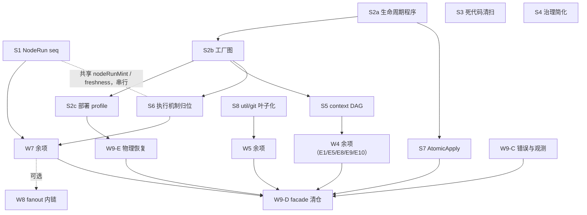

# RFC-294 实施路径：从散点 services 到分层 bounded contexts

> **当前入口（2026-10-16 刷新）**：本 RFC 按用户要求作为长期架构重构总纲维护，整体迁移仍为 In Progress。
> 本次全面审视见 [review-2026-10-16](./review-2026-10-16.md)；下一批后继见 §3。刷新前的完整实施记录（N1～N25 执行队列、
> 各波任务清单、历次 SHA 与 hosted 证据、账本重分桶记录）见 `archive-20261016-plan.md`。当前指标见 dated review 或按需报告；命令见 [status.md](./status.md)。
> **2026-10-30 进度对账**：S1、S2a、S2b、S2c 前两步与 RFC-395 关闭后的剩余范围见 [review-2026-10-30](./review-2026-10-30.md)；§1.1、§1.2、§3、§4、§8 已按其更新。
> **2026-10-31 W7 余项核销**：逐条核对记录见 [w7-closure-2026-10-31](./w7-closure-2026-10-31.md)；§1.1、§4.5、§8 已按其更新。
> **2026-10-31 S5 第一步**：[RFC-399](../RFC-399-context-dag-platform-one-way/proposal.md) 达成 S5 三条退出门规则；S5 范围余下三项由 [RFC-400](../RFC-400-collaboration-task-participants-actor/proposal.md) 承担；§1.2、§3 S5、§8 已更新。
> **2026-10-31 S5 Done**：[RFC-400](../RFC-400-collaboration-task-participants-actor/proposal.md) 完成 S5 余下三项（collaboration → task-execution 内部文件对 17 → 0、`services/humanGateComposition.ts` 删除、模块 public 合同去 legacy `Actor`）；§1.2、§3 S5、§8 已更新。
> **2026-11-03 S2 Done**：[RFC-433](../RFC-433-explicit-presence-selections/proposal.md)（Done）完成 S2c 余项第 1 项第四步——部署选择项 62 项全部由两个 profile 显式给出（51 必填 + 11 必填可空、无可选），装配层不再按「有没有给」分叉；S2 退出门核对见 §3 S2，§1.1、§1.2、§4.6、§8 已更新。
>
> **2026-11-02 S7 Done**：[RFC-401](../RFC-401-single-resource-write-stack/proposal.md)（Done）完成 S7——六类资源各一个写入参与者、三入口错误收敛、AtomicApply 持久 claim / lease、技能 / fusion / restore 接入、旧技能 operation 生命周期与零调用 legacy 写函数删除；退出门核对见 §3 S7，§1.1、§1.2、§8 已更新。

- 目标架构状态：Approved（D1～D8 沿用；D9 修订、D10～D13 新增，见 proposal §9）。本文刷新不授权任何未立项的后继。
- 迁移状态：In Progress（长期推进）。P0、W2、W3、W4-A/C/E0/E2/E3/E4a/E4b/E6/E7 已关闭；后继 S1（RFC-374）、S2a（RFC-379）、S2b（RFC-380～392）、S2c（RFC-393 / 394 与余项 RFC-425～433）、S3（RFC-375）、S4（RFC-376）、S8（RFC-377）已关闭（S2 于 2026-11-03 Done）；RFC-395 承接 S1b、S5 两步、S7 状态机合一与 W7 身份模型；W7 余项 2026-10-31 核销；S5 由 RFC-399 / RFC-400 两步完成（2026-10-31 Done）；S6 由 RFC-402～424 完成（2026-11-02 Done）；S7 由 RFC-401 完成（2026-11-02 Done）。其余见 §1.1（2026-10-30 对账）。
- 规划单位：已关闭波次（保留结论）+ 立即整改后继 S1～S8 + 余下波次（W4 余项、W5、W7 余项、W9-C/D/E，W8 可选）。

## 0. 批准边界与实施纪律

1. 批准 RFC-294 只表示批准目标架构与路线；每个后继都须按 CLAUDE.md 先落三件套并获用户批准。
2. RFC-287 已交付的行为是受保护基线；RFC-288 / 289 保持 CLOSED，旧 plan 不得执行。
3. 任何涉及 schema、行为、错误码、恢复或能力面的批次，按范围拆独立 RFC 并列能力影响。
4. 同一冲突面同时只允许一个在制高冲突批（装配根、`nodeRunMint` / freshness、迁移目录、架构生成器）；共享 `main` 上按路径精确
   暂存与提交，不建分支、不用 stash / worktree。
5. 目录迁移逐域进行：旧路径只留一跳无状态 facade，consumer 归零后删除。
6. proposal §6 的立即生效约束 C1～C9 对所有新代码生效；在制 RFC 收口前对账，偏离项逐条呈用户确认。
7. 开发、测试与验证纪律服从 CLAUDE.md 文首硬规则：先完成后继的全部实现与用例，再集中验证；CI 以 GitHub Actions 为准。

## 1. 当前基线与量化口径

当前指标以最近一次 dated review 或 `bun run architecture:report --source-ref <rev>` 的按需报告为准；
[status.md](./status.md) 只保留生成说明。RFC-376 阶段 B 起不再提交全量库存或 provenance 投影。

**architecture-significance filter**：只在 production context owner、public / required 合同、schema / 单写、装配根、
跨 context 边或 worker / lifecycle owner 发生变化时按需审视架构报告；普通提交不要求运行生成器。纯测试 / e2e / fixture、文档、
视觉原语和边角功能只更新质量与行为证据，不给任何波次计 credit。

**退出门的口径（D9 修订后）**：后继的退出门写成“某条结构规则成立”（例如“context 值级依赖无环”“`platform` 不 import
`modules`”“每模块每进程构造一次”），而不是“某份账本的 exact id 计数降到某个数”。RFC-376 阶段 B 后由硬门与文件内精确清单执行；
`counts.json` 允许 measured <= max，抬高 max 须同一提交写明原因，不设增长许可与下一笔退役。

### 1.1 逐波判定（2026-10-16；2026-10-30 对账更新）

| 区域    | 判定                                                            | 已落 / 剩余                                                                                                                                                                                                                                                                                                             |
| ------- | --------------------------------------------------------------- | ----------------------------------------------------------------------------------------------------------------------------------------------------------------------------------------------------------------------------------------------------------------------------------------------------------------------- |
| P0-A～E | Done                                                            | RFC-342（memory scope move）、RFC-343（Intent apply 恢复）、RFC-333（人工门原子性）、RFC-328（持久 ownership）；RFC-287 Done、RFC-288/289 CLOSED                                                                                                                                                                        |
| W0-R    | 治理基线 Done；**模型修订**                                     | N1 账本与守卫已落；按 D9 改为硬结构门 + 按需报告，由 S4 实施                                                                                                                                                                                                                                                            |
| W1      | 行为基线保持                                                    | RFC-287 的 assembly 与 G4～G7 行为；assembly 物理归位随 S6 完成（RFC-402，2026-11-02 S6 Done）                                                                                                                                                                                                                          |
| W2      | Done（协调器、三路引擎注册、14 类节点注册、WrapperRuntime）     | 引擎与执行器层已由 S6 成为真实层，composition 只剩装配（RFC-402～424，2026-11-02 S6 Done）                                                                                                                                                                                                                              |
| W3      | Done（RFC-341）                                                 | 无                                                                                                                                                                                                                                                                                                                      |
| W4      | A/B/C/D/E0/E2/E3/E4a/E4b/E6/E7 Done；E1/E5/E9/E10 部分；E8 开放 | 见 §4.1；B/D 的原计数已归零，退出门改为入站适配器不再深引 legacy 与模块内部。2026-10-30：`routes/` 仍有 29 个文件 import `services/`、11 个深引模块内部（与 10-16 相同）；E9 的 Event observer 已进生命周期程序。2026-11-03（RFC-434～438 后）：23 个 import `services/`、2 个深引模块内部；2026-11-04（RFC-439 后）：23 个 import `services/`、0 个深引模块内部；2026-11-04（RFC-440 后）：18 个 import `services/`；RFC-441 后 15 个，`mcp/` 清零；RFC-442～444 后 9 个；RFC-445、RFC-446 后 6 个；RFC-447 后 5 个；RFC-448 后 4 个；RFC-450 后 2 个；RFC-451 后 1 个；RFC-452 后仍 1 个（`tasks` 余 workspace-insight 7 处）；RFC-453 后 0 个——B / D 退出门达成（`routes/`、`mcp/`、`ws/` 都不 import `services/`、不深引模块内部）                                                                                                        |
| W5      | 部分纵切                                                        | RFC-308/310/321/363 已落 source-control 纵切；`util/git` 环族与 7 条 KNOWN（RFC-370 `166e918bd` 改变环形状时已删一条）由 S8（[RFC-377](../RFC-377-util-git-leaf/proposal.md)）处理；repo / cache / worktree owner 余项见 §4.3。2026-10-30：指向 source-control 的跨 context 内部文件对 5 个，`util/git.ts` 仍在 `util/` |
| W6      | Done（2026-11-02，S7）                                         | RFC-395 T10 合成唯一状态机 `platform/atomic-apply`；RFC-401 合一资源写入栈（六类资源各一个写入参与者）、三入口错误收敛、持久 claim / lease，技能 / fusion / restore 接入，旧技能 operation 生命周期删除 |
| W7      | Done（2026-10-31 核销）                                         | S1：每任务单调 `seq`（RFC-374，S1b 并入 RFC-395 D4）；身份轴由 RFC-395 交付，逐条核对见 [w7-closure-2026-10-31](./w7-closure-2026-10-31.md)                                                                                                                                                                             |
| W8      | 可选、延后                                                      | 仅 W7 后新号 RFC 获批才进入                                                                                                                                                                                                                                                                                             |
| W9      | A/B 由 S2 关闭（2026-11-03 S2 Done）；C/E/D 开放                | S2 承接 W9-A/B（唯一模块工厂图与生命周期程序）；W9-C/E/D 见 §4.6                                                                                                                                                                                                                                                        |

### 1.2 已关闭后继索引

| 波次                             | 后继                                                                                                          | 范围                                                                                                                                                   |
| -------------------------------- | ------------------------------------------------------------------------------------------------------------- | ------------------------------------------------------------------------------------------------------------------------------------------------------ |
| P0-D                             | [RFC-328](../RFC-328-durable-task-execution-ownership-fence/proposal.md)                                      | 持久 owner / intent / effect / fence 与 exact-token registry                                                                                           |
| W2-A                             | [RFC-331](../RFC-331-task-execution-topology-cut/proposal.md)                                                 | task↔scheduler 拓扑与 task SCC 族                                                                                                                      |
| W2-B                             | [RFC-332](../RFC-332-task-engine-decomposition/proposal.md)                                                   | 唯一协调器、仓库准备第 0 步、三路引擎                                                                                                                  |
| P0-C                             | [RFC-333](../RFC-333-human-gate-atomic-park-and-continuation/proposal.md)                                     | 人工门原子停驻与持久续跑                                                                                                                               |
| W2-C                             | [RFC-334](../RFC-334-node-executor-registry/proposal.md)                                                      | 14 类节点执行器注册表                                                                                                                                  |
| W2-D                             | [RFC-339](../RFC-339-wrapper-runtime-cutover/proposal.md)                                                     | WrapperRuntime 与 Loop / Git / Fanout 策略                                                                                                             |
| W3                               | [RFC-341](../RFC-341-lifecycle-committed-events-collaboration-commands/proposal.md)                           | 生命周期已提交事件与协作命令                                                                                                                           |
| P0-A                             | [RFC-342](../RFC-342-memory-scope-move-correctness/proposal.md)                                               | memory scope move 事务正确性                                                                                                                           |
| P0-B                             | [RFC-343](../RFC-343-intent-apply-recovery-correctness/proposal.md)                                           | Intent apply 恢复正确性                                                                                                                                |
| W4-A                             | [RFC-344](../RFC-344-operation-catalog-transport-cutover/proposal.md)                                         | OperationCatalog 与 transport                                                                                                                          |
| W4-C                             | [RFC-345](../RFC-345-resource-catalog-contract-cutover/proposal.md)                                           | Resource Catalog 与 ResourcePackage 合同                                                                                                               |
| W4-E7                            | [RFC-346](../RFC-346-system-operations-adapter-cutover/proposal.md)                                           | System Operations 管理编排                                                                                                                             |
| W4-E0                            | [RFC-347](../RFC-347-identity-access-authority-presence-cutover/proposal.md)                                  | identity-access authority / presence                                                                                                                   |
| W4-E2                            | [RFC-352](../RFC-352-memory-context-cutover/proposal.md)                                                      | memory context                                                                                                                                         |
| W4-E3                            | [RFC-353](../RFC-353-knowledge-evolution-context-cutover/proposal.md)                                         | knowledge-evolution context                                                                                                                            |
| W4-E4a                           | [RFC-355](../RFC-355-intent-context-cutover/proposal.md)                                                      | intent context                                                                                                                                         |
| W4-E4b                           | [RFC-360](../RFC-360-runtime-management-context-cutover/proposal.md)                                          | runtime-management                                                                                                                                     |
| W4-E9（EC provider）             | [RFC-361](../RFC-361-execution-contract-provider-cutover/proposal.md)                                         | Execution Contract provider                                                                                                                            |
| W4-E1（合同准备）                | [RFC-362](../RFC-362-task-source-control-launch-contracts/proposal.md)                                        | Task / SC 启动合同                                                                                                                                     |
| W4-E1 / W5（纵切）               | [RFC-363](../RFC-363-task-source-control-launch-cutover/proposal.md)                                          | Task / SC 启动与工作区生产切换                                                                                                                         |
| W4-E6                            | [RFC-364](../RFC-364-mcp-runtime-diagnostics-cutover/proposal.md)                                             | MCP runtime diagnostics                                                                                                                                |
| W4-E9（Event target）            | [RFC-365](../RFC-365-event-automation-target-providers/proposal.md)                                           | Event target providers                                                                                                                                 |
| W4-E9（Reaction）                | [RFC-368](../RFC-368-reaction-execution-cutover/proposal.md)                                                  | Reaction 执行切换                                                                                                                                      |
| （W7 前置）                      | [RFC-369](../RFC-369-node-run-supersession-derived/proposal.md)                                               | supersession 推导与唯一铸造的语义改善；不抵扣 W7 身份                                                                                                  |
| S3                               | [RFC-375](../RFC-375-backend-dead-code-sweep/proposal.md)                                                     | 后端死代码清扫（66 个生产文件）                                                                                                                        |
| S4（W0-R 模型修订）              | [RFC-376](../RFC-376-architecture-hard-gates/proposal.md)                                                     | 硬结构门 + 按需报告 + counts.json；全量账本与投影提交退役                                                                                              |
| S8（W5 一部分）                  | [RFC-377](../RFC-377-util-git-leaf/proposal.md)                                                               | util/git 叶子化；KNOWN_VIOLATIONS 7 → 0                                                                                                                |
| S1（W7-A）                       | [RFC-374](../RFC-374-node-run-sequence/proposal.md)                                                           | NodeRun 每任务单调 `seq`；S1b 并入 RFC-395 D4                                                                                                          |
| S2a                              | [RFC-379](../RFC-379-daemon-lifecycle-program/proposal.md)                                                    | 唯一生命周期程序与 G12                                                                                                                                 |
| S2b                              | [RFC-380](../RFC-380-daemon-module-bundles/proposal.md)～[RFC-392](../RFC-392-unified-test-entry/proposal.md) | 每模块每进程构造一次、中立应用图 / 会话图、统一测试入口（逐个见 §3 S2）                                                                                |
| S2c 第一步                       | [RFC-393](../RFC-393-cli-bootstrap-separation/proposal.md)                                                    | `cli/` 与 `bootstrap/` 分离                                                                                                                            |
| S2c 第二步                       | [RFC-394](../RFC-394-typed-deployment-profile/proposal.md)                                                    | 类型化部署 profile                                                                                                                                     |
| S2c 余项                         | [RFC-425](../RFC-425-execution-authority-without-deployment-literal/proposal.md)～RFC-433                     | 执行权去部署字面量、定时备份来源、入口根瘦身、部署选择项全部显式（无可选）                                                                             |
| S1b、S5 两步、S7 状态机、W7 身份 | [RFC-395](../RFC-395-database-target-schema-rebuild/proposal.md)                                              | 数据库目标模型与一次迁移；不代表 RFC-294 全部退出                                                                                                      |
| S5 第一步                        | [RFC-399](../RFC-399-context-dag-platform-one-way/proposal.md)                                                | context 值级 DAG（SCC 2 → 0、越界值级对 9 → 0）、`platform` → `modules` 19 → 0、删除 drizzle 再导出桶                                                  |
| S5 第二步                        | [RFC-400](../RFC-400-collaboration-task-participants-actor/proposal.md)                                       | collaboration → task-execution 内部文件对 17 → 0（改经 TE 自有 tx 参与者）、删除 `services/humanGateComposition.ts`、模块 public 合同去 legacy `Actor` |
| S7（W6）                         | [RFC-401](../RFC-401-single-resource-write-stack/proposal.md)                                                 | 唯一资源写入栈与三入口错误收敛、AtomicApply 持久 claim / lease、技能 / fusion / restore 接入、旧技能 operation 生命周期与零调用 legacy 写函数删除 |

各后继的 exact-SHA 与 hosted 证据以其自身三件套为准；本总纲的历史汇总见 `archive-20261016-plan.md` §1、§3.2。

## 2. 每个后继的统一切换协议

1. **Baseline / Oracle**：先锁当前 API、状态、事件顺序、恢复、依赖与异常路径；
2. **Additive contract**：落 domain / application port 与未接线实现，不改生产 writer；
3. **Single-consumer cutover**：一个 consumer / 纵切原子切到新实现；
4. **Facade stabilization**：旧 import 只剩一跳无状态适配，新代码禁止依赖旧路径；
5. **Contract**：consumer 归零且稳定后删除 facade / 旧读者，结构门收紧。

禁止两套独立业务 writer 双写；schema expand 兼容期允许同一 writer 在同一事务维护新字段与确定性的旧投影。禁止以运行时
feature flag 长期双跑新旧引擎。

Schema 批次规则：只 expand，不在同批 drop / rename；回填幂等、可中断、可重复；新旧 oracle mismatch 必须为 0；读者切换可
`git revert`，已应用迁移不回滚；收缩前证明在途 task / resume 兼容；两种 provider 都做 fresh / upgrade 与 schema admission
验证，并覆盖适用平台。已发布的不可倒退数据见 design §16。

Facade 只许 re-export 或参数形状适配；不得含 DB 查询、状态、授权、重试、分支、广播、回退或模块级可变状态。

## 3. 下一批后继：立即整改队列

排序依据见 [review §6](./review-2026-10-16.md#6-刷新后的后继顺序)。每项都是独立 RFC，开工前须用户批准；括号内是
它承接的原波次。

### S1 NodeRun 每任务单调序号（W7-A）

> 后继：[RFC-374](../RFC-374-node-run-sequence/proposal.md)（Done，2026-10-19，`291a5c3f3`）。S1b（所有受支持二进制都晚于 RFC-374 后删除 id 回退）待立项。2026-10-17 研究发现：PostgreSQL 迁移链今天不能给已有表加列，需新增升级种类 V8；`max+1` 与 tasks 计数器都会重开 RFC-369 的同任务冲突，分配改用 identity 分配表；迁移只能接在 RFC-370 未发布的 0259 / 0035 之后，执行时机待用户决定。
>
> 2026-10-23：S1b 不再单独立项，由 RFC-395 II-b 删除清单 D4（nullable seq 与 ID 兜底退出新执行读取）承担，见 RFC-395 plan §6.13。

- **目标**：消除“ULID 字典序 = 先后”的判据（review F6）。
- **范围**：两种 provider 的 `node_runs` 增加 `seq`；唯一铸造程序在同一事务内分配每任务单调值并保证 `UNIQUE(task_id, seq)`；
  存量行按现有 id 序回填（保持历史判定不变）；`isFresherNodeRun`、domain 与 SQL 两份 supersession、各处 `orderBy(nodeRuns.id)`
  与手写 id 比较改为比较 `seq`；回填完成并稳定后删除 id 回退。
- **退出门**：生产路径不存在按 node_run id 判断先后的比较（结构门锁定）；同毫秒连续铸造与“后铸造行 id 更小”的用例按 `seq`
  得到正确结果；在途任务 resume 兼容；两种 provider 迁移 fresh / upgrade 通过。
- **前置 / 冲突**：迁移编号排在 RFC-370 在制迁移落地之后；与 S6 共享 `nodeRunMint` / freshness，二者串行。
- **能力影响**：无产品能力变化；新旧判定只在原判据出错的情形下不同。

### S2 唯一模块工厂图与生命周期程序（W9-A/B 提前）

> 后继：S2a → [RFC-379](../RFC-379-daemon-lifecycle-program/proposal.md)（Done，2026-10-20，`1faae97cd` + `24b91ba6e`；G12 由程序与 `rfc379-daemon-lifecycle-guard` 落实）。四路只读研究确认：两个 provider 的作业 id 集合相同而后台顺序不同；PostgreSQL 现行启动顺序有四个功能缺陷（MR 终止对账先于孤儿收割、内置工具目录先于模板、托管升级结算早于执行权、运行时注册表与定向续跑竞争）；关停 30 秒宽限从未生效。S2b 拆为七个 RFC 依次推进：[RFC-380](../RFC-380-daemon-module-bundles/proposal.md)（同构模块组每会话构造一次，Done，`99944c201`）→ [RFC-381](../RFC-381-daemon-integration-bundles/proposal.md)（集成、定时任务、融合，Done，`682018fd4`）→ [RFC-382](../RFC-382-daemon-task-execution-bundle/proposal.md)（任务执行组，每会话唯一的任务驱动协调器与实时运行配置，Done，`fddf8bf74`）→ [RFC-383](../RFC-383-daemon-employee-automation-bundles/proposal.md)（数字员工、开发自动化，Done，`e9fcfc58a`）→ [RFC-384](../RFC-384-daemon-intent-bundle/proposal.md)（意图，Done，`1f60faa5d`）→ [RFC-385](../RFC-385-daemon-execution-generation/proposal.md)（执行世代按进程划分，修单机 PostgreSQL 重启后的执行恢复，Done，`f495e8e76`）→ [RFC-386](../RFC-386-task-drive-coordinator-factory/proposal.md)（每次调用的协调器改经工厂：子任务启动与续跑、按意图类型重建工作区排除配置、统一按认领世代的失败上报、子任务沿用会话运行配置，Done，`3450e6872`）→ [RFC-387](../RFC-387-task-continuation-semantics/proposal.md)（门控唤醒、房间续跑、仓库准备重试、融合适配器语义统一，驱动释放收尾，`createTaskDriveCoordinator` 删除，Done，`684972dbb`）→ [RFC-388](../RFC-388-task-execution-runtime-merge/proposal.md)（两个 provider 运行时函数合一，纯重构，Done，`8186c9852`）→ [RFC-389](../RFC-389-maintenance-worker-root-bootstrap/proposal.md)（维护 Worker 根迁入 bootstrap，线程内一张中立图，Done，`2b2919cee`）→ [RFC-390](../RFC-390-neutral-http-binding/proposal.md)（中立 HTTP 绑定：SQLite 改走 `composeProviderAppDeps`，Done，`02dae8e7f`）→ [RFC-391](../RFC-391-neutral-daemon-graph/proposal.md)（中立应用图：`bootstrap/` 下一张应用图 + 一张会话图 + 适配表，Done，`b1799e6bc`）→ [RFC-392](../RFC-392-unified-test-entry/proposal.md)（统一测试入口：删除 `server.ts` 的 SQLite 测试路径与回退，HTTP 组合迁入 `bootstrap/`，Done，`64dd81e8d`）。S2b 完成；S2c 进展见下方「S2c 部署 profile」条。

- **目标**：止住装配根的复制与同进程重复构造（review F2、F4），并为托管 profile 提供唯一落点。
- **建议拆分**：
  - **S2a 生命周期程序**：一份 provider-neutral 程序给出启动恢复步骤、runtime / 后台作业工厂与 close participant，两种
    provider 共同消费；测试锁定两者的有序作业 id 清单相同；补阶段、依赖、就绪、健康与停止回执字段；同批删除无生产调用方的
    8 个 timer 启动函数。
  - **S2b 工厂图**：每个模块在一个进程内只构造一次，HTTP / MCP / CLI / worker 共用；SQLite 与 PostgreSQL 的应用装配合并为
    一张 provider-neutral 图（以 `server.ts` 现有的 provider 无关挂载表为起点）；`DefaultTaskDriveCoordinator` 只在 bootstrap
    构造；移除 `deps.x ?? composeX(...)` 形态的测试回退；Worker 根迁出 `platform/`。
  - **S2c 部署 profile**（后继：[RFC-393](../RFC-393-cli-bootstrap-separation/proposal.md) `cli/` 与 `bootstrap/` 分离，Done，`a1a37759e` + `d31298011`；[RFC-394](../RFC-394-typed-deployment-profile/proposal.md) 类型化部署 profile，Done，`b84ff545e`；
    `StartOptions` 实测已有 77 槽，后继 RFC 见 RFC-393 proposal §7）：以类型化的 profile 取代 55 槽 `StartOptions` 覆盖与各模块的 `select*` 助手；消除 `cli/` ↔
    `bootstrap/` 互相依赖；入口根不再按部署模式分支。
    2026-10-21 起余项（单机默认值集中、执行权端口去部署字面量、入口根瘦身）因与 RFC-395 改动面冲突暂停；RFC-395 已于
    2026-10-29 Done，阻塞解除，待立项（编号届时另取）。2026-10-30 现状：`ExecutionAuthorityPort.mode` 仍在，业务层部署分支 5 处，
    `migrate` / `verify-database-restore` 仍是 `main.ts` 的命令分支。
    余项第 2 项（执行权端口去部署字面量）：[RFC-425](../RFC-425-execution-authority-without-deployment-literal/proposal.md)（Done）——删除
    `ExecutionAuthorityPort.mode`，部署种类与 SPA 标记由 profile 下传，部署分支 5 → 2。
    余项第 2 项余下部分（定时备份来源移出 provider 适配表、执行可用性的单机回落）：
    [RFC-426](../RFC-426-scheduled-backup-source-and-unbound-execution-status/proposal.md)（Done）——定时备份经系统运维模块的备份
    协调端口，顺带修复单机 PostgreSQL 定时备份落成手动家族且带工作树；部署分支 2 → 1。
    余项第 3 项（入口根瘦身）：[RFC-427](../RFC-427-entry-root-command-assembly/proposal.md)（Done）——`main.ts` 的命令依赖装配迁入
    `bootstrap/`，`migrate` / 两个校验命令成为部署描述的操作。
    余项第 1 项（单机默认值集中、选择项改必填、死槽清理）：72 项盘点见
    [RFC-428 inventory](../RFC-428-dead-deployment-selections/inventory.md)，分四步推进；第一步
    [RFC-428](../RFC-428-dead-deployment-selections/proposal.md)（Done）删去四个死槽 / 被遮蔽槽（72 → 68）；第二步
    [RFC-429](../RFC-429-evidence-deployment-selections/proposal.md)（Done）把 evidence 一组收拢到 `evidenceArtifacts`（68 → 64）；第三步
    [RFC-430](../RFC-430-derivable-deployment-selections/proposal.md)（Done）删余下三个可派生项（64 → 61）。盘点第 1 步（死槽 / 被遮蔽 /
    可派生 11 项）至此完成。第二步 [RFC-431](../RFC-431-standalone-selection-defaults/proposal.md)（Done，`90e1d0974`）把单机默认值集中到
    单机 profile：`standaloneSelections({ appHome })` 给出 39 项必填与 6 项托管独有能力（单机 `null`），装配层不再补缺省；新增
    `graphDevelopmentArtifacts`（61 → 62）保住单机图开发证据的根目录。第三步 [RFC-432](../RFC-432-session-selection-factories/proposal.md)
    （Done，`b4b24cff1`）把需要会话图的 10 项改为两侧都给的工厂（单机给本地构造函数、托管给闭包），合同变为 49 必填 + 6 必填可空 + 7 可选。
    第四步 [RFC-433](../RFC-433-explicit-presence-selections/proposal.md)（Done，`7dfa6454d`）把按有无区分部署的 7 项改为显式：执行权威单机给本地权威，
    `secretBox` 改为启动锁之后调用的工厂，5 项托管独有能力单机 `null`；合同 62 项 = 51 必填 + 11 必填可空、无可选。S2c 至此完成。
- **退出门**：每模块每进程构造一次；不存在 provider 专属或部署专属的装配函数；入口根只做参数解析与 profile 选择；
  后台作业全部经唯一生命周期程序且都有 stop；两种 provider 的作业清单一致。
- **前置 / 冲突**：`server.ts`、`cli/start.ts`、`cli/postgresqlDaemonApplication.ts` 正在被 RFC-370 改动，S2 须在其当前在制品
  落地后串行开工；RFC-370 后续的托管装配直接落在工厂图上。
- **能力影响**：无；以启动 / 关停 / 恢复行为对拍。
- **S2 Done（2026-11-03，RFC-433 `7dfa6454d` 主 CI 全绿后按源码核对；attempt 1 一个 e2e 分片超时被取消、无日志，重跑 attempt 2 全绿）**：退出门全部成立——
  - 每模块每进程构造一次：模块组按会话构造、应用图对每个模块组只构造一次（`rfc380-daemon-module-bundles`）；部署选择项由 profile 每进程
    给一次，需要会话图的由工厂每会话调用一次（RFC-432）；单机 SQLite → PostgreSQL 迁移后旧会话关闭、新会话在新库上重组。
  - 不存在 provider 专属或部署专属的装配函数：一张应用图、一张会话图、唯一 provider 适配表（`rfc391-neutral-daemon-graph`）；部署差异只在
    两个 profile（`bootstrap/standalone.ts`、`bootstrap/crewstation*.ts`），合同 62 项全部显式、装配层无隐式缺省与有无分支
    （`rfc431-standalone-selections`）；`bootstrap/` 之外的部署分支站点只剩 CrewStation 事件收件箱端口的通道字面量
    （RFC-376 `deployment-mode-branch-sites` = 1）。
  - 入口根只做参数解析与 profile 选择：`rfc427-entry-root`，以及 RFC-394 锁「入口不按部署种类分叉」。
  - 后台作业全部经唯一生命周期程序且都有 stop：`rfc379-daemon-lifecycle-guard`；运行时句柄的 `stop` 是必填
    （`bootstrap/daemonProviderRuntimeSession.ts:51`）。
  - 两种 provider 的作业清单一致：`rfc379-daemon-lifecycle` 的 G12 用例（完整 provider 记录得到相同的单机清单，托管只多声明过的项）。

### S3 死代码清扫

> 后继：[RFC-375](../RFC-375-backend-dead-code-sweep/proposal.md)（Done，2026-10-17，`0360e116d`）。仍不可达的生产文件只剩 RFC-375 design §4 保留清单（27 个，由 RFC-376 的 G14 入口可达性门锁定）。

- **范围**（逐项以 HEAD 复核后删除，改指相关测试）：development-automation 的 `composition/required-ports.ts` 与
  `ReconcilerPorts.effectExecutor`；digital-employee 的投机 command / query 端口与仅被它们引用的 DTO；collaboration 无人使用的
  public 符号（仅本模块使用的移入 application）；`services/` 中零生产 import 的文件（如 `taskArchive.ts`、`capabilityTemplates.ts`、
  `accountAuthPolicy.ts`）与只被测试使用的再导出；`services/scheduler.ts` 的 `failTask` / `cancelTaskRow`；
  `prepareWorkflowTriggerLaunch`；从入口不可达的生产文件。
- **退出门**：清单内条目删除；从 `main.ts` 与 Worker 入口不可达的生产文件只剩有明确理由保留的条目。
- **前置 / 冲突**：逐文件避让 RFC-370 在制文件。**能力影响**：无。

### S4 治理简化（W0-R 模型修订）

> 后继：[RFC-376](../RFC-376-architecture-hard-gates/proposal.md)（Done，2026-10-17，`3a81b7551` + `19ad368d1`）。G12（两 provider 生命周期清单一致）按设计留 S2a。

- **范围**：落 design §13.1 的硬结构门（新增 context 值级无环、`platform` 不 import `modules`、application 直接 effect、
  composition 禁 drizzle / schema / `node:fs` / `child_process` 的值依赖与 SQL、业务层零部署分支；生命周期清单一致 G12 留给 S2a。
  全部门的初始 allowlist 在 RFC-376 阶段 B 从当时已提交 HEAD 重算，以文件对或符号根计）；把全量库存账本（owner、跨 context 边与 exception、public surface、mutation、
  background / ambient、事务外效、facade、commons、status 投影）降为本地按需报告并停止提交（不新增 CI workflow）；撤销 provenance
  两笔提交协议与 CI 的全历史 checkout 需求；删除增长许可（T17）与按行号编号的条目；修正模块级可变单例与后台作业的计数口径；
  引入 design §13.1 所述的小计数文件。
- **退出门**：普通生产改动不再需要账本伴随提交；每条硬门都有会红的变异测试；报告可从任意已提交源码按需重新生成；
  `docs/dev-gotchas.md` 中只为旧账本机制存在的条目标为历史。
- **前置 / 冲突**：阶段 B 以 RFC-375 / RFC-377 已提交为前置，按 RFC-376 design §9 避让他人 WIP；不再运行旧 census。
  design §3.1 DAG 与 `rfc294Target.ts` 常量同批维护。**能力影响**：无（只改测试与 CI）。

### S5 恢复 context DAG 与 platform 单向依赖

- **范围**：拆除 {collaboration, memory, resource-catalog, task-execution} 与 {development-automation, integration} 两个值级环；
  collaboration 对 task-execution 内部的引用改经 task 拥有的 tx-bound participant；`services/humanGateComposition.ts` 收进
  collaboration 装配；任务生命周期写入序列从 `platform/persistence/sqlite/` 迁回 task-execution infrastructure；工作区 GC 策略归
  source-control / task-execution；退役 `legacySqliteTransportMechanisms.ts` 这类 drizzle / schema 再导出桶；legacy `Actor`
  不再出现在模块 public 合同中。
- **退出门**：context 值级依赖无环且 ⊆ design §3.1；`platform` → `modules` = 0；无 drizzle / schema 再导出桶。
- **前置 / 冲突**：S2b 之后更便宜。**能力影响**：无。
- **2026-10-23**：「工作区 GC 策略归 source-control / task-execution」与「任务生命周期写入序列迁回 task-execution」两步由 RFC-395 II-b 的跨域收口承担（RFC-395 plan §6.13、design §14）。
- **2026-10-30 对账**：退出门未成立——context 值级 SCC 仍为 2（同上两组）、off-DAG 9 对；`platform` → `modules` 19 个文件对；
  `legacySqliteTransportMechanisms.ts` 与 `services/humanGateComposition.ts` 仍在；9 个模块 `public/` 文件仍 import legacy `Actor`。
  见 [review-2026-10-30](./review-2026-10-30.md) §3。
- **2026-10-31 第一步（[RFC-399](../RFC-399-context-dag-platform-one-way/proposal.md)，Done）**：退出门三条规则成立——context 值级 SCC 2 → 0、
  越出 DAG 的值级 context 对 9 → 0、`platform` → `modules` 19 → 0、`legacySqliteTransportMechanisms.ts` 删除；新增 17 条 required-SPI 虚线。
- **2026-10-31 第二步（[RFC-400](../RFC-400-collaboration-task-participants-actor/proposal.md)，Done）**：collaboration 对 task-execution
  内部的 17 个文件对改经 TE 自有 tx 参与者（跨 context 内部文件对 73 → 56）、`services/humanGateComposition.ts` 删除、模块 public
  合同去 legacy `Actor`（8 个 public 文件 + 5 个经 public 转出的声明源；`PUBLIC_SURFACE_DEBT` 137 → 120、
  `CAPABILITY_COMPATIBILITY_DEBT` 22 → 18、RFC-317 R1 229 → 220）。提交 `8ebd3e1e9` + `01d3788e0`，CI `41220303849` 全绿。
  **S5 Done**；余下的跨 context 内部文件对（56）与 type-only 越 DAG offered 边归 S6 及后继各域 RFC。

### S6 task-execution 执行机制归位

- **范围与顺序**：见 design §5.5（kernel 机制库 → script 试点 → 其余 kind → fanout / 聚合装配线与引擎编排 → workgroup 与动态
  工作流引擎迁入 task-execution）。
- **退出门**：`nodeMechanics.ts` 删除、`legacyArgs` 消失、`TaskMechanicsState` 只出现在装配、engine 不 import `@/services`、
  `runAssembly` 不再位于 `services/`、协调器只在 bootstrap 构造；task-execution `composition/` 只剩装配。
- **前置 / 冲突**：S2b 之后；与 S1 串行。**能力影响**：无；以现有执行矩阵与恢复 oracle 对拍。
- **2026-10-30 对账**：前置已满足，退出门均未成立（`nodeMechanics.ts` 5,698 行、`runAssembly` 仍在 `services/schedulerAssembly.ts`、
  `legacyArgs` 11 处）；已成立的只有 engine 不 import `@/services`，协调器构造已收敛到 `taskDriveCoordinatorFactory.ts` 一处。
- **第一步（[RFC-402](../RFC-402-task-execution-kernel-script-pilot/proposal.md)，Done 2026-10-31，`da5ad65b8`）**：design §5.5 第 1、2 步——执行机制库
  `engine/kernel/`（assembly、隔离 / 合并 / 清理、许可、NodeRun ledger）、删除 `services/` 下七个文件、许可注册表显式实例化、script 节点试点。
  退出门中「`runAssembly` 不再位于 `services/`」成立；`nodeMechanics.ts` 4,621 行，其余退出门未成立。
- **design §5.5 第 3 步（按生命周期拆为四个 RFC）**：
  - [RFC-403](../RFC-403-task-execution-small-leaf-executors/proposal.md)（Done 2026-11-01，`2874dd182` + `d18850d35`）：code-host-call、
    input、output、review、clarify、clarify-cross-agent 迁入 `engine/node/<kind>/`，分支判定 / 跳过与端口读取归 `application/`；
    `nodeMechanics.ts` 4,621 → 3,656 行；
  - [RFC-404](../RFC-404-task-execution-child-call-executors/proposal.md)（Done）：call-workflow / call-workgroup 的共享主体迁入
    `engine/node/shared/child-call/`，两个执行器各在 registry key 目录；
  - [RFC-405](../RFC-405-task-execution-agent-single-executor/proposal.md)（Done）：agent-single 主体迁入 `engine/node/agent-single/`，
    经 task-execution 自有端口执行，`legacyArgs` 消失；`nodeMechanics.ts` 2,496 → 598 行，只剩工作组主机线；
  - [RFC-406](../RFC-406-task-execution-workgroup-host-executor/proposal.md)（Done）：workgroup host 主体迁入 `engine/node/agent-single/`，
    执行器两条 lane 共用端口；`nodeMechanics.ts` 删除，退出门「`nodeMechanics.ts` 删除」成立。design §5.5 第 3 步至此全部落地。
- **design §5.5 第 4 步（两件互不依赖，分两个 RFC）**：
  - [RFC-407](../RFC-407-task-execution-fanout-assembly-lines/proposal.md)（Done）：`wrapperMechanics.ts` 的 fanout 分片 / 聚合装配线迁入
    `engine/node/agent-single/`，与 agent 线共用端口，`FanoutAttemptPort` 的实现在 engine；`wrapperMechanics.ts` 1,954 → 730 行，只剩 wrapper
    的 data / scopeDriver / workspace 绑定与 git wrapper 的工作区 helper；
  - [RFC-408](../RFC-408-task-execution-task-control-plane/proposal.md)（Done）：`taskEngineApplication.ts` 的任务控制面迁入
    `engine/task/runTask.ts` 与 `taskSettlement.ts`，composition 只剩端口绑定与执行状态装配；DAG 结构图迁为 `engine/scope/dagGraph.ts`
    （scope 解释器层的第一个文件）。三个引擎类仍委托给 composition 绑定的主体：DAG scope 解释器迁入 `engine/scope/`、workgroup 轮次与
    动态工作流引擎迁入 task-execution 各待立 RFC。
- **scope 解释器**：[RFC-409](../RFC-409-task-execution-dag-scope-interpreter/proposal.md)（Done）：`runScope` 与 `deriveFrontier` 迁入
  `engine/scope/`，`services/dispatchFrontier.ts` 删除（frontier 判定进 `engine/scope/`，wrapper 定义图进 `domain/`）；composition 的
  `taskDagScope.ts` 只剩端口绑定。workgroup 轮次与动态工作流引擎迁入 task-execution 仍待立 RFC。
- **动态工作流生成引擎**：[RFC-410](../RFC-410-task-execution-dynamic-workflow-engine/proposal.md)（Done）：生成 pass 迁入
  `engine/task/dynamicWorkflowGenerate.ts`，编排代理与生成判定迁入 `domain/`，第二层校验迁入 shared，第一层校验经端口注入；删除
  `services/dynamicWorkflowRunner.ts` 与 `services/orchestratorAgent.ts`。workgroup 轮次引擎迁入 task-execution 仍待立 RFC。
- **workgroup 轮次引擎**：[RFC-411](../RFC-411-task-execution-workgroup-turns-engine/proposal.md)（Done）：轮次驱动迁入
  `engine/task/workgroup/`，端口进 `application/ports/`，纯函数进 `domain/workgroup/`，持久化适配器随表回到 task-execution `infrastructure/`；
  resource-catalog 下的轮次文件删除，两类 SPI 退役。
- **scheduler 残余**：[RFC-412](../RFC-412-task-execution-scheduler-residue/proposal.md)（Done）：自动提交推送迁入
  `engine/node/commit-push/`、只读巡检迁入 `engine/task/`，`TaskMechanicsState` 迁入 composition，删除 `services/scheduler.ts`。
- **composition 只剩装配（第一步）**：[RFC-413](../RFC-413-task-execution-wrapper-workspace-merge-recovery/proposal.md)（Done）：
  续跑前合并恢复与 wrapper 隔离工作区的建立 / 重建 / 合回迁入 `engine/kernel/`，wrapper 工作区端口实现与 wrapper 运行账本迁入
  `engine/wrapper/`；composition 的 `executionMergeRecovery.ts` / `wrapperRunLifecycle.ts` 删除，`wrapperMechanics.ts` 只剩绑定。
  协调器构造核对：生产只在 bootstrap 构造（RFC-386 / 387 守卫），`services/task.ts` 的测试专用装配随 W4 E1 退役。composition 其余
  非装配逻辑（数字员工执行核心、托管代理调用准备、动作执行运行器、provider 后台循环等）逐个核对后另立 RFC。
- **composition 只剩装配（第二步）**：[RFC-414](../RFC-414-task-execution-composition-io-out/proposal.md)（Done）：composition 不再直接读写
  数据库、文件系统与 git——八处 I/O 迁入 `infrastructure/`（RFC-376 `composition-forbidden-import-files` 中 task-execution 的七条随之销账，
  21 → 14），新结构锁补上持久化 helper 与 `util/git`。仍留在 composition 的应用逻辑（数字员工执行核心、动作执行运行器编排、托管代理调用
  准备、provider 后台循环）另立 RFC。
- **composition 只剩装配（第三步）**：[RFC-415](../RFC-415-task-execution-digital-employee-action-application/proposal.md)（Done）：
  数字员工 Reaction 执行核心与 agent / script 动作执行器迁入 `application/`，宿主任务启动收为窄端口 `launchHost`（到根启动内核请求的映射留在
  composition 绑定），状态读与工作区入口检查经环境端口；`composition/actionExecutionRunners.ts` 删除。
- **composition 盘点（2026-11-01）**：RFC-415 后逐文件核对 task-execution `composition/` 全部 108 个文件（9,197 行）：约 11 个文件各含 40 行以上的
  应用 / 适配器逻辑，另有少量小块；按 design §2「composition/ 下其余文件一律视为待归位的实现」与常驻规则 8 分批另立 RFC，顺序见
  [RFC-416 proposal §7](../RFC-416-task-execution-hosted-agent-invocation-infrastructure/proposal.md)。
- **composition 只剩装配（第四步）**：[RFC-416](../RFC-416-task-execution-hosted-agent-invocation-infrastructure/proposal.md)（Done）：
  托管（CrewStation）agent 调用准备迁入 `infrastructure/crewstation/agentInvocationPreparation.ts`（review F10 点名的偏差），composition 的
  `crewstationAgentInvocation.ts` 删除；托管 MCP 诊断会话迁入 `infrastructure/crewstation/mcpDiagnosticSessions.ts`，composition 只把系统代理核心
  与会话接在一起。
- **composition 只剩装配（第五步）**：[RFC-417](../RFC-417-task-execution-hosted-run-execution-infrastructure/proposal.md)（Done）：
  托管 agent 运行范围与托管材料引用、执行 owner 里的工作区 owner 判定 / owner 改写 helper / 能力缓存与判定 / 恢复证明 / 命令对账循环 / Intent
  scratch 释放迁入 `infrastructure/crewstation/`，provider 中立的任务材料准备迁入 `application/`；`crewstationTaskRunSelection.ts` 与
  `crewstationExecution.ts` 只剩构造与注入。
- **composition 只剩装配（第六步）**：[RFC-418](../RFC-418-task-execution-provider-background-application/proposal.md)（Done）：
  provider 后台循环与会话控制迁入 `application/providerBackground.ts`，legacy 清扫、节奏常量、文件配置源与定时任务执行经端口由 composition
  绑定（RFC-416 §7 原第 3 项提前，本地 agent 调用适配器待 runtime-management public 合同）。
- **composition 只剩装配（第七步）**：[RFC-419](../RFC-419-task-execution-host-launch-recovery-infrastructure/proposal.md)（Done）：
  数字员工与动作执行的宿主任务启动适配、借用工作区参与者迁入 `infrastructure/hostTaskLaunch.ts`，恢复管理面迁入
  `infrastructure/taskRecoveryAdministration.ts`（推翻 RFC-415 §6.1 把启动映射留在 composition 的落位）。
- **composition 只剩装配（第八步）**：[RFC-420](../RFC-420-task-execution-execution-state-residue/proposal.md)（Done）：
  执行状态绑定里的残余逻辑迁出——闭包端口读、上一次 fan-out 尝试的消费记录、fan-out agent / 源端口种类解析与子调用的继承面迁入
  `application/`，wrapper body 的进入与调用行 iso 的重建迁入 `engine/`，协作者投影迁入 `domain/`（RFC-416 §7 第 4 项；不把
  `TaskMechanicsState` 整体收为端口，改用窄入参与泛型状态）。
- **composition 只剩装配（第九步）**：[RFC-421](../RFC-421-task-execution-agent-invocation-stack/proposal.md)（Done）：
  agent 调用栈的中立部分（两段式准备、系统代理与冒烟核心）迁入 `application/`，本地 agent 调用适配器与本地调用准备迁入
  `infrastructure/local/`（RFC-416 §7 第 2 项第一段；各运行 family 的打开逻辑另立 RFC）。
- **composition 只剩装配（第十步）**：[RFC-422](../RFC-422-task-execution-run-family-openers/proposal.md)（Done）：
  五个运行 family 的打开逻辑迁入 `infrastructure/local/` 与 `infrastructure/crewstation/`，别的模块的实现经 task-execution 自有端口注入，
  composition 只选取 provider 并注入（RFC-416 §7 第 2 项第二段）。
- **composition 只剩装配（第十一步，收口）**：[RFC-423](../RFC-423-task-execution-composition-assembly-only/proposal.md)（Done）：
  定时任务启动 / 触发器参与者、托管恢复选择、准备 GC 的阶段分派与 worker 维护迁入 `infrastructure/`；收口锁钉住 `composition/` 的装配形状。
- **协调器只在 bootstrap 构造**：[RFC-424](../RFC-424-retire-test-only-task-drive-entries/proposal.md)（Done）：
  `services/task.ts` 的测试专用驱动入口（工厂装配、人工门唤醒、动态工作流续跑准入、仓库准备重试）删除或迁入 `tests/helpers/`，两个动态工作流
  用例改走生产确认命令；src 中协调器工厂只在 bootstrap 装配（RFC-386 盘点锁）。
- **S6 Done（2026-11-02，RFC-424 `556a45573` 主 CI 70/70 与 windows-platform 全绿后按源码核对）**：退出门全部成立——`nodeMechanics.ts`
  已删（RFC-406）、`legacyArgs` 0 处（RFC-405）、`TaskMechanicsState` 只出现在 task-execution `composition/`（RFC-412 起）、engine 不 import
  `@/services`、`runAssembly` 不在 `services/`（RFC-402）、src 中协调器工厂只在 `bootstrap/daemonModules/taskExecution.ts` 装配（RFC-424，
  RFC-386 盘点锁）、`composition/` 只剩装配（RFC-423 收口锁）。余项另立、不属本波退出门：`services/task.ts` 余下的生产部分（延后仓库准备、
  同步预览等）随 W4-E1 余项；测试侧 legacy 工作组状态模块（`tests/helpers/legacyWorkgroupState.ts`）的使用方改指或删除。

### S7 唯一 AtomicApply 引擎（W6）

- **范围**：`platform/atomic-apply` 提取唯一状态机（以 ResourcePackage 合同为基线），Intent 以 provider 接入；合并两套资源写入栈；
  收敛改为持久 claim / lease 并作为一个作业注册进生命周期程序；fusion approve / skill restore 做故障点对拍后接入或证明不适配。
- **退出门**：lifecycle 实现 1、资源写入栈 1、收敛循环 1；同一非法输入在 Intent、资源包与普通 CRUD 得到同一错误码；
  旧 nonterminal journal 归零后删除旧引擎。
- **前置 / 冲突**：S2a 之后（收敛作业落在生命周期程序上）。**能力影响**：错误码收敛属用户可见变化，须列入口与错误码呈批。
- **2026-10-30 对账**：RFC-395 T10 交付唯一状态机 `platform/atomic-apply`（Intent 与资源包为场景适配器，一个恢复作业挂两个场景），
  两份进程内锁已删，10-16 记录的错误码分叉已消失（两条写入路径共用 `domain/agentDependencies.ts`）；仍不成立的是资源写入栈两份。
  收敛持久 claim、fusion approve / skill restore 接入未核。
- **2026-10-31 核对（[RFC-401](../RFC-401-single-resource-write-stack/proposal.md)，Draft）**：上条有两处需要更正。①错误码没有收敛：
  `domain/agentDependencies.ts` 带 `intent / application / catalog` 三种语义参数，三条入口对名称冲突、缺失引用、自依赖、循环、runtime 与
  成员校验仍返回不同错误，资源包内循环会落成 `internal-error`。②写入栈不止两份：普通 CRUD、技能 operation 生命周期、种子与模板入口
  各有编排。另两项核实：收敛只有一个作业，但 apply 没有持久 lease / fencing（`platform/atomic-apply/convergence.ts:7-9`）；fusion approve
  与 skill restore 适合接入 AtomicApply。RFC-401 的用户可见变化（proposal §5）待用户确认；含 schema 的 Part B 排在 RFC-398 之后。
- **2026-11-02**：用户确认 RFC-401 proposal §5 的 12 项与 §7 两项，全部按推荐（记录见 RFC-401 proposal §7）。RFC-401 转 In Progress；
  RFC-398 已 Done，Part B 的前置满足。
- **2026-11-02 RFC-401 A1**：agent 的写入栈合一（唯一写入参与者，普通 CRUD / Intent / 资源包 / 模板 / 种子都经它），三入口错误收敛；
  其余五类按 A2～A4 分步。
- **2026-11-02 RFC-401 A2**：MCP 与 plugin 的写入栈合一；资源包覆盖保持规格不变不再重装插件。
- **2026-11-02 RFC-401 A3a**：workflow 的写入栈合一（普通 CRUD / Intent / 资源包 / 内建目录 / 种子都经唯一参与者）；Intent 允许 workflow
  重名，提交不再跑完整图校验（草稿期图校验只提示）。
- **2026-11-02 RFC-401 A3b**：workgroup 的写入栈合一（普通 CRUD / Intent / 资源包都经唯一参与者）；Intent 的成员与重名错误收敛到普通编辑。
- **2026-11-02 RFC-401 Part B**：AtomicApply 持久 claim / lease / fencing（`atomic_apply_claims`，owner `platform/atomic-apply`）；skill 的写入栈合一
  （唯一 skill 写入参与者，普通 CRUD / ZIP / restore / fusion / Intent / 资源包都经它）与 skill 写入场景（`skill_apply_journal`，resource-catalog），
  fusion 不再经 tx-bound capability 直写技能版本；旧技能 operation 的写入生命周期删除，启动兼容执行器保留。六类资源各一个写入参与者。
- **2026-11-02 RFC-401 T6 收尾（RFC-401 Done）**：agent / workflow / workgroup 的零生产调用 legacy 写函数与 YAML 导入写入者删除
  （连同不可达的 `agentReferences.ts`、`legacy/importRefs.ts`），用例夹具只走生产写入入口；AC-1 结构锁的这三类旧导入方清空。
- **S7 Done（2026-11-02，RFC-401 收口提交 `cb33528ec` 主 CI 全绿后按源码核对）**：退出门全部成立——lifecycle 实现 1（`platform/atomic-apply`
  一套状态机，Intent / 资源包 / 技能三个场景都经 `createAtomicApply`，`rfc395-a6-atomic-apply` 锁定）；资源写入栈 1（六类资源各一个写入参与者，
  `rfc401-resource-write-participants` 锁定，技能一类余下的旧导入方只做旧格式记录的启动排空与簿记）；收敛循环 1（维护作业里唯一一处
  `atomicApply.converge` 收敛三个场景，另有启动步骤 `skill-operation-recovery` 的一次性收敛，claim 持久且带 lease / fencing）；同一非法输入
  三入口同一错误（RFC-401 六类错误矩阵）；旧技能 operation 生命周期删除，旧格式记录由启动兼容执行器排空（RFC-401 AC-5）。

### S8 `util/git` 叶子化与剩余 KNOWN（W5 一部分）

> 后继：[RFC-377](../RFC-377-util-git-leaf/proposal.md)（Done，2026-10-17，`8e09ca089`）：KNOWN_VIOLATIONS 7 → 0，后端 / 全仓值级 SCC 0 / 0。`util/git` 物理迁入 source-control infrastructure 不在 S8，归 §4.3 W5 余项。

- **范围**：把 `util/git.ts` 对 `services/git*` 的动态反向 import 改为参数注入，销 git 环族与两条 util→upper；shared
  `outputKinds` 注册改为注入、frontend 递归渲染改 children / render callback，可作为同批或独立小批。
- **退出门**：后端值级 SCC = 0；`KNOWN_VIOLATIONS` 中上述条目删除。**能力影响**：无。

## 4. 余下波次与退出门

### 4.1 W4 余项

- **B / D（重新定义）**：route→DB 与 `AppDeps` 反向依赖已为 0，原计数退出门失效。新的退出门：入站适配器（`routes/`、`mcp/`、
  `ws/`）不 import `services/`、不 import 模块 application / infrastructure / domain / engine / composition，只调用模块 public
  command / query / operations。2026-10-16 时 59 个 route 文件中仍有 29 个 import `services/`、11 个深引模块内部，按 context 随下面各子波收口。
  2026-11-03 第一步 [RFC-434](../RFC-434-inbound-adapter-public-contracts/proposal.md)（Done，`1f0da4ca7`）：
  - 全仓最后 3 个非精确 public 文件并入精确入口；
  - 8 条模块外深引改走精确 public 入口（`R1-inbound-module-internals` 210 → 202，跨 context 内部边 56 → 48），深引模块内部的路由 11 → 7。
  - 余下 7 个路由需要重写句柄合同或去掉签名里的遗留 `Actor`：数字员工、事件中心、stage 合同、定时任务、能力模板（E8）、任务目录（E10）、
    Webhook 投递运行时。
  2026-11-03 第二步：[RFC-435](../RFC-435-task-catalog-typed-queries/proposal.md)（Done，`b3a1daa98`）收掉任务目录（7 → 6，见 E10）；
  [RFC-436](../RFC-436-module-inbound-http-bindings/proposal.md)（Done，`3cb987341`）把事件中心与数字员工的 HTTP 绑定归入各自模块的
  `inbound/http`，管理句柄合同留在 `application/ports` 不扩 public，development-automation 自己挂载案例范围路由：
  - 深引模块内部的路由 6 → 4，`R1-inbound-module-internals` 201 → 198，import `services/` 的路由 29 → 28；
  - 余下 4 个：stage 合同与能力模板（E8）、定时任务、Webhook 投递运行时。
  2026-11-03 第三步：[RFC-437](../RFC-437-integration-webhook-family/proposal.md)（Done，`450abf2ca`）把代码平台 Webhook 家族
  （`services/webhook/*`、端点与触发器服务、四个 Webhook 路由）整体迁入 integration，`services/webhook/` 删除；入站接收与投递重放抽成应用用例：
  - 深引模块内部的路由 4 → 3，`R1-inbound-module-internals` 198 → 178，import `services/` 的路由 28 → 24；
  - 余下 3 个：stage 合同与能力模板（E8）、定时任务（RFC-438）。
  2026-11-03 第四步：[RFC-438](../RFC-438-scheduled-tasks-into-integration/proposal.md)（Done，`0606b2597`）把定时任务（服务、节拍、路由）
  迁入 integration，并倒转 task-execution 对定时任务的依赖（后台循环只收 `runDue` 端口、启动端口由 integration 声明、bootstrap 连接）：
  - 深引模块内部的路由 3 → 2，`R1-inbound-module-internals` 178 → 176，import `services/` 的路由 24 → 23；
  - 余下 2 个：stage 合同与能力模板（E8）。
  2026-11-04 第五步：[RFC-439](../RFC-439-code-capability-inbound-bindings/proposal.md)（Done，`ce164ed44`）把 `routes/code` 与
  `routes/capabilityTemplates` 迁入 code-capability 兼容岛自己的 `inbound/http`，挂载经 `composition/routes` 转出：
  - 深引模块内部的路由 2 → 0，`R1-inbound-module-internals` 176 → 170，import `services/` 的路由仍 23；
  - 退出门的「不深引模块内部」已达成：R1 里来自 `routes/`、`mcp/`、`ws/` 的边为 0（余下 170 条来自 `services/` 157、`cli/` 7、
    `auth/` 4、`server.ts` 2）；
  - 余下「不 import `services/`」：`routes/` 23 个、`mcp/server.ts` 1 个，按 context 随各子波收口。
  2026-11-04 第六步：[RFC-440](../RFC-440-transport-helpers-out-of-services/proposal.md)（Done，`452673a11`）按 legacy 归属表把
  RFC-222 / RFC-247 的三个 HTTP 助手移出 `services/`：删除确认与删除快照进 `platform/http`，token 读视图进 identity-access 的
  `auth/`，生产零调用的 token 审计兼容层删除：
  - import `services/` 的路由 23 → 18（skills、memories、workgroups、workflows、plugins）；platform 与模块对这三个助手的依赖清零；
  - 余下「不 import `services/`」：`routes/` 18 个、`mcp/server.ts` 1 个（`services/mcpSurface`）。
  2026-11-04 第七步：[RFC-441](../RFC-441-platform-helpers-out-of-services/proposal.md)（Done，`19ba4671b`）把 API 文档、PlantUML
  渲染与外部入口开关移入 platform（`operations` / `http` / `configuration`）：
  - import `services/` 的路由 18 → 15（`auth`、`docs`、`plantuml`）；`mcp/` 不再 import `services/`，入站适配器里只剩 `routes/`；
  - 余下 15 个路由按 context 收口（collaboration、source-control、identity-access OIDC、resource-catalog、任务相关）。
  2026-11-04 第八步：[RFC-442](../RFC-442-collaboration-facades-out-of-services/proposal.md)（Done，`9c1a6f2a9`）删除 collaboration 的
  两层 legacy 转出，提问节点判定与任务问题冲突码进 domain、经 exact public 给路由：路由 15 → 12，`R1` 170 → 169。
  2026-11-04 第九步：[RFC-443](../RFC-443-oidc-into-auth/proposal.md)（Done，`21ae7afa3`）OIDC 提供方服务与开通策略原样迁入
  `auth/oidc/`：路由 12 → 10，`auth/` 不再 import `services/`。
  2026-11-04 第十步：[RFC-444](../RFC-444-builtin-resources-into-resource-catalog/proposal.md)（Done，`98cd1706f`）内建资源清单迁入
  resource-catalog domain、经 `public/types` 给模块外，清偿 W4-C 遗留的 KE-03 两条 R2 边：路由 10 → 9，`R2` 41 → 39。
  - 余下 9 个路由：source-control（`repos`、`repoGroups`、`cached-repos`）、integration 的代码平台连接（`codeHosts`、
    `accountRepositoryTransportCredentials`）、resource-catalog（`agents`、`mcps`）、task-execution（`health`、`tasks`）。
  2026-11-04 第十一步：[RFC-445](../RFC-445-launch-multipart-and-recovery-counters/proposal.md)（Done，`16465e382`）启动 multipart
  信封迁入 `platform/http`、其余上传助手按层迁入 task-execution，自启动以来的恢复计数迁入 `platform/health`，`services/launchMultipart`
  与兼容转出 `services/upload` 删除：路由 9 → 7（`agents`、`health`），`R1` 169 → 166。
  2026-11-04 第十二步：[RFC-446](../RFC-446-repository-reads-into-source-control/proposal.md)（Done，`a85eeebb6`）仓库 refs / files
  读取与已登记镜像目录判定迁入 source-control `infrastructure/local`，判定随 `RepositoryMirrors.local` 装配：路由 7 → 6，路由不再收仓库存储。
  - 余下 6 个路由：source-control（`repoGroups`、`cached-repos`）、integration 的代码平台连接（`codeHosts`、
    `accountRepositoryTransportCredentials`）、resource-catalog（`mcps`）、task-execution（`tasks`）。
  2026-11-05 第十三步：[RFC-447](../RFC-447-repository-groups-into-source-control/proposal.md)（Done，`531566b35`）仓库组用例迁入
  source-control `application`，URL 现场登记改为注入、由装配层按部署形态选择，路由只经 public 合同 `RepositoryGroups`：路由 6 → 5。
  - 余下 5 个路由：source-control（`cached-repos`）、integration 的代码平台连接（`codeHosts`、
    `accountRepositoryTransportCredentials`）、resource-catalog（`mcps`）、task-execution（`tasks`）。
  2026-11-05 第十四步：[RFC-448](../RFC-448-mcp-probe-into-resource-catalog/proposal.md)（Done，`df2cb6e26`）MCP 探测三个端点的
  编排迁入 resource-catalog `application/mcps`，探测与协调器进 infrastructure、两个进程级实例进 composition，装配根不再 import 路由：
  路由 5 → 4。
  - 余下 4 个路由：source-control（`cached-repos`）、integration 的代码平台连接（`codeHosts`、
    `accountRepositoryTransportCredentials`）、task-execution（`tasks`）。
  2026-11-05 准备步：[RFC-449](../RFC-449-code-host-requests-injected/proposal.md)（Done，`2f8d491cd`）task-execution 的代码平台节点只经
  运行时选项注入的请求端口调用、连接只认本模块端口，development-automation 的交付 provider 只认本地连接端口，装配根注入实现：
  两个模块不再 import `services/codeHost/*`（迁入 integration 时不产生 DAG 外的边）；路由仍 4，模块里 import `services/` 的文件 141 → 140。
  2026-11-05 第十五步：[RFC-450](../RFC-450-code-host-family-into-integration/proposal.md)（Done，`d29f951e0`）`services/codeHost/*` 按层
  迁入 integration（URL、TLS 选项判据、project 定位段进 domain，数据形状与端口进 application/ports，执行器、连接服务与恢复探测进
  infrastructure），「测试连接」编排迁入用例，两个路由只经 `public/types` 的合同，MR 用例经绑定里的 `requests` 发请求：路由 4 → 2，
  `R2` 39 → 35。
  - 余下 2 个路由：source-control（`cached-repos`）、task-execution（`tasks`）。
  2026-11-05 第十六步：[RFC-451](../RFC-451-repository-mirror-cache-into-source-control/proposal.md)（Done，`79867699c`）镜像缓存、批量导入、
  后台子模块保鲜与开发工作区仓库准备原样迁入 source-control `infrastructure/local`，子模块参数解析归 `platform/workspace/local`（平台 → 模块
  仍 0），`cached-repos` 路由只经 `public/types` 的 `CachedRepositoryOperations`：路由 2 → 1，`services/` 208 → 205。
  - 余下 1 个路由：task-execution（`tasks`）。
  2026-11-05 第十七步：[RFC-452](../RFC-452-task-recovery-and-diagnostics-into-task-execution/proposal.md)（Done，`4f0ede4c5`）任务恢复与诊断
  家族 17 个文件原样迁入 task-execution（只经端口决策的进 `application/recovery`、`application/lifecycleAlerts`，碰本机进程或文件的进
  `infrastructure`），`tasks` 路由的 7 个诊断 / 恢复端点只经 `public/types` 的 `TaskDiagnostics`（响应类型取 shared schema），路由里的两段
  编排迁入 `application/taskDiagnostics`：`services/` 205 → 187，`R1` 166 → 148，`R2` 35 → 33。
  - 余下 1 个路由：task-execution（`tasks`，余 workspace-insight 一族 7 处）。
  2026-11-05 第十八步：[RFC-453](../RFC-453-workspace-insight-module/proposal.md)（Done，`6fb219f5b`）workspace-insight 一族 32 个文件抽成
  新模块 `modules/workspace-insight`（纯分析进 `domain`，tree-sitter 引擎进 `engine`，面向任务的用例进 `application`，起子进程的 SCIP 深度
  索引进 `infrastructure/deep`、用例经 `application/ports` 的端口调用），code-capability 的 code-review 产物存储一并迁入，`tasks` 路由的
  7 个端点只经 `public/types` 的 `TaskWorkspaceInsight`：路由 1 → 0，`services/` 187 → 153，`R1` / `R2` 不变。
  - B / D 退出门达成：`routes/`、`mcp/`、`ws/` 都不 import `services/`、不深引模块内部（`R1` 余下 148 条全部出自 `services/`、`cli/`、
    `auth/` 与 `server.ts`）。
- **E1 task launch admission**：在 RFC-363 已落的启动 / 工作区纵切基础上，统一 `launch_origin` / 子任务继承、来源终止快照、
  catalog membership 铸造与 `__repo_prep__` 行为；`services/task.ts` 的旧启动路径随 fusion 改走根启动内核后退役。
- **E5 / workspace-insight**（2026-11-05 模块抽取由 [RFC-453](../RFC-453-workspace-insight-module/proposal.md) Done，`6fb219f5b`：
  一族 32 个文件与 code-capability 的 code-review 产物存储进 `modules/workspace-insight`，`tasks` 路由只经 `public/types`；原文所说的
  `codeWorkspaceRead` 端口已不存在，任务代码工作区查询由 task-execution 的 `TaskCodeWorkspaceQueries` 提供，本模块经它读）：把
  `services/structuralDiff/`、`services/codeIntel/`、`services/changeNarrative.ts` 抽成 `modules/workspace-insight`；余项是 design §3 的目标
  合同——幂等的叙述生成与取消（现为进程内单飞）、只消费 task / source-control / runtime 的不可变快照 participant；生产切换与
  source-control 快照一起完成。
- **E8 development-automation**（2026-11-04 入站绑定部分由 [RFC-439](../RFC-439-code-capability-inbound-bindings/proposal.md)
  Done，`ce164ed44`：两个 HTTP 绑定归入兼容岛自己的 `inbound/http`；整体吸收仍开放）：把 26 成员可选袋拆为按用例、非可选的 required 端口与 exact provider adapter；
  `services/developmentDeliveryDeps.ts` 迁为 integration 的 provider adapter；mission / config / activity 路由只调 public；
  `code-capability` 的 capability template 写入与历史查询并入 development-automation 后删除该兼容岛。
- **E9 digital-employee / event-center / execution-contract**（2026-11-03 路由部分由 [RFC-436](../RFC-436-module-inbound-http-bindings/proposal.md)
  Done，`3cb987341`：两个 HTTP 绑定归入各自模块 `inbound/http`，句柄合同留在 `application/ports`；XC 兼容 seam 仍开放）：在 RFC-361/365/368 已落切片之上，完成路由到 public command / query、
  Event observer 进入生命周期程序、XC 对 legacy agent / workflow / scriptRun 的兼容 seam 退役。
- **E10 task-catalog**（2026-11-03 public 合同部分由 [RFC-435](../RFC-435-task-catalog-typed-queries/proposal.md) Done，`b3a1daa98`：
  `TaskCatalogQueries` 在 `application/ports`、经 `public/queries` 导出，返回类型化文档与页，接自有的 `TaskCatalogViewer`；深引路由 7 → 6）：
  public 查询接 typed query、返回 typed page，不接 full Actor、不返回 JSON 字符串；来源经
  `TaskCatalogSource` 注入。

每个子波的退出门：该 context 的入站适配器与 consumer 不再深引 legacy / 内部；该 context 的 public 合同无投机符号；
全局结构门不回退。

2026-10-30 对账：入站适配器计数未变（`routes/` 59 个文件中 29 个 import `services/`、11 个深引模块内部）；E1 的 `services/task.ts`
仍 2,617 行；E5、E8、E10 未开工；E9 的 Event observer 已进生命周期程序，三个 route 仍深引 DE / EC / XC 内部。逐项证据见
[review-2026-10-30](./review-2026-10-30.md) §3。

### W4-A Operation catalog 与 adapter parity

Done（RFC-344）：transport 中立的 operation descriptor、HTTP RouteMeta 与 MCP 工具引用同一 operation、API docs 从描述派生、
HTTP / MCP 同输入同结果。细节见归档 plan §8。

### W4-C Resource Catalog

Done（RFC-345）：`ResourceCatalogQuery` summary、四个用途专属 participant、六类聚合命令化、资源包合同。细节见归档 plan §8。

### 4.2 W6

由 S7 承接；退出门见 §3 S7。

### 4.3 W5 source-control 边界

S8 之外的余项：repo / cache / group / worktree / submodule 收编到 source-control；对外只给 opaque `WorkspaceRef` 与快照引用，
删除 composition 路径 binder；task 拥有 prune candidate / claim / final stamp，source-control 只执行物理删除并返回幂等回执；
development-automation 的 candidate / delivery / conflict adapter 改用 opaque 引用。退出门：source-control 相关的跨 context
内部 import = 0，绝对路径不穿 public 合同。
2026-10-30：指向 source-control 的跨 context 内部文件对 5 个（均为 task-execution → `source-control/composition*`），
`util/git.ts` 仍在 `util/`。

### 4.4 W8（可选）

仅在 W7 完成且新号 fanout RFC 获批后进入；未获批时保留 `fanout-inner-chain-unsupported` 挡板。合同要点见 design §6.4。

### 4.5 W7 余项

S1 之后：`RunRole`、scope / container、`generationSeq`、`attemptIndex`、`shardKey` 与逐边 provenance 的 expand → 写入 →
回填 → shadow → 读者切换 → 删回退（design §6.3）；prompt 正文外置的版本化双读、DevelopmentMission→…→NodeRun 的 provenance
矩阵与 RFC-306 `skipped` / consumed 语义纳入对拍。退出门：每个输入的 producer run 可解释；生产 freshness 不依赖 id 或
nullable parent；两种 provider 迁移通过。前置：W2（已满足）、S1；与 S6 串行。
2026-10-30：RFC-395 以离线转换 + 一次切换承接本节身份模型（角色、容器、逻辑代、尝试、selected run、实际消费边；其 AC-3），
D4 销账后生产读取不再有 NULL / ID 回退。本节另列的 prompt 正文外置双读、DevelopmentMission→…→NodeRun provenance 矩阵与
RFC-306 语义对拍未见对应记录；核销前逐条确认，见 [review-2026-10-30](./review-2026-10-30.md) §3。
**2026-10-31 核销**：三条退出门与另列三项逐条满足，不需要生产改动，记录见 [w7-closure-2026-10-31](./w7-closure-2026-10-31.md)。
新输入边一律 `recorded` 且外键指向真实 producer run，历史行以 `inputs_recorded=false` / `legacy-derived` + 证据显式标注，逐端口
provenance 按 RFC-395 design §5.1 不建列；先后判据只用 `seq`（RFC-374 与 D4 两道守卫）；角色与槽位由写者给出，
`historical_parent_id` 是显式写入的归属事实，仍用于 RFC-369 结构取代与顶层筛选并由选择表对拍锁定——第二条门里的
「nullable parent」按归档原文「删除 nullable-parent freshness 推断」判定满足（本会话依用户授权判定，可推翻；推翻时另立新号 RFC
把顶层判定改由角色 / 容器事实表达）。托管 PostgreSQL 实例真实迁移、SQLite 以真实数据副本演练及双 provider 切换矩阵通过
（本机实例为归档后全新安装）；prompt 外置（RFC-311 T21 → ContentRef）、DevelopmentMission→Task 引用链与 RFC-306
`skipped` / consumed 语义均有对应实现与测试。

### 4.6 W9 余项

- **W9-A / W9-B**：由 S2 承接；S2 于 2026-11-03 Done（退出门核对见 §3 S2）。
- **W9-C 错误、OperationContext 与审计**：domain / application 错误去 HTTP status、唯一 adapter 映射；operation / correlation /
  causation id 贯穿 task / node / event；logger / metrics / audit 端口。
- **W9-E 物理恢复 generation**（独立 RFC）：按 provider 能力分别实现 checkpoint / stage / replace / verify，补齐两种 provider 的
  恢复与失败矩阵；托管 profile 的恢复路径由 RFC-370 承接的部分与之对齐。
- **W9-D facade 清仓**：所有 facade 的生产与测试 consumer 归零后删除；`services/` 只剩到期删除的一跳 facade；更新 code map 与
  onboarding。前置：S2、W9-C、W9-E。
- **2026-10-30**：W9-A / W9-B 已由 S2a / S2b 关闭；W9-C（domain / application 仍带 HTTP 状态、无 `OperationContext`）、
  W9-E（`services/backup.ts` / `restore.ts` / `pendingRestore.ts` 仍在）、W9-D（facade 45、`services/` 业务实现 219）开放。

## 5. 依赖顺序

S3、S4、S8 互不依赖，可与其他后继并行，但各自避让正在被改动的文件。S1 与 S2 都受 RFC-370 在制品的文件面约束（§6）。

## 6. 并发与冲突矩阵

| 高冲突面                                                                                             | 必须串行的后继                                 | 备注                                           |
| ---------------------------------------------------------------------------------------------------- | ---------------------------------------------- | ---------------------------------------------- |
| 装配根（`server.ts`、`cli/start.ts`、`cli/postgresqlDaemonApplication.ts`、`main.ts`、`bootstrap/`） | RFC-370 在制品 → S2 → S5 / S6 中涉及装配的部分 | RFC-370 当前大量改动这些文件                   |
| 迁移目录与 `db/schema.ts`                                                                            | RFC-370 在制迁移 → S1 → W7 余项                | 迁移编号单 owner 分配                          |
| `nodeRunMint` / freshness / supersession                                                             | S1 ↔ S6                                        | 同一批只允许一个                               |
| `tests/architecture/*` 与报告脚本                                                                    | S4 与修改同一守卫的批次                        | 按路径避让；RFC-376 后无 census / 投影发布冲突 |
| `scheduler` / `task` / `nodeMechanics` / `wrapperMechanics`                                          | S6 内部逐 kind 串行                            | —                                              |
| intent apply / 资源包 apply / 资源 participant                                                       | S7 独占                                        | —                                              |
| `util/git` / `services/git*`                                                                         | S8 独占                                        | —                                              |
| `design/plan.md` 索引与 `STATE.md`                                                                   | 每次收尾单 owner                               | 只追加本批条目，保留他人内容                   |

发现同文件并发在制改动时停止该切片，在当前会话说明，不 stash / reset / checkout 他人改动，也不向其他 session 发消息。

## 7. 验证栈

按风险逐级选择，不以 LOC 或文件数下降作为完成证据；GitHub Actions 是唯一强制门禁，本地 `gate:local` 只作诊断入口：

1. 受影响范围的纯函数 / oracle 测试；
2. 受影响 context 的完整测试；
3. 架构结构门与依赖扫描；
4. 涉及启动 / 装配 / 生命周期时：二进制构建 + 启动 / 关停 / 恢复集成；
5. 持久化变动：真实 SQLite / PostgreSQL 同一行为套件，迁移时两库 fresh / upgrade，并按平台能力覆盖；
6. 涉及用户流程：真实 E2E；
7. 独立实现门（只审功能）；
8. 精确提交 / push 后按 exact SHA 等 CI 终态，祖先或后继的绿不代替当前 SHA。

文档-only 批次不跑产品测试，但核对链接、RFC 索引、机器解析块（design §3.1 / §3.4）与暂存范围。

## 8. 全计划完成判据

- [ ] proposal AC-1～AC-11 全部兑现；
- [x] 所有 P0 后继 Done；RFC-287 Done；RFC-288/289 保持 CLOSED；W2、W3 Done；
- [x] S1～S8 Done（2026-11-03：全部 Done——S6 由 RFC-402～424 落地，退出门核对见 §3 S6；S7 由 RFC-401 落地；S2 由 S2a / S2b / S2c 落地，
      S2c 余项为 RFC-425～433，退出门核对见 §3 S2）；
- [ ] W4 余项、W5 余项、W7 余项（2026-10-31 核销）、W9-C/E/D Done；W8 仅在新能力 RFC 获批时要求；
- [ ] design §14 的终局判据全部成立；
- [ ] 在途 task、历史行、API / MCP / WS 兼容与完整 E2E 有证据；
- [ ] `STATE.md`、RFC 索引、code map 与终态源码一致。

## 附录 A. 旧版章节去向

| 旧版位置                                                                 | 去向                                      |
| ------------------------------------------------------------------------ | ----------------------------------------- |
| §0.1 2026-10-14 对账                                                     | 被本次刷新取代；原文见归档                |
| §1 measurement seed、§1.1～§1.3 已落事实与 RFC-304～337 对账、账本治理批 | 本文 §1.1、§1.2；明细见归档               |
| §3 P0 各节、§3.1 DAG、§3.2 N1～N25 执行队列                              | 本文 §1.2 索引；明细见归档                |
| §4 W0-R、§5 W1、§6 W2、§7 W3                                             | 已关闭；明细见归档                        |
| §8 W4                                                                    | 本文 §4.1 与 W4-A / W4-C 两节；明细见归档 |
| §9 W5、§10 W6、§11 W7、§12 W8、§13 W9                                    | 本文 §3（S1～S8）与 §4                    |
| §14 量化里程碑、§15 冲突矩阵、§16 验证栈、§17 完成判据                   | 本文 §1、§6、§7、§8                       |

源码与测试注释中引用的旧章节号（如“plan.md §8 E8”“§13 W9-D”）均指归档版本。
