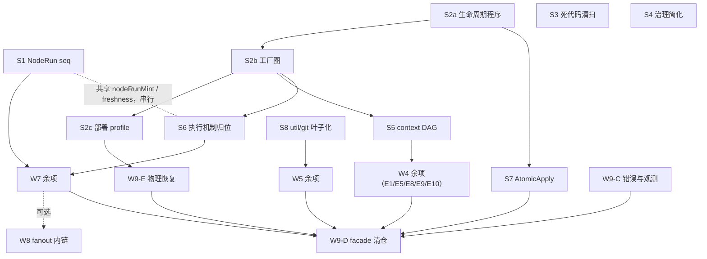

# RFC-294 实施路径：从散点 services 到分层 bounded contexts

> **当前入口（2026-10-16 刷新）**：本 RFC 按用户要求作为长期架构重构总纲维护，整体迁移仍为 In Progress。
> 本次全面审视见 [review-2026-10-16](./review-2026-10-16.md)；下一批后继见 §3。刷新前的完整实施记录（N1～N25 执行队列、
> 各波任务清单、历次 SHA 与 hosted 证据、账本重分桶记录）见 `archive-20261016-plan.md`。当前指标见 dated review 或按需报告；命令见 [status.md](./status.md)。

- 目标架构状态：Approved（D1～D8 沿用；D9 修订、D10～D13 新增，见 proposal §9）。本文刷新不授权任何未立项的后继。
- 迁移状态：In Progress（长期推进）。P0、W2、W3、W4-A/C/E0/E2/E3/E4a/E4b/E6/E7 已关闭；后继 S3（RFC-375）、S4（RFC-376）、S8（RFC-377）已关闭；其余见 §1.1。
- 规划单位：已关闭波次（保留结论）+ 立即整改后继 S1～S8 + 余下波次（W4 余项、W5、W7 余项、W9-C/D/E，W8 可选）。

## 0. 批准边界与实施纪律

1. 批准 RFC-294 只表示批准目标架构与路线；每个后继都须按 CLAUDE.md 先落三件套并获用户批准。
2. RFC-287 已交付的行为是受保护基线；RFC-288 / 289 保持 CLOSED，旧 plan 不得执行。
3. 任何涉及 schema、行为、错误码、恢复或能力面的批次，按范围拆独立 RFC 并列能力影响。
4. 同一冲突面同时只允许一个在制高冲突批（装配根、`nodeRunMint` / freshness、迁移目录、架构生成器）；共享 `main` 上按路径精确
   暂存与提交，不建分支、不用 stash / worktree。
5. 目录迁移逐域进行：旧路径只留一跳无状态 facade，consumer 归零后删除。
6. proposal §6 的立即生效约束 C1～C9 对所有新代码生效；在制 RFC 收口前对账，偏离项逐条呈用户确认。
7. 开发、测试与验证纪律服从 CLAUDE.md 文首硬规则：先完成后继的全部实现与用例，再集中验证；CI 以 GitHub Actions 为准。

## 1. 当前基线与量化口径

当前指标以最近一次 dated review 或 `bun run architecture:report --source-ref <rev>` 的按需报告为准；
[status.md](./status.md) 只保留生成说明。RFC-376 阶段 B 起不再提交全量库存或 provenance 投影。

**architecture-significance filter**：只在 production context owner、public / required 合同、schema / 单写、装配根、
跨 context 边或 worker / lifecycle owner 发生变化时按需审视架构报告；普通提交不要求运行生成器。纯测试 / e2e / fixture、文档、
视觉原语和边角功能只更新质量与行为证据，不给任何波次计 credit。

**退出门的口径（D9 修订后）**：后继的退出门写成“某条结构规则成立”（例如“context 值级依赖无环”“`platform` 不 import
`modules`”“每模块每进程构造一次”），而不是“某份账本的 exact id 计数降到某个数”。RFC-376 阶段 B 后由硬门与文件内精确清单执行；
`counts.json` 允许 measured <= max，抬高 max 须同一提交写明原因，不设增长许可与下一笔退役。

### 1.1 逐波判定（2026-10-16）

| 区域    | 判定                                                            | 已落 / 剩余                                                                                                                                                                                                                   |
| ------- | --------------------------------------------------------------- | ----------------------------------------------------------------------------------------------------------------------------------------------------------------------------------------------------------------------------- |
| P0-A～E | Done                                                            | RFC-342（memory scope move）、RFC-343（Intent apply 恢复）、RFC-333（人工门原子性）、RFC-328（持久 ownership）；RFC-287 Done、RFC-288/289 CLOSED                                                                              |
| W0-R    | 治理基线 Done；**模型修订**                                     | N1 账本与守卫已落；按 D9 改为硬结构门 + 按需报告，由 S4 实施                                                                                                                                                                  |
| W1      | 行为基线保持                                                    | RFC-287 的 assembly 与 G4～G7 行为；assembly 物理归位并入 S6                                                                                                                                                                  |
| W2      | Done（协调器、三路引擎注册、14 类节点注册、WrapperRuntime）     | 引擎与执行器层的实现仍在 composition，由 S6 让各层成为真实层                                                                                                                                                                  |
| W3      | Done（RFC-341）                                                 | 无                                                                                                                                                                                                                            |
| W4      | A/C/E0/E2/E3/E4a/E4b/E6/E7 Done；E1/E9 部分；B/D/E5/E8/E10 开放 | 见 §4.1；B/D 的原计数已归零，退出门改为入站适配器不再深引 legacy 与模块内部                                                                                                                                                   |
| W5      | 部分纵切                                                        | RFC-308/310/321/363 已落 source-control 纵切；`util/git` 环族与 7 条 KNOWN（RFC-370 `166e918bd` 改变环形状时已删一条）由 S8（[RFC-377](../RFC-377-util-git-leaf/proposal.md)）处理；repo / cache / worktree owner 余项见 §4.3 |
| W6      | 开放                                                            | S7：唯一 AtomicApply 引擎 + 唯一资源写入栈 + 持久收敛 claim                                                                                                                                                                   |
| W7      | 开放；**第一刀提为正确性修复**                                  | S1：每任务单调 `seq`；身份轴余项见 §4.5；不再依赖 W5                                                                                                                                                                          |
| W8      | 可选、延后                                                      | 仅 W7 后新号 RFC 获批才进入                                                                                                                                                                                                   |
| W9      | 开放；**A/B 提前**                                              | S2 承接 W9-A/B（唯一模块工厂图与生命周期程序）；W9-C/E/D 见 §4.6                                                                                                                                                              |

### 1.2 已关闭后继索引

| 波次                  | 后继                                                                                | 范围                                                         |
| --------------------- | ----------------------------------------------------------------------------------- | ------------------------------------------------------------ |
| P0-D                  | [RFC-328](../RFC-328-durable-task-execution-ownership-fence/proposal.md)            | 持久 owner / intent / effect / fence 与 exact-token registry |
| W2-A                  | [RFC-331](../RFC-331-task-execution-topology-cut/proposal.md)                       | task↔scheduler 拓扑与 task SCC 族                            |
| W2-B                  | [RFC-332](../RFC-332-task-engine-decomposition/proposal.md)                         | 唯一协调器、仓库准备第 0 步、三路引擎                        |
| P0-C                  | [RFC-333](../RFC-333-human-gate-atomic-park-and-continuation/proposal.md)           | 人工门原子停驻与持久续跑                                     |
| W2-C                  | [RFC-334](../RFC-334-node-executor-registry/proposal.md)                            | 14 类节点执行器注册表                                        |
| W2-D                  | [RFC-339](../RFC-339-wrapper-runtime-cutover/proposal.md)                           | WrapperRuntime 与 Loop / Git / Fanout 策略                   |
| W3                    | [RFC-341](../RFC-341-lifecycle-committed-events-collaboration-commands/proposal.md) | 生命周期已提交事件与协作命令                                 |
| P0-A                  | [RFC-342](../RFC-342-memory-scope-move-correctness/proposal.md)                     | memory scope move 事务正确性                                 |
| P0-B                  | [RFC-343](../RFC-343-intent-apply-recovery-correctness/proposal.md)                 | Intent apply 恢复正确性                                      |
| W4-A                  | [RFC-344](../RFC-344-operation-catalog-transport-cutover/proposal.md)               | OperationCatalog 与 transport                                |
| W4-C                  | [RFC-345](../RFC-345-resource-catalog-contract-cutover/proposal.md)                 | Resource Catalog 与 ResourcePackage 合同                     |
| W4-E7                 | [RFC-346](../RFC-346-system-operations-adapter-cutover/proposal.md)                 | System Operations 管理编排                                   |
| W4-E0                 | [RFC-347](../RFC-347-identity-access-authority-presence-cutover/proposal.md)        | identity-access authority / presence                         |
| W4-E2                 | [RFC-352](../RFC-352-memory-context-cutover/proposal.md)                            | memory context                                               |
| W4-E3                 | [RFC-353](../RFC-353-knowledge-evolution-context-cutover/proposal.md)               | knowledge-evolution context                                  |
| W4-E4a                | [RFC-355](../RFC-355-intent-context-cutover/proposal.md)                            | intent context                                               |
| W4-E4b                | [RFC-360](../RFC-360-runtime-management-context-cutover/proposal.md)                | runtime-management                                           |
| W4-E9（EC provider）  | [RFC-361](../RFC-361-execution-contract-provider-cutover/proposal.md)               | Execution Contract provider                                  |
| W4-E1（合同准备）     | [RFC-362](../RFC-362-task-source-control-launch-contracts/proposal.md)              | Task / SC 启动合同                                           |
| W4-E1 / W5（纵切）    | [RFC-363](../RFC-363-task-source-control-launch-cutover/proposal.md)                | Task / SC 启动与工作区生产切换                               |
| W4-E6                 | [RFC-364](../RFC-364-mcp-runtime-diagnostics-cutover/proposal.md)                   | MCP runtime diagnostics                                      |
| W4-E9（Event target） | [RFC-365](../RFC-365-event-automation-target-providers/proposal.md)                 | Event target providers                                       |
| W4-E9（Reaction）     | [RFC-368](../RFC-368-reaction-execution-cutover/proposal.md)                        | Reaction 执行切换                                            |
| （W7 前置）           | [RFC-369](../RFC-369-node-run-supersession-derived/proposal.md)                     | supersession 推导与唯一铸造的语义改善；不抵扣 W7 身份        |
| S3 | [RFC-375](../RFC-375-backend-dead-code-sweep/proposal.md) | 后端死代码清扫（66 个生产文件） |
| S4（W0-R 模型修订） | [RFC-376](../RFC-376-architecture-hard-gates/proposal.md) | 硬结构门 + 按需报告 + counts.json；全量账本与投影提交退役 |
| S8（W5 一部分） | [RFC-377](../RFC-377-util-git-leaf/proposal.md) | util/git 叶子化；KNOWN_VIOLATIONS 7 → 0 |

各后继的 exact-SHA 与 hosted 证据以其自身三件套为准；本总纲的历史汇总见 `archive-20261016-plan.md` §1、§3.2。

## 2. 每个后继的统一切换协议

1. **Baseline / Oracle**：先锁当前 API、状态、事件顺序、恢复、依赖与异常路径；
2. **Additive contract**：落 domain / application port 与未接线实现，不改生产 writer；
3. **Single-consumer cutover**：一个 consumer / 纵切原子切到新实现；
4. **Facade stabilization**：旧 import 只剩一跳无状态适配，新代码禁止依赖旧路径；
5. **Contract**：consumer 归零且稳定后删除 facade / 旧读者，结构门收紧。

禁止两套独立业务 writer 双写；schema expand 兼容期允许同一 writer 在同一事务维护新字段与确定性的旧投影。禁止以运行时
feature flag 长期双跑新旧引擎。

Schema 批次规则：只 expand，不在同批 drop / rename；回填幂等、可中断、可重复；新旧 oracle mismatch 必须为 0；读者切换可
`git revert`，已应用迁移不回滚；收缩前证明在途 task / resume 兼容；两种 provider 都做 fresh / upgrade 与 schema admission
验证，并覆盖适用平台。已发布的不可倒退数据见 design §16。

Facade 只许 re-export 或参数形状适配；不得含 DB 查询、状态、授权、重试、分支、广播、回退或模块级可变状态。

## 3. 下一批后继：立即整改队列

排序依据见 [review §6](./review-2026-10-16.md#6-刷新后的后继顺序)。每项都是独立 RFC，开工前须用户批准；括号内是
它承接的原波次。

### S1 NodeRun 每任务单调序号（W7-A）

> 后继：[RFC-374](../RFC-374-node-run-sequence/proposal.md)（Done，2026-10-19，`291a5c3f3`）。S1b（所有受支持二进制都晚于 RFC-374 后删除 id 回退）待立项。2026-10-17 研究发现：PostgreSQL 迁移链今天不能给已有表加列，需新增升级种类 V8；`max+1` 与 tasks 计数器都会重开 RFC-369 的同任务冲突，分配改用 identity 分配表；迁移只能接在 RFC-370 未发布的 0259 / 0035 之后，执行时机待用户决定。

- **目标**：消除“ULID 字典序 = 先后”的判据（review F6）。
- **范围**：两种 provider 的 `node_runs` 增加 `seq`；唯一铸造程序在同一事务内分配每任务单调值并保证 `UNIQUE(task_id, seq)`；
  存量行按现有 id 序回填（保持历史判定不变）；`isFresherNodeRun`、domain 与 SQL 两份 supersession、各处 `orderBy(nodeRuns.id)`
  与手写 id 比较改为比较 `seq`；回填完成并稳定后删除 id 回退。
- **退出门**：生产路径不存在按 node_run id 判断先后的比较（结构门锁定）；同毫秒连续铸造与“后铸造行 id 更小”的用例按 `seq`
  得到正确结果；在途任务 resume 兼容；两种 provider 迁移 fresh / upgrade 通过。
- **前置 / 冲突**：迁移编号排在 RFC-370 在制迁移落地之后；与 S6 共享 `nodeRunMint` / freshness，二者串行。
- **能力影响**：无产品能力变化；新旧判定只在原判据出错的情形下不同。

### S2 唯一模块工厂图与生命周期程序（W9-A/B 提前）

> 后继：S2a → [RFC-379](../RFC-379-daemon-lifecycle-program/proposal.md)（Done，2026-10-20，`1faae97cd` + `24b91ba6e`；G12 由程序与 `rfc379-daemon-lifecycle-guard` 落实）。四路只读研究确认：两个 provider 的作业 id 集合相同而后台顺序不同；PostgreSQL 现行启动顺序有四个功能缺陷（MR 终止对账先于孤儿收割、内置工具目录先于模板、托管升级结算早于执行权、运行时注册表与定向续跑竞争）；关停 30 秒宽限从未生效。S2b 拆为七个 RFC 依次推进：[RFC-380](../RFC-380-daemon-module-bundles/proposal.md)（同构模块组每会话构造一次，Done，`99944c201`）→ [RFC-381](../RFC-381-daemon-integration-bundles/proposal.md)（集成、定时任务、融合，Done，`682018fd4`）→ [RFC-382](../RFC-382-daemon-task-execution-bundle/proposal.md)（任务执行组，每会话唯一的任务驱动协调器与实时运行配置，Done，`fddf8bf74`）→ [RFC-383](../RFC-383-daemon-employee-automation-bundles/proposal.md)（数字员工、开发自动化，Done，`e9fcfc58a`）→ [RFC-384](../RFC-384-daemon-intent-bundle/proposal.md)（意图，Done，`1f60faa5d`）→ [RFC-385](../RFC-385-daemon-execution-generation/proposal.md)（执行世代按进程划分，修单机 PostgreSQL 重启后的执行恢复，Done，`f495e8e76`）→ [RFC-386](../RFC-386-task-drive-coordinator-factory/proposal.md)（每次调用的协调器改经工厂：子任务启动与续跑、按意图类型重建工作区排除配置、统一按认领世代的失败上报、子任务沿用会话运行配置，Done，`3450e6872`）→ [RFC-387](../RFC-387-task-continuation-semantics/proposal.md)（门控唤醒、房间续跑、仓库准备重试、融合适配器语义统一，驱动释放收尾，`createTaskDriveCoordinator` 删除，Done，`684972dbb`）→ [RFC-388](../RFC-388-task-execution-runtime-merge/proposal.md)（两个 provider 运行时函数合一，纯重构，Done，`8186c9852`）→ [RFC-389](../RFC-389-maintenance-worker-root-bootstrap/proposal.md)（维护 Worker 根迁入 bootstrap，线程内一张中立图）→ [RFC-390](../RFC-390-neutral-http-binding/proposal.md)（中立 HTTP 绑定：SQLite 改走 `composeProviderAppDeps`）→ RFC-391～392（中立应用图、删除测试回退）；S2c 待立项。

- **目标**：止住装配根的复制与同进程重复构造（review F2、F4），并为托管 profile 提供唯一落点。
- **建议拆分**：
  - **S2a 生命周期程序**：一份 provider-neutral 程序给出启动恢复步骤、runtime / 后台作业工厂与 close participant，两种
    provider 共同消费；测试锁定两者的有序作业 id 清单相同；补阶段、依赖、就绪、健康与停止回执字段；同批删除无生产调用方的
    8 个 timer 启动函数。
  - **S2b 工厂图**：每个模块在一个进程内只构造一次，HTTP / MCP / CLI / worker 共用；SQLite 与 PostgreSQL 的应用装配合并为
    一张 provider-neutral 图（以 `server.ts` 现有的 provider 无关挂载表为起点）；`DefaultTaskDriveCoordinator` 只在 bootstrap
    构造；移除 `deps.x ?? composeX(...)` 形态的测试回退；Worker 根迁出 `platform/`。
  - **S2c 部署 profile**：以类型化的 profile 取代 55 槽 `StartOptions` 覆盖与各模块的 `select*` 助手；消除 `cli/` ↔
    `bootstrap/` 互相依赖；入口根不再按部署模式分支。
- **退出门**：每模块每进程构造一次；不存在 provider 专属或部署专属的装配函数；入口根只做参数解析与 profile 选择；
  后台作业全部经唯一生命周期程序且都有 stop；两种 provider 的作业清单一致。
- **前置 / 冲突**：`server.ts`、`cli/start.ts`、`cli/postgresqlDaemonApplication.ts` 正在被 RFC-370 改动，S2 须在其当前在制品
  落地后串行开工；RFC-370 后续的托管装配直接落在工厂图上。
- **能力影响**：无；以启动 / 关停 / 恢复行为对拍。

### S3 死代码清扫

> 后继：[RFC-375](../RFC-375-backend-dead-code-sweep/proposal.md)（Done，2026-10-17，`0360e116d`）。仍不可达的生产文件只剩 RFC-375 design §4 保留清单（27 个，由 RFC-376 的 G14 入口可达性门锁定）。

- **范围**（逐项以 HEAD 复核后删除，改指相关测试）：development-automation 的 `composition/required-ports.ts` 与
  `ReconcilerPorts.effectExecutor`；digital-employee 的投机 command / query 端口与仅被它们引用的 DTO；collaboration 无人使用的
  public 符号（仅本模块使用的移入 application）；`services/` 中零生产 import 的文件（如 `taskArchive.ts`、`capabilityTemplates.ts`、
  `accountAuthPolicy.ts`）与只被测试使用的再导出；`services/scheduler.ts` 的 `failTask` / `cancelTaskRow`；
  `prepareWorkflowTriggerLaunch`；从入口不可达的生产文件。
- **退出门**：清单内条目删除；从 `main.ts` 与 Worker 入口不可达的生产文件只剩有明确理由保留的条目。
- **前置 / 冲突**：逐文件避让 RFC-370 在制文件。**能力影响**：无。

### S4 治理简化（W0-R 模型修订）

> 后继：[RFC-376](../RFC-376-architecture-hard-gates/proposal.md)（Done，2026-10-17，`3a81b7551` + `19ad368d1`）。G12（两 provider 生命周期清单一致）按设计留 S2a。

- **范围**：落 design §13.1 的硬结构门（新增 context 值级无环、`platform` 不 import `modules`、application 直接 effect、
  composition 禁 drizzle / schema / `node:fs` / `child_process` 的值依赖与 SQL、业务层零部署分支；生命周期清单一致 G12 留给 S2a。
  全部门的初始 allowlist 在 RFC-376 阶段 B 从当时已提交 HEAD 重算，以文件对或符号根计）；把全量库存账本（owner、跨 context 边与 exception、public surface、mutation、
  background / ambient、事务外效、facade、commons、status 投影）降为本地按需报告并停止提交（不新增 CI workflow）；撤销 provenance
  两笔提交协议与 CI 的全历史 checkout 需求；删除增长许可（T17）与按行号编号的条目；修正模块级可变单例与后台作业的计数口径；
  引入 design §13.1 所述的小计数文件。
- **退出门**：普通生产改动不再需要账本伴随提交；每条硬门都有会红的变异测试；报告可从任意已提交源码按需重新生成；
  `docs/dev-gotchas.md` 中只为旧账本机制存在的条目标为历史。
- **前置 / 冲突**：阶段 B 以 RFC-375 / RFC-377 已提交为前置，按 RFC-376 design §9 避让他人 WIP；不再运行旧 census。
  design §3.1 DAG 与 `rfc294Target.ts` 常量同批维护。**能力影响**：无（只改测试与 CI）。

### S5 恢复 context DAG 与 platform 单向依赖

- **范围**：拆除 {collaboration, memory, resource-catalog, task-execution} 与 {development-automation, integration} 两个值级环；
  collaboration 对 task-execution 内部的引用改经 task 拥有的 tx-bound participant；`services/humanGateComposition.ts` 收进
  collaboration 装配；任务生命周期写入序列从 `platform/persistence/sqlite/` 迁回 task-execution infrastructure；工作区 GC 策略归
  source-control / task-execution；退役 `legacySqliteTransportMechanisms.ts` 这类 drizzle / schema 再导出桶；legacy `Actor`
  不再出现在模块 public 合同中。
- **退出门**：context 值级依赖无环且 ⊆ design §3.1；`platform` → `modules` = 0；无 drizzle / schema 再导出桶。
- **前置 / 冲突**：S2b 之后更便宜。**能力影响**：无。

### S6 task-execution 执行机制归位

- **范围与顺序**：见 design §5.5（kernel 机制库 → script 试点 → 其余 kind → fanout / 聚合装配线与引擎编排 → workgroup 与动态
  工作流引擎迁入 task-execution）。
- **退出门**：`nodeMechanics.ts` 删除、`legacyArgs` 消失、`TaskMechanicsState` 只出现在装配、engine 不 import `@/services`、
  `runAssembly` 不再位于 `services/`、协调器只在 bootstrap 构造；task-execution `composition/` 只剩装配。
- **前置 / 冲突**：S2b 之后；与 S1 串行。**能力影响**：无；以现有执行矩阵与恢复 oracle 对拍。

### S7 唯一 AtomicApply 引擎（W6）

- **范围**：`platform/atomic-apply` 提取唯一状态机（以 ResourcePackage 合同为基线），Intent 以 provider 接入；合并两套资源写入栈；
  收敛改为持久 claim / lease 并作为一个作业注册进生命周期程序；fusion approve / skill restore 做故障点对拍后接入或证明不适配。
- **退出门**：lifecycle 实现 1、资源写入栈 1、收敛循环 1；同一非法输入在 Intent、资源包与普通 CRUD 得到同一错误码；
  旧 nonterminal journal 归零后删除旧引擎。
- **前置 / 冲突**：S2a 之后（收敛作业落在生命周期程序上）。**能力影响**：错误码收敛属用户可见变化，须列入口与错误码呈批。

### S8 `util/git` 叶子化与剩余 KNOWN（W5 一部分）

> 后继：[RFC-377](../RFC-377-util-git-leaf/proposal.md)（Done，2026-10-17，`8e09ca089`）：KNOWN_VIOLATIONS 7 → 0，后端 / 全仓值级 SCC 0 / 0。`util/git` 物理迁入 source-control infrastructure 不在 S8，归 §4.3 W5 余项。

- **范围**：把 `util/git.ts` 对 `services/git*` 的动态反向 import 改为参数注入，销 git 环族与两条 util→upper；shared
  `outputKinds` 注册改为注入、frontend 递归渲染改 children / render callback，可作为同批或独立小批。
- **退出门**：后端值级 SCC = 0；`KNOWN_VIOLATIONS` 中上述条目删除。**能力影响**：无。

## 4. 余下波次与退出门

### 4.1 W4 余项

- **B / D（重新定义）**：route→DB 与 `AppDeps` 反向依赖已为 0，原计数退出门失效。新的退出门：入站适配器（`routes/`、`mcp/`、
  `ws/`）不 import `services/`、不 import 模块 application / infrastructure / domain / engine / composition，只调用模块 public
  command / query / operations。2026-10-16 时 59 个 route 文件中仍有 29 个 import `services/`、11 个深引模块内部，按 context 随下面各子波收口。
- **E1 task launch admission**：在 RFC-363 已落的启动 / 工作区纵切基础上，统一 `launch_origin` / 子任务继承、来源终止快照、
  catalog membership 铸造与 `__repo_prep__` 行为；`services/task.ts` 的旧启动路径随 fusion 改走根启动内核后退役。
- **E5 / workspace-insight**：把 `services/structuralDiff/`、`services/codeIntel/`、`services/changeNarrative.ts` 抽成
  `modules/workspace-insight`，接管 `codeWorkspaceRead` 端口；生产切换与 source-control 快照一起完成。
- **E8 development-automation**：把 26 成员可选袋拆为按用例、非可选的 required 端口与 exact provider adapter；
  `services/developmentDeliveryDeps.ts` 迁为 integration 的 provider adapter；mission / config / activity 路由只调 public；
  `code-capability` 的 capability template 写入与历史查询并入 development-automation 后删除该兼容岛。
- **E9 digital-employee / event-center / execution-contract**：在 RFC-361/365/368 已落切片之上，完成路由到 public command / query、
  Event observer 进入生命周期程序、XC 对 legacy agent / workflow / scriptRun 的兼容 seam 退役。
- **E10 task-catalog**：public 查询接 typed query、返回 typed page，不接 full Actor、不返回 JSON 字符串；来源经
  `TaskCatalogSource` 注入。

每个子波的退出门：该 context 的入站适配器与 consumer 不再深引 legacy / 内部；该 context 的 public 合同无投机符号；
全局结构门不回退。

### W4-A Operation catalog 与 adapter parity

Done（RFC-344）：transport 中立的 operation descriptor、HTTP RouteMeta 与 MCP 工具引用同一 operation、API docs 从描述派生、
HTTP / MCP 同输入同结果。细节见归档 plan §8。

### W4-C Resource Catalog

Done（RFC-345）：`ResourceCatalogQuery` summary、四个用途专属 participant、六类聚合命令化、资源包合同。细节见归档 plan §8。

### 4.2 W6

由 S7 承接；退出门见 §3 S7。

### 4.3 W5 source-control 边界

S8 之外的余项：repo / cache / group / worktree / submodule 收编到 source-control；对外只给 opaque `WorkspaceRef` 与快照引用，
删除 composition 路径 binder；task 拥有 prune candidate / claim / final stamp，source-control 只执行物理删除并返回幂等回执；
development-automation 的 candidate / delivery / conflict adapter 改用 opaque 引用。退出门：source-control 相关的跨 context
内部 import = 0，绝对路径不穿 public 合同。

### 4.4 W8（可选）

仅在 W7 完成且新号 fanout RFC 获批后进入；未获批时保留 `fanout-inner-chain-unsupported` 挡板。合同要点见 design §6.4。

### 4.5 W7 余项

S1 之后：`RunRole`、scope / container、`generationSeq`、`attemptIndex`、`shardKey` 与逐边 provenance 的 expand → 写入 →
回填 → shadow → 读者切换 → 删回退（design §6.3）；prompt 正文外置的版本化双读、DevelopmentMission→…→NodeRun 的 provenance
矩阵与 RFC-306 `skipped` / consumed 语义纳入对拍。退出门：每个输入的 producer run 可解释；生产 freshness 不依赖 id 或
nullable parent；两种 provider 迁移通过。前置：W2（已满足）、S1；与 S6 串行。

### 4.6 W9 余项

- **W9-A / W9-B**：由 S2 承接。
- **W9-C 错误、OperationContext 与审计**：domain / application 错误去 HTTP status、唯一 adapter 映射；operation / correlation /
  causation id 贯穿 task / node / event；logger / metrics / audit 端口。
- **W9-E 物理恢复 generation**（独立 RFC）：按 provider 能力分别实现 checkpoint / stage / replace / verify，补齐两种 provider 的
  恢复与失败矩阵；托管 profile 的恢复路径由 RFC-370 承接的部分与之对齐。
- **W9-D facade 清仓**：所有 facade 的生产与测试 consumer 归零后删除；`services/` 只剩到期删除的一跳 facade；更新 code map 与
  onboarding。前置：S2、W9-C、W9-E。

## 5. 依赖顺序

S3、S4、S8 互不依赖，可与其他后继并行，但各自避让正在被改动的文件。S1 与 S2 都受 RFC-370 在制品的文件面约束（§6）。

## 6. 并发与冲突矩阵

| 高冲突面                                                                                             | 必须串行的后继                                 | 备注                                           |
| ---------------------------------------------------------------------------------------------------- | ---------------------------------------------- | ---------------------------------------------- |
| 装配根（`server.ts`、`cli/start.ts`、`cli/postgresqlDaemonApplication.ts`、`main.ts`、`bootstrap/`） | RFC-370 在制品 → S2 → S5 / S6 中涉及装配的部分 | RFC-370 当前大量改动这些文件                   |
| 迁移目录与 `db/schema.ts`                                                                            | RFC-370 在制迁移 → S1 → W7 余项                | 迁移编号单 owner 分配                          |
| `nodeRunMint` / freshness / supersession                                                             | S1 ↔ S6                                        | 同一批只允许一个                               |
| `tests/architecture/*` 与报告脚本                                                                    | S4 与修改同一守卫的批次                        | 按路径避让；RFC-376 后无 census / 投影发布冲突 |
| `scheduler` / `task` / `nodeMechanics` / `wrapperMechanics`                                          | S6 内部逐 kind 串行                            | —                                              |
| intent apply / 资源包 apply / 资源 participant                                                       | S7 独占                                        | —                                              |
| `util/git` / `services/git*`                                                                         | S8 独占                                        | —                                              |
| `design/plan.md` 索引与 `STATE.md`                                                                   | 每次收尾单 owner                               | 只追加本批条目，保留他人内容                   |

发现同文件并发在制改动时停止该切片，在当前会话说明，不 stash / reset / checkout 他人改动，也不向其他 session 发消息。

## 7. 验证栈

按风险逐级选择，不以 LOC 或文件数下降作为完成证据；GitHub Actions 是唯一强制门禁，本地 `gate:local` 只作诊断入口：

1. 受影响范围的纯函数 / oracle 测试；
2. 受影响 context 的完整测试；
3. 架构结构门与依赖扫描；
4. 涉及启动 / 装配 / 生命周期时：二进制构建 + 启动 / 关停 / 恢复集成；
5. 持久化变动：真实 SQLite / PostgreSQL 同一行为套件，迁移时两库 fresh / upgrade，并按平台能力覆盖；
6. 涉及用户流程：真实 E2E；
7. 独立实现门（只审功能）；
8. 精确提交 / push 后按 exact SHA 等 CI 终态，祖先或后继的绿不代替当前 SHA。

文档-only 批次不跑产品测试，但核对链接、RFC 索引、机器解析块（design §3.1 / §3.4）与暂存范围。

## 8. 全计划完成判据

- [ ] proposal AC-1～AC-11 全部兑现；
- [x] 所有 P0 后继 Done；RFC-287 Done；RFC-288/289 保持 CLOSED；W2、W3 Done；
- [ ] S1～S8 Done；
- [ ] W4 余项、W5 余项、W7 余项、W9-C/E/D Done；W8 仅在新能力 RFC 获批时要求；
- [ ] design §14 的终局判据全部成立；
- [ ] 在途 task、历史行、API / MCP / WS 兼容与完整 E2E 有证据；
- [ ] `STATE.md`、RFC 索引、code map 与终态源码一致。

## 附录 A. 旧版章节去向

| 旧版位置                                                                 | 去向                                      |
| ------------------------------------------------------------------------ | ----------------------------------------- |
| §0.1 2026-10-14 对账                                                     | 被本次刷新取代；原文见归档                |
| §1 measurement seed、§1.1～§1.3 已落事实与 RFC-304～337 对账、账本治理批 | 本文 §1.1、§1.2；明细见归档               |
| §3 P0 各节、§3.1 DAG、§3.2 N1～N25 执行队列                              | 本文 §1.2 索引；明细见归档                |
| §4 W0-R、§5 W1、§6 W2、§7 W3                                             | 已关闭；明细见归档                        |
| §8 W4                                                                    | 本文 §4.1 与 W4-A / W4-C 两节；明细见归档 |
| §9 W5、§10 W6、§11 W7、§12 W8、§13 W9                                    | 本文 §3（S1～S8）与 §4                    |
| §14 量化里程碑、§15 冲突矩阵、§16 验证栈、§17 完成判据                   | 本文 §1、§6、§7、§8                       |

源码与测试注释中引用的旧章节号（如“plan.md §8 E8”“§13 W9-D”）均指归档版本。
