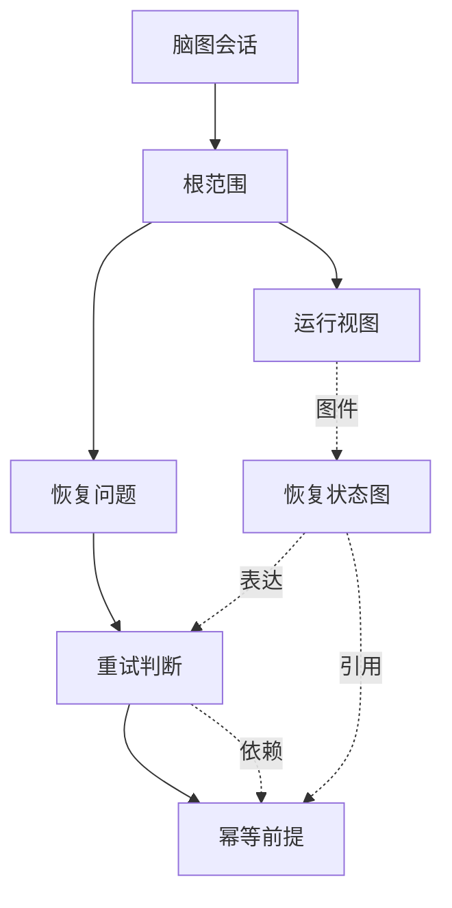
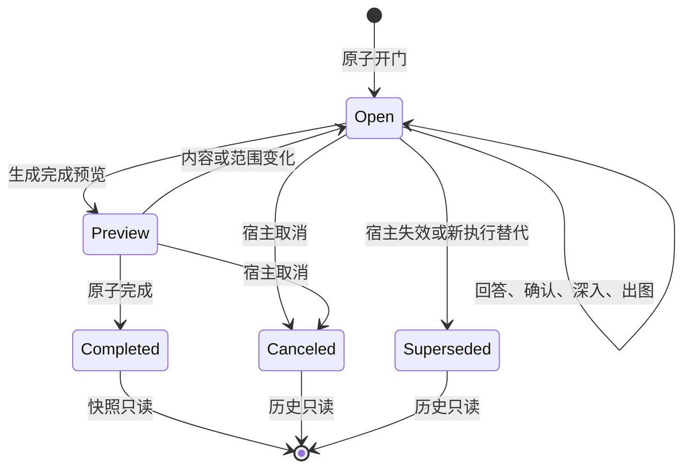

# RFC-372 技术设计：脑图反问与设计交付

> 状态：In Progress；用户已批准实施，生产验收尚未完成。
>
> 日期：2026-10-12，第 5 版。在第四版单一工作区上增加全景脑图；全景与聚焦是同一设计数据的两种视图。
>
> 当前接点复核：`main@540168eceeabe9a70ba6030dbbd5cb8a79db78c2`；原始研究基线 `0d43da993b23d245f3f4fd154c55ef1798642d95`。
> 产品范围见 [proposal.md](proposal.md)，实施顺序与交付状态见 [plan.md](plan.md)，原型行为与验证范围见 [prototype.md](prototype.md)。

## 0. 执行摘要与交接边界

在 Agent Workflow 中增加用户可选择的 **“脑图反问”节点形态**：工作流预置必须讨论的内容与完成要求，AI 在规则内将设计思路组织为可持续递归的判断结构，人可以逐节点回答、修订、深入、核对架构图并确认具体版本。只有适用的必答要求与当前范围均已完成，且用户明确提交，框架才冻结设计快照并恢复提问 Agent。

底层保留现有 `clarify` / `clarify-cross-agent` 节点和系统通道，新增正交的 `interactionMode: 'questions' | 'mindmap'`。节点面板提供“脑图反问”预设；它是具有独立配置和运行界面的反问类型，持久化时共享已有反问节点的执行拓扑。

必须区分三件事：

1. **工作流节点**：参与调度、连线、任务生命周期的 `WorkflowNode`。
2. **脑图节点**：一份反问会话内部的 `MindmapNode`，表达设计内容、问题、判断或视图。
3. **任务问题条目**：现有 `task_questions`，表达问题的指派、执行、处理后确认。脑图节点不能直接当成该执行台账条目。

一个工作流反问节点可以承载数百个脑图节点。脑图深入不会创建对应数量的工作流节点，不会每答一道题就重跑设计 Agent，不会把脑图子树变成工作流 DAG。

本稿与 proposal/plan 构成 RFC-372。第 2～6 章为完整交互规则，第 7～16 章为技术合同，第 17～20 章为实施与验收。用户于 2026-10-12 明确批准按此方案开始实现，并要求取消分支放大、打磨正式画布交互。原输入文档中的执行说明仍仅为参考；实现授权来自本次直接确认。

### 0.1 本设计的关键裁决

| 编号 | 裁决                                                   | 直接结果                                                              |
| ---- | ------------------------------------------------------ | --------------------------------------------------------------------- |
| D01  | 以反问节点交互模式扩展现有节点                         | 复用现有连线、收件箱、任务入口和人类门                                |
| D02  | 递归能力属于每个脑图节点                               | 用户生成的、AI 生成的、视图类节点都可以继续深入                       |
| D03  | 不设置业务层级上限                                     | 用分页、聚焦和单次生成预算控制负担                                    |
| D04  | AI 提案、人的原话、人的确认分别保存                    | 采纳 AI 表述不等于已由人确认                                          |
| D05  | 节点确认、分支范围完成、证据核验彼此独立               | 父节点确认不会覆盖后代，确认事实也不伪装成外部核验                    |
| D06  | 允许探索的 open 分支中，显式深入可直接追加未确认子问题 | fixed 分支的额外探索及已收敛分支先进入候选；已有结论变更仍需审阅      |
| D07  | 已收敛范围中的新问题先列为候选                         | AI 不会让已完成范围无限膨胀                                           |
| D08  | 4+1 视图绑定范围、图源版本和依据                       | 架构图可以继续分解，也能定位回对应判断                                |
| D09  | 图内动作不释放反问门                                   | 保存、追问、确认、出图都不会触发业务续跑                              |
| D10  | 完成走独立 `FinishMindmap` 命令                        | 不伪造普通问卷答案，不调用只适用于问卷的 seal/autoDispatch            |
| D11  | 完成结果与既有 continuation 在一个决定事务中提交       | 刷新、重试和进程重启不会重复恢复工作流                                |
| D12  | 复用当前 CLI runtime 和应用模块边界                    | 不增加独立模型网关、登录体系、项目体系或调度器                        |
| D13  | 工作流保存可递归的分支模板和覆盖要求                   | 多层必答内容由框架建立，不能依赖 AI 是否恰好问到                      |
| D14  | 必答程度与追问方式分别配置                             | required/conditional/optional 与 fixed/guided/open 可组合             |
| D15  | 完成同时检查模板要求与当前范围                         | 删除、归档、移出范围不能消除适用的必答义务                            |
| D16  | 一个持久脑图会话配合多次短 AI 调用                     | 保存不自动调用模型；每次处理一个节点或一个分支的小批内容              |
| D17  | 本次完成与以后再进入分别处理                           | map 使用确切 cycle 的完成记录；不把旧节点级持续 stop 当作脑图完成合同 |
| D18  | 有价值分支经人工整理和差异审阅后明确应用到工作流       | 现有 CAS 保存正式新版本，后续任务使用；运行中的冻结模板不变           |

### 0.2 第三版裁决与修订依据

本版保留第二版的递归、覆盖、三态条件、范围、版本确认、4+1、双 provider、self/cross、恢复与模板回流完整范围；将六项分析建议转为确定合同：

| 编号 | 第三版裁决                                                                                             | 规范位置          |
| ---- | ------------------------------------------------------------------------------------------------------ | ----------------- |
| D19  | 提取稿在应用前独立编辑；明确应用后走现有正式工作流版本保存，没有虚构的第二次发布                       | 4.10、7.1.6、12.6 |
| D20  | 完整设计包永远保留；普通规模全文注入，大图使用人工审阅的交付正文与同快照精确读取；按最终消费者合计预算 | 14.2              |
| D21  | AI 新增、关系、图件与覆盖建议统一使用 existing/new 引用；采纳按依赖单元解析正式 ID                     | 11.2              |
| D22  | 宿主持久化通道、进入与来源继承映射；技术 retry 不推导新周期，来源改变单独检查适用性                    | 8.5、10.8         |
| D23  | 在同一工作区就地确认判断、标准、图件与范围；已展示项可显式组合提交，底层记录仍分开                     | 3.6、12.2         |
| D24  | required 和人的显式 entry 由宿主确定性建立模板骨架；AI 补充是独立 action，失败不撤销已打开的图         | 7.4、10.1         |
| D25  | 首先贯通小模板的真实开门、确认、快照、完成与 asker 续跑，再扩展全部交互                                | 17                |

现状复核发现：工作流编辑器具有本地复合草稿和约一秒自动保存，服务端直接更新正式 definition 并增加 version；没有独立 publish 生命周期。runtime 模型公开查询没有上下文容量字段，材料预算提供方是新增合同。现有校验器禁止同一 Agent 连接多个反问目标，因此不扩展多通道路由。当前 Task provider 的 module/persistence/driver 绑定已较旧基线前进，新增 participants 必须从同一实际 binding 装配。

配置 schemaVersion=2、启动补充 envelope version=1、工作流写入版本、模板语义版本和文档修订号各自独立。旧 85 条验收保留编号并更新受影响语义，累计新增 U01～U27；本稿共 112 条目标用例，均不代表已运行。

### 0.3 第四版：一个工作区贯穿设计与确认

按用户本轮三项反馈调整信息架构：取消独立审阅清单；整棵树所有适用义务有效满足即显示“审阅完成”，不再让用户在另一页重复审阅。大树采用分支聚焦、同层分段、祖先路径、全局定位和后端聚合，禁止一次挂载全树。取消独立“完成与交付”页面：完成前用工作区内简短确认，完成后用原任务状态及可恢复的异常处理面板。底层版本确认、不可变快照和 delivery 命令继续保留，它们不等于用户必须经过的页面。

## 1. 仓库现状与接入依据

以下是已经核对的基线事实，来源索引见第 21 章。后文未冠以“现有”的结构是本 RFC 的新增设计。

| 现有能力                                                                 | 源码依据                                                                        | 对本设计的约束                                                         |
| ------------------------------------------------------------------------ | ------------------------------------------------------------------------------- | ---------------------------------------------------------------------- |
| `clarify` 与 `clarify-cross-agent` 已是工作流节点                        | `packages/shared/src/schemas/workflow.ts:736–867`                               | 交互形态与 self/cross 路由职责应正交                                   |
| self 反问使用固定 `questions` / `answers` 系统通道                       | `packages/shared/src/nodePorts.ts`；`schemas/workflow.ts:746–753`               | 保留端口名和连线语义                                                   |
| self 问卷默认最多 5 题，题型为 single/multi，另有自定义文本              | `packages/shared/src/schemas/clarify.ts:20–105`                                 | 新脑图不套旧问卷题数和题型限制                                         |
| 现有解析器对超量问题有截断及警告；cross 有单独的无题数截断入口           | `packages/shared/src/clarify.ts`                                                | “每轮 5 题”不是全部路径都严格同形，不能全局改一个常量当作脑图实现      |
| `sessionMode` / `sessionModeForQuestioner` 控制 isolated/inline 执行会话 | `schemas/workflow.ts:756–864`                                                   | 不把 `mindmap` 塞进执行会话枚举                                        |
| 统一反问记录是 `clarify_rounds`，带提问 run、中介 run、轮次与来源        | `schemas/clarify.ts:386–515`；backend `infrastructure/clarifyRounds.ts`         | 脑图必须绑定确切 round/run，不能只绑定 workflow node ID                |
| `/clarify/$nodeRunId` 已承载 self/cross；已有协作草稿和 WS 刷新          | frontend `routes/clarify.detail.tsx`、`hooks/useClarifyWs.ts`                   | 在原路由内按模式呈现，保留现有导航与协作能力                           |
| `task_questions` 已有分派、暂存、执行和处理后确认                        | backend `infrastructure/taskQuestions.ts`；frontend `TaskQuestionList.tsx`      | “设计判断确认”不能复用“处理后确认”的状态机                             |
| 旧 seal 遇到空问卷会抛 `clarify-seal-empty`                              | backend `modules/collaboration/infrastructure/clarify/seal.ts:278–289`          | 脑图完成必须有独立内容策略                                             |
| 已有人工门决定事务、operation receipt 与 durable continuation            | collaboration `clarifyDecision.ts`、task-execution `acceptHumanGateDecision.ts` | 复用持久化续跑机制，不能在 HTTP 路由里自行 mint/resume                 |
| frontend 已有 React、xyflow、dagre、Mermaid、TanStack 与 i18next         | `packages/frontend/package.json`                                                | 不新增一套脑图或图表基础栈                                             |
| 当前数据库业务实现通过 provider-neutral 会话访问                         | backend `db/providerSchema.ts`、`platform/persistence/`                         | 同时覆盖 SQLite 与 PostgreSQL，不写两套业务算法                        |
| RFC-294 要求 feature-first 模块、明确 public/required ports              | `design/RFC-294-backend-layered-target-architecture/`                           | 领域放 collaboration，运行接 task-execution，不能继续横向堆新 services |

注意：部分历史设计文档及源码注释仍描述较早的 self/cross 行为。以基线实际调用链为准。例如当前回答默认恢复提问者；“让上游设计者改动”已有独立指派语义，不能因节点名含 cross 就恢复为历史上的“自动重跑设计者”。

### 1.1 为什么选择交互模式字段

`clarify` / `clarify-cross-agent` 区别的是连接和结果路由；`questions` / `mindmap` 区别的是人如何组织和确认设计。两者可以组合。

新增 `kind: 'clarify-mindmap'` 会迫使端口注册、节点执行器、拓扑分类、导航、序列化和跨 Agent 变体重复表达同一套路由。采用模式字段仍然能在产品上提供一个清晰的“脑图反问”节点，同时保留已有执行结构。

模式切换只作用于编辑中的工作流定义和之后的新任务。已启动任务使用冻结的定义；已打开的普通问卷不会被编辑器的模式切换自动迁成脑图。v1 不提供对已提交历史问卷的原地模式转换。

## 2. 产品目标、范围与验收原则

### 2.1 目标

核心目标是让人的判断成为设计内容的一等数据。AI 应帮助人发现缺口、表达权衡、找到反例、维护结构；用户应能清楚看到“哪些是我说的”“哪些是 AI 推导的”“哪些我已经确认”“这个判断在什么条件下成立”。

形成以下完整循环：输入设计意图 → 建立初始维度 → 选择任意节点 → 表达自己的判断 → AI 提取/反问 → 新问题继续递归 → 修订相关判断 → 核对架构视图 → 确认当前范围 → 交付冻结设计。

### 2.2 v1 必须交付

- 工作流中的“脑图反问”预设、inspector 配置、运行时入口和收件箱识别。
- 递归预置分支、必答/条件必答/可选要求、固定/围绕清单/开放追问；任意节点的多层递归。
- 可聚焦脑图、面包屑、树形大纲、节点详情与明确的版本状态。
- 人的原始输入、AI 提案、人工采纳、版本确认和操作历史。
- 回答驱动的追问；澄清含义、拆解、比较方案、检查反例、提出验证任务。
- 范围收敛、候选问题、明确的延后/不适用处置及依赖影响提示。
- 根范围和子范围的 4+1 视图节点，Mermaid 图源、预览、依赖与人工确认。
- 服务端持久化、多人/多标签页更新、异步生成的过期结果处理、取消和恢复。
- 完成预览、冻结 Markdown/JSON/图源、向提问 Agent 注入结果并续跑。
- self 与 cross 共用脑图内容能力；保持其现有执行范围和连线限制。
- 原问卷模式及其草稿、题数、提交、指派和历史行为的回归保护。
- 运行中的有价值分支经人工整理、差异审阅后沉淀为工作流预置；明确应用并保存工作流新版本。
- 明确的脑图完成、暂停、取消生成与重新进入；默认不因完成后的业务续跑自动再开一轮。

### 2.3 v1 不承担的工作

不新增独立设计项目管理平台，不引入新的账户或角色体系，不把所有工作流或 workgroup 人工交互自动切换成脑图，不实现多人同时拖动的 CRDT 编辑，不在本 RFC 自动修改/提交目标仓库代码，也不把深层追问变成自动执行验证脚本的许可。

已有 workgroup、动态工作流和单 Agent 任务中的普通反问保持现状。只有任务启动快照中明确选用脑图模式的反问节点走本路径；该节点在宿主已经支持的 wrapper/frame 中复用现有能力，不扩大宿主本来不支持的连接方式。

### 2.4 产品成功不按问题数量衡量

有用的指标包括：需要判断的节点中，有多少保留了人的具体结论；关键决策有多少记录了理由、成立条件和未选方案；完成后需要返工的判断及原因；人是否能解释某张图为什么这样画。

层数、生成问题数、点击确认数仅用于观察交互负担。它们不能作为“思考充分”或“设计正确”的替代指标。v1 的测试证明系统能承载判断和追溯，不声称证明它提升了所有场景的设计质量。

## 3. 概念模型与操作入口

### 3.1 核心对象

| 对象                | 含义                                     | 身份边界                                            |
| ------------------- | ---------------------------------------- | --------------------------------------------------- |
| MindmapSession      | 一次脑图反问门的持久化内容空间           | 绑定一个确切 `clarify_rounds.id`                    |
| MindmapNode         | 一个可继续深入的内容单元                 | 稳定 ID，与深度和标题无关                           |
| HumanInputRevision  | 人在节点上提交的一版原始回答             | 原文不可被 AI 覆写，编辑产生后继版本                |
| Proposal            | AI 对新增问题、解释、关系或图的建议      | 可采纳、拒绝、过期；不能代表人的确认                |
| NodeConfirmation    | 人对具体节点版本及有效上下文的确认       | 记录确认者、时间、版本与前提                        |
| ScopeBoundary       | 用户声明的某段子树的当前讨论范围         | 根范围默认存在；子系统可独立收敛                    |
| ArchitectureDiagram | 某视图中的一个有版本图件                 | 绑定图源、图中元素映射和依据版本                    |
| MindmapSnapshot     | 本次完成时冻结的设计                     | 内容不可变，供导出与业务续跑读取                    |
| MindmapAction       | 一次 AI 辅助操作                         | 有请求、上下文、运行记录和结果状态                  |
| BranchTemplate      | 工作流冻结的递归分支与提问/覆盖规则      | 稳定 template key，属于明确模板版本                 |
| CoverageRequirement | 一个模板分支或准则在本次执行中的覆盖要求 | 与运行节点的 ID 分开，不能靠删节点删除义务          |
| MindmapCycle        | 本次业务执行范围的一次澄清准入与完成记录 | 关联确切 round；回答后的业务重跑和技术 retry 继承它 |

### 3.2 用户入口

1. 在工作流节点面板拖入“脑图反问”，自动形成 `kind: clarify, interactionMode: mindmap` 的配置；可通过既有机制挂接提问 Agent。
2. 使用跨 Agent 反问时，在该节点 inspector 中选择脑图模式；保持原 questioner / consumer 连接方式。
3. 任务等待反问后，任务画布和收件箱均显示“待完善脑图”，点击进入原反问详情路由。
4. 任务的问题清单呈现“设计脑图”摘要入口，显示适用必答覆盖数、待确认/待复核/范围外候选数量；不将其加入现有待指派队列。
5. 已完成任务或历史轮次可只读查看当时的脑图和冻结输出。

### 3.3 工作区

同一工作区提供“全景脑图 / 聚焦工作区”两种视图，切换不产生新的审阅阶段。以下三块区域属于聚焦视图，复用现有页面和面板原语：

- 左侧：分支导航、虚拟化树形大纲、全局搜索和待处理定位。每个分支显示包含未加载后代的状态聚合。
- 中央：当前分支的局部脑图。默认焦点加一层直接孩子；可展开第二层但共用节点/边预算，广分支分段读取，深分支点击进入并用祖先路径返回。聚焦视图的缩放只作用于当前局部；另用第 3.8 节全景视图完整展示整棵树的空间结构与状态。
- 右侧：选中节点的原话、当前结论、理由、依赖、证据、图件与就地确认。相关完成标准和范围确认跟随节点呈现，不要求转入独立审阅页面。

窄屏把大纲/脑图/详情切换为同一工作区的页签，保留选中节点。大纲提供完整的键盘操作路径，不能要求用户必须操作二维画布才能完成设计。

顶部显示任务、提问 Agent、反问节点、当前 round，以及“已保存/仅本地草稿/保存失败”。全局进度来自整棵树的权威聚合，与当前页面加载量分开。“下一项待处理”直接定位任意深度的未解决项。“完成澄清并继续工作流”只在全局审阅完成后可用，点击打开同工作区的简短确认，不导航到交付页；不能与节点上的“继续深入”共享提交处理器。

### 3.4 工作流作者怎样配置

选中已有 self/cross 反问节点，在 inspector 选择“问答形式：普通问答 / 脑图问答”。选中脑图后展开“启动要求、预置脑图、分支追问规则、完成要求、AI 批量、完成后的业务会话”六组设置。inline/isolated 只出现在最后一组。

“编辑预置脑图”打开较大的树/脑图模板编辑器，支持任意深度新增子分支；右侧设置必答程度、适用条件、问题与选项、完成标准、允许的探索方式和视图要求。默认从“软件架构设计”基础模板开始，作者可以修改；不强迫作者用一段长 prompt 表达所有层级和规则。

为确定性设计节点，默认 `activation=required`。需要 AI 按需决定是否开图时才选择 on_demand；含强制必答或条件必答要求的模板不得选 on_demand。模板确定要检查的内容不能被模型在开门前绕过。高级设置收纳条件表达式、结构深度、再次进入策略和运行预算。

### 3.5 运行中的按钮与原“继续/停止反问”

questions 模式保持原按钮。mindmap 模式使用以下明确动作，不原样暴露旧 continue/stop 二选一开关：

| 所在位置/意图                  | 操作名称                         | 影响                                                           |
| ------------------------------ | -------------------------------- | -------------------------------------------------------------- |
| Task 画布、收件箱              | 打开脑图 / 继续完善              | 进入同一 round/session，不新建一轮                             |
| 按需未发起、宿主允许启动的节点 | 发起脑图澄清                     | 提交显式 entry request；即使 on_demand，本次也明确要求建立脑图 |
| 选中节点                       | 继续深入；fixed 分支显示额外探索 | 按本分支策略生成，或显式探索候选                               |
| 分支范围                       | 确认本分支已覆盖                 | 检查覆盖与范围，不代替子节点确认                               |
| 暂时离开                       | 保存并稍后继续                   | 保存现场，当前人工门继续等待                                   |
| 正在生成                       | 取消本次生成                     | 只取消当前 AI action                                           |
| 整份脑图                       | 检查完成条件                     | 返回可定位的必答缺口、待复核和图件问题                         |
| 整份脑图                       | 完成澄清并继续工作流             | 检查、预览、人工提交并冻结结果                                 |
| 已完成且宿主允许重新执行       | 发起新一轮澄清                   | 创建新 cycle/round，可基于旧快照，不改旧结果                   |

如为习惯保留“停止反问”快捷入口，它只能导航到完成检查，不直接修改旧 stop store。运行摘要示例：“必答 8/10 · 待复核 2 · 候选问题 3”。候选与强制缺口分别计数，用户能看到真正阻塞完成的内容。

### 3.6 工作区即审阅界面

工作区默认选择第一个适用必答 blocker。顶部只展示必答覆盖、待复核和范围外候选；详情按“问题与目的 → 你的判断 → 当前表述/理由 → 本次审阅 → 可选 AI 帮助”排列。AI 提案不预选，版本号/绑定/历史收进可展开区域。大纲与二维脑图使用同一选中节点和状态；窄屏切换大纲、脑图、详情页签，保留内容与焦点。

节点详情中直接展示并确认当前判断；human_review 标准、图件和范围分别在其所属节点内确认。确认后卡片、祖先分支和全局状态同步更新。不能把父节点自身的绿色当成整个分支已完成：父卡同时显示“本项已确认 / 后代仍待处理 N 项”。分支只有自身和全部适用后代义务满足才显示“分支完成”。候选、明确范围外和条件不适用可为灰色，但必须有正确的范围/条件依据；条件未知、适用必答缺口、过期确认和未核验的必需证据均阻塞全局绿色。

全局“审阅完成”对应第 10.5 节第 2～9 项内容义务及稳定性条件，覆盖要求、标准、实质深度、图件、证据、范围和条件，不包含用户尚未点击的完成提交及交付预算。聚合未知、过期或重算中时显示“正在核对”，不沿用绿色。绿色只说明设计审阅结束；用户仍明确点击完成，才冻结快照并继续工作流。完成确认只展示采用范围、尚未纳入的候选和接收对象，不要求把已确认内容再勾选一遍。

可选的“确认当前展示项”属于工作区局部工具。用户明确选择实际看到的节点判断、human_review 条目、图件表达和范围声明，默认不勾选；不得提供一键确认未加载后代。需要组合提交时，PrepareReviewSelection 按依赖顺序模拟结果，返回初始 read set、模拟后每项的完整表述/依据/hash、执行顺序与 preview digest；在当前详情中展开这些最终确认结果，再点击“确认所选 N 项”提交 previewId/digest。提交核对初始基线后全部成功才落各自原有记录；不得用提交时的新 hash 替换用户未见依据。普通单项确认沿用独立命令，不为每项增加重复预览步骤。保存不是确认，完成预览也不自动选项。

纯 group 的标题/范围表达可与对应 ScopeBoundary 放在同一张明确审阅卡内；它们仍是两个记录。要求不同的技术判断不会因处于同一卡片而合并。一个原答若已能直接用作当前表述，允许用户选择“使用我的原话作为表述”，避免被迫调用 AI；这个明确采纳动作仍不代表确认。

确认失败指出具体条目和版本变化，整批不产生部分成功。人工可以取消选中一项后重新审阅，不会丢原答。修改上游前提后提供原因链与逐项复核入口，保留其他已有效确认。

### 3.7 完成动作和任务状态，不增加交付页面

全局审阅完成后，简短确认展示本次范围、候选排除摘要和实际接收对象；正常情况下明确“完成并继续”即可。系统自动构造设计包、选择合同允许的材料方式并准备续跑。本文中的 finish-preview 是数据合同，不意味着完整的独立页面或新审阅环节。

完成后工作区切为只读，在原位置显示“设计已完成 · 已安排执行 / 等待其他来源 / 需要处理材料”等实际状态，保留快照、历史与任务执行入口。等待外部来源仅显示可解释状态，不把无可执行动作的等待包装成让人处理的待办。材料超限、容量未知或新来源需核对时，从该状态条打开同工作区的处理面板，调用第 14.5 节可恢复命令；人可以关闭后稍后继续，已完成设计不重开。高级包引用、预算来源和诊断信息按需展开。完整导出从只读工作区获取，不另设“交付页面”。

### 3.8 全景脑图：一张连续画布看完整设计

全景以设计目标为中心，主要维度分布在两侧，父子连接形成整棵脑图。它和聚焦视图共享 session、节点身份、选择、草稿、确认与全局状态；视图切换不是复制设计。用户可把全景作为自己的默认入口，个人视口偏好与设计语义版本分开保存。

- **一张图**：全树在同一连续坐标空间内有位置；平移、缩放和“适应全图”不跳到另一页。小图可直接看到全部节点标题；大图在远景显示所有节点/分支的轻量状态标记，近景逐步出现可读标题和详情。正文不必在远景铺满，不能把只加载首批分支伪称为完整全景。
- **看状态**：绿色为该分支全部适用义务满足；橙色“需深入”来自明确缺口（必要内容、条件、标准等尚欠），蓝色“待确认”表示已有表述仍待人的确认，紫色“需复核”表示依据变化使旧确认失效，灰色为未纳入或有依据的不适用。颜色配文字及标记形状，不依赖色觉。AI 建议可进一步探索不等于必答缺口，归入不阻塞完成的候选。
- **混合分支**：分支显示完整后代的各类数量；主标色按需复核、需深入、待确认、已完成的显示优先级决定，完整计数始终可读。父节点自己已确认而后代有缺口时不画成绿色分支。未知/陈旧聚合显示“核对中”，不能当成完成。
- **只看待处理**：默认仅降低已完成分支的视觉强度，保留其位置和连接，不删除它们造成空间跳动，也不改变全局分母或完成判定。
- **从总览到处理**：单击节点显示当前判断、未完成原因和下一步，保持当前缩放与位置；不提供“放大此分支”，双击不改变视野。用户可在同页详情确认已经展示的具体内容，或切到聚焦工作区继续写判断和深入。返回全景恢复视口及选中节点，状态同步更新。
- **大量内容**：全景缩放采用语义层级，不把文字无限缩小；保持可读字号、碰撞避让和选中项标签。低倍率下不显示全部正文，用户放大或选择即可读取同一个节点。小地图始终表示完整结构，框出当前视口；鼠标拖动、缩放按钮与键盘可操作的分支选择/节点搜索提供等价路径。触屏支持拖动和双指缩放，滚轮缩放需有明确提示并避免无意截获页面滚动。

正式交互要求：空白拖动、空格加拖动及中键平移；按指针位置缩放，支持触控板与双指；拖动越过阈值后不触发选择。节点选择、确认、正文保存、状态更新与视图切换不自动 fit；搜索只在目标不在视口时平移使其可见，保持倍率。首次布局和明确的“适配全图”才全图适配。个人相机与选中态跨视图保留；异步布局更新维持选中锚点。键盘可用大纲/搜索和缩放控件完成等价操作；文字输入期间不截获快捷键。

全景不引入“全部确认”或根据视觉密度自动判断完整度。完成动作继续使用同一审阅事实、第 10.5 节投影和原子命令。

## 4. 递归脑图的产品规则

### 4.1 所有内容节点都可以继续深入

`group`、`question`、`decision`、`fact`、`assumption`、`view` 均可有子节点。节点类型表达内容用途，不代表固定层级。例如问题下面可以继续有问题；视图下面可以有子视图、设计约束和场景问题。

在 open 会话中，每个未归档节点至少提供：编辑、补充原始判断、继续深入、手动添加子节点、查看关联、确认当前版本、查看历史。已确认节点仍能深入；确认不会冻结探索能力。completed/canceled/superseded 会话只读；完成后继续设计通过基于旧快照的新会话承接。

模板的 fixed 约束默认 AI 不增加清单外议题，不限制数据结构继续生长。人在 fixed 分支仍可手动新增，或显式选择“额外探索”生成 proposed 子问题；这次动作不改工作流模板，也不改变已有必答义务。

例：可靠性 → 失败恢复 → 执行结果不确定 → 重试资格 → 幂等保障 → 外部接口无幂等键 → 对账证据 → 人工决策权限。数据模型不能预设“维度/问题/答案”三层后就不能再有孩子。

### 4.2 继续深入是一组操作

| 操作          | 用户想解决的问题       | 主要输出                   |
| ------------- | ---------------------- | -------------------------- |
| 澄清表述      | 这句话具体是什么意思   | 术语、边界和条件问题       |
| 继续拆解      | 这件事还由什么组成     | 子能力、约束或子决策       |
| 比较方案      | 哪些选择还没有判断     | 平行方案、代价与选择依据   |
| 检查反例      | 什么时候这条结论不成立 | 失败场景、冲突假设与追问   |
| 设计验证      | 怎样知道这个前提成立   | 可执行的核验计划与所需证据 |
| 总结分支      | 我们目前到底决定了什么 | 可审阅的分支摘要提案       |
| 生成/更新视图 | 这些判断如何表达成架构 | 有引用的图件提案           |

默认“继续深入”让 AI 根据未解决缺口选择恰当方式，并返回选择该方式的简短、可见理由。用户可以指定其中一种。可见理由是产品解释，不请求或保存模型隐藏思维过程。

### 4.3 回答必须改变后续追问

同一个“执行超时后如何处理”节点：

- 用户选择“暂停等待人工确认”，下层应追问暂停条件、证据、接管角色、恢复条件。
- 用户选择“自动重试”，下层应追问幂等前提、重试资格、重复执行边界、终止条件。
- 用户回答“不确定外部接口是否支持幂等”，应先建立待核验事实/假设与核验问题；不能假定支持后继续设计。

不得仅根据节点标题从固定模板复制同一组下级标题。每个新问题保存 `whyAsked`、`resolvedWhen` 和所依据的输入/节点引用。

### 4.4 追加规则

| 发起方式与范围                                   | 新增子问题如何进入脑图                                   | 是否改旧结论           |
| ------------------------------------------------ | -------------------------------------------------------- | ---------------------- |
| guided/open 分支中用户显式深入，最近范围仍 open  | 校验后的新子问题自动追加为 current、unconfirmed          | 不允许                 |
| fixed 分支中的普通清单检查                       | 补充已有问题的表述/缺口建议，不自动追加新议题            | 不允许                 |
| fixed 分支中用户显式选择额外探索                 | 新增内容为 proposed；可人工纳入                          | 不允许                 |
| 用户显式深入，范围已经 baselined 或 needs_review | 追加为 proposed，用户决定是否纳入当前范围                | 不允许                 |
| AI 后台发现可补充内容                            | proposed；可以在候选区预览                               | 不允许                 |
| AI 建议改已有结论/依赖/图件                      | 保存 Proposal，展示差异后人工采纳                        | 只有采纳操作可生成新版 |
| 用户手动创建/编辑                                | 按用户明确操作保存，形成新版本                           | 可以；保存后仍需确认   |
| 已确认的条件变化激活预置必答分支                 | 由框架将适用必答节点及祖先链纳入 current；相关范围需复核 | 不替人修改答案或确认   |

点击“继续深入”已经表达对新增问题的意图，所以 guided/open 且范围 open 时的纯追加不再二次要求“确认让 AI 生成”。如果结果同时包含旧节点改写，必须拆成追加结果与独立改写提案。模板条件激活是确定性覆盖规则，不受 AI 候选策略抑制；不能将新激活的必答内容留在 proposed 来维持表面完成。

新增节点必须有稳定 ID；标题相同不是同一身份。系统只用 `actionId + proposal item ID` 保证重试不重复插入。语义相似问题给出合并建议，不自动吞掉内容。v1 支持人工标记为重复并引用保留节点；不要求自动语义合并。

### 4.5 聚焦、移动与归档

双击或“进入该分支”将任意节点作为视口焦点，顶部保留根到当前节点的面包屑。返回上层恢复上次布局与选择。搜索可以命中未渲染的深层节点，定位时按祖先链展开。

拖动位置仅改变布局。改变父节点是独立“移动分支”命令，先列出原/新范围、继承约束和受影响的依赖；确认后更新包含关系。禁止移动到自身后代，禁止产生多父包含关系。引用关系允许跨分支。

删除采用归档：保留历史、来源和引用。归档有当前依赖或未完成节点的子树时，界面展示影响并要求用户明确处理去向。恢复归档内容不会自动恢复已过期确认。

### 4.6 范围收敛

“还可以追问”不等于“本次必须继续”。每个范围边界有一段用户可审阅的范围说明，列出本次包含什么、排除什么、还有哪些已知后续问题。

范围内节点成员状态为 `current / proposed / excluded`；适用状态另用 `active / inactive / unresolved` 表达。有效 current 是 membership=current、activationState=active 且未归档的节点，进入内容完成统计；整轮完成还必须独立检查冻结模板的全部适用必答要求。proposed 在界面中真实可见，但不会自动阻塞完成；完成预览必须列出尚未纳入的候选数量和内容入口。模板必答要求不能靠改变 membership 删除；条件待明确骨架也不能混进普通候选计数而被忽略。

用户可将可选问题延后，但必须说明原因并明确是否移出当前范围。仅按“稍后再答”不会把 current 节点算成已确认。适用必答项不能仅靠延后/排除完成；只有模板允许且有依据的不适用处置可以解除相应义务。若有其他 current 判断依赖该内容，必须先解决该依赖，或由人将其明确改成带成立条件的假设。

分支“已覆盖当前范围”表示：当前成员集合及其处理情况已经过人检查。它不表示今后不能新增问题，也不自动确认分支内的任何节点。

### 4.7 嵌套范围的唯一计算规则

范围判断由服务端纯函数计算，客户端复用同一规则或直接读取其投影。不能由当前画布焦点推断完成集合。

1. 根节点默认拥有根范围；每个节点最多是一个 ScopeBoundary 的根。`node.scopeId` 指向它自身或祖先链中最近的范围边界。`create_scope` 在选中节点建立边界，重算其后代的最近归属，遇到已有子范围继续保留那个更近的边界。
2. 包含树中的有效 current 必须祖先闭合：有效 current 后代不能藏在 proposed/excluded/archived 或未激活的祖先下面。排除或归档分支时，命令必须携带界面已展示的受影响子树版本，并原子处理后代；纳入深层节点时，明确展示并纳入必需祖先链。服务端拒绝会留下孤立 current 后代或绕过必答覆盖的写入。根本身始终 current/active，不能归档或移动。模板条件的 false/unknown 可使整条受控路径暂不参与内容统计，但独立覆盖要求继续存在。
3. 一个范围的 **本地成员** 是最近归属为该范围的节点；其 **汇总成员** 是范围根下所有有效 current 节点，包括嵌套范围，按节点 ID 去重。父范围汇总包含子范围，但不把同一个节点计算两遍。完成永远从会话根计算汇总集合，检查其中每个 current 节点及每个被包含的范围边界。
4. 节点生成策略看最近的范围。根范围 open、子范围 baselined 时，在子范围中深入仍产生 proposed。`needs_review` 表示曾建立的基线已失效，继续按候选策略工作；用户明确重开该范围为 open 后，后续显式深入才自动纳入。祖先范围的 open 不会隐式重开已收敛的子范围。
5. 范围说明、有效 current 成员、适用条件、已收敛成员的有效处置、子范围的覆盖声明发生变化，更新相关范围 revision，并将受影响的既有基线投影为 needs_review；仅新增 proposed 不改变当前成员基线。布局、排序和视口不改变范围。`currentMembershipHash` 使用确定排序后的汇总成员 ID；范围基线另保存成员有效状态、适用性依据及子范围基线摘要。条件激活必答项是确定性规则变更，即使最近范围已 baselined，也要原子纳入 current 并失效相关基线。
6. 移动子树必须原子重算 parent/placementRevision、最近 scopeId、相关范围成员与继承约束。只有有效约束或显式前提实际变化的节点确认需要复核；跨范围移动本身不机械撤销整棵树的确认。被移动的 ScopeBoundary 跟随其根移动，不能留下悬空范围。
7. `session.scopeRevision` 是范围/成员/基线变更的会话级汇总版本，供完成候选校验；每个 ScopeBoundary 同时保留自己的 revision。普通节点操作只校验实际相关范围，不因无关范围变化而全部冲突。完成必须检查所有被包含子范围的当前基线，不能只检查页签中选中的一个范围。

范围基线是人对“本次覆盖到哪里”的声明，可以先于各节点确认建立；成员随后改变或其中已确认判断失效时，基线需要复核。所有 current 判断均有效且所有被包含范围均 baselined，才满足整轮完成条件。建立父范围基线不代替子范围基线，也不替代任何节点确认。

### 4.8 预置要求与实际脑图分别保存

工作流保存递归分支模板，运行时建立模板要求与脑图节点的明确映射。框架按冻结模板建立完整结构并计算适用性；AI 只补充问题或提出对照建议。不能让模型是否生成了某个标题决定必答要求是否存在。

模板节点具有稳定 template key；一个运行节点可以经明确映射满足多个要求，但标题相同不自动认为已覆盖。原始模板要求保留独立身份和历史，移动运行节点、把回答整理到另一分支、归档原节点都不会删除要求。替换对应节点时先显示哪些要求会改用新依据，并由人确认；缺失依据显示缺口。

required/conditional/optional 与 fixed/guided/open 是两个正交维度。固定清单保证预置内容存在；围绕清单深入根据人答发现条件和反例；开放探索允许新增关注方向。AI 不得把必答降为可选、把条件未知改为不适用、修改模板要求，或直接把覆盖状态设为满足。

### 4.9 条件、深度与完成标准

条件读取被人确认且当前仍有效的稳定选项/类型化事实，并组合成 true/false/unknown。自由文本中疑似表达的条件只能由 AI 提议，经过人明确保存和确认后才能参与确定性激活。引用的题干、原答、判断或事实已失效时，条件回到 unknown。

true 激活适用要求；false 保存依据并标为条件不适用；unknown 产生待澄清条件。条件必答的 unknown 本身就是完成 blocker。祖先适用条件向下合并，false 可使子树本次不适用，unknown 不能让必需后代被跳过；optional 父节点不能隐藏一个适用 required 后代，其必需祖先链仍要可见和可处理。

模板条件未满足的节点可以提前建立并折叠，显示“条件待明确”或“本次不适用”；它们默认不计入 current 内容统计。覆盖查询仍读取其独立要求和条件状态，不能因 UI 暂未展示或 membership 为 excluded 就漏掉 unknown 的强制要求。用户改变条件后，系统在同一命令提交中重算适用性、成员集合及受影响范围基线。

深度优先由递归问题结构和完成标准表达。例如重试分支预置“可重试错误、禁止情况、是否已执行的证据、次数/等待策略、结束后处理、选择理由”。可机器检查的字段、选项、图件存在性由系统校验；语义是否充分、取舍是否合理由人逐项确认，AI 只提示缺口。

最低结构深度仅在工作流作者明确需要时配置，并结合预置问题与内容标准检查。目录或空标题不能被视为有效澄清节点凑层数；达到层数也不代表完成了所有内容要求。不存在一个用 AI 自评“已充分”替代全部人工判断的规则。

### 4.10 将经验写回工作流

运行分支提供“沉淀为工作流预置”：选择来源版本 → 提取通用问题/条件/标准 → 独立编辑待应用提取稿 → 与目标工作流的当前正式版本对比 → 明确“应用到工作流”。提取/编辑阶段不调用自动保存目标工作流；关闭面板可保留本地提取稿。

默认只提取问题结构与规则，不复制本任务答案、确认、证据或身份。人可明确整理有来源的经验说明。最终应用复用 resource-catalog 的 SaveWorkflow CAS：成功即产生正式工作流新版本，后续新任务可使用；不存在第二个发布按钮。应用成功后显示目标版本以及“当前任务仍使用模板 v3”。

原任务的完整 configSnapshot/templateDigest 不变。模板键的冲突在差异预览中解决：更新原分支保留 key；复制为新分支由编辑器分配新的稳定 key 并重写内部条件引用；引用未选择的外部控制问题时明确要求映射到目标模板现有 key 或一并纳入，不自动按标题匹配。

工作流版本冲突后保留提取稿，重读目标并重新审阅差异。用户可以放弃、另存提取稿或重新应用。应用回执丢失按稳定 operation/request 身份读取原结果，不依据最新内容相同与否猜测是否成功。详细合同见 12.6。

## 5. 人的判断、确认与相关复核

### 5.1 先让人表达

节点详情首先显示问题、目的和“你的判断”输入区。默认不选中 AI 推荐选项，不预填人的理由。用户可以自由输入，也可以展开方案帮助后选择/改写选项；两种路径都保留。

对关键决策，确认前至少需要可执行的判断陈述和理由。理由可以是人写的，也可以是人明确采纳并进一步确认的 AI 候选理由；记录两者来源。普通目录节点可只确认标题和范围表达，不机械要求长篇理由。

“没有意见”“尚不清楚”“需要核验”是有效输入；它们不会被 AI 自动补写成肯定结论。用户不应为了离开当前节点而被迫选择某个推荐答案。

### 5.2 原话、整理和确认分别呈现

节点详情分开显示：

1. **你的原话**：逐版保存，可回看是谁何时修改；AI 不能改写这块数据。
2. **当前设计表述**：直接由人编写，或从 AI 提案采纳；附来源。
3. **AI 待采纳建议**：解释、补充、反例或修改，未采纳前不改变当前表述。
4. **确认记录**：确认的是哪一版内容、哪些前提、哪一版图；显示当前是否仍有效。

“保存回答”不等于“确认设计”。“采纳表述”也不等于“确认设计”。可以提供明确标注的“采纳并确认此版本”组合操作，但必须同时满足确认条件并分别记录两种事件。

每版原答还绑定用户实际看到的题干语义版本。选项保留稳定 ID 和当时的含义；历史回看按不可变题目版本解析，不能用当前选项文案重新解释旧选择。另一标签页修改题干或选项后，旧页面保存必须提示版本冲突并保留输入。把旧原答用于新题目或新判断是可见的再次采纳，不是后台重新归因。

### 5.3 三个相互独立的状态轴

| 轴       | 状态                                                               | 含义                         |
| -------- | ------------------------------------------------------------------ | ---------------------------- |
| 节点判断 | unconfirmed / confirmed / needs_review / deferred / not_applicable | 人对当前语义版本的处理状态   |
| 证据核验 | unverified / verified / contradicted / inconclusive / expired      | 可核对前提的证据情况         |
| 范围收敛 | open / baselined / needs_review                                    | 当前范围和成员集合是否已检查 |

`not_applicable` 必须由人附理由；绑定必答要求的节点还要符合模板允许的不适用规则。条件明确为 false 的系统适用性投影和人的不适用处置分别记录。AI 不能设置 confirmed、not_applicable 或 verified。系统只有取得实际核验结果并按已定义的核验标准记录后，才可标识 verified；普通“我觉得是”只属于人的判断。

模板覆盖另有独立投影：未明确适用条件、缺少内容、已答待确认、已满足、需复核或有依据的不适用。节点显示 confirmed 不一定意味着一个分支的所有覆盖准则都已完成；工作区节点详情及分支聚合应同时表达这两类结果。

### 5.4 确认具体版本

一次确认绑定：节点语义版本、当前采用的原始回答版本、显式前提的版本、对子树生效的祖先约束版本；视图节点还绑定图源和元素映射版本。确认请求必须携带用户实际看到的版本；当前内容已经变化时返回可解释的版本冲突。

父节点 confirmed，只表示父节点本身的陈述已确认。它的子节点可以仍是 unconfirmed；界面应同时显示“本节点已确认 / 当前范围仍有 4 项待确认”，不能只用一颗绿点遮蔽子树状态。

### 5.5 内容变化怎样影响确认

| 变化                                | 本节点                    | 其他节点                           | 范围                       |
| ----------------------------------- | ------------------------- | ---------------------------------- | -------------------------- |
| 平移、折叠、缩放、同父排序          | 确认不变                  | 不变                               | 不变                       |
| 修改问题、标题语义、结论、原始回答  | 新版待确认；历史确认保留  | 显式依赖它的判断需要复核           | 涉及的已收敛范围需复核     |
| 追加 current 子问题                 | 父节点确认不变            | 不因包含关系统一撤销祖先确认       | 成员集合发生变化           |
| 追加 proposed 子问题                | 旧确认不变                | 不变                               | 当前成员集合不变           |
| 修改“对子树生效”的约束              | 约束新版待确认            | 实际继承该约束的后代与依赖者需复核 | 受影响范围需复核           |
| 新发现反例但尚未证实                | 显示待处理疑点            | AI 可建议影响范围                  | 不把疑点当作已证伪         |
| 采纳冲突/前提变化                   | 相关节点 needs_review     | 沿已声明依赖传播，展示原因链       | 对应范围需复核             |
| 更新图源或图与节点映射              | 图确认失效                | 图所表达的判断不因重画自动失效     | 相关视图待审阅             |
| 图源不变，但图件依据的判断/处置已变 | 图件表达确认 needs_review | 原判断按其自己的依赖规则处理       | 所属视图和已收敛范围需复核 |

定义 `A depends_on B` 为“A 的结论以 B 为前提”。当 B 的有效版本变化，复核沿反向引用查找 A 及依赖 A 的判断；不沿整棵包含树无条件传播。一个 `related_to` 链接不等于依赖。

文本编辑原则上产生语义新版本；只有布局类字段明确不触发语义版本变化，避免依赖 AI 猜测一次文字改动是否“只是润色”。

## 6. 4+1 架构视图

### 6.1 视图表达的是当前范围

4+1 指逻辑、开发、进程、物理四个视角，以及通过场景把这些视角串起来的 +1。它不是每个设计固定交付五张任意图；同一视图可有多个图件，也可在明确理由下不适用。该定义来源于 Kruchten 的原始 4+1 论文 [S1]。

默认“软件架构设计”模板在 branches 中预置一个 4+1 分组及五个 view 节点，各自具有 requirement 和覆盖准则。用户可在支付子系统、调度器等子范围再建立自己的视图集合。普通节点的“添加视图”操作不要求它处于固定层级；要求交付哪些图与其不适用条件统一走模板覆盖检查。

| 视图节点    | 主要确认问题                         | v1 图件表达建议          |
| ----------- | ------------------------------------ | ------------------------ |
| logical     | 关键概念、职责、接口与关系是否准确   | 组件/类/领域关系图       |
| development | 代码模块、包、依赖和构建边界怎样组织 | 模块依赖图               |
| process     | 运行时进程、并发、消息与同步如何发生 | 运行拓扑、状态图、时序图 |
| physical    | 软件怎样部署到节点、环境和基础设施   | 部署拓扑图               |
| scenarios   | 关键用例、失败路径如何穿过上述结构   | 场景时序图及走查步骤     |

上表后三列是本产品的表达建议，并非 4+1 论文规定的唯一图类型。

### 6.2 点击视图节点后的界面

显示范围说明、图件列表、选中图的渲染、Mermaid 源码、依据节点、尚未确定的假设、图件版本和确认记录。支持“生成图”“建议更新图”“编辑图源”“继续深入”和“确认此图版本”。

一个 process 视图可继续拆为进程边界、并发控制、恢复状态机；一个 scenarios 视图可继续拆为正常完成、外部响应丢失、取消后回包、人工接管。承载图件的视图节点下面同样可生长问题，不能把它实现为只能打开图片的叶子附件；图件本身通过稳定 diagramId 附着于 view 节点。

### 6.3 图与判断双向关联

每张图保存 `diagramElementId -> MindmapNodeRef[]` 映射和生成依据的版本清单。选择图件旁的元素条目可定位脑图节点；选择脑图节点可看到引用它的图件。

v1 必须保证旁边的元素清单可定位；SVG 内点选可在稳定渲染 ID 可用时实现，不以插入 Mermaid `click` 指令作为依赖。图源变更后映射必须一同校验，不能沿用已经不存在的元素 ID。

### 6.4 两层确认

- **内容判断确认**：图中的职责、交互、部署等前提已由对应节点确认。
- **图件表达确认**：人看过当前图，确认它准确表达这些前提；图里明确标注的未决假设也保持未决标签。

用户可以确认“这张图如实表达了当前未决状态”，但这不会让未决设计节点变成 confirmed。标准完成仍检查 current 范围中的未决节点。

图件确认绑定图源、元素映射以及依据的有效版本摘要。即使源码一个字没变，依据判断变化后仍显示“图源未变，设计依据已变，需复核”。人可以修改图源形成新版；也可以查看新版依据后确认当前图仍准确，新增绑定当前依据的图件确认记录，不要求为了复核而无意义修改源码。

图件渲染失败时显示错误位置和该版源码。上一个成功图可以以“上一版本”单独查看，不能显示旧图却允许确认新版。v1 图格式固定为 Mermaid，复用仓库已有依赖；扩展其他格式另行增加 renderer，不改变节点模型。

## 7. 工作流配置、版本与启动协议

### 7.1 配置入口与递归分支模板

#### 7.1.1 用户怎样配置

工作流编辑器选中现有反问节点后，在右侧面板选择“问答形式：普通问答 / 脑图问答”。节点面板同时提供“脑图反问”预设，拖入后自动设置 `interactionMode: mindmap`。两种入口写入同一份配置，底层继续使用 `clarify` 或 `clarify-cross-agent`；现有 `sessionMode` / `sessionModeForQuestioner`、来源与目标路由字段保持各自含义。

切到脑图模式后展示以下配置区域：

| 区域         | 配置内容                                               | 默认行为                |
| ------------ | ------------------------------------------------------ | ----------------------- |
| 澄清启动     | 必须经过 / 按需发起                                    | 必须经过                |
| 再次进入     | 显式重新开启 / 每次 Loop 迭代重新检查                  | 显式重新开启            |
| 预置脑图     | 递归分支、固定问题、条件分支、架构视图                 | 从可编辑的基础模板开始  |
| 分支规则     | 必答、条件必答、可选；固定清单、围绕清单深入、开放探索 | 必答 + 围绕清单深入     |
| 完成要求     | 结构化内容、人工判断、图件和可选的最低实质深度         | 按各分支的明确要求检查  |
| 单次生成     | 初始化和继续深入的输出数量预算                         | 初始化 12 项、深入 4 项 |
| 业务续跑会话 | 原有 inline / isolated 设置                            | 沿用该节点原配置        |

“编辑预置脑图”打开脑图与树形大纲共用的编辑界面，支持任意节点下继续添加子节点、移动、设置条件与完成要求。选中一个条件分支时显示其控制问题和稳定选项，不能只填写一段无法执行的条件描述。界面同时预览“必答”“等待适用条件”“可选”以及“允许怎样追问”，使工作流作者能检查自己的要求是否连通。

工作流作者编辑的是后续任务使用的模板；运行时的人回答的是某次任务冻结模板后实例化的脑图。运行中的回答、确认和临时新增内容不写回工作流配置。

#### 7.1.2 公共类型与字段合同

下列类型与字段纳入 shared schemas，由前后端共用校验器和唯一的默认值解析函数。`BranchTemplate.children` 使用递归 schema；不能把模板序列化、表单或解析器限制成固定两层。读取和遍历实现需要支持深树，但产品不设置最大脑图层数。

```ts
type ClarifyInteractionMode = 'questions' | 'mindmap'
type ArchitectureViewKind = 'logical' | 'development' | 'process' | 'physical' | 'scenarios'
type BranchRequirement = 'required' | 'conditional' | 'optional'
type BranchExploration = 'fixed' | 'guided' | 'open'
type TemplateNodeKind = 'group' | 'question' | 'decision' | 'fact' | 'assumption' | 'view'
type FactValue = string | number | boolean

type BranchCondition =
  | { op: 'all'; conditions: BranchCondition[] }
  | { op: 'any'; conditions: BranchCondition[] }
  | { op: 'not'; condition: BranchCondition }
  | { op: 'selected'; templateKey: string; optionKey: string }
  | {
      op: 'fact_equals'
      templateKey: string
      value: FactValue
      // 为 true 时，除有效人工确认外还要求当前核验状态为 verified。
      requireVerification: boolean
    }

interface TemplateQuestion {
  text: string
  wording: 'fixed' | 'adaptive'
  answerKind: 'text' | 'single' | 'multi'
  options: Array<{ key: string; label: string; explanation: string }>
  // 仅 fact 节点可配置；与 answerKind:text 配合采集有类型的事实值。
  factType?: 'string' | 'number' | 'boolean'
  whyAsked: string
}

type CoverageCriterion =
  | {
      key: string
      kind: 'field'
      label: string
      field:
        | 'statement'
        | 'rationale'
        | 'answer.rawText'
        | 'answer.selectedOptionIds'
        | 'answer.factValue'
      check: 'present' | 'non_empty'
    }
  | {
      key: string
      kind: 'human_review'
      label: string
      reviewQuestion: string
      rationaleRequired: boolean
    }
  | {
      key: string
      kind: 'diagram_confirmation'
      label: string
      minimumCount: number
    }

interface BranchTemplate {
  // 在本模板整棵树中唯一；移动和改显示标题时保持稳定。
  key: string
  kind: TemplateNodeKind
  title: string
  purpose: string
  requirement: BranchRequirement
  // 仅 requirement:conditional 时存在。
  condition?: BranchCondition
  exploration: BranchExploration
  question?: TemplateQuestion
  // 条目是该分支适用并纳入本次范围后必须满足的完成要求。
  coverageCriteria: CoverageCriterion[]
  // 可选硬规则，统计本分支内一条路径上的实质节点数，见下文。
  minimumSubstantiveDepth?: number
  notApplicable: 'forbidden' | 'reason_required'
  // 仅 kind:view 时必填；一个 view 节点可承载多张图件。
  viewKind?: ArchitectureViewKind
  children: BranchTemplate[]
}

interface ClarifyMindmapConfig {
  schemaVersion: 2
  templateId: string
  templateVersion: number
  instructions?: string
  activation: 'required' | 'on_demand'
  reentry: 'explicit' | 'each_iteration'
  branches: BranchTemplate[]
  allowAiDimensions: boolean
  // 仅控制一次操作，不限制累计问题数或脑图深度。
  initialGenerationBudget: number
  childGenerationBudget: number
}

interface ClarifyInteractionFields {
  interactionMode?: ClarifyInteractionMode
  mindmap?: ClarifyMindmapConfig
}
```

把 `ClarifyInteractionFields` 加到 `ClarifyNodeSchema` 和 `ClarifyCrossAgentNodeSchema`，不改变它们既有的业务会话、路由与端口定义。唯一的 `resolveClarifyInteractionMode(node)` 对缺失值返回 questions。mindmap 模式必须取得校验通过并填充默认值的 config；questions 模式可以保留未激活的脑图草稿，运行时不读取它。

默认值：`activation=required`、`reentry=explicit`、`allowAiDimensions=true`、`initialGenerationBudget=12`、`childGenerationBudget=4`；单次预算允许 1～24 和 1～8。这些数值是首版交互预算，不是模型能力结论，也不是完成标准。分支默认 `requirement=required`、`exploration=guided`、`notApplicable=forbidden`；选择条件必答后必须补齐结构化 condition，不能用默认空条件替代。模板 `children`、`coverageCriteria` 和题目 `options` 可由默认值解析器规范化为空数组。

`templateId` 首次创建时分配并保持稳定。`templateVersion` 为正整数，由 resource-catalog 在成功保存且规范化 templateDigest 改变时递增；非模板改动、逻辑 no-op 和相同请求重放不递增。普通编辑器的防抖保存仍遵循现有行为，不能承诺多个已经成功保存的语义变更只算一个“发布”。待应用提取稿的输入不会改目标版本。工作流格式版本、模板内容版本和配置 schema 版本独立。

#### 7.1.3 关注要求与追问方式正交

| 字段值      | 合同                                                                       |
| ----------- | -------------------------------------------------------------------------- |
| required    | 所在条件路径适用时必须覆盖；不能用删除、归档或移出 current 范围消除要求    |
| conditional | 按结构化条件计算；成立时必答，不成立时保留不适用依据，未知时保留待澄清条件 |
| optional    | 用户决定是否纳入本次范围；未纳入不阻塞，纳入后的内容仍受该分支完成要求约束 |
| fixed       | 默认仅处理预置问题和已规定的完成内容，AI 不自动追加新的正式议题            |
| guided      | 保留预置要求，AI 围绕回答缺口、成立条件和反例继续追问                      |
| open        | 围绕分支目的探索新维度、候选方案和相关问题，并按范围规则纳入或保留候选     |

`fixed` 不关闭节点的递归能力。人始终可以添加子节点；用户明确点击“额外探索”时，可发起带 `extra_exploration` 意图的一次 AI 动作，新项先作为 proposed 候选。该动作不改变模板的长期策略，也不抵消已有必答项、确认或完成要求。无需增加一个永久的运行时 exploration 覆盖字段。

模板节点使用自己的 exploration；没有独立模板绑定的新节点继承最近所属模板分支的规则。子模板可显式选择不同规则，不从一个 fixed 祖先推导整棵后代都禁止探索；一次调用必须按各拟操作目标实际生效的规则校验。

一个 optional 分组不能隐藏其 required 后代。若某条有效条件路径中含有 required 子项，系统必须保留到该子项的祖先结构路径，并在编辑器中标注“包含必答内容”；作者把祖先设为 optional 并不把 required 子项一起变成可选。条件祖先为 false 时，该祖先控制的整个子树不适用；为 unknown 时，下层要求保持条件未决，不按不适用或已完成处理。对“只有用户主动纳入这个方向，才要求下面的内容”的设计，应使用一个明确的已确认选择作为条件，或将整个方向保持 optional 后由运行时 current 范围激活其完成要求。

运行时以 `activationState: active | inactive | unresolved` 独立投影适用性，不把条件尚未成立的预置骨架混为 AI 候选。有效 current 成员须同时满足 membership=current、activationState=active 且未归档；unknown 的必答要求仍由独立覆盖账阻塞完成。适用的 required/conditional 分支进入 current，未选的 optional 分支为 proposed；若 optional 祖先下有适用必答项，必要祖先路径也进入 current。条件从 unknown/false 变成 true 时，系统原子激活分支、补齐 current 祖先路径并使受影响的范围基线需要复核。具体实体和投影见第 8 章。

`activation=required` 表示工作流必须经过本次澄清入口，运行时需检查实际产生的脑图会话，不能由模型用“暂时没有问题”跳过。`activation=on_demand` 只允许整棵模板所有分支的 requirement 均为 optional；出现 required 或 conditional 子项时配置校验失败。optional 分支可以保留 coverageCriteria、最低实质深度和图件要求，但只有用户将其纳入 current 后才成为该次讨论的完成要求。编辑器发现用户添加必答项时，应提示并允许明确切换为 required，不能暗中继续以按需方式运行。activation 决定没有人工明确启动意图时的自动进入方式；人执行“发起澄清/重新开启”时，本次必须建立脑图，仍保留冻结配置原值。

`reentry=explicit` 为默认，再次进入同一业务位置不能仅因 AI 还有问题自动新建脑图；需要明确的重新开启动作。`each_iteration` 表示新的 Loop 迭代按工作流合同再次检查，当前轮内的保存、深入和重新加载仍使用同一份会话。二者都不表示每次 AI 短调用新建一次反问 round。具体 gate、轮次和 stop 兼容合同见第 10 章。

#### 7.1.4 条件使用结构化值和三态计算

条件只读取同一冻结模板内由 `templateKey` 唯一定位的输入，以及稳定 `optionKey` 或有类型的 `factValue`。原始回答与题干版本仍按第 5、8 章保存。模板选项的运行时 ID 直接使用该节点内稳定的 `option.key`，或使用一次持久化的确定性映射；不得按显示序号、当前文案或每次生成的随机 ID 重新解释已保存选择。

`selected` 必须引用 single/multi 题目的实际选项 key。`fact_equals` 必须引用配置了 factType 的 fact 节点，比较值类型必须相同；不做字符串到数字或布尔值的隐式转换。fact 节点可以保留 `answerKind:text` 以保存原话解释，但界面另外按 factType 收集 `HumanInputRevision.factValue`；AI 不能从自由文本中自行抽取一个事实值并将它当成人已确认的条件输入。

每个条件结果为 true / false / unknown：

- 来源节点当前版本及其有效上下文由人确认后，才可用其选择或事实值计算。未回答、未确认、deferred、needs_review、not_applicable、类型值缺失，均为 unknown。
- 证据已经过期、被反证或核验尚无结论时，相关事实前提为 unknown；不能把原来缓存的 true 或 false 继续用于覆盖检查。`requireVerification=true` 还要求当前为 verified；该字段为 false 只允许使用有效的人类事实判断，不把它标成已核验事实。
- 已有效确认的 single 选择可明确判断另一个选项为 false；multi 在整份选择结果已确认后，未选中的实际选项才为 false。不能把“用户还没选”当成 false。
- all：任一项 false 则 false，否则有 unknown 则 unknown，其余为 true。any：任一项 true 则 true，否则有 unknown 则 unknown，其余为 false。not 对 unknown 仍得到 unknown。
- 条件为 false 时，保存判定所依据的输入版本、确认和条件版本，投影为“条件不成立，本次不适用”。这不是 AI 设置的 not_applicable，也不是用户手写理由的替代。条件为 unknown 时，必须定位到控制问题让人继续澄清；不得从完成检查中略过。

配置校验拒绝不存在的 key/optionKey、空 all/any、条件自引用、循环条件依赖，以及条件依赖自己所控制子树内尚未激活的问题。控制一个必答条件的来源问题必须可以独立进入当前判断范围；不能用一个可被任意排除的可选来源，让条件长期处于 unknown 后仍允许完成。必要的控制问题及其祖先路径由覆盖计划列为待处理项。运行时用户改变选择或前提版本时，重新计算适用性与覆盖结果，保留旧回答及旧判定历史。

#### 7.1.5 完成内容与澄清深度

`coverageCriteria` 定义“需要明确什么”，不能只写一个让 AI 自行判定的笼统分数。一个分支适用并进入必须处理的范围后，其全部 criteria 都要取得满足记录；criterion key 在所属分支内稳定，运行时使用 `(templateId, templateVersion, branchKey, criterionKey)` 追溯。

| criterion            | 系统能检查什么                                                 | 人需要判断什么                   |
| -------------------- | -------------------------------------------------------------- | -------------------------------- |
| field                | 对应当前版本的字段是否存在、类型是否正确、内容是否非空         | 这个内容是否正确、是否适用于业务 |
| human_review         | 是否存在绑定当前依据版本的明确人工判断，以及要求的理由         | 取舍、边界、反例是否已充分讨论   |
| diagram_confirmation | 当前视图是否达到规定数量，图源、映射和有效依据是否已有有效确认 | 图件是否准确表达当前设计         |

`field` 只检查本节点或明确绑定的履约节点字段，不用 AI 语义相似度猜测某个回答是否覆盖要求。字段非空不是质量通过。`present` 对事实值 `false`、数字 `0` 同样视为有值；`non_empty` 适用于文本和选择集合。配置校验拒绝对 factValue 使用与其类型不相容的检查。`human_review` 由人记录满足/不满足与理由；AI 只能提供建议和发现缺口。完成预览展示这些独立标准，不能用一个“AI 认为通过”覆盖全部条目。

预置节点与实际履约节点之间保留显式绑定。直接回答预置问题可默认绑定自己；把一个判断移动、合并或整理到其他位置后，需要经人的明确操作重新绑定，保留版本与历史；重命名、移动和新增相似标题不会创造或消灭模板要求。

深度首先通过递归 children 和各层具体 criteria 表达。例如“失败恢复 → 重试资格 → 幂等前提 → 不支持幂等时的证据要求”，每层分别有需要判断的内容。可选的 `minimumSubstantiveDepth` 是额外硬规则，取正整数：在该分支内，至少存在一条适用且纳入 current 的向下路径，包含规定数量的实质内容节点；分支本身符合条件时计为 1。它不代表其他子分支可以不满足各自的必答要求。

实质节点计数排除 group、纯标题、空壳节点、proposed/excluded 内容、非 active 内容、not_applicable 处置和失效确认；参与计数的节点必须有本身明确的设计表述或原答、有效人工确认，并满足其他完成要求。校验候选路径时排除正在评估的这一条 minimumSubstantiveDepth，避免“确认深度前先要求同一深度已经确认”的循环；其余分支标准按依赖顺序计算。路径可穿过结构分组，但分组不计数。系统检查结构与记录后，仍须由人确认选定路径各层有独立要澄清的判断，不能用重复表述、空分组或拆分同一句话凑层数。这条人工深度确认以 CoverageAssessment 保存完整路径、placement 及各节点有效摘要；路径或节点依据改变即需复核，AI 不能把它设置成 met。未设置 minimumSubstantiveDepth 时，不强制增加层数；已经设置时，不能以内容看起来充分为由悄悄忽略。任何最低深度均不构成最大深度限制。

`notApplicable=reason_required` 允许人在模板规定范围内给出不适用理由并确认，作为该要求的一种显式处置；默认 forbidden。该处置只满足当前要求，不自动豁免子项；只有控制条件为 false 时，才按条件作用范围传播子树不适用。结构化条件为 false 与此人工处置分别记录。用户不能用归档、隐藏或移出 current，替代一个不允许不适用的必答项。

#### 7.1.6 模板冻结与经验沉淀

任务接受时冻结标准化 config、templateId/templateVersion/templateDigest 和 branch/criterion/option key 语义。后续工作流保存不会改运行任务。模板回流必须先在独立提取稿内编辑并确认差异，再通过现有正式工作流保存接口产生新版本；不把编辑器的本地 draft 误当服务器未发布资源。

同一模板语义的 digest 使用规范化规则，布局不进入模板语义；内容/条件/criteria/选项含义改变才增加 templateVersion。工作流整体 version 仍由既有保存机制管理。新建 task 使用当时确切 workflow version 的模板，旧 task 的 key 和选项解释不重新绑定。

基础软件架构模板包含目标、恢复、数据/模块、场景与 4+1。模板编辑器优先显示必答程度、追问方式和完成内容；条件表达式、最低实质深度及运行预算收在高级设置。4+1 是可编辑的业务模板内容，不给每个普通节点强加五张图。

### 7.2 完整节点配置示例

以下是一个完整的脑图反问**节点配置示例**，包含所有 mindmap 顶层字段，并演示必答、条件必答、开放探索、结构化事实、递归深度和 4+1。它不是完整的可导入工作流；Agent 名称、其余节点和连线由实际工作流定义。示例模板版本 3 仅用于展示内容版本，不表示已有三个已上线版本。

```yaml
id: clarify_design
kind: clarify
title: 设计脑图反问
interactionMode: mindmap
sessionMode: isolated
mindmap:
  schemaVersion: 2
  templateId: architecture_design
  templateVersion: 3
  instructions: 先让用户明确边界和取舍，再根据已确认回答深入；未知条件必须显式保留。
  activation: required
  reentry: explicit
  allowAiDimensions: true
  initialGenerationBudget: 12
  childGenerationBudget: 4
  branches:
    - key: scope
      kind: question
      title: 目标与范围
      purpose: 明确本次交付解决的问题和边界。
      requirement: required
      exploration: fixed
      notApplicable: forbidden
      question:
        text: 这次交付必须解决什么问题，哪些内容明确不在范围内？
        wording: fixed
        answerKind: text
        options: []
        whyAsked: 后续判断需要共同遵循明确边界。
      coverageCriteria:
        - key: scope_answer
          kind: field
          label: 已填写范围判断
          field: answer.rawText
          check: non_empty
        - key: scope_review
          kind: human_review
          label: 目标与边界已明确
          reviewQuestion: 是否明确了交付目标、范围边界及选择这些边界的理由？
          rationaleRequired: true
      children: []
    - key: reliability
      kind: group
      title: 可靠性与恢复
      purpose: 明确失败、恢复和人工介入条件。
      requirement: required
      exploration: guided
      notApplicable: forbidden
      minimumSubstantiveDepth: 2
      coverageCriteria: []
      children:
        - key: recovery_mode
          kind: decision
          title: 结果不确定时的恢复方式
          purpose: 由人选择恢复策略，激活需要继续判断的分支。
          requirement: required
          exploration: guided
          notApplicable: forbidden
          question:
            text: 外部调用超时且结果不确定时，先自动重试还是先人工核对？
            wording: adaptive
            answerKind: single
            options:
              - key: automatic_retry
                label: 满足条件后自动重试
                explanation: 需要明确允许重试的证据和终止边界。
              - key: manual_recovery
                label: 先人工核对
                explanation: 需要明确核对依据和人工恢复条件。
            whyAsked: 超时本身不能证明外部动作未发生。
          coverageCriteria:
            - key: recovery_rationale
              kind: field
              label: 已说明选择理由
              field: rationale
              check: non_empty
          children:
            - key: automatic_retry_branch
              kind: group
              title: 自动重试的成立条件
              purpose: 明确哪些证据允许系统重试。
              requirement: conditional
              condition:
                op: selected
                templateKey: recovery_mode
                optionKey: automatic_retry
              exploration: guided
              notApplicable: forbidden
              coverageCriteria: []
              children:
                - key: provider_idempotency
                  kind: fact
                  title: 外部接口是否支持幂等键
                  purpose: 记录当前核对到的接口约束。
                  requirement: required
                  exploration: guided
                  notApplicable: forbidden
                  question:
                    text: 当前外部接口是否支持可验证的幂等键语义？
                    wording: fixed
                    answerKind: text
                    factType: boolean
                    options: []
                    whyAsked: 重试方案必须以实际接口行为为前提。
                  coverageCriteria:
                    - key: typed_fact
                      kind: field
                      label: 已填写并确认类型化事实值
                      field: answer.factValue
                      check: present
                  children:
                    - key: without_idempotency
                      kind: question
                      title: 不支持幂等时怎样核对原操作
                      purpose: 防止结果未知时重复执行有副作用的操作。
                      requirement: conditional
                      condition:
                        op: fact_equals
                        templateKey: provider_idempotency
                        value: false
                        requireVerification: true
                      exploration: guided
                      notApplicable: forbidden
                      question:
                        text: 没有幂等键时，什么证据足以确认原操作未发生？
                        wording: adaptive
                        answerKind: text
                        options: []
                        whyAsked: 需要解释重试资格及证据不足时的处理。
                      coverageCriteria:
                        - key: retry_evidence
                          kind: human_review
                          label: 重试资格与证据不足的处理已明确
                          reviewQuestion: 是否明确了可重试证据、证据缺失时的路径以及例外？
                          rationaleRequired: true
                      children: []
                - key: retry_budget
                  kind: question
                  title: 重试次数与终止处理
                  purpose: 明确自动恢复的上限与退出路径。
                  requirement: required
                  exploration: guided
                  notApplicable: forbidden
                  question:
                    text: 自动重试达到什么次数、时长或状态后必须停止，之后怎样处理？
                    wording: adaptive
                    answerKind: text
                    options: []
                    whyAsked: 需要可执行的停止边界。
                  coverageCriteria:
                    - key: retry_boundary
                      kind: human_review
                      label: 终止边界已明确
                      reviewQuestion: 是否明确了次数、时长、禁止重试状态和结束后的责任主体？
                      rationaleRequired: true
                  children: []
            - key: manual_recovery_branch
              kind: question
              title: 人工核对与恢复
              purpose: 明确人工恢复所需证据、责任与操作条件。
              requirement: conditional
              condition:
                op: selected
                templateKey: recovery_mode
                optionKey: manual_recovery
              exploration: guided
              notApplicable: forbidden
              question:
                text: 谁根据哪些证据核对结果，在什么条件下允许恢复？
                wording: adaptive
                answerKind: text
                options: []
                whyAsked: 人工恢复也需要明确判断依据。
              coverageCriteria:
                - key: manual_boundary
                  kind: human_review
                  label: 人工恢复条件已明确
                  reviewQuestion: 是否明确了核对证据、操作责任和允许恢复的边界？
                  rationaleRequired: true
              children: []
    - key: evolution
      kind: group
      title: 未来演进
      purpose: 发现本次范围之外可能有价值的扩展方向。
      requirement: optional
      exploration: open
      notApplicable: reason_required
      coverageCriteria: []
      children: []
    - key: architecture_views
      kind: group
      title: 架构视图
      purpose: 从不同视角核对设计是否一致。
      requirement: required
      exploration: guided
      notApplicable: forbidden
      coverageCriteria: []
      children:
        - key: logical_view
          kind: view
          title: 逻辑视图
          purpose: 核对主要职责与接口关系。
          viewKind: logical
          requirement: required
          exploration: guided
          notApplicable: reason_required
          coverageCriteria:
            - { key: diagram, kind: diagram_confirmation, label: 逻辑图已确认, minimumCount: 1 }
          children: []
        - key: development_view
          kind: view
          title: 开发视图
          purpose: 核对模块组织与代码依赖。
          viewKind: development
          requirement: required
          exploration: guided
          notApplicable: reason_required
          coverageCriteria:
            - { key: diagram, kind: diagram_confirmation, label: 模块图已确认, minimumCount: 1 }
          children: []
        - key: process_view
          kind: view
          title: 进程视图
          purpose: 核对并发、交互与恢复路径。
          viewKind: process
          requirement: required
          exploration: guided
          notApplicable: forbidden
          coverageCriteria:
            - { key: diagram, kind: diagram_confirmation, label: 运行图已确认, minimumCount: 1 }
          children: []
        - key: physical_view
          kind: view
          title: 物理视图
          purpose: 核对环境与部署边界。
          viewKind: physical
          requirement: required
          exploration: guided
          notApplicable: reason_required
          coverageCriteria:
            - { key: diagram, kind: diagram_confirmation, label: 部署图已确认, minimumCount: 1 }
          children: []
        - key: scenarios_view
          kind: view
          title: 场景视图
          purpose: 走查正常、失败与人工接管路径。
          viewKind: scenarios
          requirement: required
          exploration: guided
          notApplicable: forbidden
          coverageCriteria:
            - { key: diagram, kind: diagram_confirmation, label: 场景图已确认, minimumCount: 1 }
          children: []
```

示例中 `provider_idempotency=false` 只有取得有效人工确认、且按 `requireVerification:true` 要求已核验后，才激活“不支持幂等时怎样核对原操作”。未确认或证据不足时显示条件 unknown，要求先澄清接口事实；不能因为未知就略过该分支。manual_recovery 路径由 recovery_mode 与 manual_recovery_branch 两个实质节点满足示例最低深度，分组不参与凑层数。

现有 self 连线仍为 `asker.__clarify__ → clarify_design.questions` 和 `clarify_design.answers → asker.__clarify_response__`。`answers` 是反问系统通道，不因脑图而新增一个可任意连接的设计文档数据端口。业务最终输出仍由提问 Agent 通过已有 output ports 产生。

### 7.3 工作流格式版本

基线当前写入版本为 6。本 RFC 建议将当前写入版本升为 7，并保留 v1～v6 的既有升级链；执行时若版本已被其他工作占用，接在实际最新版本之后。

原因是旧节点 schema 使用 `.passthrough()`：仅增加可选 `interactionMode`，旧版本可能接受配置后仍按普通问卷执行。脑图必须用格式版本明确表达所需能力，不能静默降级。

v6→v7 是语义明确的升级：缺失 mode 仍为 questions；不替旧节点主动生成脑图配置；不把旧 task workflow snapshots 或历史 rounds 改写成 map。新写出的配置统一使用新工作流版本。旧运行器对新版本应保留既有 unsupported-version 行为，不能把新版本导出成 v6 却保留脑图字段。

本章 `mindmap.schemaVersion=2` 是本次细化后的配置格式。此前文档中的 schemaVersion 1、`presetDimensions + seedQuestions + rootArchitectureViews` 尚未实现或上线，不能写成对已部署脑图数据进行迁移。若执行 session 确需读取此前保存的设计草稿，可提供**仅用于草稿导入**的归一器：维度转为 group、seedQuestions 转为 question、视图转为 view 分支，并分配可持久化的稳定 key；默认补齐 required/guided 等字段后，向作者展示新产生的必答和完成规则，待编辑、校验后保存为 v2 草稿。归一器不读取或重写运行中任务、历史 rounds，也不暗中发布工作流版本。正式脑图运行只接受当前已校验的配置 schema。

### 7.4 确定性模板开门与可选 AI 补充

开门的两个来源是明确的 union：`host_template` 与 `agent_seed`。

- `activation=required` 或人的显式 entry/reopen：宿主在源 Agent 输入已就绪、获得当前进入资格后，按冻结模板直接准备开门；不要求模型先输出 envelope。创建根、全部模板骨架、覆盖要求、必要控制问题与当前成员是确定性操作。
- 没有显式请求且 `activation=on_demand`：源 Agent 先按原业务方式运行。合法 `<workflow-clarify>` 的 mindmap body 表示请求开图；正常业务输出表示本进入未请求，成功提交后保存 `on_demand_not_requested`。非法 seed 仍按既有协议恢复，不能把错误当成未请求。

host_template 路径在 task-execution 已有 source pending run 上记录 `pre_business` 停靠义务，尚未提交该业务 invocation；source row 保持 pending，intermediary row 作为实际 awaiting_human gate carrier。scheduler 必须识别其受脑图 gate 阻塞，不能因 source pending 就再次运行。finish 通过同一 Task Decision participant 完成人工门，并提交包含 source disposition 的共同 delivery plan。只有 asker-only 且材料/目标已就绪，才清除此停靠并受理原 pending source；等待来源、材料或上游 designer 时，停靠转为同一计划持有的交付义务，不能提前运行。designer-first 按 14.3 处理。不得伪造 source done，也不得无条件另 mint 重复 pending run。已经执行并产出 agent_seed 的路径标为 `post_source`，使用既有合法 rerun 规划。两种 opening 与 source disposition 在 manifest 明确区分，技术重试继续继承完成周期。

AI 初始化补充使用普通持久 action `initialize_dimensions`，可由用户点击“结合任务补充问题”发起。它读取已建立的模板与任务输入，fresh invocation 失败/取消只影响该 action，脑图继续可手动完善。初始化新项预算 12；完整模板和题干适应不计入新节点预算。首次开门不默认消费 AI 调用。

按需源输出仍保留外层 `<workflow-clarify>`，body 显式包含 `interactionMode:'mindmap'`、`schemaVersion:1`、title、intentSummary、questionAdaptations、nodes、hasMoreSuggestions。nodes 使用扁平 key 与 parentRef（root/template/new）；AI 不能替模板生成正式 ID 或省略必答义务。新增 nodes 可以为空。questionAdaptations 仅可修改 adaptive text，固定题干、条件、选项 key 与含义、criteria 均来自冻结模板。

补充 action 使用第 11.2 节统一的 NodeProposalRef；初始化 supplement 另允许 `{kind:'template',key}` 定位现有实例及 `{kind:'root'}`。运行时规范化为已有节点引用后进入同一解析/提案应用规则。

template、父引用和无环校验失败返回可定位错误；host_template 的附加 AI 失败不撤销 gate。脑图不经过 CLARIFY_MAX_QUESTIONS，不创建假的 task_questions，不把失败退回 questions。保存/确认/继续深入均不启动新的正式 round。

## 8. 数据模型与版本合同

### 8.1 树与关系

包含关系是一棵树；引用、依赖、证据和图元素链接是树之外的关系。根只有一个，非根节点只有一个 parent。关系不能通过复制节点正文来表达。



图中实线表示包含，虚线分别表示判断依赖和图件引用。仅有包含关系不足以推导语义依赖。

### 8.2 核心类型

下列是领域 DTO 的最低合同。实体使用 ULID 等仓库已有 ID 机制。审计中的 actor 信息由宿主命令上下文写入，不接收 AI 给出的身份，也不注入模型 prompt。

```ts
type Id = string
type NodeKind = 'group' | 'question' | 'decision' | 'fact' | 'assumption' | 'view'
type Membership = 'current' | 'proposed' | 'excluded'
type NodeActivationState = 'active' | 'inactive' | 'unresolved'
type JudgmentState = 'unconfirmed' | 'confirmed' | 'needs_review' | 'deferred' | 'not_applicable'
type VerificationState = 'unverified' | 'verified' | 'contradicted' | 'inconclusive' | 'expired'
type ScopeState = 'open' | 'baselined' | 'needs_review'

interface VersionRef {
  id: Id
  revision: number
}
interface SourceRef {
  kind: 'human-input' | 'node' | 'artifact' | 'evidence' | 'template'
  id: Id
  revision: number
  locator?: string
}

interface MindmapSession {
  id: Id
  roundId: Id
  taskId: Id
  rootNodeId: Id
  state: 'open' | 'completed' | 'canceled' | 'superseded'
  revision: number
  scopeRevision: number
  coverageRevision: number
  configSnapshot: ClarifyMindmapConfig
  templateDigest: string
  cycleSource: MindmapCycleSource
  basedOnSnapshotId: Id | null
  finalSnapshotId: Id | null
}

interface MindmapNode {
  id: Id
  sessionId: Id
  parentId: Id | null
  scopeId: Id
  order: number
  kind: NodeKind
  membership: Membership
  // 由冻结模板条件及祖先适用性推导，不接受客户端或 AI 任意写入。
  activationState: NodeActivationState
  templateRequirementIds: Id[]
  archivedAt: number | null
  semanticRevision: number
  childrenRevision: number
  placementRevision: number
  title: string
  statement: string
  question?: {
    text: string
    answerKind: 'text' | 'single' | 'multi'
    factType?: 'string' | 'number' | 'boolean'
    options: Array<{ id: Id; label: string; explanation: string }>
    whyAsked: string
    resolvedWhen: string
  }
  rationale: string
  criticalDecision: boolean
  appliesToDescendants: boolean
  currentHumanInputId: Id | null
  sources: SourceRef[]
  // 以下是由版本与记录投影的状态，不允许 AI 直接写入。
  judgment: JudgmentState
  verification: VerificationState
  viewKind?: ArchitectureViewKind
}

interface HumanInputRevision {
  id: Id
  nodeId: Id
  revision: number
  answeredNodeSemanticRevision: number
  rawText: string
  selectedOptionIds: Id[]
  factValue?: FactValue
  supersedesId: Id | null
  createdAt: number
  actorRef: Id
}

interface NodeConfirmation {
  id: Id
  nodeId: Id
  semanticRevision: number
  humanInputId: Id | null
  effectiveContextHash: string
  premiseVersions: Array<{
    nodeId: Id
    semanticRevision: number
    effectiveContextHash: string
    disposition: JudgmentState
  }>
  diagramVersions: VersionRef[]
  disposition: 'confirmed' | 'not_applicable'
  note: string
  actorRef: Id
  createdAt: number
}

interface MindmapRelation {
  id: Id
  sessionId: Id
  fromNodeId: Id
  toNodeId: Id
  kind: 'depends_on' | 'related_to' | 'contradicts' | 'duplicates'
  explanation: string
  revision: number
}

interface ScopeBoundary {
  id: Id
  sessionId: Id
  rootNodeId: Id
  revision: number
  statement: string
  state: ScopeState
  currentMembershipHash: string
  baselineEffectiveHash: string | null
  baselinedAt: number | null
  baselinedBy: Id | null
}
```

`judgment` 不是独立可任意改写的事实列：当前有效确认不存在则 unconfirmed，确认的内容/前提变了则 needs_review，显式延后记录可投影 deferred。相同规则由服务端和测试使用一份纯函数实现。

判断正文、原始回答、来源、图源和确认均保留版本。布局不进入 semanticRevision；个人的视口、折叠与焦点放在 UI state，不影响其他用户的确认。多人共享的是内容、范围及判断，不要求同步每个人正在看哪个节点。

### 8.3 有效上下文摘要

`effectiveContextHash` 对以下规范化数据计算摘要：目标节点 semanticRevision、所采用 HumanInput ID 及其题干版本（含原答、稳定选项和 factValue）、已采用证据版本与当前核验状态、已声明前提的语义版本/有效上下文摘要/有效处置、祖先中明确 `appliesToDescendants=true` 且实际适用的约束、实际控制该节点的条件依据、该节点需审阅图件的版本与有效依据摘要。纯原始输入的保存也会使原确认与当前采用输入不再匹配。只加入实际相关的模板与条件依据，不把全会话 coverageRevision 塞进每个节点摘要，使无关回答导致全图失效。

正式前提必须绑定其 `effectiveContextHash`，不能只记录 semanticRevision 与 confirmed 字样。对 A depends_on B depends_on C，C 的变化使 B 的有效上下文变化；即使 B 的正文没改、后来由人重新确认，A 仍绑定着旧 B 上下文，必须由人复核后才能恢复 confirmed。服务端沿无环前提图按拓扑顺序计算有效摘要并保留失效原因；不能因上游状态重新变成 confirmed 就把未经复核的后继自动回绿。证据从有效到过期/反证的变化也纳入同一规则。

这里的摘要用于发现“人看到的版本”和“当前版本”是否一致。不能把 AI 上次读取的所有上下文一律变成正式设计依赖。`SourceRef` 是来源记录，`depends_on` 是结论成立前提；从前者升级为后者必须经过规则或人的明确采纳。

包含树禁止环。v1 对 `depends_on` 也禁止新引入的环：互相定义但尚无基础前提的判断应改为共同上层约束或 related_to，避免“互相确认即成立”。关联图允许环。

### 8.4 图件类型

```ts
interface ArchitectureDiagramRevision {
  id: Id
  diagramId: Id
  viewNodeId: Id
  revision: number
  format: 'mermaid'
  title: string
  source: string
  sourceHash: string
  basis: VersionRef[]
  elements: Array<{ elementId: string; nodeRefs: VersionRef[] }>
  unresolvedNodeIds: Id[]
  createdBy: { kind: 'human'; actorRef: Id } | { kind: 'ai'; actionId: Id }
}

interface DiagramConfirmation {
  id: Id
  diagramId: Id
  diagramRevision: number
  sourceHash: string
  effectiveBasisHash: string
  confirmedBasis: Array<{
    nodeId: Id
    semanticRevision: number
    effectiveContextHash: string
    disposition: JudgmentState
  }>
  actorRef: Id
  createdAt: number
}
```

渲染观察对应确切 `sourceHash`。前端只能对当前成功呈现的版本提供“确认图件”操作；图源和映射变化都产生新版本。后端记录人的版本确认，不声称接口本身可以证明人的实际理解程度。

`effectiveBasisHash` 由当前图件 revision/sourceHash、该版元素映射及依据节点的当前有效版本/处置计算。生成时的 `basis` 是不可变来源；确认记录的 `confirmedBasis` 表达本次人工复核实际采用的依据，允许在图源不变时重新绑定当前依据。依据节点归档、排除、结论或有效前提变化都会改变摘要；无法取得必需依据时产生明确 blocker。图件不得把所属 view 节点自身或经图件回指自己的依赖链作为正式依据，避免循环确认。图件依据是表达绑定，不自动新增判断之间的 depends_on。

证据记录同样不可变，最低字段为 `id/nodeId/revision/criterion/method/observedResult/sourceRefs/conclusion/validUntil/recordedAt/actorRef`。其中 conclusion 为 verification 状态之一，来源必须可定位到实际材料；人工提交核验结果由宿主写入归属。AI 的 verify action 只产生核验计划，不能调用人的 `record_evidence` 命令直接给自己标 verified。新证据、反证或有效期变化会重新计算相关前提状态，并按正式依赖影响确认；历史结果仍可回看。

### 8.5 会话归属与宿主身份映射

MindmapSession.roundId 一对一。cycle 是 session/round/decision receipt 的业务投影，仍没有第二份可编辑生命周期。

```ts
interface MindmapCycleSource {
  roundId: Id
  sessionId: Id
  taskId: Id
  clarifyNodeId: Id
  askingNodeId: Id
  logicalChannelRef: Id
  entryScopeRef: Id
  hostEntryRef: Id
  sourceAskingRunId: Id
  originIntermediaryRunId: Id
  configSnapshotRef: Id
  sourceContextDigest: string
  opening: 'pre_business' | 'post_source'
  trigger:
    | { kind: 'first_entry' | 'host_iteration' }
    | { kind: 'explicit_request'; requestId: Id; previousRoundId: Id | null }
  previousSnapshotId: Id | null
}
interface CompletedMindmapCycle {
  source: MindmapCycleSource
  state: 'completed'
  snapshotId: Id
  snapshotDigest: string
  completedAt: number
  completionReceiptId: Id
}
```

task-execution 新增公开 `ClarifyEntryParticipant`，输入为其自己持有的当前执行 obligation/context，不接受 collaboration 拼 frame。返回 `create_new/reuse_open/reuse_completed/on_demand_not_requested/wait`、entry revision、当前 round、sourceContextDigest 及内容适用性。身份由以下持久映射取得：

| 身份                | 生成与存储规则                                                                                                   | 稳定性                                                                               |
| ------------------- | ---------------------------------------------------------------------------------------------------------------- | ------------------------------------------------------------------------------------ |
| logicalChannelRef   | task + 冻结 asking→clarify 绑定 + 宿主逻辑实例路径 + shardInstanceRef 唯一；task-execution 首次受理时分配持久 ID | 同逻辑实例的 retry、cascade、连续 Loop 保持；新 fanout 实例即使 shard 标签复用也不同 |
| hostEntryRef        | 通道 + 完整相关 Loop 迭代路径（wrapper 逻辑实例 ID、iteration）                                                  | 同迭代恢复/技术重试保持；任意相关 Loop 进入新迭代则变化                              |
| entryScopeRef       | 通道内一次持久进入义务；首次/each_iteration 新 host entry/显式 request 分别受理                                  | 继承原义务的重试、业务续跑、重复 continuation 保持                                   |
| sourceAskingRunId   | 本次开门的确切 source run，pre_business 时为已分配且尚未调用的 pending run                                       | 只作来源，不被后续消费 run 覆盖                                                      |
| sourceContextDigest | 冻结工作流节点配置、实际输入 port 产物 digest、任务输入、必要工作空间来源版本                                    | source context 改变时重新计算；不把时间/原生进程 ID 放入                             |

宿主逻辑实例路径不是 container_run_id 的简单拼接。scheduler mint 新逻辑 call/wrapper/fanout 时分配 occurrence 身份；process retry、clarify resume、同实例 stale-redispatch/cascade 通过既有来源链传递它，不能根据新 run ID 猜测。真正替换/重新展开一个实例必须分配新 occurrence，旧 open gate 由宿主 supersede。完整具体生产 mint 点清单在 T01 前置接点表中核对，并以实际 run 图 fixture 锁定。

上述映射由 task-execution-owned 的 `task_clarify_channels`、`task_clarify_entries` companion 持久化：前者保存逻辑键、当前 head/entryRevision；后者保存 host/entry/source run/trigger/sourceContext/park obligation/处置。两表不是 collaboration 的另一份 round lifecycle；它们表达宿主进入与运行义务。schema ownership/迁移/恢复和同一 Task transaction 装配全部列入本 RFC。

显式请求同时校验 entryRevision 与 expectedCurrentRoundId（可 null）。同头的不同 request 不能排队创建两轮；已有 open/request 返回同入口。on_demand_not_requested 必须由准确 source run 成功提交证明；运行中、失败和未知都不能作为 sibling 已齐。

`reentry=explicit` 的完成抑制与内容适用性分开：新运行读取 completed 周期后，若 sourceContextDigest 相同可直接复用材料；若不同，返回 `source_changed` 和可见输入差异。不会自动 reopen，也不自动把旧确认标成适用于新输入。该 consumer 进入 `waiting_context_review`，通过独立“审阅沿用”记录绑定旧 snapshotDigest 与新的 sourceContextDigest。认可范围仍成立才受理消费；判断已不成立则显式 reopen，新图继承旧内容作为来源，旧确认不自动生效。source_changed 不阻塞无关运行。

Completed session/snapshot 永远只读，沿用审阅记录属于 delivery/entry consumption，不更改旧 NodeConfirmation。当前上下文再次变化使沿用记录失效。首次开图、连续迭代、技术重试、同迭代 cascade、新 shard 实例与显式 reopen 都必须用同一公开判定路径。

### 8.6 模板覆盖、适用性与人工标准

每个冻结 template key 都有独立 `CoverageRequirement`，包括未激活与可选分支；不能从当前已加载节点反向推测要求是否存在。运行模型最低合同如下：

```ts
type ConditionValue = 'true' | 'false' | 'unknown'
type CoverageState =
  | 'optional_out_of_scope'
  | 'condition_unresolved'
  | 'missing'
  | 'awaiting_confirmation'
  | 'needs_review'
  | 'satisfied'
  | 'not_applicable'

interface CoverageRequirement {
  id: Id
  sessionId: Id
  templateId: string
  templateVersion: number
  templateDigest: string
  branchKey: string
  parentRequirementId: Id | null
  // 冻结规则在 configSnapshot 中，不能接受运行时修改 requirement/condition/criteria。
  ruleRef: string
}

interface CoverageBinding {
  requirementId: Id
  revision: number
  originNodeId: Id
  fulfillmentNodeIds: Id[]
  // condition 读取的唯一回答来源；默认是 originNodeId。
  conditionSourceNodeId: Id
  optionBindings: Array<{
    templateOptionKey: string
    nodeId: Id
    optionId: Id
  }>
  criterionBindings: Array<{ criterionKey: string; nodeIds: Id[] }>
}

interface ApplicabilityEvaluation {
  requirementId: Id
  revision: number
  value: ConditionValue
  // 合并本分支条件及祖先条件；required/optional 无局部条件时局部值为 true。
  conditionDigest: string
  basis: Array<{
    sourceTemplateKey: string
    nodeId: Id
    semanticRevision: number
    humanInputId: Id | null
    effectiveContextHash: string
    verification: VerificationState
  }>
  unresolvedSourceKeys: string[]
}

interface CoverageAssessment {
  id: Id
  requirementId: Id
  target: { kind: 'criterion'; criterionKey: string } | { kind: 'minimum_depth'; pathNodeIds: Id[] }
  result: 'met' | 'not_met'
  rationale: string
  bindingRevision: number
  applicabilityRevision: number
  basis: Array<{ nodeId: Id; semanticRevision: number; effectiveContextHash: string }>
  pathPlacementVersions?: VersionRef[]
  actorRef: Id
  createdAt: number
}

interface CoverageProjection {
  requirementId: Id
  requiredForFinish: boolean
  applicability: ConditionValue
  state: CoverageState
  criterionResults: Array<{
    criterionKey: string
    state: 'missing' | 'awaiting_review' | 'needs_review' | 'met'
    nodeIds: Id[]
  }>
  blockerNodeIds: Id[]
  reason: string
}
```

框架初始化一对一默认绑定；人可把一个实际判断绑定给多个明确要求，或用多个节点履行一项要求。`criterionBindings` 明确每项读哪些节点，field 检查指定集合中的每个绑定字段，不能用相似标题或另一个问题的非空回答冒充满足。图件标准仅对明确绑定 view 的有效图件去重计数。修改绑定是显式人工命令，保留旧版，重新计算条件和覆盖；AI 可建议绑定，但不能直接使其生效。条件解释器先通过被引用 template key 的 binding 取得唯一实际回答来源，要求类型与稳定选项含义兼容；无法兼容的重新绑定被拒绝，不能把两个相互冲突回答自动合并成一个条件值。

绑定后的条件来源、适用性继承、实际生效的祖先约束及 depends_on 要组成可计算的无环依赖图；改绑定、移动或增添关系时须重新校验，不能把控制问题的来源改绑到由它激活的后代而造成循环。仅普通包含关系不等同于判断依赖，联合校验只加入真实的适用性/上下文读取边。拒绝时保留原绑定及全部输入。

参与完成的必要 fulfillmentNodeIds 和每项 criterionBindings 不得为空；缺少绑定投影为 missing，不能利用空集合的检查结果判为满足。履约依据必须是有效 current；inactive/unresolved、proposed/excluded 或归档节点只能作为历史或候选，不能支撑当前 met。绑定多个要求也不能改变节点原有条件，或把受 false 祖先控制的节点暗中激活。允许的不适用处置单独按规则判断。

field 与 diagram_confirmation 的结果由纯规则从当前记录派生；human_review 以及 minimum_depth 使用当前有效的人工 CoverageAssessment。后端从 criterionBindings、路径及当前适用性依据推导必需 basis，客户端必须完整覆盖这份集合并匹配当前版本；不能只提交多节点标准的某一个节点就确认整项。最低深度先检查路径、有效节点确认和其他标准，排除正在评估的同一 minimum_depth，再检查数量和人工实质判断；路径同时绑定全部 parent/placement 与有效上下文，必须是同一分支中当前存在的向下路径。该记录不代替各节点自己的确认。人工判断“满足”在输入、适用条件、绑定、路径或任一实际依据改变后失效；历史记录仍可读。

可选且未纳入的要求为 optional_out_of_scope。适用的 required/conditional、为确定必答适用性所必需的控制问题，以及已经纳入 current 的 optional 都参加完成校验。unknown 的必答为 condition_unresolved；false 为有依据的 not_applicable。节点的人工 not_applicable 只在每个相关模板明确允许、理由与当前版本有效时处置对应要求；不自动豁免 required 子项。只剩机器字段非空而没有有效节点确认，状态至多为 awaiting_confirmation。

初始化时，适用必答和必要控制问题及其祖先链原子纳入 current；optional 默认 proposed，可被人纳入。未激活的模板骨架使用独立 activationState 展示，不伪装成 AI 候选。条件从 unknown/false 变 true 时，受控必答及必要祖先原子成为 active/current，无论范围此前是否 baselined；反向变化保留答案与历史，移出有效 current 统计并使相关范围、引用与确认按实际条件依据重新计算。不能用排除、归档、移动或删除模板实例来消除独立要求；允许整理替换时，先完成有效绑定迁移，否则命令明确拒绝或保留可定位缺口，绝不能批准整轮完成。

`session.coverageRevision` 仅在规则实例、绑定、适用依据或覆盖结果变化时递增，完成候选绑定它。普通无关编辑仍使用实体级版本；一条影响条件的命令在同一事务内更新输入、条件投影、成员/范围、coverageRevision 和事件。条件与内容依赖必须按已校验无环顺序计算；不能出现已保存新选项、页面仍使用旧 false 放行的窗口。

## 9. 模块划分与持久化

### 9.1 模块职责

| 模块                                  | 负责什么                                                             | 不应承担什么                        |
| ------------------------------------- | -------------------------------------------------------------------- | ----------------------------------- |
| shared                                | 配置/DTO/schema、纯树/关系规则、状态投影、协议解析与 prompt 片段     | 访问数据库、启动 CLI                |
| collaboration/domain                  | 递归内容、模板实例、适用条件、覆盖与范围、确认、提案应用、完成条件   | task 调度、runtime 进程管理         |
| collaboration/application             | 命令、查询、上下文准备、FinishMindmap、AI action 编排、模板回流草稿  | import task-execution 内部表/调度器 |
| collaboration/infrastructure          | provider-neutral 仓储、查询投影、文档序列化适配                      | 复制 SQLite/PG 两套领域逻辑         |
| task-execution                        | 权威进入身份/资格、微操作的实际 runtime 调用、最终业务续跑及生命周期 | 读取脑图表、推断设计确认规则        |
| resource-catalog 的既有工作流编辑能力 | 接收显式模板修改、工作流正式版本 CAS 校验与保存回执                  | 从运行中答案自动发布新模板          |
| composition/bootstrap                 | 将 required ports 绑定到具体实现                                     | 替 application 决定节点是否正确     |
| frontend                              | 递归模板编辑、脑图、大纲、问答、覆盖清单、视图、确认和恢复提示       | 直接调用模型或自行恢复工作流        |

### 9.2 新增表

推荐新增 companion 表，保持 `clarify_rounds` 现有列结构。原因不仅是兼容：基线 PostgreSQL 升级协议对整表新增有现成支持，不能假设可以直接照搬 SQLite `ALTER TABLE ADD COLUMN`。

| 表名（建议）                            | 主要内容与必要约束                                                                                                                                                                         |
| --------------------------------------- | ------------------------------------------------------------------------------------------------------------------------------------------------------------------------------------------ |
| `clarify_mindmap_sessions`              | `id`、`round_id UNIQUE`、根节点、状态、revision/scopeRevision/coverageRevision、完整 configSnapshot/templateDigest、cycleSource、基于哪版快照、final snapshot 引用；进入触发身份有唯一约束 |
| `clarify_mindmap_nodes`                 | 当前节点投影、parent/scope/order、成员状态、当前语义版本、childrenRevision/placementRevision、归档信息；索引 `(session_id,parent_id,order)`                                                |
| `clarify_mindmap_node_revisions`        | 不可变语义正文及来源；`UNIQUE(node_id,revision)`                                                                                                                                           |
| `clarify_mindmap_human_inputs`          | 人的不可变原文/选项/factValue、题干版本与归属；`UNIQUE(node_id,revision)`                                                                                                                  |
| `clarify_mindmap_requirements`          | 冻结要求身份、template/branch/rule refs；`UNIQUE(session_id,branch_key)`；不随节点删除                                                                                                     |
| `clarify_mindmap_coverage_bindings`     | 模板实例及逐标准履约节点、唯一条件来源、稳定选项映射的不可变绑定版本                                                                                                                       |
| `clarify_mindmap_applicability`         | 条件/祖先路径的三态判定、原答/确认/核验依据、历史版本及当前投影                                                                                                                            |
| `clarify_mindmap_coverage_assessments`  | 人对标准与最低深度路径的判断、实际版本、理由和归属                                                                                                                                         |
| `clarify_mindmap_confirmations`         | 版本/前提/图件绑定的人工处置历史                                                                                                                                                           |
| `clarify_mindmap_diagram_confirmations` | 图件 revision/sourceHash 与当前有效依据版本绑定的人工确认                                                                                                                                  |
| `clarify_mindmap_relations`             | 依赖与引用；索引入边/出边，禁止同会话同关系重复                                                                                                                                            |
| `clarify_mindmap_scopes`                | 范围说明、成员摘要、版本、收敛记录                                                                                                                                                         |
| `clarify_mindmap_diagrams`              | 图件身份、版本化图源与映射；`UNIQUE(diagram_id,revision)`                                                                                                                                  |
| `clarify_mindmap_evidence`              | 实际证据内容或引用、核验标准、结果、有效期和来源版本                                                                                                                                       |
| `clarify_mindmap_actions`               | action/request identity、single/branch/view 目标、explorationIntent、上下文快照、运行尝试、状态、结果提案、应用回执；`UNIQUE(session_id,request_id)`                                       |
| `clarify_mindmap_command_receipts`      | 普通图内命令的请求摘要和结果；`UNIQUE(session_id,request_id)`；与人工门完成 receipt 职责分开                                                                                               |
| `clarify_mindmap_snapshots`             | 完成候选/正式快照、内容摘要、确定性 Markdown/JSON 与图件引用                                                                                                                               |
| `clarify_mindmap_deliveries`            | snapshot、消费计划、consumer 及来源执行范围、等待/受理/完成状态；同计划同 consumer 唯一                                                                                                    |
| `clarify_mindmap_consumptions`          | delivery 与实际业务 run/重试的绑定、prepared/injected/consumed 事实；`UNIQUE(delivery_id,consumer_run_id)`                                                                                 |
| `clarify_mindmap_events`                | 同会话单调 seq、操作、实体版本、归属和变更说明；供历史与增量读取                                                                                                                           |
| `clarify_mindmap_entry_requests`        | 明确的首次启动/再开启请求、旧 round/snapshot（可空）、权威执行范围与通道头版本、宿主受理关联和状态；`UNIQUE(task_id,request_id)`，同一通道头 CAS 防止不同请求重复新建 round                |

表可按实际 ORM 组织合并某些小型不可变记录，但不得合并掉人答/AI 建议/确认的语义区分。生成提案可以作为 action 的结构化 JSON 保存，无需额外建一个通用提案平台。

cycle completion 从准确 session/round/decision receipt 投影，不再建立第二份独立可变 cycle 状态。进入身份唯一索引应根据 provider-neutral entry 合同设计，不能把 technical run ID 当作重入去重键。模板提取稿使用独立本地草稿 namespace；明确应用调用现有版本保存，并新增 resource-catalog-owned 应用回执保证历史结果重放。宿主另增加两张 task-execution-owned entry companion；这是进入映射，不是第二套业务调度器。

session 与 snapshot 的循环引用不要求建立循环外键：snapshot 引用 session，session 的 final_snapshot_id 可用应用级同事务校验；迁移顺序应保持可建表。新表由 collaboration 拥有其声明与 mapper，按仓库实际 schema composition 注册；不向跨模块暴露 Drizzle 表。

### 9.3 模式的单一事实源

运行 round 的 mode 由其是否存在一对一 mindmap session 投影，并与 task 的冻结节点配置交叉校验。历史 questions round 没有 companion row；冻结配置明确为 mindmap 却缺少 companion 时是持久化一致性错误，不能推导成 questions。打开时两者必须在同一事务建立。

`ClarifyRound` / `ClarifyRoundSummary` DTO 增加 `interactionMode`，脑图模式额外返回 `mindmapSessionId` 和精简 summary。它们是查询投影，不在旧表另写一份易漂移的 mode 列。

开门、源 prompt、旧 directive 读取和完成派发必须先按 mode 选择合同。questions 才解释原 standing stop；mindmap 读取准确 cycle 的进入/完成投影。新模式既不能被旧 stop 提前短路，也不能在完成时顺便清理旧指令。

map round 中旧 `questions/answers` 维持空数组或现有 nullable 对应的非适用形态；新前端必须根据 mode 分派。不能只看 questionCount=0 就显示“没有待处理内容”。反问 pending badge 继续按待处理 round 计数，一个脑图算一个反问门，不按节点数膨胀收件箱角标。

### 9.4 写事务

图内命令在一个 provider-neutral `DatabaseSession` 事务内完成：核对期望版本 → 更新对应聚合/不可变版本 → 重算实际受影响的条件、模板覆盖、有效成员/范围和确认 → 写历史事件 → 保存幂等回执。提交后再发 WS invalidate。条件变化必须与成员和覆盖一起提交，不能只在浏览器上晚一步更新；完成事务重新从事实校验全部要求，不仅信任缓存计数。

AI/CLI、图件渲染、文件导出和网络读取不放进数据库事务。新增 collaboration-owned action claim/reconcile/wake 生命周期适配，接入现有 composition 的启动/停止与进程执行能力。基线 `platform/background/definitions.ts` 只是定义合同，不是现成的任意 AI job 提交器；实现必须补齐真实 worker 受理与恢复，不能只注册一个定义便声称完成。仅需重建的 UI 计数/通知可重新查询事实表；必须继续业务执行的效果使用已有 durable continuation。

普通回答、确认、范围变更等操作带明确的请求 ID 和期望版本。相同 request ID 重放返回已保存的结果；相同 ID 不同操作内容返回冲突，不重复创建子节点、确认或续跑。

“沉淀为工作流预置”通过显式 required port 调用既有工作流正式版本保存命令：collaboration 输出带来源的模板差异与用户确认后的配置，resource-catalog 校验目标工作流/节点、expectedWorkflowRevision 和全部模板规则。两个模块不共享可写表；返回新工作流正式版本与确定的保存结果。该明确应用不修改当前 session，失败也不影响运行中回答；保存成功直接产生后续任务可用的正式版本。

## 10. 运行链路：开门、图内操作和完成

### 10.1 开门必须显式区分内容模式

在源 Agent prompt 准备/执行前，task-execution 解析冻结 mode，再按 8.5 取得进入资格。questions 保持旧 standing directive；mindmap 不被旧 stop 短路。reuse_open 返回当前 gate；reuse_completed 读取精确完成投影，并处理 source_changed；on_demand_not_requested 复用已提交无图处置。

create_new 且 required/显式请求，走 7.4 host_template：先准备源输入/material 冻结引用与 pending source obligation，再准备模板根/要求/绑定/条件/视图，不执行模型。纯模板校验失败返回配置错误，不留半张图。按需自发 agent_seed 只有源结果确切成功解析后才走 post_source 开门。

新增 prepareMindmapGateOpen 与可判别 open manifest v2，包含 mode、opening、冻结 config/digest、实例化计划、cycleSource、source pending continuation plan 或原 rerun plan。保留 questions v1 解码；不把 questions=[] 传入旧 assertInput。

同一 TaskPark 事务写入 intermediary gate、round/session/cycle 来源、根/模板/条件与视图骨架、独立要求与默认绑定、宿主 entry/park obligation、open journal 和 committed event。agent_seed 的有效新增项在相同事务合入；host_template 的 AI 补充后续走独立 action。幂等键绑定模板、entry 和初始化内容，而非空问题数组。

canonical identity 保持 `gate.kind=clarify`、`gate.ref=clarify:<intermediaryNodeRunId>`、`originNodeRunId=intermediaryNodeRunId`。asking/source run 与中介 carrier 区分。Task Decision participant 对 pre_business 的 source disposition 使用 `release_existing_when_ready` 或 `hold_for_upstream_refresh`；对 post_source 使用既有 rerun 规划。完成、后续材料补齐和上游更新沿同一共同计划及 durable continuation 推进，不各自受理重复运行。

source 已 done 的 post_source 路径和 source pending 的 pre_business 路径都由 gate/park obligation 阻挡数据后继。无独立可运行分支时 Task 为 awaiting_human，有独立分支时仍可 running。Task 取消或 source 被替代会关闭对应 session 并取消 AI action，不把 source pending 错记业务成功。

### 10.2 图内命令与业务续跑分离



Preview 是一个冻结候选的产品状态，session 的持久 state 在完成前仍为 open。候选过期只要求重新生成预览，不丢失已有设计。

保存回答、采纳表述、确认一个节点、收敛一个分支、生成图和发起 AI 操作，都不得调用旧 `/answers`、`sealRoundQuestions`、`autoDispatchClarify` 或业务 Agent rerun。

### 10.3 图内 AI 动作怎样执行

这里同时存在三种不同的会话对象：

| 对象                      | 保存内容                                                              | 何时结束                      |
| ------------------------- | --------------------------------------------------------------------- | ----------------------------- |
| 持久脑图 session          | 同一 round 内全部递归节点、模板覆盖、原答、确认、范围、图件和动作历史 | 完成本次澄清，或宿主取消/替代 |
| 单次 AI action invocation | 一个明确动作及被冻结的相关输入                                        | 本次成功、失败、取消或中断    |
| 业务 Agent session        | 原工作流执行和最终快照消费                                            | 沿用原业务执行规则            |

保存回答不默认调用 AI。人可以逐题保存，也可以先回答一组相关问题，再点击“检查本分支”。“保存并继续追问”是明确的组合动作，保存成功取得版本后才建立一次 action；保存失败或冲突时不调用模型。持久 session 的身份不取决于浏览器是否在线、某个 CLI 进程时长或 native conversation ID。

AI 动作的目标用明确的 union 表达：

```ts
type MindmapActionTarget =
  | { scope: 'single_node'; nodeId: Id }
  | { scope: 'branch_review'; rootNodeId: Id; reviewedNodeIds: Id[] }
  | { scope: 'view'; viewNodeId: Id; diagramId?: Id }
type MindmapExplorationIntent = 'configured' | 'extra_exploration'
```

一次调用默认处理一个节点，或同一分支中少量有关联且已保存的回答。`review_branch` 专门检查预置覆盖、遗漏、矛盾及下一步，不等同于一定追加孩子的 deepen。服务端校验 action kind、target 与 explorationIntent 的合法组合：fixed 下正常检查不能追加议题；人显式请求 extra_exploration 才产生 proposed。混合规则的分支检查按每个实际目标自己的有效策略处理。

`reviewedNodeIds` 表达本次明确选取的评审集合，不能用浏览器当前加载集合冒充全分支。后端补入必要的祖先约束、相关前提、完整子树摘要与独立模板覆盖；实际读取的内容记录 read set。完整分支超出预算时，明确拆为小批并显示本次检查范围；不能遗漏未加载深层内容后宣称已检查整枝。每次默认生成 2～4 个最重要问题，childGenerationBudget 限制整次输出总量，不对每个选中节点再乘一遍。

有依赖的下层追问等待对应上层判断明确；预置骨架可以先展示，AI 不预填任何假定的人答。分支检查可以零新增问题，结论仍是建议。AI 内容检查与完成前的系统确定性覆盖/版本检查分别呈现；两者都不替用户完成确认。

本基线的 `ExecutionKernel` 是 RFC-294 的架构概念，不能假定仓库已有一个同名服务可调用。实际复用链路为：

`AgentInvocationPreparation.compile` → `CompiledAgentInvocation.bind` → `runSystemAgentCore` → `invocation.bindExecution` → `effect.submit` → 已选择的运行实现；native 实现进入共同 `runAgentProcess`。

task-execution 新增一个脑图动作的窄 participant，由 collaboration 的 required port 请求，复用完整 `AgentMaterialIntent` 和已选择的 preparation。`composition/systemAgentRun.ts` 中的 `runPreparedSystemAgent` 是可复用接点；实现应补齐 observation 绑定，不把调用后只拿到文本当作已经完成运行可观测性。

不能直接用 `localSystemAgentRunFamily` 代替源 Agent material：基线该 family 的 MCP 等材料并不等同于原 asking Agent 的完整配置。

```ts
interface MindmapActionExecutor {
  execute(input: {
    actionId: Id
    attemptId: Id
    sourceMaterialRef: Id
    sourceExecutionRef: Id
    contextSnapshotRef: Id
    preparedPrompt: { text: string; digest: string }
    promptTemplateVersion: string
    actionKind: MindmapActionKind
    signal: AbortSignal
  }): Promise<{
    invocationRef: Id
    outcome: 'succeeded' | 'invalid_output' | 'runtime_failed' | 'timeout' | 'canceled'
    rawOutput: string
    resultRef: Id | null
  }>
}

type MindmapActionKind =
  | 'initialize_dimensions'
  | 'deepen'
  | 'extract'
  | 'clarify'
  | 'decompose'
  | 'compare'
  | 'challenge'
  | 'verify'
  | 'synthesize'
  | 'review_branch'
  | 'generate_view'
```

source refs 由服务端从冻结上下文解析，不由浏览器拼原生命令参数。运行绑定保留源 Agent 的 runtime/profile/model、相关覆写、所选技能/MCP/plugin 及任务工作空间语义；若某项材料目前没有可重读的冻结引用，在 open/action preparation 中补齐，而不是重试时悄悄读取最新默认配置。

`preparedPrompt.text` 是 collaboration 已根据第 11.1 节不可变上下文构造并校验的完整本次指令，digest 与 action/attempt/context 身份一同记录。task-execution 使用该正文进入 invocation preparation，无需读取 collaboration 内部表；`contextSnapshotRef` 只用于追溯。源 Agent 材料中的系统配置仍由 task-execution 按冻结 source refs 准备，这两部分不能互相替代。

返回的 `rawOutput` 是本次完整结构化协议文本，collaboration 据此校验并保存提案；resultRef 是可选的运行产物追溯引用，不能成为没有声明读取端口的黑盒。`deepen` 表示默认继续深入，由模型在本次上下文中选择澄清/拆解/比较/反例等方式并写简短说明；显式 action kind 则按用户选定方式运行。

每次微动作使用新的 native conversation，不传源 asking conversation 的 resume ID，不创建普通 workflow node_run。工作空间、运行实现和进程控制通过现有 selected material/invocation 机制选择，不在新模块硬编码另一套 CLI 启动路径。

动作的产物是结构化设计提案。若用户需要执行外部验证或修改代码，先形成明确验证任务/执行计划，再通过宿主相应工作流处理；“继续深入”本身不提交代码、不生成业务 output port。

### 10.4 动作记录与失效

执行状态与提案状态分开：

| 对象           | 状态                                                                   |
| -------------- | ---------------------------------------------------------------------- |
| action attempt | queued / running / succeeded / failed / canceled / interrupted / stale |
| proposal       | pending / applied / partially_applied / rejected / stale               |

动作保留请求 ID、typed target、explorationIntent、实际 read set、输入快照、template 版本/绑定/适用性依据、source material、invocation/attempt、结果、解析错误与应用回执。可以沿现有 system observation 用 `originalId=actionId`、`originalAttempt=attemptId`、`parentTaskId=taskId` 关联。观测字段中出现 nodeRunId 不等于真的创建了业务 node_runs；验收应检查实际业务记录。

执行完成后先保存结果，再按第 4.4 节决定自动追加或等待采纳。应用时检查实际读取的节点版本、原答版本、有效约束、目标孩子集合、范围版本及相关模板覆盖/条件依据。任一相关输入改变则 stale；布局变化和无关分支变化不应使结果过期。只有节点语义相同而条件前提已变，也不能继续应用旧建议。

结果落库时拆成有稳定 item key 的可应用单元；互相引用的新节点构成一个原子 append batch，旧节点编辑/关系/图件按其 read dependencies 分成独立单元。每个单元保存 read dependencies、所需先行单元和 apply receipt。已应用 item 的重放先返回回执，不能先校验旧版本再误报 stale。剩余单元只能用已有回执证明并解释本 action 自己的写入，不能把任意当前版本当作新的输入基线；真正被先前改动或其他用户写入影响的剩余单元标为 stale。已 applied 的单元保持 applied；action 的汇总状态可为 partially_applied，不能把已插入节点整体退回未应用。UI 选择部分条目时显示必要的原子 batch，不能拆掉临时 parent 引用依赖。

取消只取消当前 action。迟到输出保留为历史，不能复活已取消动作或改写完成快照。同一个失败 action 重试产生新的 attempt；上下文已变化时创建新 action，不能把新上下文伪装成旧请求的一次重试。请求响应丢失时先查询原请求回执，不重新生成一批子节点。

### 10.5 完成条件

标准“完成澄清并继续工作流”的决定事务必须满足以下全部条件。查询明确分离三种投影：`reviewReadiness` 对应第 2～9 项；`finishEligible` 为审阅已完成且当前 gate 有效，调用方无未处理本地稿，可以生成合法完成候选和消费计划（生成后、提交时再次校验候选）；`deliveryReadiness` 另判断来源、材料、容量、目标和输入适用性是否允许实际运行。用户的点击是执行命令，不是显示绿色或开启完成确认的循环前置条件。本地未保存输入覆盖当前 UI 的可提交状态，不冒充服务端能观察其他离线客户端的稿。

1. session/round 仍是当前 open gate；发起完成的客户端已保存或明确舍弃其本地未提交输入，后端确认全部交付内容来自已提交版本。
2. 从冻结模板的全部独立要求计算适用性：适用必答、必要控制问题及已纳入的 optional 均已满足；条件未知的必答为 blocker，false 必须有当前有效依据。不存在通过归档、排除、移动或修改题目类型丢失的要求。
3. 每个应处理分支的 field、human_review、diagram_confirmation 和已配置最低实质深度都通过各自检查；人工记录绑定当前依据。内容字段非空、节点数量或 AI 自评都不能代替这些标准。
4. 从会话根计算的全部有效 current 节点（含嵌套范围）都有当前有效的 confirmed 或模板允许、附理由的 not_applicable 处置。纯结构分组只确认标题与范围表达，不伪造技术判断。确认父节点不连带确认后代。
5. current 节点不存在 needs_review、未解决的已采纳冲突或断裂的必要依赖；deferred 仍在 current 就阻塞完成。被排除或条件不适用的节点若仍是必要前提，必须处理该依赖。
6. 关键决策有可执行陈述、理由和必要的成立条件。需要外部核验的前提已有结果，或在模板允许时被人明确改为带边界的假设；后者仍标为未验证。模板明确要求 verified 的条件不能靠改成假设绕过。
7. 当前要求的视图具有有效图件表达确认，或模板允许且有当前有效的人工不适用处置；current 场景问题已经处理。
8. 全部被包含范围的说明及当前成员集合已由人检查，且其基线仍有效；候选、条件不适用和范围外事项可在完成预览中查看。
9. 当前没有尚可能自动追加的在途 action。用户可等待或取消它；不能完成后继续扩写快照。其他迟到输出只保留历史。
10. 用户明确提交本次完成并选择合法消费计划；后端校验当前 cycle、候选、消费目标与当前可知的材料准备结果。内容审阅已完成时，已知材料超限、容量未知、同快照读取能力待配置或 sibling 尚未合并，均允许冻结设计并把准确等待原因与后续动作持久化到计划：分别进入 waiting_material 或 waiting_sources；inline 占用未知还须保留明确选择 isolated 的待处理动作。完成确认须提前展示已知等待，不承诺立即运行。等待不冒充材料通过，实际受理运行前仍须完成第 14.2 节整体预算和材料能力检查。未知消费者、无效拓扑或无法持久化的非法计划不能按等待绕过。达到单次生成数量预算或最低实质深度、AI 未再发现问题、离开页面或取消生成均不触发完成。

不提供不经审阅的“全部设为已确认”。可以批量确认用户在工作区实际选择的具体版本，但逐项应用同一确认条件，显示批量内容和前提；最终完成不能顺便替用户批量确认。

后端无法知道另一台离线浏览器尚未提交的文字，不以“全员此刻没有草稿”作为可证明条件。完成后迟到的保存返回 session-closed，并保留客户端草稿供导出或新会话使用；已完成快照不吸收迟到输入。当前调用方遇到待保存失败必须先处理，不得直接提交完成。

### 10.6 完成预览与原子完成

预览由确定性 renderer 生成，使用当前版本形成 immutable candidate。用户看到：模板版本与必答覆盖、当前条件及依据、标准/深度检查、交付范围、已确认判断、视图、假设、不适用和排除项、尚未纳入候选、阻塞项，以及将恢复哪个 Agent。AI 总结若仍是待采纳提案，不得在这个步骤自动进入正式快照。

`FinishMindmap` 包含 candidate ID/digest、准确 round/session/gate 身份、期望 session/scope/coverage/task/gate revisions、消费选择和 request ID；它表示完成当前周期。不能将模板必答通过删除、归档、排除、普通 stop 或旧问卷封口绕过。未来何时进入新周期由冻结 reentry 与宿主进入/明确人工请求决定，本次完成不捎带修改长期偏好或工作流模板。

同一个决定事务完成：

1. 校验当前准确 gate、cycle 来源、候选版本、模板覆盖及全部完成条件。
2. 将候选确定为正式 snapshot，保存规范化 digest 和明确的消费计划。
3. session → completed、round → answered；保存人的完成归属、snapshotId 与完成周期来源。map cycle disposition 从这些事实表达 completed，不写 questions 的 directive=stop。
4. 写 collaboration 自有 `clarify-mindmap-decision` manifest/receipt，绑定配置版本、entryScopeRef、准确 round/session、完成快照、消费选择和 request ID；保留全局 gate.kind=clarify 和原 gate.ref。
5. 通过同事务的既有 Task Decision Participant 更新 intermediary 门、task revision，受理同一条 durable continuation，并写 committed event。

失败全部回滚；提交后响应丢失返回同一回执；提交后进程重启由既有 continuation 恢复。HTTP adapter 不再次 dispatch，不把“已完成设计”和“Agent 已实际开始运行”混成一个状态。

questions 的决定适配器仍负责旧 stop store；mindmap 的适配器只完成当前周期。若共享 round 的 directive 列存在强约束，执行 session 应核对当前 schema，用可判别 companion/manifest 读取路径承载新模式，不能为了套旧封口而把 stop 解释成长期指令。无需新增全局续跑器，也不修改全局 continuation v1。

### 10.7 提交后的收敛与结果消费

`ClarifyContinuationConvergence` 识别 collaboration decision 的内容模式：questions 分支保留旧 `finishCommittedClarifyAutoDispatch`；mindmap 分支读取已经冻结的 snapshot，幂等生成/关联合法的业务续跑。

全局 `HumanGateContinuationPayload` 仍为 v1、gate kind 仍为 clarify；round/session/snapshot 信息留在 collaboration 自有 manifest/receipt。不能将 gate.ref 改成 roundId，否则会破坏现有 pre-drive 对 `clarify:<originNodeRunId>` 的检查。

新增 delivery 与消费记录：delivery 绑定 `snapshotId + deliveryPlanId + consumerNodeId + executionScopeRef`；consumption 绑定 delivery 与实际 consumerRunId/运行尝试，内部关联既有 continuation。记录 prepared/injected/consumed 等阶段：prompt 已组装不代表业务输出已成功；技术重试必须取得同一 snapshot。私有 continuation worker 标识不进入前端公共 DTO。脑图不借用 `task_questions.triggerRunId` 记录这个过程。

self 默认恢复 asking Agent；cross 默认恢复 questioner，显式上游投递见第 14.3 节。普通 downstream 仍在源 Agent 产生其业务输出之后由原调度规则推进。

### 10.8 本次完成、再次进入和旧 stop 的边界

**普通问答保持原语义。** 基线 questions 路径的 stop 是 standing directive，主键包含 task、node、shard；读取先匹配 shard 再回退节点级，显式 continue 的清理与重新进入行为维持现状。脑图模式不把这套开关直接呈现为“继续反问 / 停止反问”，也不借写入或清除它来表示当前脑图已完成。

**脑图完成关闭一个明确周期。** 本设计中 cycle 是一次正式反问 round 的业务含义，始终关联唯一 round、session、intermediary gate 与完成 snapshot；不再增加与它们互相独立的第二份可编辑状态机。`FinishMindmap` 原子记录当前周期已完成，并使业务 Agent 依据该 snapshot 继续当前任务。这个完成事实必须同时用于开门资格判断和业务 prompt 组装：当前已完成周期不能再次接纳 seed，finish 后的源 Agent 也不得再次提交同一反问通道的 `<workflow-clarify>` 来重开旧图。

**再次进入由冻结配置和明确执行事实决定。**

| 场景                                                   | `reentry=explicit`，默认                            | `reentry=each_iteration`                            |
| ------------------------------------------------------ | --------------------------------------------------- | --------------------------------------------------- |
| 新 Task 首次执行该反问节点                             | 按该 Task 冻结的 activation/template 创建自己的周期 | 相同                                                |
| 浏览器刷新、断线恢复、相同开门请求重放                 | 返回同一 round/session                              | 相同                                                |
| 完成后源 Agent resume、业务失败重试或重复 continuation | 继续消费同一完成快照，不新开图                      | 相同                                                |
| designer 更新后带动 asker 再运行，宿主仍处同一相关迭代 | 不自动新开图                                        | 不自动新开图                                        |
| 宿主进入新的相关 Loop 迭代                             | 沿用明确完成/抑制规则，等待人的重新开启指令         | 以宿主新的执行范围身份创建下一周期，遵循 activation |
| 人执行“重新开启澄清”                                   | 请求新的 round/session，旧快照只读                  | 同样允许显式新轮次，按请求身份幂等                  |

`each_iteration` 的“新迭代”必须来自 task-execution 提供的权威 frame、Loop 迭代路径和 shard 执行身份，不能用 `node_run.id`、调用次数、时间戳或客户端生成的数字替代。嵌套 Loop 采用完整相关迭代路径；并行分片分别定位，某一路完成不能关闭另一路。原始 asking run ID 是来源证据，不是每次改变都触发新周期的键。

执行提供方应给 collaboration 提供一个明确的 `entryScopeRef` 与再进入判定结果；该引用需要区分宿主的逻辑节点实例/分片和每次相关 Loop 进入，并在相同执行义务的恢复与技术重试中保持稳定。默认 explicit 只把宿主确认的同一逻辑通道/分片连续执行视为已完成；不能把所有相同 node ID 的并发实例合并。一次实际新分片实例的首次运行与同一实例的重试也必须分别识别。这项映射应落在 task-execution 的公开合同，collaboration 不自行拼接内部 frame 字段。

“发起澄清 / 重新开启澄清”使用同一个独立、显式、幂等的宿主 entry request。请求校验 Task、执行范围和当前通道头仍可操作，并复用宿主现有重执行与开门能力受理；它不原地将 completed session 改回 open，也不在仍运行的业务 Agent prompt 中插入一个新门。若目标尚有运行/恢复义务，保留一个已受理请求等待或返回可读的不可立即受理原因，不能取消现有运行再偷开第二路。相同 request 重放返回原结果，不同 request 对同一通道头按 CAS 合并为现有入口或返回冲突，不能依次创建用户未要求的后续轮次。此前按需未发起、没有 round 的通道从 Task 级入口启动；已有 completed 图的 reopen 只是同一命令的便捷入口。人的明确启动不再由 on_demand 交给 AI 决定是否执行。新 round 可携带 `basedOnSnapshotId`，保留以前的答案作为来源，当前确认按新上下文重新判断。原 round/session/snapshot 和消费记录保持只读。

map 的重新开启不会自动调用旧 questions 的节点级 continue 来清除 standing stop。若已有旧 questions 指令，继续由 questions 路径按其原规则解释；明确配置为 mindmap 的通道由本节周期资格处理。执行 session 必须让交互模式判别发生在相关 prompt 与开门规则选择之前，避免旧 stop 先短路掉新脑图，或新脑图完成误写旧问卷控制。

`sessionMode` / `sessionModeForQuestioner` 只控制最终业务续跑：isolated 新会话收到完整设计包及经预算准备的交付正文；inline 恢复原 asking 会话，仍须完整注入本次 finalized map context，因为图内短调用没有写入源会话。原 resume 不可用时的 fallback 保持，并继续携带同一 snapshot 与周期完成事实。再次进入规则不随 inline/isolated 改变。

## 11. AI 上下文、提案协议与提示词

### 11.1 上下文快照

每次 AI 动作由服务端建立不可变 `MindmapActionContext`：

- 用户的本次动作、typed target、explorationIntent 和目标集合最新已保存原答；包括真实题干版本、稳定选择和 factValue。
- 任务原始设计输入及可追溯片段，源 Agent/工作流上下文的冻结引用。
- 目标节点的当前表述、问题、状态、来源和未采纳建议。
- 根到目标的范围说明与实际生效的继承约束。
- 冻结模板的相关 branch/criterion、履约绑定、条件状态及其实际依据、必答缺口、最低深度要求和有效 exploration。
- 显式前提、相关反例、当前已有子问题和必要邻接节点。
- 生成图时的视图范围、已有图版本、依据节点与未决项。
- 可读取资源的引用、当前输入预算、此次没有纳入的上下文清单。

不得只传目标标题，也不得以一段来源不明的 AI 摘要替代人的原答。上下文有限时先缩减无关兄弟、历史中间稿和重复说明；关键已确认约束不能被悄悄截掉。仍超预算则返回 context_too_large，并列出需要聚焦的范围或待显式压缩的材料，允许用户继续手动编辑。

模型输出中的来源必须指向实际发送或通过本次运行实际取得的内容。拿不到接口特性、性能数据、组织规则等事实时，生成待核验项。验证建议和真正核验结果分开，不把计划写成证据。

### 11.2 结构化 action 结果

微动作采用独立 `<workflow-mindmap-action>` envelope，避免被业务输出/旧反问解析器误消费。初始 `<workflow-clarify>` 与该 envelope 可共享节点草稿 schema，但拥有不同的归属和应用语义。

```ts
type NodeProposalRef =
  | { kind: 'existing'; id: Id; semanticRevision: number }
  | { kind: 'new'; key: string }
interface ProposalBasisRef {
  node: NodeProposalRef
}

interface MindmapActionProposal {
  protocol: 'mindmap-action'
  version: 1
  actionId: Id
  attemptId: Id
  contextSnapshotId: Id
  summary: string
  appendNodes: Array<{
    key: string
    parentRef: NodeProposalRef
    kind: NodeKind
    title: string
    statement?: string
    questionText?: string
    answerKind?: 'text' | 'single' | 'multi'
    options?: Array<{ key: string; label: string; explanation: string }>
    factType?: 'string' | 'number' | 'boolean'
    viewKind?: ArchitectureViewKind
    whyAsked: string
    resolvedWhen: string
    sourceRefs: SourceRef[]
  }>
  edits: Array<{
    key: string
    nodeId: Id
    baseSemanticRevision: number
    proposedStatement?: string
    proposedQuestionText?: string
    rationale: string
    sourceRefs: SourceRef[]
  }>
  relationSuggestions: Array<{
    key: string
    from: NodeProposalRef
    to: NodeProposalRef
    kind: 'depends_on' | 'related_to' | 'contradicts' | 'duplicates'
    explanation: string
  }>
  diagrams: Array<{
    key: string
    target:
      | { kind: 'new'; viewNode: NodeProposalRef }
      | { kind: 'update'; diagramId: Id; baseRevision: number }
    title: string
    mermaidSource: string
    basis: ProposalBasisRef[]
    elements: Array<{ elementId: string; nodeRefs: NodeProposalRef[] }>
    unresolvedNodes: NodeProposalRef[]
  }>
  coverageSuggestions: Array<{
    key: string
    requirementId: Id
    nodes: NodeProposalRef[]
    explanation: string
  }>
  issues: Array<{ code: string; message: string; nodes: NodeProposalRef[]; requirementIds?: Id[] }>
  hasMoreSuggestions: boolean
}
```

操作结果不包含可写 confirmed、verified、actor、round status、workflow ports 或业务 rerun 指令，也不能包含修改模板 requirement/condition/exploration 的指令、条件 true/false 裁决或 coverage met。服务器对当前操作规定可用输出字段：例如 guided/open 且范围 open 的显式 deepen 可自动应用 appendNodes；fixed 的额外探索只进 proposed；edits/diagrams 即使合法也只进入待采纳提案。coverageSuggestions 仅供人选择履约绑定，需走带版本的明确人工命令，不随 append 自动应用。解析错误原文与原因进入 action 记录，允许重试，不吞成空成功。

seed.nodes 与 appendNodes 使用同一节点草稿校验核心，只有 parentRef 的合法目标集合不同。持久化前把 questionText/answerKind/options/factType/whyAsked/resolvedWhen 规范化为 `MindmapNode.question`：`question.text` 保存完整题干，title 是短标题，二者分开且均纳入语义版本。模板 text 来自冻结原题或合法 adaptation；AI 新问题省略 questionText 时，以它提供的 title 作为初始题干。question 默认 text，single/multi 必须有选项，服务端一次性把新选项 key 映射为正式稳定 ID 并保留含义；view 必须给出合法 viewKind。模板选项使用第 7 章冻结 key 映射，不能由新输出重建。factType 仅允许 fact+text，AI 新建问题不能顺便填入人的 factValue。未提供 statement 时归一为空的待完善表述，不能补成已确定判断。临时 key 只能由服务端映射为正式 ID。

edits 至少包含 proposedStatement 或 proposedQuestionText 一项合法变更，不能用空对象假装成功；后者仅对允许改写的 adaptive/非模板题目生效。fixed 题干以及冻结选项含义在初始化、普通 edit_node 和提案采纳入口都不可被改写。adaptive 改写需校验 baseSemanticRevision，形成新题干语义版本，已有原答仍绑定原题；历史展示可还原原题、适应题干和用户实际作答的版本。

同一 action 的 new key 在整个结果内唯一；existing 必须来自实际 read set，new 必须解析到该 action 的 appendNodes。关系、图件、覆盖建议和 issues 统一使用此 union，不能把临时 key 填进正式 ID 字段。采纳前建立 item 依赖图，拒绝不存在 key 和生成环。依赖一个尚未采纳新节点的关系/图件不能单独采纳；界面显示必要前置，可一起明确选择。节点的自动追加不自动采纳关系、图件或覆盖绑定。正式 ID 映射与应用回执同事务持久化，重放返回已有映射。生成后的新节点版本由已提交映射解析，existing 的期望版本仍按 read set 校验；不能用任何当前新版本冒充模型原输入。

### 11.3 提问提示词骨架

以下为新功能 prompt 模板内容，可由执行 session 按仓库既有模板组织拆成英文系统协议和用户语言任务内容；不改变原 Agent persona 的来源。

```text
你正在协助用户完善一份设计脑图。本次只处理给定动作和目标范围。

优先让用户表达自己的边界、取舍与判断。先读 HUMAN_INPUT，再读已确认约束，
然后识别尚未解决的具体缺口。不要把用户未回答的内容补写成用户已同意。

规则：
1. 每个新增问题说明 whyAsked 和 resolvedWhen，并引用依据。
2. 自适应子问题使用实际已保存回答和已确认条件；上层未答时保留未知，不假定选项。
3. 已存在的问题先检查是否覆盖同一缺口；相似内容建议关联，不静默删除。
4. 任意深度都可以继续拆解；遵守目标有效 exploration，fixed 只在明确额外探索时给候选。
5. 一次只提出预算内最值得判断的内容；还有问题用 hasMoreSuggestions 表示。
6. 无法确定的事实标明待核验，不编造来源。
7. appendNodes 只追加；已有表述、关系或图件的改动放到相应提案字段。
8. 不输出人的确认、已核验事实状态、条件裁决、覆盖通过或工作流续跑指令。
9. 必答规则、固定题干、稳定选项含义来自模板，不能自行删减或改写。
10. review_branch 检查提供的完整评审范围与模板缺口；允许零新增，但不宣称人已批准完成。
11. 返回符合协议的 workflow-mindmap-action envelope。

输入区：ACTION / TARGET / EXPLORATION / HUMAN_INPUT / CURRENT_NODES /
TEMPLATE_REQUIREMENTS / COVERAGE_GAPS / CONDITION_BASIS / EFFECTIVE_CONSTRAINTS /
RELATED_NODES / EXISTING_CHILDREN / REVIEW_BOUNDARY / SCOPE / AVAILABLE_SOURCES / BUDGET。
```

### 11.4 图件与总结提示词补充

```text
本次将已提供的判断表达成指定范围的架构视图，或提议一版分支总结。

每个关键职责、边界或交互必须能定位到给定节点或实际来源。
尚未确认的内容明确标为待定，不把常见架构惯例当作用户已经决定。
图件给出 Mermaid 源码、节点依据及元素映射；表达不了的冲突单列为 issues。
场景视图必须覆盖指定的正常/异常/恢复路径，并指出涉及哪些设计判断。
总结忠实保留条件、例外、不适用和范围外事项，不把它们压成肯定结论。
返回提案；是否采纳以及是否确认由用户决定。
```

### 11.5 示例：同一个回答驱动更深一层

```json
{
  "protocol": "mindmap-action",
  "version": 1,
  "actionId": "act_demo_1",
  "attemptId": "attempt_demo_1",
  "contextSnapshotId": "context_demo_7",
  "summary": "用户已选择人工核对，进一步说明以外部状态查询和回调日志为依据。",
  "appendNodes": [
    {
      "key": "manual_evidence",
      "parentRef": { "kind": "existing", "id": "node_uncertain_result", "semanticRevision": 4 },
      "kind": "question",
      "title": "外部状态查询与回调日志给出相反结果时，以哪项为准？",
      "statement": "",
      "whyAsked": "用户已给出两类证据，但还没有判断它们相互冲突时如何处理。",
      "resolvedWhen": "明确证据优先级、核对责任和无法消除冲突时的处置。",
      "sourceRefs": [{ "kind": "human-input", "id": "answer_pause", "revision": 3 }]
    },
    {
      "key": "resume_guard",
      "parentRef": { "kind": "existing", "id": "node_uncertain_result", "semanticRevision": 4 },
      "kind": "question",
      "title": "核对完成到点击恢复之间，外部状态再次变化时怎样处理？",
      "statement": "",
      "whyAsked": "用户给出的核对步骤与恢复动作之间仍存在状态变化窗口。",
      "resolvedWhen": "明确恢复前重查、状态变化后的停止条件和责任主体。",
      "sourceRefs": [{ "kind": "human-input", "id": "answer_pause", "revision": 3 }]
    }
  ],
  "edits": [],
  "relationSuggestions": [],
  "diagrams": [],
  "coverageSuggestions": [],
  "issues": [],
  "hasMoreSuggestions": false
}
```

示例中的 ID 仅用于说明协议。模型不能自行声明读到了 answer_pause 的新版；contextSnapshotId 和实际 read set 由服务端绑定校验。

示例假定预置的“人工核对与恢复”问题已在此前得到回答，所以继续问证据冲突和时间窗口，不再重复生成同一个预置问题。人也可以先保存这两题，再用一个 review_branch 检查这组回答与原模板的关系；不会为每次键入或保存启动一个 AI session。

## 12. HTTP、查询投影与实时更新

### 12.1 路由约定

沿用 `/api/clarify/:nodeRunId` 家族，路径中的 nodeRunId 是 intermediary run。mutating body 同时包含 sessionId、roundId 和各操作需要的版本，避免用户停留在历史地址时误写另一个会话。

尚未建立 round 的显式首次启动使用 Task 级薄入口 `POST /api/tasks/:taskId/clarify-mindmap-entry-requests`，调用同一个公开 RequestMindmapEntry 命令。它没有可用的 intermediary/session 地址，不能强行传入虚构 ID。请求包含 requestId、askingNodeId、clarifyNodeId、服务端提供的 entryScopeRef、expectedEntryRevision、expectedCurrentRoundId（可 null）及可选 basedOnSnapshotId；后端重新解析权威范围并校验通道头 CAS。响应返回已受理请求、已有 open 图、新 round/session 或明确等待/冲突原因。任务详情提供该通道的当前进入投影及可用动作。

| 方法与后缀                                      | 用途                                                           | 关键输入/输出                                                                                                                |
| ----------------------------------------------- | -------------------------------------------------------------- | ---------------------------------------------------------------------------------------------------------------------------- |
| GET 原详情                                      | 返回统一 round 与模式摘要                                      | questions 原字段保留；mindmap 带 session ref                                                                                 |
| GET `/mindmap`                                  | 会话元数据、根、范围、周期和计数                               | revision/scopeRevision/coverageRevision、eventSeq、cycleSource、按当前状态可用的动作                                         |
| GET `/mindmap/overview`                         | 全景所需的紧凑全树结构与状态投影                               | topologyRevision/projectionRevision、固定投影 cursor、节点与总量、全局 completeness；见 §13.3.4                              |
| GET `/mindmap/nodes`                            | 按 parent/focus 查询孩子与祖先链                               | cursor、limit；节点/祖先/计数分开                                                                                            |
| GET `/mindmap/nodes/:id`                        | 当前内容、原答、关系、图件与确认                               | 返回完整编辑基线                                                                                                             |
| GET `/mindmap/search`                           | 全会话搜索，包括未加载节点                                     | query、状态/范围筛选、定位祖先链                                                                                             |
| GET `/mindmap/coverage`                         | 独立模板要求与适用性/完成进度                                  | templateId/version/digest、绑定、criteria、条件三态及依据、必答 blocker、定位路径                                            |
| POST `/mindmap/commands`                        | 保存/采纳/确认/范围/关系/归档等 typed command                  | requestId、command discriminator、expected revisions                                                                         |
| POST `/mindmap/review-preview`                  | 准备一批明确选择的审阅项，按依赖模拟最终确认                   | 选项及其当前基线；previewId/digest、初始 read set、排序与模拟后逐项依据                                                      |
| POST `/mindmap/actions`                         | 受理单节点/相关分支/视图 AI 动作                               | actionKind、typed target、explorationIntent、expected read versions；202 + actionId、attemptId、状态                         |
| GET `/mindmap/actions/:id`                      | 动作与提案状态                                                 | 运行结果、read set、应用回执                                                                                                 |
| POST `/mindmap/actions/:id/cancel`              | 取消当前运行                                                   | 幂等回执；不清空节点                                                                                                         |
| POST `/mindmap/actions/:id/retry`               | 在原上下文仍适用时重试                                         | 新 attempt；否则说明需要新 action                                                                                            |
| GET `/mindmap/history`                          | 分页查询会话或节点历史                                         | afterSeq/cursor；原答和确认版本可读                                                                                          |
| POST `/mindmap/finish-preview`                  | 确定性完成预览                                                 | candidateId/digest、coverageRevision、blockers、标准/深度/范围与接收对象                                                     |
| POST `/mindmap/finish`                          | 原子完成并受理续跑                                             | snapshot ref + 现有 gate receipt                                                                                             |
| POST `/mindmap/reopen`                          | completed 后显式受理下一澄清周期，适配同一 RequestMindmapEntry | requestId、entryScopeRef、expectedEntryRevision/expectedCurrentRoundId、basedOnSnapshotId；待受理原因或新 round/session 引用 |
| POST `/mindmap/template-preview`                | 从运行分支提取通用问题结构，预览工作流差异                     | 节点版本、目标 workflow/node、当前正式版本；候选 BranchTemplate[] 与来源/差异                                                |
| POST `/mindmap/template-to-workflow`            | 将人已编辑和确认的模板明确应用到工作流正式版本                 | requestId、targetWorkflowId/nodeId、expectedWorkflowRevision、完整候选配置、diffDigest；新工作流正式版本                     |
| POST `/mindmap/snapshots/:id/deliver`           | 完成后显式将快照交给已连接 designer                            | requestId、目标与执行范围基线；delivery ref/既有结果                                                                         |
| GET `/mindmap/deliveries`                       | 查询该会话快照的接收与执行摘要                                 | consumer、等待原因、可见业务 run refs                                                                                        |
| GET `/mindmap/deliveries/:deliveryId`           | 完成后读取交付材料、输入差异、沿用与预算审阅状态               | 完整 snapshot 集合、sourceContext、material revision、可用动作                                                               |
| POST `/mindmap/deliveries/:deliveryId/commands` | 独立交付命令；允许 session completed 后继续                    | 保存正文、确认材料、确认沿用、选择 isolated、更新明确预算配置引用                                                            |
| POST `/mindmap/deliveries/:deliveryId/preview`  | 联合材料或输入沿用准备预览                                     | material/basis revision、完整有序来源、拟沿用范围与预算；previewId/digest                                                    |
| GET `/mindmap/snapshots/:id/export`             | 下载 MD/JSON/图源                                              | 精确 snapshotId、format                                                                                                      |

当前路由目录可作为薄 inbound adapter 挂载点；实际命令和查询进入 collaboration public contracts。不要把领域逻辑实现进一个巨大的 `routes/clarifyMindmap.ts`。

旧 answers、draft、seal、continue/stop 等问卷写入口，对 mindmap round 返回明确的 mode mismatch，并提示使用脑图界面；不把空数组或停止开关按成功处理。统一列表、详情、计数、历史与任务终态读取继续覆盖两种模式。

reopen 和 template-to-workflow 是独立的明确动作，不属于修改 closed session 的普通 commands。前者通过宿主 entry/reexecution participant 幂等受理，不能让浏览器直接创建 round；后者调用工作流编辑命令，不修改旧图和旧快照。历史节点可作为模板提取来源，但目标工作流版本与当前编辑资格仍按既有流程校验。

### 12.2 typed commands

```ts
interface ReviewSelection {
  kind: 'review_selection'
  requestId: Id
  previewId: Id
  previewDigest: string
}
// PrepareReviewSelection 接收原 confirm_node / assess_coverage_criterion /
// assess_minimum_depth / confirm_diagram / set_scope(baselined) 的严格输入 union。
// preview 保存 initialReadSet、orderedItems、simulatedResults、digest。
// simulatedResults 包含用户需要确认的正文、完整依据和模拟后 effective hashes。
// 不可夹带 edit/append/finish；修改选择、理由或源内容必须重新准备预览。

type MindmapNodeDraft = Pick<MindmapNode, 'kind' | 'title' | 'statement' | 'rationale'> &
  Partial<Pick<MindmapNode, 'question' | 'criticalDecision' | 'appliesToDescendants' | 'viewKind'>>
type MindmapNodeEdit = Partial<MindmapNodeDraft>
type DiagramDraft = Pick<
  ArchitectureDiagramRevision,
  'title' | 'source' | 'basis' | 'elements' | 'unresolvedNodeIds'
>
interface EvidenceDraft {
  criterion: string
  method: string
  observedResult: string
  sourceRefs: SourceRef[]
  conclusion: VerificationState
  validUntil: number | null
}

type MindmapCommand =
  | ReviewSelection
  | { kind: 'add_node'; parentId: Id; draft: MindmapNodeDraft; membership: Membership }
  | { kind: 'edit_node'; nodeId: Id; expectedSemanticRevision: number; changes: MindmapNodeEdit }
  | {
      kind: 'save_human_input'
      nodeId: Id
      expectedInputRevision: number
      expectedNodeSemanticRevision: number
      rawText: string
      selectedOptionIds: Id[]
      factValue?: FactValue
    }
  | { kind: 'apply_proposal'; actionId: Id; itemKeys: string[] }
  | {
      kind: 'confirm_node'
      nodeId: Id
      expectedSemanticRevision: number
      effectiveContextHash: string
      note: string
    }
  | { kind: 'set_not_applicable'; nodeId: Id; expectedSemanticRevision: number; reason: string }
  | { kind: 'defer_node'; nodeId: Id; reason: string; excludeFromCurrentScope: boolean }
  | { kind: 'change_membership'; nodeIds: Id[]; membership: Membership; reason: string }
  | { kind: 'create_scope'; rootNodeId: Id; expectedPlacementRevision: number; statement: string }
  | {
      kind: 'set_scope'
      scopeId: Id
      expectedScopeRevision: number
      statement: string
      state: 'open' | 'baselined'
    }
  | { kind: 'set_relation'; relation: MindmapRelation; expectedRelationRevision: number | null }
  | { kind: 'move_subtree'; nodeId: Id; targetParentId: Id; expectedPlacementRevision: number }
  | { kind: 'archive_subtree'; nodeId: Id; expectedSemanticRevision: number; reason: string }
  | { kind: 'restore_node'; nodeId: Id; expectedSemanticRevision: number }
  | { kind: 'create_diagram'; viewNodeId: Id; draft: DiagramDraft }
  | { kind: 'save_diagram'; diagramId: Id; expectedDiagramRevision: number; draft: DiagramDraft }
  | {
      kind: 'confirm_diagram'
      diagramId: Id
      revision: number
      sourceHash: string
      effectiveBasisHash: string
    }
  | {
      kind: 'record_evidence'
      nodeId: Id
      expectedNodeSemanticRevision: number
      expectedEvidenceRevision: number
      draft: EvidenceDraft
    }
  | {
      kind: 'set_coverage_binding'
      requirementId: Id
      expectedBindingRevision: number
      fulfillmentNodeIds: Id[]
      conditionSourceNodeId: Id
      optionBindings: CoverageBinding['optionBindings']
      criterionBindings: CoverageBinding['criterionBindings']
    }
  | {
      kind: 'assess_coverage_criterion'
      requirementId: Id
      criterionKey: string
      expectedBindingRevision: number
      expectedApplicabilityRevision: number
      basis: CoverageAssessment['basis']
      result: 'met' | 'not_met'
      rationale: string
    }
  | {
      kind: 'assess_minimum_depth'
      requirementId: Id
      expectedBindingRevision: number
      expectedApplicabilityRevision: number
      pathNodeIds: Id[]
      expectedPathPlacementVersions: VersionRef[]
      basis: CoverageAssessment['basis']
      result: 'met' | 'not_met'
      rationale: string
    }
```

实现将这些字段子集落为具体 strict Zod schema，不接受任意 JSON patch；如 viewKind 与 kind、单/多选选项等条件必须显式校验。统一外壳包含 requestId、sessionId、roundId、有关范围期望版本；所有返回包含改变的实体版本、sessionRevision、eventSeq。move 使用独立 placementRevision，不能借布局变更绕过当前 parent 基线。来源和人的身份由命令上下文/采纳回执补充，不由普通编辑任意覆写。

ReviewSelection 不按原始逐项 hash 在变化中的状态上逐条重放。preview 使用同一纯领域规则计算 B 确认后依赖 A 的上下文、图件依据、实质深度与范围；提交先核对 initialReadSet，再将已展示结果原子落下。一次记录引用该 batch receipt 及前序项，最终版本/hash 在 preview 中可确定。任何初始相关依据变化则整批返回 review-preview-stale，不静默补选或换依据；与 read set 无关的分支变化不使预览失效。

`create_scope` 返回新 scopeId 及重算后的成员归属；范围/移动/归档命令还携带 `expectedAffectedSubtreeHash` 和相关 scope revisions，用来核对用户已查看的影响清单。`save_human_input` 同时检查回答基线与题目基线；`confirm_diagram` 同时检查图源和当前依据。同一 view 可以有多张图，创建返回 diagramId，更新必须用 diagramId，不能仅凭 viewNodeId+revision 选择图件。`apply_proposal` 的 itemKeys 是服务端保存后的稳定键，依赖和幂等按第 10.4 节处理。不同命令仅携带其实际需要的期望版本，禁止所有编辑都强制争用全会话 revision。

`save_human_input.factValue` 按冻结 factType 严格校验；false 和 0 是有效值，缺失不是 false。`assess_coverage_criterion` 仅用于 human_review，field/diagram_confirmation 不接收人工绕过机器校验的 met。`assess_minimum_depth` 校验真实父子路径、有效 current、各节点确认、其他标准及全部 placement/effective versions，排除正在评估的同一深度规则后再确认本规则。两者的 basis 必须完整覆盖后端推导的实际依据，不能接受任意子集；宿主写 actor 和时间，AI action 不能调用同等写入分支。

绑定/范围命令返回其影响的必答、条件和当前成员清单；不能改动冻结模板，也不能产生孤立的有效 current 后代。必要绑定为空不算满足，履约只能来自有效 current；绑定、移动和关系变更重新校验第 8.6 节联合依赖，循环命令被拒绝。edit_node 的题干/选项写入遵守第 11.2 节冻结字段规则。完成预览/完成必须携带并重新校验 coverageRevision；存在 unknown、失效依据或丢失履约节点时，响应给出 requirementId/criterionKey 与可定位原因，不只显示“还没答完”。

### 12.3 保存与跨标签页

文本编辑可以先保留本地 draft；后端成功返回后才显示“已保存”。复用公共 draftDb/现有 durability 状态，使用 `task + intermediaryRun + round + session + node + field` 隔离草稿，不能把脑图强制转换成旧 `ClarifyAnswer[]`。

普通保存不受理 action，批量保存也不会对每题各启动一次调用。“保存并稍后继续”确保当前编辑已提交，或明确保留为本地草稿后离开，人工门仍 open；它不完成 round。服务器不能把本地草稿同步事件当作正式回答或确认。

点击“继续深入”或“确认”时，如果本地有未保存文本，先完成保存并取得新版本，再受理依赖操作；保存失败则停在原节点并保留文本，不让 AI 使用旧答案。

多标签页使用版本冲突提示：本地未改的字段可采用服务器新值；本地已改的字段保留并显示对照，用户选择如何合并。不得用一次全量 refetch 覆盖正在输入的内容。动态追加节点按 ID 增量合并，不复用旧详情页面“一轮只初始化一次答案字典”的假设。

### 12.4 实时通道

复用现有 Task WS 与 `useWsInvalidation/useClarifyWs`，新增明确事件，例如 `clarify-mindmap-changed`、`clarify-mindmap-coverage-changed`、`clarify-mindmap-action-changed`、`clarify-mindmap-finished`。事件体只带 task/intermediary/round/session、entity refs、revision/coverageRevision、eventSeq，通知客户端重新查询，不广播整份图正文。条件激活与覆盖变更在同一事务提交后一起通知，前端按相同版本显示节点和必答计数。

WS 是刷新提示，服务端查询是事实源。重连通过现有 reconnect reconciliation 重新读会话；eventSeq 存在缺口时重取必要范围/快照，重复和乱序事件按 seq 忽略。每个 Task 共用连接，不为每个脑图节点新开 socket；不增加第二套 SSE 通道。

### 12.5 用户可理解的错误

| 错误码（建议）                      | 用户可见含义                         | 恢复动作                                             |
| ----------------------------------- | ------------------------------------ | ---------------------------------------------------- |
| `mindmap-version-conflict`          | 你正在编辑的版本已有更新             | 保留本地文本，对照后保存                             |
| `mindmap-action-stale`              | 该建议依据的内容已经变化             | 查看旧建议或根据最新内容重新生成                     |
| `mindmap-session-closed`            | 当前反问已完成或被宿主结束           | 查看历史；需要时从新会话继续                         |
| `mindmap-cycle-closed`              | 当前周期已完成，不能再次提交启动消息 | 继续消费已完成快照；需要新轮时明确重新开启           |
| `mindmap-mode-mismatch`             | 此操作不适用于当前交互模式           | 打开正确界面，不静默提交                             |
| `mindmap-finish-blocked`            | 仍有明确待判断/待复核内容            | 返回可定位的 blocker 清单                            |
| `mindmap-coverage-blocked`          | 操作会绕过必答要求或缺少有效履约依据 | 显示模板要求、允许的不适用规则与可行修改             |
| `mindmap-condition-unresolved`      | 控制分支的判断尚未明确或已失效       | 定位实际控制问题及缺少的确认/核验                    |
| `mindmap-template-version-conflict` | 工作流正式版本已被其他编辑更新       | 保留提取稿，重新显示差异后保存                       |
| `mindmap-reopen-unavailable`        | 当前任务或执行范围不能立即新开一轮   | 显示等待中的请求或宿主不可受理原因，不改旧图         |
| `mindmap-entry-conflict`            | 发起时所见的当前轮次或启动状态已变化 | 返回实际通道头和已有入口，不把旧请求排到下一张图之后 |
| `mindmap-context-too-large`         | 当前材料无法完整放入一次生成         | 缩小焦点或明确整理上下文                             |
| `mindmap-generation-budget`         | 达到当前生成/资源预算                | 保留全部内容，分批继续或调整设置                     |
| `mindmap-diagram-invalid`           | 当前图源无法正确呈现或映射失配       | 修改当前图源，旧版单独查看                           |
| `mindmap-runtime-unavailable`       | 已选择的运行资源当前不可用           | 保留图，手动编辑或恢复资源后重试                     |

### 12.6 模板沉淀的保存合同

`template-preview` 读取明确来源版本与目标正式 workflow version/snapshotHash，输出通用分支、稳定 key 映射、diffDigest 和必要的外部条件引用。结果是待应用提取稿，不写 workflows。普通编辑可本地保存该提取稿；重新进入时对照目标是否变化，不能把过期 diff 当作最新。

`template-to-workflow` 的产品操作名为“应用到工作流”，请求包含 requestId、source refs、targetWorkflowId/nodeId、expectedVersion/expectedSnapshotHash、完整规范化候选与 diffDigest。collaboration 通过窄 required port 交给 resource-catalog。provider 验证差异确实对应当前版本后，在既有 SaveWorkflow transaction 中同时写目标定义/版本与 `workflow_template_applications` 回执。这个 resource-catalog-owned companion 的唯一键为 `(workflow_id,request_id)`，保存 requestDigest、来源、目标旧/新 revision、templateDigest 和返回结果。

之所以新增回执：现有 SaveWorkflow 的 response-loss 处理主要依赖当前逻辑内容相同；如果回流已成功后第三人又修改工作流，单靠此规则不能恢复最初应用结果。应用 participant 复用同一保存算法而不从 collaboration 跨域写 workflows，不另造一套工作流版本机制。相同请求和内容返回原历史应用回执，即使目标已经更高版本；相同 ID 不同内容冲突。

没有成功回执且版本变化时拒绝应用，返回当前正式 revision，保留提取稿供重新预览。全部模板引用、选项和条件按同一 shared schema 校验。应用成功即成为正式新 workflow version，可供后续任务启动，无独立发布动作。模板语义 digest 改变才增加 templateVersion；no-op 和重放不增加。当前 task/configSnapshot 与已完成 snapshot 始终不变。

可保存草稿只指尚未应用的提取稿；原型和产品文案不得将已成功应用称为“等待发布”。

## 13. 恢复、资源预算与交互性能

### 13.1 持久状态与恢复规则

| 中断点或失败                                        | 持久化事实                                                              | 恢复行为                                                                   |
| --------------------------------------------------- | ----------------------------------------------------------------------- | -------------------------------------------------------------------------- |
| 用户输入尚未保存即刷新                              | 本地节点草稿及编辑基线                                                  | 恢复草稿并与服务器版本对照；不冒充已保存原答                               |
| 普通命令已提交，HTTP 响应丢失                       | command receipt、实体版本、event                                        | 按 requestId 查询/重放并返回原结果                                         |
| action 已受理但未启动                               | queued action、冻结 context/prompt、attempt                             | 既有后台任务恢复后校验上下文仍适用，再启动相同尝试或标 stale               |
| CLI 运行中连接中断                                  | action/attempt 与 invocation 关联                                       | 先由现有 runtime 观察/恢复判断进程状态，不因浏览器离开取消                 |
| 进程状态无法恢复判定                                | interrupted attempt，已知输出和诊断                                     | 显示可重试；不并行再启动一个状态不明的相同动作                             |
| 输出已保存、应用前重启                              | proposal 与 item/batch read dependencies                                | 恢复时幂等校验并应用；新内容已变化则仅把相关未应用项标 stale               |
| 部分内容已应用，回执响应丢失                        | 单元 apply receipts、正式 ID 映射                                       | 返回已应用部分；不复制节点，不回滚人的后续编辑                             |
| 完成事务前失败                                      | session 仍 open，候选可读                                               | 保留全部输入和确认；重新预览或重试完成                                     |
| 完成事务已提交、worker 尚未处理                     | completed session/准确 cycle、正式 snapshot、gate receipt、continuation | 既有 durable worker 恢复同一义务；页面显示设计已完成、等待执行；不新开一轮 |
| consumer 运行失败                                   | 同一 snapshot 的 delivery/consumption 与业务运行失败状态                | 使用既有业务 retry/recovery，重新注入相同快照；失败不算 consumed           |
| Task 取消、人工门废弃或 run 被替代                  | 宿主状态与 canceled/superseded 原因                                     | 会话只读；取消相关未完成 action，迟到结果不能再应用                        |
| WS 丢失、乱序或断线                                 | 数据库事实、sessionRevision/eventSeq                                    | 重取相关 query；不靠重放浏览器事件恢复设计内容                             |
| 改变控制答案时进程退出                              | 原答、适用性、成员/范围、coverage 和 receipt 的同事务事实               | 全提交或全回滚，不能沿旧 false 漏过新必答；恢复后重取一致投影              |
| 显式 reopen 已受理但目标仍忙                        | 稳定 request、旧 snapshot、宿主进入/受理关联                            | 等待原运行收敛后幂等新建下一轮；旧会话保持只读                             |
| 按需源成功提交而没有 round，随后重复调度/跨来源等齐 | 权威 entry 的 on_demand_not_requested 与实际 source run 结果            | 同进入复用已处理结果，不制造假 round；跨来源不永远等待不存在的门           |
| 模板回流保存后响应丢失或草稿被他人修改              | 工作流保存回执及版本、原提取来源                                        | 重放返回原保存结果；真实版本冲突保留提取稿，不改当前任务模板               |

浏览器关闭不等于取消反问或取消 AI 运行。Task 的显式取消按原任务语义处理；“取消此次生成”只作用于 action。两者在 UI 使用不同按钮、文案和命令。

脑图 action 使用既有后台运行生命周期，记录可恢复的状态并提供 wake-up 入口；它不复用用于释放人工门的 continuation。未得到宿主已结束事实的超时，不把 round 自动标 answered 或 abandoned。

### 13.2 生成预算与并发

- 单次初始 AI 节点预算默认 12，单次追加默认 4，branch_review 也共用整次追加预算；确定性模板实例与题干适应不占新问题数。上下文和输出字节限制由服务端配置，超限给出明确错误，不静默截断 JSON 或丢弃最后几层。
- v1 每个 session 默认最多一个运行中的生成 action，其他请求排队或返回已存在动作入口。不同 session 复用宿主现有运行资源限制，不另建全局调度器。人的编辑、确认、大纲浏览不等待生成结束。
- 排队时已经冻结的 read set 在开始前重新校验；若相关回答已更新，标 stale 并允许对最新版本重新发起，不能把旧问题生成到新判断下面。
- 每次点击的 requestId 在重试期间稳定；用户明确“再生成一批”才是新 request。候选批次数量不等于确认次数。
- 普通保存不占调用预算；人可先答多个相关问题，再进行一次分支检查。前后依赖未明确时不自动连续跑下一批，也不把一次批次结果当作人已确认的上层回答。
- 达到单次预算返回 `hasMoreSuggestions`，由用户决定是否继续；不自动循环到“AI 再也提不出问题”。无需新建总深度上限，运营资源限制也必须以资源限制说明，而不是伪装成设计已完整。

该串行生成默认值是首版减小冲突面的选择。今后若允许同会话多个无交集 action 并发，沿用相同 read set、item receipt 和范围规则，不改变领域数据格式。

### 13.3 任意深度与大图读取

数据存储使用 parentId 和稳定 ID，不使用固定长度路径作为主键；深度是查询/布局计算结果。服务端遍历和影响传播使用迭代算法或受控查询，避免以 JavaScript 调用栈深度决定产品能力。

#### 13.3.1 先限制工作集合，再限制屏幕绘制

| 层           | 呈现与读取策略                                     | 默认预算与超出后的行为                                                                                |
| ------------ | -------------------------------------------------- | ----------------------------------------------------------------------------------------------------- |
| 聚焦导航总览 | 一级分支摘要及完整后代聚合                         | 分支多时分页；显示待处理数量和入口；全景另见 13.3.4                                                   |
| 当前焦点     | 焦点加一层直接孩子；可选展开第二层                 | 当前图最多 60 张内容卡、120 条边；所有展开共用预算，超出用带计数的聚合入口继续进入或翻页              |
| 同层宽度     | 服务端 cursor 分页；布局仅接收当前分段             | 查询默认 50、最多 100 个直接孩子；屏幕可进一步每段 8～20 张，窄屏更少；翻页替换当前图，不无限追加 DOM |
| 层级深度     | 进入子分支后重设焦点，保留祖先路径和返回位置       | 路径过长只显示首尾，展开祖先选择器；不以越来越大的缩进吞掉正文宽度                                    |
| 左侧大纲     | 已展开节点的扁平投影交给共享 VirtualList           | 只挂载可视行加 overscan；未加载部分保留加载/重试占位，收起不丢稿                                      |
| 关联与依赖   | 默认只显示选中节点相关的边；跨焦点引用用可定位入口 | 同样分页；跨范围引用不触发自动全图展开或传递闭包加载                                                  |
| 全局处理     | 服务端搜索、下一项待处理、按原因筛选               | 与局部已加载集合无关；定位结果含路径及节点所在兄弟段，可直接跳到第 N 层                               |

60/120 是初始渲染预算而非产品数据上限，需在真实实现验收后调整。小图自然展示全部；图过广时以可读卡片和聚合入口保持工作量有界，不以无限缩放代替信息组织。不会同时将 5,000 个 `hidden` 节点送入布局器后宣称已解决性能问题。

现有 `packages/frontend/src/components/VirtualList.tsx` 已提供窗口化、动态行高、稳定 key 和追加入口；复用该公共原语，补齐树形投影与键盘定位，不能把已有通用列表误称为已实现脑图虚拟树。局部图继续使用现有 React Flow 技术栈；memoized 节点/回调、细粒度订阅和可视区裁剪只作为第二层优化。`onlyRenderVisibleElements` 有额外开销，需实测决定开启，不能代替限制读取和布局范围。参考 [React Flow 性能指南](https://reactflow.dev/learn/advanced-use/performance) 和 [可视区参数](https://reactflow.dev/api-reference/react-flow#viewport-props)。

#### 13.3.2 查询一致性与全局完成事实

在第 12.1 节现有路由上补充以下参数/返回合同；不是另一个数据 owner：

- `nodes` 的 parentId/cursor/filter/sort 绑定同一 session、parent、筛选和稳定排序。响应含直接孩子段、nextCursor、完整后代聚合、projectionRevision；无法延续相同读取版本时明确 stale_cursor，刷新对应段并按节点 ID 恢复选择，不静默跳项或重复项。
- `nodes` 的 focus 查询响应含焦点、受预算限制的局部节点/边、聚合占位和祖先尾段；祖先很深时支持沿 ancestorCursor 分页，无须下载全部祖先才能显示当前层。搜索/待处理查询返回稳定 nodeId 或 requirementId、定位信息与相同聚合版本；已移动/排除/完成的结果须重新解析。
- session/branch summary 返回 totalNodes、effectiveCurrentNodes、按义务统计的未完成数及原因、candidateCount、reviewReadiness 和 projectionRevision；会话另提供第 10.5 节的 finishEligible，delivery 查询单独提供 deliveryReadiness。不能将“已确认节点数”作为全部标准/范围/深度已完成的替代。无实体节点的必答缺口也须定位到要求及可履约入口。
- 缓存更新仅影响关联节点/祖先及实际依赖范围；WS 只作失效提示。服务端聚合必须和语义事实同版本，若异步重算则 reviewReadiness=checking。客户端旧投影、断线后未重取、冲突或有未保存草稿时均不能显示可提交的绿色。服务端 FinishMindmap 仍重新校验完整集合和 candidate/read set。
- 草稿按 session/node 绑定；快速切焦点返回较迟的请求不得覆盖新选择。分页加载失败在原位置重试，保留已保存状态与本地稿，不能用空列表冒充分支完成。

布局与内容分开：拖动不写语义版本；自动布局仅依赖可视节点身份、尺寸和结构。输入文字与确认状态更新不触发全图重排；切焦点按稳定 ID 恢复局部位置与视口。长正文留在详情，节点仅显示问题和简短状态。子图装载、新增节点、筛选和定位均保持可解释的焦点变化；后台 AI 新增只提示入口。

#### 13.3.3 规模验收

至少 500 节点、12 层的真实操作样例，以及 5,000 节点、单父至少 300 个直接孩子的分页/搜索/完成校验样例；另用 100 层链验证定位与祖先选择器。12/100 层及 5,000 节点均为测试样例，不是产品上限。检查渲染内容卡始终不超过预算、DOM 不随访问页数增长、局部输入不全图布局、常规列表无 N+1、任意未加载后代的 blocker 均计入全局状态。记录机器、环境、数据、请求数、首屏/定位耗时、交互延迟和内存，不把未经真实 React Flow/后端实测的响应时间写成承诺。

第四版交互原型使用 5,000 个本地生成演示节点，以分段和聚焦展示可用性；它验证信息架构和有限挂载，不能代替真实网络分页、共享 VirtualList、React Flow 布局或服务器聚合的性能验收。第五版新增独立全景原型，具体验证范围见 prototype.md。

#### 13.3.4 全景的数据、布局与绘制合同

全景与聚焦使用不同绘制策略，复用相同领域事实。60 张内容卡 / 120 条边预算仅约束聚焦中的富交互子图；全景使用 Canvas 的轻量拓扑/状态层，命中的选中节点才接入现有详情组件。首版不默认引入第二套图编辑器或新 WebGL 依赖；若 Canvas 实测不足再基于数据评估，不预先承诺帧率。

1. **紧凑全树投影**：在 collaboration 查询面新增 GET `/mindmap/overview`，返回 session、topologyRevision、projectionRevision、预计/已交付节点数、布局所需的 id/parentId/order、短标题、完整义务计数/状态，以及全局 completeness。它不拉取每个节点的原答、历史或长正文。响应按固定投影 cursor 分块；未收齐时明确“全景加载中 X/Y”，未知总量则显示已加载量，不能亮全局绿色或声称全树已展示。超大投影可按全局分区返回各区轮廓与精确摘要，必须标记该区域为聚合状态并可继续展开。
2. **稳定全局布局**：布局计算与正文/确认更新解耦，在 Worker 内对紧凑结构做迭代布局；全树用稳定 ID 和有序兄弟关系定位。确认只更新状态绘制，不重排树；新增/移动结构后更新受影响区域，保持选中节点的屏幕锚点，提供显式重新整理，不因 WS 更新而强制适应全图。原型使用本地同步布局，不代签 Worker 性能。
3. **语义缩放**：远景绘制结构路径和状态标记；中景增加主要分支短标题与聚合计数；近景增加当前区域节点标题，选中项以可读 HTML 详情展示。文字标签按屏幕空间避让，不能通过把 5,000 个复杂 DOM 节点都放到 hidden 状态解决规模问题。视口外图元可裁剪，但小地图和全局坐标仍表示整棵树，不是另一份局部分页图。
4. **命中与访问**：坐标转换统一处理 devicePixelRatio、相机平移/缩放和容器 ResizeObserver；绘制与点击命中使用同一布局版本。用空间索引减少大图命中扫描。搜索、待处理定位与键盘分支入口不依赖像素点击，使用同一稳定节点 ID；拖动超过阈值不误触确认。缩放、选择和高亮不写领域状态。
5. **事实一致性**：混合 revision 的分块不得拼成“已完成全景”；投影变化使旧 cursor 明确失效，旧画面标记核对中并保留相机。概览状态是服务器完整义务聚合的呈现，不以画布当前绘制数量计算 ready。全景确认仍使用既有具体版本命令；若未知或需要更完整依据，进入当前详情处理。
6. **故障与规模**：画布/布局失败时保留语义内容、草稿及焦点，提供聚焦工作区继续处理；不得回退为空图或显示全绿。分别记录 500 / 5,000 节点全树适配、平移/缩放、标签数量、绘制耗时、内存和命中一致性，以及 100 层深链。演示中全图可画不等于真实后端和双运行时验收。

### 13.4 人能够持续掌握当前状态

用文字和图标共同表达确认/待复核/待核验/范围外状态，不能只靠颜色。大纲支持 Tab、上下节点、展开/折叠、打开详情和回到焦点；输入框中的 Enter 按原表单习惯操作，不隐式确认或结束整轮。搜索结果和 blocker 都能直接定位节点。

AI 新增节点只提示数量和入口，不抢走正在编辑的节点与键盘焦点。保存冲突显示本地与远端的题干/原答/结论差异；生成失败仍可手动新增与编辑。复用当前任务成员身份和访问边界，不要求用户为脑图另建项目或另一套角色。

必答覆盖、条件待明确、内容待确认/复核、AI 候选分别显示计数。条件变更将产生的新必答在输入确认时展示影响说明，并可定位到任意深度；它不能躲在折叠层级内。达到生成预算显示“本次生成已结束”，保存离开显示“等待继续完善”，最终完成显示准确快照与业务接收状态，避免把这些停止点用同一个“停止反问”按钮表达。

## 14. 完成输出与 Agent 消费

### 14.1 冻结输出包

完成 snapshot 至少包含以下确定性内容，所有导出由同一冻结对象生成：

| 文件/内容                              | 必需字段或章节                                                                                                                                                                             | 消费用途                      |
| -------------------------------------- | ------------------------------------------------------------------------------------------------------------------------------------------------------------------------------------------ | ----------------------------- |
| `design.md`                            | 原始目标、模板版本与覆盖摘要、范围声明、按树组织的当前结论、理由与条件、原答引用、确认版本、依赖、核验状态、视图、条件不适用/排除/延后/候选附录                                            | 人审阅与业务 Agent 的设计依据 |
| `design.json`                          | schemaVersion、snapshot/session/round/cycle 来源、冻结 source context 和完整模板、要求/绑定/适用依据/标准与深度判断、节点及对应版本、原答/factValue、确认、范围、关系、证据、图件和 digest | 可重读、可比较的结构化事实    |
| `diagrams/<diagramId>-v<revision>.mmd` | 本次采用的 Mermaid 源码；索引中绑定图件版本/依据/确认                                                                                                                                      | 图的继续编辑与实现追溯        |
| 完成回执                               | snapshotId/digest、准确 cycle source/配置与 coverage 版本、完成归属、完成时间、接收对象与公共执行状态                                                                                      | 界面显示和幂等重放            |

文件名只是输出包内约定；物理路径/资源引用由宿主现有 artifact/materialization 能力决定。业务 prompt 不包含人的账户标识、协作审计内部字段或 continuation worker 标识。完整人工历史在会话历史中保留；当前交付采用的人答版本及其来源必须可由快照读取，不能只能访问随后会变化的 live node。

`design.md` 的生成不再询问模型“帮我最后总结一下”。所有有效 current 陈述逐项来自已采纳、已有效确认的内容；未验证假设、not_applicable、条件 false、excluded 和 proposed 具有明确分区和标签。一个未纳入候选不能因为出现在附录就被下游当成已要求实现。独立覆盖表说明每项预置由哪些节点和人工判断履行，不把当前树的外观当成模板已满足的证据。

候选与最终 snapshot 使用稳定字段顺序/排序和规范化算法计算 digest；生成时间等非内容字段不进入设计内容摘要，完成归属另行保存。完成后导出同一个 snapshot 的内容不因图的当前 live revision、用户昵称变化或服务重启而改变。

### 14.2 完整设计包、消费者材料与上下文预算

完整 immutable snapshot 的 Markdown/JSON/图源保留全部采用内容及精确引用。任何交付正文都是对此快照的有版本投影，不改原设计。数据可分页增长与一次模型输入有限是两个合同。

```ts
interface ConsumerContextBudget {
  runtimeRef: Id
  modelRef: string
  basis: 'runtime_reported' | 'configured' | 'unknown'
  inputLimitTokens: number | null
  reservedOutputTokens: number
  tokenCounting: 'exact' | 'estimated' | 'unknown'
  systemAndToolTokens: number | null
  businessInputTokens: number | null
  priorSessionTokens: number | null
}
interface FinalizedMindmapContext {
  kind: 'mindmap'
  version: 2
  snapshotId: Id
  snapshotDigest: string
  roundId: Id
  sessionId: Id
  originIntermediaryRunId: Id
  completion: CompletedMindmapCycle
  template: { id: string; version: number; digest: string }
  consumerRole: 'asker' | 'designer'
  materialRevision: number
  mode: 'full_text' | 'reviewed_brief'
  finalizedPromptText: string
  finalizedPromptDigest: string
  resources: Array<{
    kind: 'design-json' | 'design-markdown' | 'diagram-source'
    artifactRef: Id
    digest: string
  }>
  exactReadManifest: {
    snapshotDigest: string
    nodeIndexRef: Id
    supportedBySelectedRuntime: boolean
  }
}
interface MindmapConsumerMaterialParticipant {
  prepare(input: {
    consumerRef: Id
    executionScopeRef: Id
    snapshotRefs: Array<{ id: Id; digest: string }>
    sourceContextDigest: string
    expectedConsumerMaterialRevision: number
  }): Promise<ConsumerMaterialPreparation>
}
// ConsumerMaterialPreparation 判别 ready / needs_brief_review /
// needs_budget_configuration / needs_isolated_review / blocked，包含预算分项、
// 完整有序 snapshot 集合 digest、准备材料引用及确切 consumer/source 基线。
```

task-execution 提供已选 runtime/model 的预算与材料准备合同。当前 RuntimeModelQueries 不具备容量字段：新增 provider 能返回 runtime 报告的容量，或复用产品配置记录明确的输入限制与输出预留；未知时返回 unknown，不能虚构精确剩余量。估算值明确标“估算”。最终预算计算包含系统/工具定义、业务输入、全部待注入快照、此前应继承设计和输出预留；同 snapshot 按 ID/digest 去重，不逐图独立宣布“能放下”。

ordinary/full_text 在材料可容纳时直接注入全部采用正文。reviewed_brief 用于较大设计：每个适用必答的决策/约束有可定位的交付条目，保留决定、必要条件、例外、风险/未验证标签和范围边界；附有完整采用节点索引与精确读取入口。框架检查所有必要 requirement/decision 的条目或引用存在，人工审阅语义是否保真。AI 可提草稿，但用户逐项或按已展示的分支清单确认后才能使用。未知、排除和候选仍独立标注，不能在精简时混成确定要求。选中的 runtime 必须能实际读取已物化的同 digest 设计包（分块文件/现有工具能读的产物，或明确 read participant）；无读取能力就只允许 full_text。

精确读取指向 immutable snapshot，不能以 live node 或裸宿主路径代替。所有必要细节仍可读取；可读并不声称模型已理解或真的读过每项，consumed 仍仅表示业务输出正式提交。没有新建检索索引/模型网关，也不自动拆成多条业务运行。

人工审阅的 brief 保存为 delivery material revision，绑定完整 snapshot 集合、basis、sourceContext 和 consumer。可以在 completed 图之后为新 delivery 再准备/审阅材料，但不会改旧 snapshot。关键条目精简后仍超预算时明确 blocked；用户可以保存设计/导出候选、配置适合的 runtime 预算或继续整理交付正文，不能删除必答义务来绕过，也不承诺任何规模都能一次输入。

inline 的原会话占用若无可靠值，不能把新增正文大小视为总上下文。preview 返回 needs_isolated_review，让用户明确同意本次按 isolated 准备再确认；未同意则等待，仍保留 inline 偏好与原快照。原生恢复实际失败后的 fallback 使用同一冻结材料重新准备，预算未知不得静默通过。配置不包含假的自动容量探测保证。

finish-preview 对当前已知消费集合准备 budget/material，并把 consumer 选择、source/context、snapshot 集合、material digest、会话模式及已知等待原因纳入 candidate。本来就超限/容量未知/读取能力待配置，或 cross 尚有 sibling 未完成时，均可按第 10.5 节显示“设计可完成，执行等待材料或相关来源”，提交可恢复计划；无需将已结束的设计审阅退回。最终消费者的完整集合和配置就绪后必须再做 aggregate preparation。新增来源导致总预算不足，delivery 进入 waiting_material，允许审阅联合 brief；不回滚已完成图，不先启动缺材料的 prompt。

task-execution 在真正接受消费运行前比对同一 material 集合和源输入版本；变化则重新 prepare，不替换已提交 invocation 的 prompt。prepared/injected/consumed 持续跟踪确切 delivery IDs 与 digest 列表。

即使 task_questions=0，也从独立 finalized map reader 获得上下文。消费列表和 cycle 完成资格独立；已经 consumed 不取消周期抑制。业务提示明确当前准确通道已完成，使用采用结论继续产出 workflow-output，不能自动重开。source_changed 走 8.5 的显式沿用审阅或 reopen，cross designer 的其他合法反问义务继续保持。

### 14.3 cross 的显式设计更新

默认完成只恢复该轮的提问 Agent：self 是 asker，cross 是 questioner。cross 完成预览增加可明确选择的“同时依据此快照更新设计”，目标仅为当前冻结拓扑已连接的 `targetConsumerNodeId`。选择状态、消费者和执行范围进入 candidate/digest、finish request、decision manifest 和持久 delivery plan；它不能只保存在一个浏览器复选框里。

**接入缺口。** 基线 `QuestionDispatchCommandPort` 只接受 task question entryIds，没有可直接接收 snapshot 的公共派发操作。内部 `taskQuestionDispatch` 的 frontier 和 designer readiness 又依赖 `TaskQuestionRow`。执行 session 应提取共享的纯 frontier/readiness 规则，保留旧问题路径作为适配器；新增 typed `MindmapFeedbackDeliveryPlanner` required port 及 task-execution 对应的 exact public consumer-run participant。composition 只连接这些合同。不能为得到一次 rerun 先伪造一条 task_question，也不能跨模块 import 内部调度函数。

**一次共同规划。** 显式选 designer 时，`{asker, designer}` 是同一个 affected consumer set：

| 当前拓扑/状态                          | 正确顺序                                                                                                          |
| -------------------------------------- | ----------------------------------------------------------------------------------------------------------------- |
| designer 是 asker 的数据上游           | 先受理最上游 designer frontier；designer 产生更新输出后，由既有 freshness/cascade 接续 asker，并注入同一 snapshot |
| designer 与 asker 没有这条数据先后关系 | 按既有图依赖和 ready 规则受理；不强行编造串行边                                                                   |
| 仍有本次相关 sibling source 待完成     | delivery 为 waiting_sources，只等待受影响消费者；相关 source/无关分支继续可运行                                   |
| designer 当前已有运行或恢复义务        | delivery 为 waiting_target；等当前义务收敛后受理下一批，不替换已准备 prompt                                       |

如果先无条件恢复 asker，再把 designer 更新结果向下级联，asker 会以旧设计运行一次后又运行一次；这是必须通过共同 frontier 消除的重复。完成事务只提交一个 coherent delivery plan；后续受理使用同一计划的幂等身份，不能被两个独立 endpoint 各 mint 一组业务 run。

该顺序同样适用于 required 的 pre_business opening。designer 是数据上游时，plan 将原 pending source 标为 `hold_for_upstream_refresh`，门完成后仍不得提交其 invocation；先推进 designer。新上游输出提交后，task-execution 沿原 freshness/cascade 规则明确保留尚可刷新输入的 pending source，或将被 supersede 的旧 pending 关闭并受理唯一替代 run；替代必须继承同一 logicalChannelRef、entryScopeRef、已完成 cycle 和 delivery IDs。不得同时释放旧 pending 与新 run。新 sourceContext 与快照适用依据不同，则转 waiting_context_review；核对通过后再受理。asker-only 且 sourceContext/材料就绪使用 `release_existing_when_ready`，维持单个原 pending source。sourceAskingRunId 始终保留最初开门来源，不改写历史。

**多来源等待。** 复用现有按 task/designer/frame/loop 定位 sibling 的规则；questions 的 answered/abandoned 等处理语义保持。对 mindmap，逐来源查询本次权威 entry disposition，不能一律把“没有当前 round”当作未齐：reuse_completed 和已提交的 on_demand_not_requested 表示该来源的澄清义务已处理；reuse_open、wait、尚未提交或结果未知仍需等待。源业务数据和目标运行占用另按宿主 ready/frontier 规则检查。

默认 explicit 在后续 Loop 中可以由 entry participant 明确复用前一周期完成事实；each_iteration 仅接受相应新进入的处置。按需源未发起时由已提交 source run 证明，不伪造 round。相同 workflow node 在其他 frame、loop、shard 的任意历史反问不能替代当前来源，也不能阻塞当前来源；跨迭代引用只有权威进入判定明确允许才有效。内容选送仍独立：复用旧完成事实使等齐成立，不会自动把那份旧快照再次投给 designer。

“是否等齐”与“哪些内容交给 designer”分别计算：等齐后只聚合用户明确选送且未消费的 snapshot，以及旧路径已经明确指派的普通问题。已完成但未选送的脑图不会自动进入 designer prompt。基线 readiness 的 sources 列表可能排除 questions 的 stop 轮次，不能把这个列表原样当作脑图快照来源；map cycle 完成与 delivery 选择各有独立事实。

等待只限制相关 consumer 和其必要后继；不能把整个 Task 锁死，否则尚未产出 round 的 sibling 永远无机会执行。完成回执可以返回“设计已确认，等待另一路反问/设计 Agent”，不要求用户重新确认同一张图。

**目标忙碌。** 基线 `assertNoInFlightDispatch` 在没有 task_questions 时会提前返回；新路径不能用它单独证明 designer 空闲。task-execution 公共提供方必须检查真实目标 run、待执行/恢复义务，并能看见普通问题派发与脑图 delivery，避免两种来源同时受理重复运行。目标运行失败不是成功消费；恢复/重试按原任务语义处理。

**完成后的显式投递。** v1 同时提供“依据此快照更新设计”命令，供完成时未选送、之后才决定更新的用户使用。它引用不可变 snapshot 与当时合法的 consumer/execution scope，生成独立请求回执和新的 delivery plan；已经对同一消费目标成功交付的相同快照返回已有结果，不能因连续点击重复更新。若原任务/拓扑执行范围已失效，显示不可投递原因，保留导出，不重新打开旧 round。

### 14.4 delivery 与消费状态

delivery 表达一个快照对一个合法消费者的交付义务；consumption 表达该义务绑定到哪次真实业务运行。主键不能只用 consumerNodeId，否则会把循环/分片或后来的独立快照覆盖。

| 状态/事实              | 精确定义                                                     | UI 摘要          |
| ---------------------- | ------------------------------------------------------------ | ---------------- |
| pending                | 完成或显式投递意图已持久化，尚未满足受理条件                 | 等待安排         |
| waiting_sources        | 所需 sibling 尚未处理完                                      | 等待相关反问     |
| waiting_target         | 目标尚有运行/恢复义务                                        | 等待目标 Agent   |
| waiting_material       | 聚合材料尚未通过预算/交付正文审阅/精确读取准备               | 等待准备交付内容 |
| waiting_context_review | 新 sourceContext 与旧快照适用依据不同，尚未明确沿用或 reopen | 等待核对新输入   |
| accepted               | 既有任务运行机制已受理，并确定业务 run/计划                  | 已安排执行       |
| prepared               | 该业务运行材料中准备了指定 snapshot/context                  | 执行准备中       |
| injected               | 该次 invocation 实际提交了指定 prompt/context                | 正在处理设计     |
| consumed               | 绑定运行成功产生并按原任务规则提交了业务输出                 | 已用于本次结果   |
| failed / canceled      | 对应执行义务失败或被宿主取消，原因可读                       | 执行失败/已取消  |

prepared/injected/consumed 保存为 consumption 事实，delivery 的公共摘要由其关联运行投影，避免两份独立状态互相漂移。失败保留所有注入和运行记录；重试可创建新的运行尝试/消费绑定，但不能把业务失败后的自动重试计作另一份“新设计”。

聚合多个来源时，consumer run 保存明确的 delivery ID 列表和 snapshot digest 列表；成功后逐个记录消费。任何后续用户更新只能形成新快照与新 delivery，不改写已经绑定到运行中的材料。

### 14.5 完成之后的交付审阅命令

交付编辑使用独立命令外壳，不借用 closed session 的图内 commands。每个请求包含 requestId、deliveryId、expectedDeliveryRevision、完整 snapshot 集合 digest、sourceContextDigest 与 expectedMaterialRevision；准备中的材料和沿用记录持久化为 delivery 投影，刷新可恢复。多 delivery 聚合到同一消费者时，使用同一 material set ID 及完整有序集合，不能逐来源各自覆盖联合正文。

| 命令                       | 用户动作与记录                                                                  | 下一步                                                                 |
| -------------------------- | ------------------------------------------------------------------------------- | ---------------------------------------------------------------------- |
| `save_material_draft`      | 保存人工正文及 decision/requirement 条目映射；不等于确认                        | material revision 增加，旧材料确认失效；可刷新后继续                   |
| `confirm_material`         | 提交 previewId/digest；预览展示完整集合、正文、必要条目、精确读取能力和合计预算 | 固定本版 delivery material，唤醒原 continuation 重新 prepare           |
| `confirm_context_reuse`    | 提交沿用 previewId/digest、已显示的 source 差异、所选 snapshot 的适用范围及理由 | 固定新的 sourceContext 沿用记录；重新 prepare；不改旧 NodeConfirmation |
| `choose_isolated`          | 明确同意该 delivery 从 inline 改为 isolated，记录选择和原基线                   | 重新准备材料与预算，未就绪继续等待；不修改工作流全局偏好               |
| `use_budget_configuration` | 选择既有产品配置中的容量/输出预留 revision 引用                                 | 由 runtime participant 解析并重新计算，不由前端声称预算通过            |

“不沿用，重新澄清”仍走 RequestMindmapEntry/reopen 合同，旧 delivery 由宿主标为 superseded 并关联替代 cycle；不使旧快照可写。GET 返回等待原因及对应可执行动作。命令重放返回历史回执；source/material/集合发生变化则保留草稿并要求重新预览。对已经提交 invocation 的材料不得原位改写，返回运行已受理与该次消费材料；后续变化只能建立新交付计划。

当沿用/材料完成时，只 wake 同一持久交付义务，由原 consumer acceptance 再判断 sources、target、material 与 context 是否全部就绪；不直接在 HTTP route 中 mint source。用户可以先完成设计，再逐项解决等待原因，不需要重新确认旧图。

## 15. 具体工程改动地图

以下路径按核对基线给出，来源与核对范围见第 21 章。每行标明现有接点与新增职责；新增文件名是建议，执行 session 可以按当时模块布局调整，但必须保持 public/required port 和领域归属。不能把下面的“建议新增”当作可以直接调用的现有 API。模板配置、图内命令和周期完成须贯通同一组公共合同，不能只更新前端设置而保留后端旧问卷行为。

### 15.1 shared：格式、协议和纯规则

| 现有文件                                   | 必须修改的内容                                                                                                                                                            |
| ------------------------------------------ | ------------------------------------------------------------------------------------------------------------------------------------------------------------------------- |
| `packages/shared/src/schemas/workflow.ts`  | self/cross 的 mode 与 schemaVersion=2 配置；递归 BranchTemplate、稳定 key、条件/criteria/depth、activation/reentry 校验；唯一默认解析；新的 workflow 写入版本及旧版本支持 |
| `packages/shared/src/workflowMigration.ts` | 在共享升级链追加新版本；旧 mode 缺失保持 questions；不重写历史 Task 快照                                                                                                  |
| `packages/shared/src/schemas/clarify.ts`   | round/summary 的 mode、map/cycle 引用与必答/复核/候选计数投影；无 round 的 Task entry 投影与显式请求；保持普通问卷的原 schema/题数语义                                    |
| `packages/shared/src/clarify.ts`           | 业务 clarify envelope 的模式分派；保留原 self/cross 解析器的行为                                                                                                          |
| `packages/shared/src/prompt.ts`            | map 模板清单/seed/题干适应协议、review_branch 目标与 finalized context；required 入口和已完成周期使用不同明确指令；questions mandatory 保留                               |
| `packages/shared/src/schemas/ws.ts`        | 加入脑图变化、action 变化、完成/投递摘要事件                                                                                                                              |
| `packages/shared/src/nodePorts.ts`         | 原端口保持；增加模式不改变系统通道规则的回归约束，通常无需新增端口                                                                                                        |

建议新增 `packages/shared/src/schemas/clarifyMindmap.ts` 统一配置/DTO/命令/结果 schema；新增 `packages/shared/src/clarifyMindmap/` 放纯树、模板校验、三值条件、覆盖计划、实质深度、范围、依赖有效性、规范化和确定性输出规则。public export 按当前 shared 组织声明，避免前后端各自复制一份状态算法。

配置 schema、启动 envelope、工作流格式和模板内容各有自己的版本；不得因配置采用 schemaVersion=2，就把启动 envelope 的版本或工作流版本一起改成 2。此处没有已经上线的“脑图配置 v1 数据迁移”前提。

### 15.2 collaboration：内容、开门和完成

下表路径相对 `packages/backend/src/modules/collaboration/`。

| 现有接点                                                                                                  | 修改或新增职责                                                                                                   |
| --------------------------------------------------------------------------------------------------------- | ---------------------------------------------------------------------------------------------------------------- |
| `application/prepareClarifyGateOpen.ts`、`domain/clarifyGateOpen.ts`                                      | 新 map preparation、合法周期进入与可判别 open manifest；框架递归实例化模板，AI 仅补充；保留 questions v1 decode  |
| `infrastructure/humanGateOpenParticipant.ts`                                                              | 原 park transaction 内写 round/session、模板实例、覆盖台账、条件依据、seed/cycle 来源与 open journal；统一回滚   |
| `infrastructure/clarifyRounds.ts`、`infrastructure/clarify/service.ts`                                    | round/summary mode 与 map summary 投影；识别没有 flat questions 的待处理脑图                                     |
| `public/{commands,queries,participants,types,events}.ts`                                                  | 图内命令/查询、模板履约/人工标准判断、条件与深度投影、重新开启、模板回流意图、完成上下文及事件的 exact contracts |
| `composition/collaborationRouteOperations.ts`、`composition/commandContext.ts`                            | 将薄 HTTP adapter 接应用层，沿用宿主 actor/task 上下文                                                           |
| `infrastructure/clarifyDecision.ts`、`application/ports/taskDecisionParticipant.ts`                       | map 完成检查、cycle completion、receipt 与同事务 gate 决定受理；不为 map 写 questions standing directive         |
| `infrastructure/clarifyContinuationConvergence.ts`、`application/ports/clarifyContinuationConvergence.ts` | questions 原收敛路径保留；map snapshot/delivery 的幂等收敛分支                                                   |
| `application/humanGateContinuationWorker.ts`、`composition/humanGateRecoveryTicker.ts`                    | 复用全局人工门续跑/恢复；不为 map 改写全局 gate identity                                                         |
| `infrastructure/clarify/queue.ts`                                                                         | 原问卷队列保留；新 finalized map reader 独立输出，不转换成队列假行                                               |
| `infrastructure/clarify/seal.ts`、`infrastructure/clarify/autoDispatch.ts`                                | 问卷命令拒绝误用 map；原题目封口/指派回归；新 FinishMindmap 不绕回空问卷路径                                     |
| `infrastructure/taskClarifyDirective.ts`                                                                  | questions 原 stop/continue 读取、作用域与清理保持；map 完成/重新开启不隐式写清旧 store                           |
| `application/ports/questionDispatchCommand.ts`                                                            | 保留旧问题合同；另加 snapshot delivery required port，复用抽出的合法 frontier/readiness 规则                     |
| `composition.ts`                                                                                          | 绑定新 repository、commands/queries、runtime 与生命周期 required ports                                           |

建议新增目录和文件：

- `domain/mindmap/`：模板实例/适用性/覆盖要求、节点、scope、确认、深度路径、依赖影响、提案应用、完成条件、cycle 和 delivery 意图。
- `application/mindmap/`：`open`、`executeCommand`、`prepareAction`、`applyProposal`、`evaluateCoverage`、`finishPreview`、`finish`、`requestReopen`、`prepareTemplatePromotion`、`deliverSnapshot`、`queries`。
- `application/ports/mindmapRepository.ts`、`mindmapActionExecutor.ts`、`mindmapActionLifecycle.ts`、`mindmapFeedbackDelivery.ts`：本领域需要的窄合同；再进入与模板草稿写回分别对接 task-execution、resource-catalog 的明确公开能力。
- `infrastructure/mindmap/`：provider-neutral 仓储和 mapper、coverage/condition 事实投影、action claim/reconcile、确定性输出适配、查询投影。

普通命令、action 执行、human gate continuation 是三种不同责任。不能因为都有 requestId 就合成一个没有领域边界的“万能任务表/事件执行器”。覆盖台账独立于树节点存在，保存稳定的 template/branch/criterion 身份及履约依据；归档一个节点不能删除对应模板要求。框架检查字段和版本，人确认语义与取舍，AI 提供建议，这三种满足依据在记录和查询中可区分。

### 15.3 task-execution：真实执行和业务消费

下表路径相对 `packages/backend/src/modules/task-execution/`。

| 现有接点                                                                                                               | 必须修改的内容                                                                                                                                                                                    |
| ---------------------------------------------------------------------------------------------------------------------- | ------------------------------------------------------------------------------------------------------------------------------------------------------------------------------------------------- |
| `application/taskAgentRun.ts`、`application/ports/taskAgentRun.ts`                                                     | 源 Agent 结果区分 questions、mindmap seed 和已成功提交的按需未发起事实，旧解析及 warning 保留                                                                                                     |
| `composition/nodeMechanics.ts`                                                                                         | mode-specific 周期进入与 completed/on_demand_not_requested 投影、required/显式请求开门、通道头 CAS、park 判定、无 flat queue 时读取 finalized context、inline 完整注入；questions stop 原分支保持 |
| `composition/nodeRunPrompts.ts`                                                                                        | 新内容上下文交给 shared renderer；实际 runtime 资源准备一致                                                                                                                                       |
| `composition/systemAgentRun.ts`、`application/systemAgentRun.ts`                                                       | 复用 prepared invocation/common core，新增 micro action 窄提供方                                                                                                                                  |
| `composition/agentInvocationPreparation.ts`、`composition/agentInvocation.ts`                                          | 使用选定 source material/preparation；不能绕过到新 CLI 调用链                                                                                                                                     |
| `composition/systemAgentObservations.ts`                                                                               | actionId/attemptId/parentTask 观测归属；不制造业务 node_runs                                                                                                                                      |
| `application/acceptHumanGateDecision.ts`、`domain/humanGateContinuation.ts`、`composition/gateContinuationPreDrive.ts` | 保持原全局 payload/gate identity；兼容 map 自有 cycle completion manifest 与同事务决定；当前完成不能关闭其他 gate                                                                                 |
| `composition/dagFrontier.ts`                                                                                           | 脑图开门后源 run 继续受 park 约束；consumer 等待不得锁住无关分支                                                                                                                                  |
| `composition/providerBackground.ts`、`composition.ts`                                                                  | 将脑图动作生命周期接入实际 host start/stop/reconcile；基线这不是通用任意 job submitter                                                                                                            |

新增 micro-action participant、周期进入/重新开启 participant 和 consumer-run acceptance participant 的精确名字按当前 public 表面确定。collaboration 给出已冻结 prompt、准确周期和 delivery 意图；task-execution 决定 runtime 材料、实际运行占用、权威 entryScopeRef/Loop 迭代路径、frontier、run 继承和业务效果。显式启动/重新开启复用宿主合法重执行能力，以请求身份和当前通道头 CAS 幂等；无 round 的 on_demand 已提交结果也能被 readiness 读取，不能把每次新 node_run 当成新脑图。

基线 consumer frontier 相关逻辑位于 collaboration 的 `infrastructure/taskQuestionDispatch.ts`。此次抽取时把图调度规则归入 task-execution 所拥有的合同和实现，保留旧 question adapter；不要为了避免改旧文件而复制一份存在行为差异的调度器。

### 15.4 数据库、升级与 HTTP 装配

| 现有文件/目录                                                                     | 必须落实的工作                                                                                                                      |
| --------------------------------------------------------------------------------- | ----------------------------------------------------------------------------------------------------------------------------------- |
| `packages/backend/src/db/schema.ts`、`db/providerSchema.ts`                       | 注册新 companion 表/索引和 provider-neutral schema；具体 ownership 留在 collaboration                                               |
| `packages/backend/src/platform/persistence/schemaContract.ts`                     | 将新表加入精确 source-table roster，并更新 owner 分类；当前仅声明新表可能被归到 resource-catalog，必须覆盖 `clarify_mindmap_*`      |
| `packages/backend/src/platform/persistence/postgresqlMigrationSequence.ts`        | 按现有版本序列增加建表/索引步骤，校验重跑幂等和 schema 投影                                                                         |
| `packages/backend/src/platform/persistence/sqliteMigrator.ts`                     | SQLite 对应升级与约束，和 PG 共享业务语义                                                                                           |
| `packages/backend/src/routes/clarify.ts`                                          | 在原 clarify route 家族挂载脑图薄 adapter；旧问卷写 API 显式检查 mode；Task 级 entry request 在既有 Task 路由装配中适配同一公开命令 |
| `packages/backend/src/modules/resource-catalog/infrastructure/legacy/workflow.ts` | 保持委托 shared migration；接续现有工作流正式版本写入方式，不另写第二份 v6→v7 算法；模板回流写入必须校验当前正式版本基线            |

数据库落表数量可按 ORM 实际映射整理；schema ownership、迁移序列、导入/导出/恢复契约中的必要 roster 必须同步，覆盖模板实例/要求台账、条件与人工深度依据、cycle 来源、command receipts、action receipts、delivery/consumption。不能只让开发机新建库能跑，而存量库升级或另一 provider 缺表。

“沉淀为工作流预置”的最终写入由 resource-catalog 拥有的工作流写入合同负责。collaboration 提供已选来源和归纳后的 template patch，resource-catalog 校验正式 workflow revision/digest 与变更预览，冲突返回新差异供人重新决定；不从 collaboration 直接更新 resource 表。提取稿单独保存，明确应用直接复用现有正式工作流保存行为，不新建审批或权限体系。

### 15.5 frontend：保留宿主，新增内容工作区

下表路径相对 `packages/frontend/src/`。

| 现有文件                                                                                                  | 必须落实的工作                                                                                                            |
| --------------------------------------------------------------------------------------------------------- | ------------------------------------------------------------------------------------------------------------------------- |
| `components/canvas/nodePalette.ts`                                                                        | 增加稳定 preset key；让 serialize/deserialize/makeNode 全程传递 mode/config；同 kind 普通项和脑图项不冲突                 |
| `components/workflow-editor/WorkflowNodePicker.tsx`、`components/canvas/EditorSidebar.tsx`                | modal、侧栏、搜索、点击添加与拖放都能创建相同脑图配置                                                                     |
| `components/canvas/inspector/ClarifyEdit.tsx`、`CrossClarifyEdit.tsx`                                     | 共用 interaction、activation/reentry 设置；递归模板编辑入口、分支规则/条件/criteria/深度和预算；与原 inline/isolated 分组 |
| `components/canvas/nodes/ClarifyNode.tsx`、`CrossClarifyNode.tsx`、`components/canvas/WorkflowCanvas.tsx` | 显示模式、必答/待复核/候选计数；使用“打开脑图 / 继续完善”，进入原 clarify detail；不原样展示旧 stop/continue              |
| `routes/clarify.detail.tsx`                                                                               | 共用外壳；按 mode 分派内容；脑图保存、深入、分支检查、完成/重新开启使用独立命令；保留历史与终态                           |
| `components/clarify/QuestionForm.tsx`                                                                     | 若复用 single/multi 控件，加稳定选项 ID/题目版本适配；选择/Enter 不代表确认                                               |
| `components/review/MermaidBlock.tsx`                                                                      | 对已有 DOM render helper 做薄 React 包装/复用；增加图源版本/渲染错误/元素清单业务接口                                     |
| `lib/clarify/draftStore.ts`、公共 draftDb                                                                 | 保留原问卷草稿格式；新 map draft adapter 按 session/node/field/版本隔离                                                   |
| `hooks/useClarifyWs.ts`、`hooks/useWsInvalidation.ts`、`lib/query-keys.ts`                                | 同 Task WS invalidation、重连与脑图查询 key；动态节点增量 reconcile                                                       |
| `routes/tasks.detail.tsx`、`components/tasks/TaskQuestionList.tsx`                                        | 问题区添加脑图摘要及无 round 时的明确启动入口；读取权威 entryRevision/当前轮次；旧问题处理确认与指派语义不变              |
| `i18n/zh-CN.ts`、`i18n/en-US.ts`                                                                          | 模式、节点/范围/图件/执行状态、错误、空态与操作文案                                                                       |

建议新增 `components/clarify/mindmap/`：工作区、canvas、大纲、节点编辑/原答/提案对照、范围面板、条件与覆盖要求面板、深度路径审阅、图件面板、完成预览、历史与模板回流差异。递归模板编辑器可放在 workflow-editor 下，复用树编辑控件，但模板节点与运行节点使用不同 typed DTO。新增 `lib/clarify/mindmap/` 管理 query/command hooks、局部 draft、可视子图布局。现有通用表单/对话框/分栏/状态组件继续复用，不复制应用导航外壳。

普通保存成功后不发 AI 调用。“保存并继续追问”必须先收到保存回执再创建 single_node action；“检查本分支”使用明确 branch_review target，显示本次覆盖范围。用户没有加载的深层节点不能被前端遗漏后计作“全分支检查完成”。

## 16. 升级、兼容与启用

### 16.1 兼容矩阵

| 输入或运行情况                                       | 新版本的预期行为                                                                                                         |
| ---------------------------------------------------- | ------------------------------------------------------------------------------------------------------------------------ |
| v1～v6 工作流，没有 interactionMode                  | 原升级链读取为 questions，行为保持                                                                                       |
| 新版本普通 clarify/cross                             | 仍走原问卷 schema、表单、草稿、seal/dispatch 和 prompt                                                                   |
| 新版本明确 mindmap                                   | 使用 map seed/open/session/commands/finish/context 全链路                                                                |
| 脑图配置 schemaVersion=2                             | 使用递归 BranchTemplate 与完整校验；这是当前设计格式，不据此假定存在已部署 v1 脑图数据                                   |
| 此前文档里的 presetDimensions/seedQuestions 设计草稿 | 仅可通过显式草稿导入归一器转换并展示差异；校验、人工保存后才作为新草稿使用，不自动发布或迁移历史任务                     |
| 旧 Task 的 frozen workflow snapshot                  | 保留原解释；不因全局 workflow 编辑而切模式                                                                               |
| 已打开/已回答的历史 questions round                  | 无 companion session，查询投影为 questions；原历史可读                                                                   |
| 已打开的 map round                                   | 必须读到同事务保存的 companion；丢失时报告一致性错误，不降级为空问卷                                                     |
| 旧问卷 API 写入 map round                            | 返回明确 mode mismatch，无副作用                                                                                         |
| 新 map API 写入 questions round                      | 返回明确 mode mismatch，无副作用                                                                                         |
| cross 中混合 questions/map sibling                   | readiness 包含两类语义及权威 entry disposition；明确按需未发起或复用完成不等待假 round，内容选送独立                     |
| inline/isolated                                      | 与交互 mode 正交；map 使用同快照的 full_text/reviewed_brief 和可读完整包                                                 |
| 已有 questions standing stop/continue                | 原路径保持；map 的完成和重新开启既不写入，也不清除旧 store，不因旧 stop 绕过 required 脑图                               |
| map activation=on_demand                             | 仅全树 optional 的配置合法；未发起由已提交 source 结果持久表达；人的显式启动必须建图；纳入范围后的 criteria/确认仍需完成 |
| map explicit 再次进入                                | 同 Task/逻辑通道不因技术重试或 resume 新开图；人显式请求新 round；新 Task 有独立首次进入                                 |
| map each_iteration 再次进入                          | 仅宿主新的相关 Loop/执行范围身份触发；相同进入重放与分片隔离按第 10.8 节处理                                             |
| 工作流模板在 Task 运行期间更新                       | 当前 Task 继续使用冻结模板；新保存版本供后续 Task 选用；旧回答不自动变成新模板的确认                                     |
| workgroup/单 Agent 自动反问等未显式选择 map 的入口   | 原有行为；不做全局反问转换                                                                                               |
| 支持的 frame/loop/shard 中重复使用节点               | 按确切 round/context 隔离，不能跨轮覆盖会话或快照                                                                        |

滚动发布期间，后端必须拒绝旧问卷写入口对 map 的操作；兼容的新前端明确按 mode 呈现。已经缓存的旧前端没有脑图渲染能力，需刷新到兼容版本，不能承诺它仅收到新字段就能自动理解脑图。不能让“零题”被当作成功完成。旧 wire fixture 如依赖字段形状，可以对 questions 保持 mode 可选并用唯一解析器缺省为 questions；map 则必须明确返回 mode 与 session 引用。

### 16.2 升级顺序

1. 升级可识别新 companion、模板要求/履约依据、周期来源的数据库 schema、ownership roster 与两种 provider 迁移。
2. 部署具备新配置/三值条件/覆盖校验/周期进入/协议/命令/worker/finish/context 的后端和 shared 依赖；其仍可承接旧问卷。
3. 部署具备 mode 分派、递归模板编辑和完整工作区的前端，再暴露可创建脑图的 palette preset。
4. 通过一份显式选择 mindmap 的示例工作流验证真实 runtime 与既有 Task 生命周期，再按仓库现有发布方式启用。

首版不要求额外 feature-flag 平台。尚未完成端到端联通时不要让“脑图反问”入口看起来已经可用于生产任务；若仓库已有能力开关可沿用，但不能用开关代替实际兼容。

工作流格式升级与模板内容版本保存分别处理。`mindmap.schemaVersion=2`、`templateVersion` 和实际工作流格式版本不可混用；此前未上线的设计草稿无需生产数据库数据迁移。模板回流明确应用后，要明确显示“当前 Task 不变，明确应用后供后续 Task 使用”。

### 16.3 回退边界

回退应首先停止创建新脑图任务，保留已保存设计与历史。旧程序并不知道如何恢复仍 open 的 map gate，不能承诺把二进制切回旧版本就能继续这些任务；采用前向修复，或由具备本功能的版本把存量任务按宿主明确终止/完成后再按发布约定回退。

数据库新增表不在普通代码回退时自动删除。新格式不伪装导出为 v6；旧程序对不支持的新版本应明确拒绝。这里的约束直接来自模式不应静默降级的功能要求。

## 17. 实施顺序与任务边界

完整任务拆分见 [plan.md](plan.md)。优先解决宿主 entry/source parking、同一决定事务及消费材料三个接点；先让小模板贯通一次真实“开图—回答—确认—完成—业务续跑”。UI、条件、图件和 cross 完整能力逐步加入同一闭环，不到最后才验证完成合同。

| 阶段              | 工作内容                                                                                                                  | 完成证据                                                        |
| ----------------- | ------------------------------------------------------------------------------------------------------------------------- | --------------------------------------------------------------- |
| M0 设计与接点     | 本三件套、当前生产调用点映射、独立功能设计检视、交互原型                                                                  | 设计可审阅；明确尚未实施的能力                                  |
| M1 最小真实闭环   | 小模板、双 provider、host_template 原子开图、手动原答/确认、完整 snapshot、FinishMindmap、复用 pending asker/source retry | 无 AI 也能开图；确切 source 只受理一次；故障恢复及原问卷保持    |
| M2 完整内容与交互 | 三态条件、深层递归、覆盖绑定、范围/依赖/证据、工作区就地确认、全景画布/局部图/虚拟大纲、多人草稿、cycle 继承/源变化       | 全树 blocker 与聚合、轻量全景与有界局部渲染、精确失效与不丢输入 |
| M3 AI 与图件      | 完整 selected material、action 生命周期、existing/new 引用、部分采纳、Mermaid/4+1、reviewed brief                         | AI 补充失败仍能手动；正式业务不因图内动作启动                   |
| M4 完整交付       | self inline/isolated、aggregate budget、cross frontier、等待/消费记录、explicit/each_iteration                            | 多来源不漏、不重复；跨迭代身份及 source 变化正确                |
| M5 回流与收口     | 独立提取稿、现有正式保存和幂等应用回执、5,000 节点、所有112项验收、真实 CLI、CI                                           | 设计输出和后续模板闭环；原型不能代签产品验收                    |

不得因早期闭环可用而删去后续范围。每批保留原 questions 回归与 provider parity；完整本地门禁不追逐无关 HEAD 变化，CI 以确切提交为准。本次只完成 M0 设计/原型，不创建产品服务或实施生产代码。

## 18. 可判定的功能验收

以下共 **112 条**目标用例，不表示已运行。保留原 85 个编号并更新相关合同，累计追加 U01～U27。执行 session 可合并共用 fixture，但每项须有可观察结果；涉及真实 CLI、持久化故障和 provider 的项目不能只通过前端 mock 代替。条目分组不意味着可只实现其中某一组。

### 18.1 配置与开门

| ID  | 场景                                                   | 必须观察到的结果                                                                         |
| --- | ------------------------------------------------------ | ---------------------------------------------------------------------------------------- |
| A01 | 导入旧 v1～v6 工作流及当前 questions 节点              | mode 缺省为 questions；原题数、解析、端口和 prompt 行为保持                              |
| A02 | 分别从侧栏、modal picker、搜索、点击与拖放创建脑图预设 | 存盘/重载后均为正确 kind+mindmap；无同 kind key 冲突或反序列化丢 mode                    |
| A03 | self/cross 选择不同执行会话模式，再编辑原工作流        | interactionMode 与 inline/isolated 正交；已启动 Task 的冻结配置不变                      |
| A04 | required 模板实例化与按需 seed 合入；可选 AI 补充预算  | host_template 不等待模型；模板完整；预算仅计补充节点；失败不丢已有图                     |
| A05 | map open 在 round/session/节点写入各处注入故障并重放   | 同事务回滚或恢复同一 map；gateRef 对应 intermediary；无 parked 空会话和假 task_questions |

### 18.2 递归、范围与大图

| ID  | 场景                                                                                | 必须观察到的结果                                                                                 |
| --- | ----------------------------------------------------------------------------------- | ------------------------------------------------------------------------------------------------ |
| R01 | 对人建/AI 建节点及 view 持续深入到至少 12 层                                        | 任意层可新增/编辑/聚焦；实际没有两层或固定三类层级上限                                           |
| R02 | 对同一超时问题分别回答“人工暂停”“自动重试”“不确定幂等能力”                          | 下一层针对不同判断生成不同缺口；不确定路径有待核验项                                             |
| R03 | 在条件适用的 guided/open 分支中，对 open 与 baselined/needs_review 范围分别显式深入 | open 新子问题为 current/unconfirmed；已有基线范围为 proposed；模板本来的必答要求不因候选规则消失 |
| R04 | 同一 action 请求响应丢失后重试，再明确请求下一批                                    | 重试返回原节点 ID；新请求可再追加；标题相似内容不被静默吞掉                                      |
| R05 | 根 open、嵌套子范围 baselined；纳入深层候选或排除祖先                               | 最近范围规则生效；成员祖先闭合；当前焦点不改变完整完成集合                                       |
| R06 | 移动含子范围的子树、改变继承约束、尝试移入自身后代                                  | 合法移动原子重算归属/影响；无关确认保留；环和悬空 scope 被拒绝                                   |
| R07 | 归档被 current 判断依赖的分支，再恢复                                               | 有明确影响/处置要求；引用历史可读；恢复不自动复活过期确认                                        |
| R08 | 500 节点操作样例和 5,000 节点分页样例，深层有未确认项                               | 搜索可定位隐藏节点；局部读写不全图回写；完成校验准确包含未加载后代                               |

### 18.3 人的判断与有效性

| ID  | 场景                                                 | 必须观察到的结果                                                     |
| --- | ---------------------------------------------------- | -------------------------------------------------------------------- |
| H01 | 保存原答、生成 AI 整理、采纳、确认依次执行           | 四种事实分开；原话不被覆盖；保存/采纳没有自动 confirmed              |
| H02 | 不展开 AI 帮助自由输入，或回答不知道                 | 没有预选推荐/预填理由；未知保持未知，不被补写成肯定设计              |
| H03 | A 改题干/同一选项 ID 的标签，B 在旧界面保存或确认    | 按题干/输入/上下文版本冲突；保留 B 草稿；历史原答显示当时含义        |
| H04 | 关键判断无理由；current 节点延期；在允许处显式不适用 | 无理由不能完成关键确认；延期仍阻塞；人工不适用须符合模板策略并附理由 |
| H05 | 确认父节点后新增 current 子问题                      | 父本身仍 confirmed，分支计数出现待确认；完成不漏掉孩子               |
| H06 | 修改前提、无关兄弟、related_to 节点及布局分别执行    | 仅正式依赖/继承约束实际受影响的判断 needs_review；布局无语义影响     |
| H07 | 新建 A depends_on B depends_on A，以及 related_to 环 | 正式依赖环被拒绝，相关关系环合法；不出现循环相互证明                 |
| H08 | AI 生成核验计划、人工录入实际证据、证据过期或反证    | 计划不等于 verified；证据变化可使相关确认待复核；历史记录保留        |
| H09 | 多层依赖中间节点失效，随后人重新确认                 | 展示具体原因链；未被人复核的受影响后继不因上游重确认就自动恢复有效   |

### 18.4 4+1 与图件

| ID  | 场景                                           | 必须观察到的结果                                                        |
| --- | ---------------------------------------------- | ----------------------------------------------------------------------- |
| V01 | 根范围与深层子系统分别建立视图、继续拆分场景   | 每套视图范围明确；view 可有子问题；不要求每个普通节点补齐五图           |
| V02 | 同一 process view 有两张 v1 图，只更新其中一张 | 通过 diagramId 命中正确图件；另一张图的内容与确认不变                   |
| V03 | 图源有渲染错误，页面保留上一成功图             | 当前版本显示错误，不能用旧画面确认新 sourceHash                         |
| V04 | 图源/映射不变，basis 节点或其有效处置变化      | 当前图仍可看，但表达确认 needs_review；重新核对可在不改源码时绑定新依据 |
| V05 | 确认图件，但其中一个设计判断仍未决             | 不自动确认判断；完成继续显示该节点 blocker；拒绝回指自身的循环图依据    |
| V06 | 从元素清单定位脑图，再从节点查看所引用图件     | 稳定 ID 双向定位；删除/改名 Mermaid 元素时检测失配，不点到无关节点      |

### 18.5 AI action 与真实 runtime

| ID  | 场景                                                     | 必须观察到的结果                                                                                |
| --- | -------------------------------------------------------- | ----------------------------------------------------------------------------------------------- |
| G01 | 从真实选定 runtime/profile/model/material 发起深入与出图 | 进入 preparation/core/effect；记录 action/attempt；图内调用不增加业务 node_runs/round.iteration |
| G02 | 有未保存新回答时点击深入；随后保存失败/成功              | 失败不发起旧上下文调用；成功调用含新原答、题干版本、约束和已有子节点                            |
| G03 | 模型返回非法 envelope、父引用、版本或可写 confirmed 字段 | 错误可见且原文保留；不把错误吞成空成功，不释放人工门                                            |
| G04 | 一次 action 自动 append 后再采纳其 edits；重放已应用条目 | 单元回执正确；自身追加不让全部剩余提案机械 stale；真实受影响条目仍需重生成                      |
| G05 | 生成期间改变实际前提、改无关分支、只拖动画布             | 相关变更使相应提案 stale；无关/布局变化不使全部生成失效                                         |
| G06 | 取消、超时、重试和迟到输出；原会话已完成                 | 取消当前 attempt，保留历史；迟到输出不复活动作/污染快照；retry 不偷偷换上下文                   |
| G07 | action queued/running/result-saved 三处重启 daemon       | 实际 claim/reconcile 恢复可观察；未决进程不盲目重复启动；业务源 conversation 未被复用或改写     |

### 18.6 完成与消费

| ID  | 场景                                                                                | 必须观察到的结果                                                                                                    |
| --- | ----------------------------------------------------------------------------------- | ------------------------------------------------------------------------------------------------------------------- |
| F01 | 存在隐藏 current 未确认、适用必答未覆盖、过期依据、未复核图或子范围                 | preview 返回可定位 blocker；焦点/折叠/移出范围均不绕过必答；纯可选 proposed 单独列示                                |
| F02 | 预览后改变材料、范围、消费者；完整或精简正文超预算                                  | 旧候选失效；保留原答；显示确切 consumer blocker 或明确等待聚合材料，不静默截断                                      |
| F03 | 两个标签页以同/不同 requestId 并发完成；HTTP 回执丢失                               | 只有一个正式 snapshot/合法决定；同请求重放回原回执；冲突解释明确                                                    |
| F04 | 在 snapshot、round、cycle completion、gate decision、continuation 提交边界故障/重启 | 同事务全回滚或全提交，由同一 continuation 恢复；没有完成但丢续跑或重复 mint；questions standing store 不被 map 改写 |
| F05 | self isolated、inline、经明确选择的预算 fallback，task_questions 为空               | 取得同一 snapshot 的确切 full_text/reviewed_brief 与可读完整包；不依赖旧问卷队列                                    |
| F06 | 消费 Agent 失败后按宿主重试；随后显式“重新开启澄清”                                 | 失败不算 consumed，重试使用同一快照与完成周期；明确新请求按宿主规则新建 round，旧 session/确认历史不改回 open       |
| F07 | 完成后修改模板/用户显示名/新会话，重复导出旧 snapshot                               | 旧 MD/JSON/图源内容与 digest 稳定；未采纳建议没有混进正式结论                                                       |

### 18.7 cross 交付

| ID  | 场景                                                                                           | 必须观察到的结果                                                                                                                         |
| --- | ---------------------------------------------------------------------------------------------- | ---------------------------------------------------------------------------------------------------------------------------------------- |
| X01 | cross 默认完成，再显式选择 designer 的另一轮                                                   | 默认只恢复 questioner；显式选送的快照绑定两个消费者与各自执行状态                                                                        |
| X02 | designer 是 questioner 数据上游；以及二者无数据依赖                                            | 上游情形先 designer 后 cascade questioner，只运行必要 frontier；无依赖时按图规则受理                                                     |
| X03 | questions/map 混合且部分 map 未选送；一路 on_demand 未发起，或 explicit 在新迭代复用已完成周期 | 按权威 entry disposition 等齐，不永久等待不存在的新 round；只有明确选送内容进入 designer，不自动重投旧快照；首个完成不丢、最终聚合不重复 |
| X04 | designer 正在运行，普通问题派发与 map delivery 同时到达                                        | 不改当前 prompt，不双重受理；等待运行/恢复义务收敛后按共同规则处理                                                                       |
| X05 | 另一 frame/loop/shard 有同名来源，当前仍有可运行 sibling                                       | 身份隔离正确；无关范围不干扰；等待不让尚未开门的 sibling 永远无法运行                                                                    |
| X06 | 完成后显式投递、重复点击、worker 重启                                                          | immutable snapshot 不重开确认；同一交付幂等；等待与消费状态可恢复                                                                        |

### 18.8 持久化、协作与兼容

| ID  | 场景                                                     | 必须观察到的结果                                                                                         |
| --- | -------------------------------------------------------- | -------------------------------------------------------------------------------------------------------- |
| D01 | SQLite/PG 新库与存量库升级、重新执行迁移、逻辑导出恢复   | 模板/覆盖/cycle 等新表、索引、owner/roster 正确；两 provider 的条件/完成命令结果等价；旧数据不误迁为 map |
| D02 | 同节点多标签页编辑与普通命令响应丢失                     | 基线冲突不覆盖原话；幂等回执不重复历史；本地/服务端保存状态真实                                          |
| D03 | 动态追加时正在编辑，WS 丢失/重连/乱序                    | 焦点与未提交输入保留；增量 reconcile 能显示新节点；最终以服务端事实为准                                  |
| D04 | Task 取消、gate 废弃、run 被新执行替代后旧页面写入       | 历史可读，旧写入和迟到 action 不能改变新 session 或继续旧业务                                            |
| D05 | 窄屏、大纲键盘操作、中英切换、图件错误                   | 能完成全部主要操作；状态不只用颜色；Enter 不意外确认整轮                                                 |
| D06 | 跑原问卷关键回归与新链路 CI，并执行有条件的真实 CLI 场景 | 报告真实结果/限制；不把 mock、类型检查或页面截图说成业务端到端通过                                       |

### 18.9 周期、再次进入与调用边界

| ID  | 场景                                                                                                                   | 必须观察到的结果                                                                                                                              |
| --- | ---------------------------------------------------------------------------------------------------------------------- | --------------------------------------------------------------------------------------------------------------------------------------------- |
| L01 | 同一工作流分别执行 questions/map，并从 map 调用旧 continue/stop/answers/seal 入口                                      | questions 原控制保持；map 无含混开关，旧入口返回 mode mismatch；任何入口不能绕过适用模板必答                                                  |
| L02 | 完成后重复 finish、重放 continuation、inline resume、业务 retry 和同迭代 designer cascade                              | 原 round/gate 仅完成一次，消费同 snapshot；无新脑图和重复受理；既不写入，也不清除旧 standing store                                            |
| L03 | explicit 已完成后进入同 Task 下一 Loop 迭代，再显式重新开启；另建新 Task                                               | 同 Task 不因新业务 run 自动开图；显式请求创建一个新 round/session，旧图只读；新 Task 按其冻结配置首次进入                                     |
| L04 | each_iteration 下的嵌套 Loop/两个 shard，相同宿主进入重复投递和故障重试，再进入下一迭代                                | 同一权威进入只建一轮；新迭代按 activation 处理；分片隔离；变化的 node_run.id 不等于新迭代                                                     |
| L05 | completed 图 reopen 或 on_demand 尚无 round 时显式启动；目标仍忙，两标签页用相同/不同 requestId 从同一通道头点击并重启 | Task 级入口和 reopen 调用同一命令；本次必须建图，不能再被按需跳过；通道头 CAS 返回已有入口或冲突，最多受理一轮；不改旧图/旧 stop/已有运行材料 |
| L06 | 完成回执提交前后重启，之后收到旧周期的 seed 或旧页面 action                                                            | completion、开门资格与业务 prompt 同源；已关闭周期明确拒绝新写入，不暗开下一轮，不影响其他 gate                                               |
| L07 | 连续保存三题，再“检查本分支”；另一次“保存并继续追问”先遇到保存冲突                                                     | 普通保存零 invocation；分支检查一次短调用包含已保存内容；组合动作冲突时零调用，不使用未提交文字                                               |
| L08 | 单次生成达到预算/被取消，或 AI 报告未发现缺口；cross designer 仅接收到此快照                                           | 不因此完成 session；人工完成要求仍在；收到他人快照的 designer 自己其他反问通道不被当前 cycle 抑制                                             |

### 18.10 递归模板、覆盖要求与经验回流

| ID  | 场景                                                                                                        | 必须观察到的结果                                                                                                                                   |
| --- | ----------------------------------------------------------------------------------------------------------- | -------------------------------------------------------------------------------------------------------------------------------------------------- |
| P01 | 模板编辑器建立至少 12 层的 children，移动/重命名后导出、导入、冻结并实例化                                  | 深层结构和稳定 branch/criterion key 保留；不因表单只显示两层丢失配置；正式节点映射可重读                                                           |
| P02 | 配置重复 key、无效 option 引用、条件自引用/循环，以及依赖自身受控子树的条件                                 | 保存/导入前返回准确路径错误；不以随机改 key 或默认为 false 修复；合法跨分支条件可用                                                                |
| P03 | AI seed 省略、替换或删除某个深层必答项；完全不返回额外 nodes                                                | 全部模板实例和覆盖台账仍由框架建立；AI 不能改变 requirement/criteria，合法空补充不导致必答项缺失                                                   |
| P04 | fixed/adaptive 完整题干保存、刷新与历史回看；收到题干提案、选项重排，已有回答后再次改写                     | question.text 与短 title 分开可还原；fixed 原题不变；adaptive 改写走明确字段提案和语义版本；稳定 option key/含义不变，旧原答仍解释为其实际题干版本 |
| P05 | 将 required/conditional/optional 与 fixed/guided/open 组合，再于 fixed 分支点“额外探索”                     | 关注要求与生成方式独立；fixed 默认不加正式议题；显式额外探索产生候选，不永久改模板或抵消必答                                                       |
| P06 | single/multi 尚未答、已保存未确认、有效确认、延期/待复核/不适用等输入分别驱动 selected 条件                 | 只有有效确认可得 true/false；未选择不是 false；旧版确认或无有效输入为 unknown，并可定位控制问题                                                    |
| P07 | 对 all/any/not 构造 true、false、unknown 组合并嵌套                                                         | 严格按三值真值表计算，not unknown 仍 unknown；false 和 unknown 的完成影响与历史依据可区分                                                          |
| P08 | fact_equals 比较 boolean false、number 0、字符串，以及 requireVerification 开/关、证据失效                  | 无隐式类型转换；有效的 false/0 可比较；核验要求明确；未满足或依据失效变 unknown，不沿用缓存判定                                                    |
| P09 | 控制选择从 A 改为 B，再改回 A，期间编辑已激活分支                                                           | 条件/覆盖随当前确认版本重算；旧回答历史不丢，重新适用时不自动恢复过期确认，不重复建立模板实例                                                      |
| P10 | optional 祖先下有 required 后代；另一路由 conditional 祖先控制为 false/unknown                              | 必答后代及祖先通路仍保留；false 子树有明确不适用依据；unknown 仍待控制问题，不因祖先 optional 跳过                                                 |
| P11 | 对适用 required 内容删除/归档/排除、改名、移动或折叠，然后提交完成                                          | 独立覆盖台账不消失；需要合法履约或模板允许处置；完成指出未覆盖要求，树位置不决定要求是否存在                                                       |
| P12 | 明确重绑履约节点；把控制来源改绑到其受控子树，或通过移动/关系产生联合循环；改绑到未激活/范围外/归档节点     | 合法重绑有版本历史；循环被拒绝且保留原绑定；无效 current 不能支撑满足，绑定不改变节点条件；依据变化使原满足记录失效                                |
| P13 | field criterion 检查空文本/空集合、false/0、类型不匹配；清空必要 fulfillment/criterion 绑定                 | 按字段类型检查，false/0 不当空；空绑定是 missing，不能用空集合校验放行；非空仅满足字段规则，不代替人工判断                                         |
| P14 | human_review 缺理由或让 AI 返回“已通过”；双节点标准只提交一个 basis；有效满足后任一依据变化                 | AI 无权满足，必要理由和完整后端依据集合缺失均被拒绝；人的记录绑定全部实际版本，任一相关变化需重做审阅                                              |
| P15 | view 要求 minimumCount=2，只有一张有效图；另补无关图或过期图                                                | 只统计该视图有效图件确认；无关图/旧 source/basis 不凑数；达到数量后仍检查每项设计判断                                                              |
| P16 | 内容节点最低深度为 1，首次确认后建立深度记录；最低深度为 4 时用分组、空壳、候选、重复一句话或失效确认凑层数 | 排除当前正在计算的同一深度前置要求，深度 1 可正常完成；不合格内容不计数，人确认各层独立判断；路径/placement/依据变化后复核                         |
| P17 | 未配置 minimumSubstantiveDepth，或一条路径达到最低深度但其他适用必答仍欠缺                                  | 未配置时不强凑层数；达到最深路径不能抵消其他必答；最低深度不是最大层数，也不能替代 criteria                                                        |
| P18 | required 项 notApplicable=forbidden / reason_required，分别尝试人工不适用与自动条件 false                   | forbidden 不接受人工绕过；允许时记录理由/确认；条件 false 有独立计算依据，不伪装成人已确认不适用                                                   |
| P19 | required 源模型不可用；on_demand 配置深层 required；全 optional 按需运行                                    | required 由框架开图、手动可用；非法配置拒绝；按需只有成功 source 提交才能记录未请求                                                                |
| P20 | review_branch 仅加载首屏但深层有回答/模板要求；运行期间相关与无关分支分别变化                               | 后端补齐实际评审范围与 read set；不能以可见节点冒充全分支；超预算显式拆范围；只使相关结果 stale                                                    |
| P21 | 选择分支提取通用内容，编辑后明确应用工作流                                                                  | 编辑提取稿不写目标；应用才保存正式新版本；不复制答案/确认，不修改当前 Task                                                                         |
| P22 | 并发模板应用、保存后第三人继续修改、原请求重放                                                              | 版本冲突保留稿；成功请求依靠持久回执重放原结果；no-op/重放不增加模板版本                                                                           |
| P23 | 将此前文档的 schemaVersion=1 草稿提交到正式入口；若提供旧草稿导入，再单独执行该导入                         | 正式入口不接受未校验旧设计；可选草稿归一器须显式转换并展示新规则；不声称已上线迁移，配置/模板/工作流版本分别解释                                   |

### 18.11 已有测试锚点

以下为基线实际存在的文件，用于选择回归位置，不要求把全部新测试塞进这些文件。

| 关注点                                  | 已有路径                                                                                                                                                           |
| --------------------------------------- | ------------------------------------------------------------------------------------------------------------------------------------------------------------------ |
| 普通 schema / mandatory / inline prompt | `packages/shared/tests/clarify-schemas.test.ts`、`rfc100-mandatory-clarify-prompt.test.ts`、`clarify-prompt-inline.test.ts`                                        |
| 源 run 与问卷停车/续跑                  | `packages/backend/tests/runner-clarify-branch.test.ts`、`scheduler-clarify-inline.test.ts`、`rfc359-w12-clarify-inline-session-log.test.ts`                        |
| 决定事务与恢复                          | `packages/backend/tests/rfc359-t2b-clarify-decision.test.ts`、`rfc333-human-gate-open-fault-baseline.test.ts`、`rfc341-human-gate-continuation-worker.test.ts`     |
| cross 等齐、级联与隔离                  | `packages/backend/tests/cross-clarify-multi-source-wait.test.ts`、`cross-clarify-downstream-cascade.test.ts`、`cross-clarify-fast-path-isolation.test.ts`          |
| provider 与 schema                      | `packages/backend/tests/rfc349-dual-provider-behavior-oracle.test.ts`、`rfc349-postgresql-schema.test.ts`、`rfc349-sqlite-migration-compatibility.test.ts`         |
| 入口与 inspector                        | `packages/frontend/tests/palette.test.ts`、`cross-clarify-inspector-palette.test.tsx`、`node-inspector-clarify-session-mode.test.tsx`                              |
| 详情、草稿、WS                          | `packages/frontend/tests/clarify-detail-route.test.tsx`、`clarify-detail-nodeRunId-switch.test.tsx`、`clarify-draft-durability.test.ts`、`use-clarify-ws.test.tsx` |
| 任务问题语义                            | `packages/frontend/tests/task-question-board.test.ts`、`task-question-list.test.tsx`                                                                               |

同一单元格后续简写文件与第一个文件同目录。测试文件名中包含历史 RFC 不代表新设计必须恢复该 RFC 的旧语义；先核对当前断言和调用链。

### 18.12 第三至五版接入与交互验收

| ID  | 场景                                                                       | 必须观察到的结果                                                                                                                               |
| --- | -------------------------------------------------------------------------- | ---------------------------------------------------------------------------------------------------------------------------------------------- |
| U01 | required 首次进入时模型不可用/不发 envelope                                | 取得合法 entry 后框架原子建立完整图；业务 source pending 受 gate 阻塞；没有虚假 done 或重复 invocation                                         |
| U02 | pre_business 完成重放与 daemon 重启                                        | 原 pending source 只受理一次；post_source 保留合法 rerun；canonical gate identity 不改                                                         |
| U03 | 已开图后补充 AI 失败/取消/迟到返回                                         | 图和人答可用，人工门仍 open；迟到结果不修改 closed 图                                                                                          |
| U04 | retry、同迭代 cascade、嵌套 Loop 新迭代、重复 shard 标签的新实例           | 按实际 occurrence/entry 映射保持或分配身份；不按 run ID/标签误合并                                                                             |
| U05 | explicit 复用完成图时 sourceContext 变化                                   | 精确显示差异并等待沿用审阅/reopen；不自动宣称旧确认适用；无关运行继续                                                                          |
| U06 | 一次 action 新建 A/B，并建议 A depends_on B、图件及覆盖引用                | 所有 new key 正确映射；必要单元不能被拆；重放无重复，既有引用仍有版本检查                                                                      |
| U07 | 用户选三条审阅项，其中一项版本变化或条件未满足                             | 整批不提交；输入保留且定位失败项；通过后分别保存三条原有记录                                                                                   |
| U08 | 只确认父节点/一个 criterion，另一个未展示                                  | 不连带确认；完成 blocker 保持；键盘可操作工作区内的全部就地确认入口                                                                            |
| U09 | 提取分支后修改/关闭面板，尚未明确应用                                      | 正式 workflow definition/version 未变化；稿可恢复，当前 task 不变                                                                              |
| U10 | 应用成功后另一人再保存工作流，原响应丢失后重放                             | 返回应用原历史回执和版本；不覆盖后来内容、不再次增版                                                                                           |
| U11 | 修改普通工作流字段、模板语义、只拖动布局及同请求重放                       | 仅真实已保存的模板语义变化增加 templateVersion；workflow version 保持原合同                                                                    |
| U12 | 单个 snapshot 能容纳，两个 sibling 合并后超预算                            | aggregate preparation 返回 waiting_material；只在联合材料通过后受理；已完成图不重开                                                            |
| U13 | runtime/model 容量或 inline 旧上下文未知                                   | 显示未知/估算；明确配置或选择 isolated 后准备，不把未知当零                                                                                    |
| U14 | 大图使用 brief，遗漏条件/例外或无法读取精确完整包                          | 缺必要条目/读取能力阻塞；人审语义保真；不修改原 snapshot，不声称模型已读全部                                                                   |
| U15 | 收敛后继续深入；改前提；窄屏进入 blocker                                   | 候选不抢焦点；相关判断/图件待复核；320/390px 无页面横溢，所有主要动作有键盘路径                                                                |
| U16 | 设计完成但 consumer 正在等待材料/来源/目标                                 | 回执区分设计已完成与执行未开始；显示等待原因；不重复恢复、不把 prepared 记 consumed                                                            |
| U17 | required pre_business + cross 上游 designer 显式选送                       | source pending 保持阻塞；designer 更新后唯一保留/替代 source 继承 entry/cycle；新输入核对后才执行，不用旧输入提前跑                            |
| U18 | 同批选择前提 B、依赖 B 的 A、图件及范围                                    | 先显示模拟后逐项依据与 hash，再确认；一次提交分别留痕，无旧 hash 误报或隐式换依据                                                              |
| U19 | 图已 completed 后联合 brief 超限，保存草稿、刷新、确认，再发生 source 变化 | delivery 命令可恢复；初始基线变化使预览失效；精简与沿用分别完成后原 continuation 只受理一次；旧 snapshot 不变                                  |
| U20 | 当前画面全绿，但未加载后代/无节点的必答覆盖仍欠缺，或聚合过期              | 分支和全局不变绿；下一项直达深层节点或要求；最新完整义务全部满足才显示审阅完成，且不自动续跑                                                   |
| U21 | 5,000 节点、单父 300+ 孩子、100 层链；翻页/切焦点/关联跳转                 | 卡片/边预算有界，访问页数不累积 DOM；可回到路径和原位置；输入不触发全图布局；跨焦点依赖可定位                                                  |
| U22 | 内容全满足但尚未点击完成、预算未知或已知超限；提交后又等待来源或新输入核对 | reviewReadiness=ready，合法 gate 可打开完成确认；已知等待提前可见，明确提交才冻结并进入持久等待；无额外审阅/交付页，异常可稍后恢复，旧快照不变 |
| U23 | 分页期间节点移动或新确认、快速切焦点、断网重取、草稿未保存                 | stale cursor 明确刷新，迟到响应不覆盖新焦点；计数与事实版本一致，未就绪不呈现全局绿色；稿和焦点不丢                                            |
| U24 | 全景从紧凑投影分块加载，中途断网/版本变化/总数未知                         | 明示加载或核对中；不伪称完整、不错误变绿；全局状态不从已绘制数量推导                                                                           |
| U25 | 全景适配、拖动、缩放、缩略图、HiDPI/Resize 与深层搜索                      | 一张连续空间，命中与布局同版本；无分支放大和双击缩放；指针锚定缩放、拖动不误选；选择/编辑/确认/更新不跳视口，键盘与触屏有对应路径              |
| U26 | 全景确认、切入聚焦保存/确认、再回全景；突出待处理                          | 同一节点/草稿/确认与全局计数；视口可恢复；高亮不改范围/分母；父绿不能覆盖未完成后代                                                            |
| U27 | 5,000 节点全景、状态更新、结构追加、Worker 失败                            | 无数千富 DOM；状态更新不重排，结构更新保留选中锚点；失败可继续聚焦，完整语义与稿不丢                                                           |

## 19. 完整走查样例与关键取舍

### 19.1 从一句设计意图长成深层判断

用户初始输入：“我想让任务执行平台在外部调用超时后能够恢复，但不希望重复执行已经发生的动作。”

工作流作者已经把反问节点设为脑图模式，并预置 `activation=required`、`reentry=explicit`，模板中包含：固定必答的目标范围、guided 可靠性分支、由恢复方式控制的自动重试/人工核对条件分支，以及需要核对的 4+1 视图。可靠性分支要求明确方案理由、适用证据和终止边界；某条关键路径还设置最低实质深度。未来跨区域恢复是 optional + open，可以留作后续探索。

开始任务后，由框架实例化完整预置结构和覆盖台账；用户明确选择补充或深入后，AI 才结合任务提出问题。界面同时展示已激活的必答、待判定条件和可选方向，不能把条件 unknown 的骨架表示为“本次不需要”。此时每项都是待判断内容，既没有人的有效确认，也没有 AI 自动完成的覆盖记录。

| 步骤 | 人的操作/原话                                                                            | 系统应形成的内容与状态                                                                                        |
| ---- | ---------------------------------------------------------------------------------------- | ------------------------------------------------------------------------------------------------------------- |
| 1    | 在范围和恢复方式上连续保存回答：“先暂停；只有获得允许重试的证据才自动重试，否则人工核对” | 保存题干/选项版本和原话，未自动调用 AI；恢复方式尚未确认，相关条件保持 unknown                                |
| 2    | 明确选择有条件的自动重试，补理由“重复执行影响不可接受”，确认选择与当前表述               | 原答、表述和确认分别留痕；自动重试分支激活，其覆盖要求进入必答清单                                            |
| 3    | 看到预置的“外部接口是否支持幂等”，回答“尚未核实”                                         | 条件来源仍未知；不能把 unknown 当 false，也不能把“不支持幂等”下的未答项静默排除                               |
| 4    | 取得接口资料，按模板录入有类型的事实 `false`，附依据并确认当前事实                       | 按核验要求计算适用性，激活“不支持幂等时怎样确认原操作”的分支；已存在骨架保留身份                              |
| 5    | 保存“查询能力”“证据有效期”等几个相关回答，再点击“检查本分支”                             | 一个 review_branch 短调用读取全部已保存回答、祖先暂停约束和模板 criteria，提出一小批具体缺口                  |
| 6    | 对“允许重试的证据”点“继续深入”，继续到“查询结果不一致”→“核对记录”→“接管条件”             | 每一层仍可回答与深入；同一个 round/session 持续扩展，未创建业务 node_runs；父判断本身不自动失效               |
| 7    | 补充每层具体判断，核对选定深度路径并满足内容标准                                         | 只有有实质内容、有效确认和独立判断的路径满足最低深度；空分组不计数；其他必答仍单独检查                        |
| 8    | 给“恢复子系统”建立子范围和 process/scenarios 视图，逐项核对                              | 图中表达不确定、核验、人工接管和恢复；图件稳定 ID/元素/依据关联到当前判断                                     |
| 9    | 决定本次不纳入 optional 的“跨区域恢复”；尝试移出必答“重试终止条件”                       | 可选方向进入范围外附录；必答台账仍存在，完成检查继续要求处理终止条件                                          |
| 10   | 之后得知查询接口不能提供可信的未执行证据                                                 | 相关事实、依赖判断和图件依据进入复核；其他确认保留，源代码未变的图也显示依据已变                              |
| 11   | 修订恢复方式为“此类接口先人工核对”，明确人工恢复条件并确认                               | 条件适用性重新计算，旧自动重试回答保留历史；新激活分支按当前要求处理，不自动套用旧确认                        |
| 12   | 本分支已收敛后，AI 又发现“取消后收到成功回包”                                            | 新发现先为候选；用户可决定纳入本次讨论。若纳入则补原答与确认，否则明确留在候选附录                            |
| 13   | 认为这个遗漏值得每次关注，选择“沉淀为工作流预置”                                         | 提取通用问题、条件和标准；查看与当前正式版本的差异后显式保存。当前 Task 模板不变，明确应用后用于后续 Task     |
| 14   | 点击“检查完成条件”，处理剩余必答、待复核图件与范围基线                                   | 系统返回可定位 blocker，AI 的无新增建议不代替检查；全部完成后才允许提交最终预览                               |
| 15   | 查看交付范围、条件/假设、候选附录与接收 Agent，点击“完成澄清并继续工作流”                | 冻结同一 snapshot，原子完成当前 cycle/gate 并受理原 continuation；源 Agent 吸收判断后产生业务输出，再推进下游 |
| 16   | 业务 Agent 技术重试；之后确需新一轮，人点击“重新开启澄清”                                | 重试仍消费同一快照，不自动新图；明确 reopen 创建新 round/session，旧图只读，可作为新图来源                    |

这份样例的设计结论只是展示交互规则，不是对所有外部接口的统一恢复建议。实际实现条件应来自任务自己的事实和人的判断。

如果作者把 reentry 改为 each_iteration，则之后宿主真正进入新的相关 Loop 迭代时，按该规则处理新的澄清周期；完成后的 resume、技术 retry 和重复调度仍不算新迭代。模板回流过程中有人先保存了工作流正式新版本时，保存返回 CAS 冲突并重新展示差异，不能把本任务的发现直接覆盖别人刚写的分支。

### 19.2 4+1 在样例中的确认重点

| 视图 | 样例图件应表达的内容                               | 人需要判断的关键点                     |
| ---- | -------------------------------------------------- | -------------------------------------- |
| 逻辑 | 任务、执行尝试、外部请求、恢复证据之间的关系       | “业务任务完成”与“请求超时”是否混淆     |
| 开发 | 执行、状态记录、外部适配、恢复协调、人工交互模块   | 哪个模块拥有恢复规则，哪些只是适配     |
| 进程 | 超时、结果不确定、核验、人工等待、恢复的状态与消息 | 哪些动作可以并发，恢复资格怎样判定     |
| 物理 | 运行节点、持久存储、外部系统和操作入口             | 关键状态保存在哪里，恢复后能否重新取得 |
| 场景 | 响应丢失、查询不可用、人工核对、再次恢复           | 每条场景是否遵守已经确认的恢复边界     |

同一视图可同时拥有总览和局部细节图。图的职责是把已有判断表达成可核对结构，并暴露尚未做出的判断；不能用漂亮的图替代这些判断。

### 19.3 已决定的取舍与实施时保留的自由度

| 事项                 | 本文裁决                                                                                           | 执行 session 可以调整的部分                |
| -------------------- | -------------------------------------------------------------------------------------------------- | ------------------------------------------ |
| 独立节点 kind 或模式 | 使用 clarify/cross 的 interactionMode                                                              | palette 文案、是否同时给 cross 独立 preset |
| 预置结构             | BranchTemplate.children 真递归；配置 schemaVersion=2；任务冻结模板内容版本                         | 默认业务模板与编辑器布局                   |
| 确定性与发散性       | requirement 与 exploration 分开；框架保证实例与覆盖，AI 在规则内补充                               | 默认每批问题数量与具体提示词表达           |
| 条件与深度           | 结构化三值条件；实质深度与内容标准分别判断；unknown 不当不适用                                     | 条件编辑界面和深度路径可视化               |
| 固定层数或递归       | 所有内容节点可递归，无业务深度上限                                                                 | 可视层数、分页与局部布局参数               |
| 自动追加或逐批采纳   | 适用 guided/open 范围显式深入可追加；已收敛范围或 fixed 额外探索为候选；改旧内容需采纳             | 单次默认数量可根据实际反馈调整             |
| 必答与范围           | 独立覆盖台账；删除/归档/排除不消除要求；不适用须遵循模板                                           | 覆盖面板的排序和提醒布局                   |
| 确认传播             | 只按语义版本、正式前提、继承约束与图依据复核                                                       | UI 如何展示差异和原因链                    |
| 数据持久化           | round 一对一 session、版本化内容、人答/AI/确认分离                                                 | 小表物理拆并、mapper 与查询优化            |
| AI 执行              | 保存不默认调用；single_node 或 branch_review 小批；现有 runtime 的 fresh invocation                | 窄 participant 名称、排队/进度展示         |
| 完成与续跑           | immutable snapshot + 当前 cycle completion + 原决定事务/continuation；questions standing stop 保持 | renderer 排版及资源包物理组织              |
| 启动与再进入         | required 默认；on_demand 仅全 optional；explicit 默认；each_iteration 依据宿主身份                 | 入口说明与可读的等待原因                   |
| cross                | 默认 questioner，显式 designer，共同 frontier                                                      | 合法消费者摘要的具体 UI 布局               |
| 经验回流             | 用户选择、归纳通用问题、差异预览、独立提取稿、按现有 CAS 流程明确应用正式版本；当前 Task 不变      | 推荐归纳文案和差异显示方式                 |
| v1 资源策略          | 单会话单运行 action，分批生成，完整设计包及经预算准备的交付正文                                    | 宿主预算的默认数值及排队提示               |

核心合同变化必须先更新 RFC 和验收条目。例如把 current 深层节点忽略掉以便完成、把单次 4 题改成总共只能 4 题、把必答移出范围后当作无需处理、用旧 standing stop 代替当前周期完成、让 AI 自动确认或自动发布模板，都属于改变用户要求，不是普通实现优化。

## 20. 交接范围

本 RFC 为设计与原型交付。实现应按 plan 的任务和依赖，先完成 M1 真实闭环；功能设计检视只审功能正确性、完整性与回归。所有生产新增的字段、表、participants、worker、budget、typed commands 均仍待实现；原型使用固定演示数据与本地状态，不调用模型、任务或真实工作流保存。

交接时检查 proposal/design/plan、112 条用例和 prototype 的实际覆盖；设计检视通过不等于产品实现、CI、真实 runtime 或部署验收。遵守共享 main 和并行改动保留规则，不创建开发 worktree，不扩大到其他 RFC。

## 21. 来源与核对范围

产品规则、字段和接口设计是本文的方案判断；现有工程事实来自固定基线源码。具体行号会随后续提交变化，因此链接固定 SHA。执行 session 必须使用当前版本复核接点，不能把本表当作未来 main 仍未变化的保证。

### 21.0 第三版当前源码复核

固定当前复核 SHA：540168eceeabe9a70ba6030dbbd5cb8a79db78c2。原 S/R 引用保留为历史研究材料；下列现状优先：

- `packages/frontend/src/hooks/useWorkflowEditorDraft.ts:309,515`：本地复合草稿及1秒防抖自动保存。
- `packages/backend/src/modules/resource-catalog/infrastructure/legacy/workflow.ts:581,617`：逻辑重放协调、直接更新正式 definition/version；需新增模板应用历史回执。
- `packages/backend/src/modules/runtime-management/public/queries.ts:39`：模型列表无容量合同，本 RFC 预算 participant 为新增。
- `packages/backend/src/modules/resource-catalog/infrastructure/legacy/workflow.validator.ts:3428`：一个 Agent 仅允许一个反问目标；不扩展多通道。
- `packages/backend/src/modules/task-execution/composition/taskDriveBinding.ts:15`：同一 module/persistence/driver binding；新入口不绕回另一实例。
- `packages/backend/src/modules/collaboration/application/prepareClarifyGateOpen.ts:89`：旧输入要求非空问题；pre_business/new manifest 需显式新增。

### 21.1 原始架构参考

[S1] Philippe Kruchten, _Architectural Blueprints—The “4+1” View Model of Software Architecture_, IEEE Software 12(6), 1995, pp. 42–50：[原始论文 PDF](https://users.encs.concordia.ca/~eshihab/teaching/readings/kru95.pdf)。本文引用其四视图与场景的定义；范围、脑图节点、确认状态和 Mermaid 选型是本产品设计，不声称来自原论文。

### 21.2 仓库源码与工程规则

| 索引 | 支持的现有工程事实                       | 固定基线源码                                                                                                                                                                                                                                                                                                                                                                                                                                                                                                                                                                                                                                                                                                                                                                                                                                                                                                   |
| ---- | ---------------------------------------- | -------------------------------------------------------------------------------------------------------------------------------------------------------------------------------------------------------------------------------------------------------------------------------------------------------------------------------------------------------------------------------------------------------------------------------------------------------------------------------------------------------------------------------------------------------------------------------------------------------------------------------------------------------------------------------------------------------------------------------------------------------------------------------------------------------------------------------------------------------------------------------------------------------------- |
| R01  | 工程流程与模块边界                       | [AGENTS.md](https://github.com/wangbinquan/agent-workflow/blob/0d43da993b23d245f3f4fd154c55ef1798642d95/AGENTS.md)；[CLAUDE.md](https://github.com/wangbinquan/agent-workflow/blob/0d43da993b23d245f3f4fd154c55ef1798642d95/CLAUDE.md)；[STATE.md](https://github.com/wangbinquan/agent-workflow/blob/0d43da993b23d245f3f4fd154c55ef1798642d95/STATE.md)；[RFC-294 design](https://github.com/wangbinquan/agent-workflow/blob/0d43da993b23d245f3f4fd154c55ef1798642d95/design/RFC-294-backend-layered-target-architecture/design.md)                                                                                                                                                                                                                                                                                                                                                                           |
| R02  | 工作流节点、版本与端口                   | [workflow schema](https://github.com/wangbinquan/agent-workflow/blob/0d43da993b23d245f3f4fd154c55ef1798642d95/packages/shared/src/schemas/workflow.ts)；[workflowMigration](https://github.com/wangbinquan/agent-workflow/blob/0d43da993b23d245f3f4fd154c55ef1798642d95/packages/shared/src/workflowMigration.ts)；[nodePorts](https://github.com/wangbinquan/agent-workflow/blob/0d43da993b23d245f3f4fd154c55ef1798642d95/packages/shared/src/nodePorts.ts)                                                                                                                                                                                                                                                                                                                                                                                                                                                   |
| R03  | 旧问卷、cross parser 与 prompt           | [clarify schema](https://github.com/wangbinquan/agent-workflow/blob/0d43da993b23d245f3f4fd154c55ef1798642d95/packages/shared/src/schemas/clarify.ts)；[clarify parser](https://github.com/wangbinquan/agent-workflow/blob/0d43da993b23d245f3f4fd154c55ef1798642d95/packages/shared/src/clarify.ts)；[prompt](https://github.com/wangbinquan/agent-workflow/blob/0d43da993b23d245f3f4fd154c55ef1798642d95/packages/shared/src/prompt.ts)                                                                                                                                                                                                                                                                                                                                                                                                                                                                        |
| R04  | 源 run、真正开门与 prompt 注入条件       | [taskAgentRun](https://github.com/wangbinquan/agent-workflow/blob/0d43da993b23d245f3f4fd154c55ef1798642d95/packages/backend/src/modules/task-execution/application/taskAgentRun.ts)；[nodeMechanics](https://github.com/wangbinquan/agent-workflow/blob/0d43da993b23d245f3f4fd154c55ef1798642d95/packages/backend/src/modules/task-execution/composition/nodeMechanics.ts)；[runtime mechanics port](https://github.com/wangbinquan/agent-workflow/blob/0d43da993b23d245f3f4fd154c55ef1798642d95/packages/backend/src/modules/collaboration/application/ports/collaborationRuntimeMechanics.ts)                                                                                                                                                                                                                                                                                                                |
| R05  | 开门 manifest 与事务                     | [prepareClarifyGateOpen](https://github.com/wangbinquan/agent-workflow/blob/0d43da993b23d245f3f4fd154c55ef1798642d95/packages/backend/src/modules/collaboration/application/prepareClarifyGateOpen.ts)；[clarifyGateOpen domain](https://github.com/wangbinquan/agent-workflow/blob/0d43da993b23d245f3f4fd154c55ef1798642d95/packages/backend/src/modules/collaboration/domain/clarifyGateOpen.ts)；[humanGateOpenParticipant](https://github.com/wangbinquan/agent-workflow/blob/0d43da993b23d245f3f4fd154c55ef1798642d95/packages/backend/src/modules/collaboration/infrastructure/humanGateOpenParticipant.ts)                                                                                                                                                                                                                                                                                              |
| R06  | 旧 seal、完成决定与收敛                  | [seal](https://github.com/wangbinquan/agent-workflow/blob/0d43da993b23d245f3f4fd154c55ef1798642d95/packages/backend/src/modules/collaboration/infrastructure/clarify/seal.ts)；[clarifyDecision](https://github.com/wangbinquan/agent-workflow/blob/0d43da993b23d245f3f4fd154c55ef1798642d95/packages/backend/src/modules/collaboration/infrastructure/clarifyDecision.ts)；[autoDispatch](https://github.com/wangbinquan/agent-workflow/blob/0d43da993b23d245f3f4fd154c55ef1798642d95/packages/backend/src/modules/collaboration/infrastructure/clarify/autoDispatch.ts)；[clarifyContinuationConvergence](https://github.com/wangbinquan/agent-workflow/blob/0d43da993b23d245f3f4fd154c55ef1798642d95/packages/backend/src/modules/collaboration/infrastructure/clarifyContinuationConvergence.ts)                                                                                                           |
| R07  | 人工门身份、决定接受与恢复               | [acceptHumanGateDecision](https://github.com/wangbinquan/agent-workflow/blob/0d43da993b23d245f3f4fd154c55ef1798642d95/packages/backend/src/modules/task-execution/application/acceptHumanGateDecision.ts)；[humanGateContinuation](https://github.com/wangbinquan/agent-workflow/blob/0d43da993b23d245f3f4fd154c55ef1798642d95/packages/backend/src/modules/task-execution/domain/humanGateContinuation.ts)；[continuation effects](https://github.com/wangbinquan/agent-workflow/blob/0d43da993b23d245f3f4fd154c55ef1798642d95/packages/backend/src/services/humanGateContinuationEffects.ts)；[continuation worker](https://github.com/wangbinquan/agent-workflow/blob/0d43da993b23d245f3f4fd154c55ef1798642d95/packages/backend/src/modules/collaboration/application/humanGateContinuationWorker.ts)                                                                                                       |
| R08  | 现有队列、cross 等齐与 consumer frontier | [queue](https://github.com/wangbinquan/agent-workflow/blob/0d43da993b23d245f3f4fd154c55ef1798642d95/packages/backend/src/modules/collaboration/infrastructure/clarify/queue.ts)；[clarify service](https://github.com/wangbinquan/agent-workflow/blob/0d43da993b23d245f3f4fd154c55ef1798642d95/packages/backend/src/modules/collaboration/infrastructure/clarify/service.ts)；[taskQuestionDispatch](https://github.com/wangbinquan/agent-workflow/blob/0d43da993b23d245f3f4fd154c55ef1798642d95/packages/backend/src/modules/collaboration/infrastructure/taskQuestionDispatch.ts)；[questionDispatchCommand port](https://github.com/wangbinquan/agent-workflow/blob/0d43da993b23d245f3f4fd154c55ef1798642d95/packages/backend/src/modules/collaboration/application/ports/questionDispatchCommand.ts)                                                                                                       |
| R09  | 完整 preparation 与运行内核              | [runPreparedSystemAgent](https://github.com/wangbinquan/agent-workflow/blob/0d43da993b23d245f3f4fd154c55ef1798642d95/packages/backend/src/modules/task-execution/composition/systemAgentRun.ts)；[systemAgentRun core](https://github.com/wangbinquan/agent-workflow/blob/0d43da993b23d245f3f4fd154c55ef1798642d95/packages/backend/src/modules/task-execution/application/systemAgentRun.ts)；[agentInvocation](https://github.com/wangbinquan/agent-workflow/blob/0d43da993b23d245f3f4fd154c55ef1798642d95/packages/backend/src/modules/task-execution/composition/agentInvocation.ts)；[localSystemAgentRunFamily](https://github.com/wangbinquan/agent-workflow/blob/0d43da993b23d245f3f4fd154c55ef1798642d95/packages/backend/src/modules/task-execution/composition/localSystemAgentRunFamily.ts)                                                                                                        |
| R10  | 真实进程与 system observation            | [agentProcess](https://github.com/wangbinquan/agent-workflow/blob/0d43da993b23d245f3f4fd154c55ef1798642d95/packages/backend/src/platform/execution/local/agentProcess.ts)；[systemAgentObservations](https://github.com/wangbinquan/agent-workflow/blob/0d43da993b23d245f3f4fd154c55ef1798642d95/packages/backend/src/modules/task-execution/composition/systemAgentObservations.ts)                                                                                                                                                                                                                                                                                                                                                                                                                                                                                                                           |
| R11  | 源 run 停车与 standing stop              | [dagFrontier](https://github.com/wangbinquan/agent-workflow/blob/0d43da993b23d245f3f4fd154c55ef1798642d95/packages/backend/src/modules/task-execution/composition/dagFrontier.ts)；[taskClarifyDirective](https://github.com/wangbinquan/agent-workflow/blob/0d43da993b23d245f3f4fd154c55ef1798642d95/packages/backend/src/modules/collaboration/infrastructure/taskClarifyDirective.ts)                                                                                                                                                                                                                                                                                                                                                                                                                                                                                                                       |
| R12  | 数据库声明、owner/roster 与迁移          | [providerSchema](https://github.com/wangbinquan/agent-workflow/blob/0d43da993b23d245f3f4fd154c55ef1798642d95/packages/backend/src/db/providerSchema.ts)；[schemaContract](https://github.com/wangbinquan/agent-workflow/blob/0d43da993b23d245f3f4fd154c55ef1798642d95/packages/backend/src/platform/persistence/schemaContract.ts)；[PostgreSQL migration sequence](https://github.com/wangbinquan/agent-workflow/blob/0d43da993b23d245f3f4fd154c55ef1798642d95/packages/backend/src/platform/persistence/postgresqlMigrationSequence.ts)；[SQLite migration journal](https://github.com/wangbinquan/agent-workflow/blob/0d43da993b23d245f3f4fd154c55ef1798642d95/packages/backend/db/migrations/meta/_journal.json)；[PostgreSQL migration journal](https://github.com/wangbinquan/agent-workflow/blob/0d43da993b23d245f3f4fd154c55ef1798642d95/packages/backend/db/postgresql-migrations/meta/_journal.json) |
| R13  | 后台生命周期的实际边界                   | [background definitions](https://github.com/wangbinquan/agent-workflow/blob/0d43da993b23d245f3f4fd154c55ef1798642d95/packages/backend/src/platform/background/definitions.ts)；[providerBackground](https://github.com/wangbinquan/agent-workflow/blob/0d43da993b23d245f3f4fd154c55ef1798642d95/packages/backend/src/modules/task-execution/composition/providerBackground.ts)                                                                                                                                                                                                                                                                                                                                                                                                                                                                                                                                 |
| R14  | 公开能力与组合根                         | [collaboration public](https://github.com/wangbinquan/agent-workflow/blob/0d43da993b23d245f3f4fd154c55ef1798642d95/packages/backend/src/modules/collaboration/public/participants.ts)；[task-execution public](https://github.com/wangbinquan/agent-workflow/blob/0d43da993b23d245f3f4fd154c55ef1798642d95/packages/backend/src/modules/task-execution/public/participants.ts)；[collaboration composition](https://github.com/wangbinquan/agent-workflow/blob/0d43da993b23d245f3f4fd154c55ef1798642d95/packages/backend/src/modules/collaboration/composition.ts)                                                                                                                                                                                                                                                                                                                                             |
| R15  | 前端 palette 与配置                      | [nodePalette](https://github.com/wangbinquan/agent-workflow/blob/0d43da993b23d245f3f4fd154c55ef1798642d95/packages/frontend/src/components/canvas/nodePalette.ts)；[WorkflowNodePicker](https://github.com/wangbinquan/agent-workflow/blob/0d43da993b23d245f3f4fd154c55ef1798642d95/packages/frontend/src/components/workflow-editor/WorkflowNodePicker.tsx)；[ClarifyEdit](https://github.com/wangbinquan/agent-workflow/blob/0d43da993b23d245f3f4fd154c55ef1798642d95/packages/frontend/src/components/canvas/inspector/ClarifyEdit.tsx)；[CrossClarifyEdit](https://github.com/wangbinquan/agent-workflow/blob/0d43da993b23d245f3f4fd154c55ef1798642d95/packages/frontend/src/components/canvas/inspector/CrossClarifyEdit.tsx)                                                                                                                                                                             |
| R16  | 统一详情、原问答草稿与 WS                | [clarify.detail](https://github.com/wangbinquan/agent-workflow/blob/0d43da993b23d245f3f4fd154c55ef1798642d95/packages/frontend/src/routes/clarify.detail.tsx)；[QuestionForm](https://github.com/wangbinquan/agent-workflow/blob/0d43da993b23d245f3f4fd154c55ef1798642d95/packages/frontend/src/components/clarify/QuestionForm.tsx)；[draftStore](https://github.com/wangbinquan/agent-workflow/blob/0d43da993b23d245f3f4fd154c55ef1798642d95/packages/frontend/src/lib/clarify/draftStore.ts)；[useClarifyWs](https://github.com/wangbinquan/agent-workflow/blob/0d43da993b23d245f3f4fd154c55ef1798642d95/packages/frontend/src/hooks/useClarifyWs.ts)                                                                                                                                                                                                                                                       |
| R17  | 图件基础、依赖与任务问题语义             | [MermaidBlock](https://github.com/wangbinquan/agent-workflow/blob/0d43da993b23d245f3f4fd154c55ef1798642d95/packages/frontend/src/components/review/MermaidBlock.tsx)；[frontend package](https://github.com/wangbinquan/agent-workflow/blob/0d43da993b23d245f3f4fd154c55ef1798642d95/packages/frontend/package.json)；[TaskQuestionList](https://github.com/wangbinquan/agent-workflow/blob/0d43da993b23d245f3f4fd154c55ef1798642d95/packages/frontend/src/components/tasks/TaskQuestionList.tsx)；[taskQuestions](https://github.com/wangbinquan/agent-workflow/blob/0d43da993b23d245f3f4fd154c55ef1798642d95/packages/backend/src/modules/collaboration/infrastructure/taskQuestions.ts)                                                                                                                                                                                                                     |

### 21.3 本文完成程度

第五版新增与聚焦共用数据的全景脑图，补充连续画布、状态编码、语义缩放、紧凑全树投影和 U24～U27，累计 112 条生产目标用例，均未运行。第三版检视结论和本轮限定复核分开记录于 [design-review.md](design-review.md)；本轮单一工作区原型的实际检查范围见 [prototype.md](prototype.md)，不沿用旧页面检查作为新版证据。本次未实施产品代码或运行目标仓库测试。设计门、原型浏览器检查、产品实现和真实 CLI/双 provider/CI/部署分别报告，不能相互替代。
