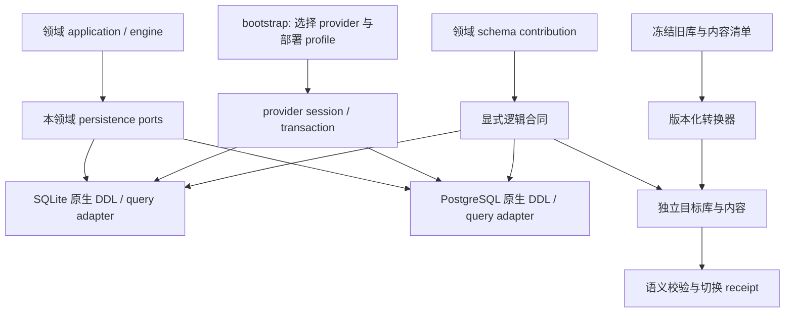

# RFC-395 技术设计

## 1. 阶段终态与职责

目标是一个业务数据库、两个受支持 provider、一份业务算法。表按领域贡献 schema，迁移器统一注册和生成依赖顺序。数据内容可以在文件系统、数据库字节列或对象存储中，业务行通过明确的内容引用访问。

新增生产代码按 RFC-294 落位：

| 层 | 职责 | 不承担的工作 |
| --- | --- | --- |
| `modules/<context>/domain` | 角色、选择、快照、引用等纯规则 | 数据库类型、路径或 provider 分支 |
| `modules/<context>/application/ports` | 场景持久化与事务 participant 合同 | 暴露任意表操作或万能 repository |
| `modules/<context>/infrastructure/persistence` | 本模块 schema contribution、读写适配、投影 | 修改他域表 / 私有 schema |
| `platform/persistence` | 语义类型、事务、原生 provider 能力、schema 注册、迁移机制 | 根据表名前缀猜 owner、业务状态转换 |
| `platform/atomic-apply` | 共用持久状态机、claim 与恢复调度机制 | 领域幂等键与可用性规则 |
| 领域迁移 contribution + 独立迁移入口 | 识别已支持旧版本、转换及历史读取 codec | 正常新写入双写旧列 |
| `bootstrap/` | 一次选择与装配 session / 模块 / 迁移运行图 | 逐表业务转换、从其他入口导入实现 |

所有权精确列在 [table-mapping.md](./table-mapping.md)。例如 `workgroups` / `workgroup_members` 的定义属于 resource-catalog，运行中的 assignments / messages 属于 task-execution；开发自动化旧配置 `digital_employees` 属于 development-automation，不因名字类似就与 OS `employee_definitions` 合表。

## 2. 显式 schema 合同与 provider

### 2.1 合同来源

每个 contribution 显式声明 `tableId, ownerContext, version, columns, keys, constraints, indexes, retention, migrationPolicy`；每列声明语义 codec、可空条件、默认值来源及 provider 表达。没有 owner / codec 的列不能靠 default owner 或列名推导进入注册表。

`db/schema.ts` 不再是全域源码唯一入口。最终领域持久化只导入本模块 contribution；跨领域业务协作通过 `public` participant / query。全局聚合仅用于 DDL、迁移、诊断与测试，不能回流成业务可任意访问的 mega schema。已有外键先保留语义，新增跨域物理外键必须说明生命周期；不为消除 import 而悄悄删除引用约束。

### 2.2 语义类型

| 类型 | SQLite | PostgreSQL | 合同 |
| --- | --- | --- | --- |
| ID / 不透明文本 | TEXT | text | ID 不承担时间排序；保留原字节语义 |
| 有界计数 / epoch-ms | INTEGER | bigint 或已证明足够的 integer | 公共 JS number 只接受安全整数；identity / 大计数用 bigint codec，禁止静默截断 |
| 布尔 | INTEGER + CHECK | boolean | 无 `0` / `false` / NULL 互换的业务回退 |
| 业务枚举 | TEXT + CHECK | text + CHECK | 领域联合与数据库约束来自同一声明；不使用难收缩的原生 enum |
| 结构化 JSON | TEXT + 有效性约束 / codec | jsonb（需结构语义）或 json（需保留文本） | 显式声明是否保留原始文本、对象顺序及摘要算法；不能全部改为 jsonb |
| 原始 JSON / 带摘要原文 | TEXT / BLOB | text / bytea | 原始 bytes + schemaVersion / digest，与解析后的投影分开 |
| 二进制内容 | BLOB | bytea | byte-for-byte；base64 仅允许出现在迁移或传输边界 |
| 逻辑序号 | INTEGER | bigint / identity | 分配与业务行同事务；无连续无缺口承诺；历史负数合法 |

唯一键中允许 NULL 的语义必须显式定义。需要“缺失也是同一身份”的槽位用确定的结构化 `slot_key`，不能依赖两个 provider 对 NULL 的默认唯一性行为。排序用同一 collation / byte ordering 合同；列表查询必须提供稳定 tie-breaker。不能为了过迁移检查统一填空串、0 或空 JSON。

### 2.3 查询与事务

替换 `ProviderNeutralDatabase = BaseSQLiteDatabase<...>`、`sqlite-proxy` 承载 PostgreSQL、进程级 active provider 表门面及 SQL 字符串修补链。使用生成的原生表定义与各 provider 原生 driver/query builder。允许共用纯查询规格、投影和映射器；不新造覆盖任意 SQL 的 ORM，不把业务状态机复制两份。

高层 transaction / participant 合同不变：一个操作绑定一个 session / tx，跨模块 participant 在调用者事务内工作；事务重试只重放无外部副作用的闭包，提交后 effect 走现有持久队列。错误分类、锁粒度、返回行、冲突返回值和提交后事件语义需要双 provider 行为测试。不能用 SQLite 通过证明 PostgreSQL 等价。

## 3. Task：主体、定义与生命周期分离

### 3.1 表与不变量

| 表 | 主键 / 关键字段 | 不变量 |
| --- | --- | --- |
| `tasks` | `id`；状态、时间、错误摘要、恢复状态、owner、可见性、生命周期 revision | 热生命周期唯一写入口；不再包含工作流必填、主仓镜像或大执行定义 |
| `task_definitions` | PK/FK `task_id`；`subject_kind`、`source_id`、`source_revision`、`engine_kind`、`definition_version`、冻结执行定义、资源闭包、inputs、预算 | 正常任务恰好一个定义；主体是 workflow / agent / workgroup，source 与引擎表示分开；不 FK 到可变资源的当前版本 |
| `task_launch_contexts` | PK/FK `task_id`；启动来源、触发上下文、父任务 / run、root、lineage、来源回执 | 冻结启动事实；与可变生命周期分开。父 / root / lineage 的删除与历史查询语义沿用现有合同 |
| `task_source_termination_states` | PK/FK `task_id`；来源绑定、launch revision、fence、effect revision | 原来源终止协议的可变状态；同事务 CAS 推进，不混入冻结启动事实 |
| `task_workspaces` | PK/FK `task_id`；工作区种类、根引用、repo group 快照、Git 执行策略、保留 / prune 状态 | 工作区来源与执行主体正交；内部工作区不伪装为外部仓库 |

`task_definitions` 保存冻结的 Workgroup 启动配置；运行中的成员调整、轮次、message/cursor 仍由对应运行表拥有。不能把当前可变 Workgroup 行作为恢复时的定义。

Agent / Workgroup 允许由引擎编译出内部图，但它是执行定义，不是 resource-catalog 的隐藏 Workflow。停止创建 / 查询 `AGENT_HOST_WORKFLOW_ID` 和 Workgroup host 数据行。API 若仍需旧 `workflowSnapshot` 形状，由边界从冻结执行定义投影；不再向库反写合成 catalog ID。

### 3.2 旧 `tasks` 70 列去向

以下按旧数据库列名列举；目标可使用更清晰的列名，映射不得遗漏来源。

| 目标 | 源字段 |
| --- | --- |
| `tasks` 生命周期 | `id, name, status, started_at, running_ms, running_since, finished_at, error_summary, error_message, failed_node_id, auto_recovery_attempts, auto_recovery_suspended, auto_recovery_window_started_at, expires_at, deleted_at, owner_user_id, catalog_visibility, lifecycle_event_revision` |
| `task_definitions` | `workflow_id, workflow_snapshot, workflow_version, inputs, max_duration_ms, max_total_tokens, schema_version, workgroup_id, workgroup_config_json, source_agent_name, source_agent_id, ref_closure_json`；提取真实 subject，保留冻结定义版本与 provenance |
| `task_launch_contexts` | `launch_origin, scheduled_task_id, webhook_trigger_id, webhook_fire_id, event_subscription_id, event_delivery_id, code_round_id, digital_employee_round_id, digital_employee_case_id, parent_task_id, parent_node_run_id, invocation_depth, root_task_id, execution_lineage_id, lineage_slot_path_json, trigger_context_json, platform_input_paths_json` |
| `task_source_termination_states` | `source_termination_binding, source_termination_launch_rev, source_termination_fence, source_termination_effect_rev` |
| `task_workspaces` | `repo_group_id, repo_group_name, worktree_path, git_user_name, git_user_email, auto_commit_push, space_kind, workspace_pruning_at, workspace_prune_cause, workspace_pruned_at, branch_started_at` |
| `task_repository_mounts` / 启动分支事实 | `repo_path, repo_url, cached_repo_id, base_branch, branch, base_commit, working_branch` 与 `task_repos` 联合转换，按 migration §4 的冲突决议生成一个权威值；两个旧值都留在迁移证据 |
| 派生，不持久镜像 | `repo_count` 由挂载数计算；旧主仓 API 字段由 ordinal 0 的挂载投影 |

字段映射的实施合同须标出每列 `immutable / CAS mutable / derived`，不得简单把整张启动 / 工作区表标成只读。来源终止状态由原有业务 owner 通过新子表同事务推进，保留 effect 与 fence 的关联。

## 4. 工作区与仓库 checkpoint

`task_repos` 转成 `task_repository_mounts`：PK `(task_id, repo_key)`，唯一 `(task_id, ordinal)` 和任务内规范化 `mount_path`；`repo_key` 是稳定身份，不能因重新排序变化。迁移器按原 task / repo_index 建立稳定映射并保存映射 receipt。

| 字段组 | 目标语义 |
| --- | --- |
| `repo_path, repo_url, cached_repo_id` | 来源与本地 materialization 引用；不能把机器绝对路径当跨部署身份 |
| `base_branch, branch, working_branch, base_commit` | 带版本的 Git 起点与发布目标；显式 `branch / detached / unborn / none` 状态，适用字段按状态存在 |
| `worktree_path, worktree_dir_name, mount_path, subdir` | 工作区内容 root 引用 + 唯一 mount 相对路径 + subdir；删除 `worktree_dir_name` 重复身份 |
| `readonly, readonly_dirty_count, workspace_profile_version, workspace_profile_digest, has_submodules, submodule_init_ok, submodule_init_error, schema_version` | 原功能保留，区分冻结挂载配置、准备结果与可变运行状态 |

`node_run_repo_checkpoints`：PK `(node_run_id, repo_key)`，FK 到同任务挂载；保存 `pre_snapshot, isolation_base, node_tree, submodules, isolation_root_ref, merge_state`，每个 checkpoint 可表示真实“尚未生成”。一仓就是一行，多仓就是多行；仓库 map 的缺项与没有快照是两个不同事实，迁移不能互换。

工作区 preparation、source-control 的 source / snapshot / preparation operation 保留各自职责：准入准备可以发生在 Task 创建前，不能强制 FK 到尚不存在的任务。`task_workspace_preparations`、托管工作区命令与回执和新的挂载通过稳定身份关联，复用现有租约 / effect 恢复协议。

## 5. NodeRun 身份、选择与数据分层

### 5.1 目标表

| 表 | 键与内容 | 约束 |
| --- | --- | --- |
| `node_runs` | `id, task_id, seq, role, synthetic_owner, node_id, historical_parent_id, container_run_id, generation_seq, attempt_index, scope_path, shard_key, operation_generation`；状态 / 开始结束 / 错误 | seq 非空，`UNIQUE(task_id,seq)`；role 区分 node-attempt / container / synthetic；task synthetic 无伪 host；容器、历史 parent 与 selected 分开 |
| `task_execution_generations` | PK `(task_id,generation_seq)`；原因、前代、操作引用、创建时间 | 逻辑重跑代，独立于尝试序号与进程 execution ownership generation |
| `node_run_selections` | PK `(task_id,generation_seq,slot_key)`；`selected_run_id, revision` | slot 是 scope / node / shard 的版本化结构键；所选 run 必须属于同任务、代和槽位 |
| `node_run_inputs` | PK `(consumer_run_id,input_port,ordinal)`；`producer_run_id,output_port,output_revision,digest` | 记录实际消费，不从当前最新 producer 倒推；保留多输入顺序 |
| `node_run_configs` | PK/FK `node_run_id`；runtime / binary / params、资源 inventory、prompt ref、注入记忆、override | 冻结执行配置；不恢复到当前 mutable agent 默认值 |
| `node_run_runtime_states` | PK/FK `node_run_id`；pid / launch nonce / session、启动验证、wrapper progress、isolation root | 仅有执行进程或 wrapper 状态的角色需要；允许还没启动的合法缺失 |
| `node_run_results` | PK/FK `node_run_id`；token 计数、校验失败、commit/push、merge / rollback / review 结果 | 可增量更新的结果与主身份分开；保留观测系统独立账本 |
| `node_run_repo_checkpoints` | 见 §4 | 单仓 / 多仓统一 |
| `execution_legacy_evidence` | `(record_kind,record_id,source_contract)`；原记录内容引用、推导质量、缺失字段 | 仅迁移写与历史读；不成为正常执行 fallback |

不因“62 列中 52 列可空”机械拆所有列。运行前、非 agent 节点、无输出等合法状态天然可空；本次按写入频率、适用角色与冻结边界拆分。角色条件、record mode 和可空条件一起声明。

历史记录的公共身份 `id/task_id/seq` 保留；确实不能证明 role / scope / config 的记录显式 `record_mode=history-only`、`provenance_quality=unknown`，相关字段可空，原值进 evidence。正常 mint 只产生 `record_mode=executable`，其角色条件必须完整；恢复入口只接收通过迁移检查的 executable 记录。历史列表仍可显示缺失事实。不得给未知历史造一个 synthetic owner 或当前 agent 配置。

### 5.2 排序、世代与选择

继续用 `node_run_seq_allocations` 在 caller-owned transaction 内先分配再 mint。保留分配器高水位，允许回滚产生序号空洞；禁止 `MAX(seq)+1`、热 Task 自增计数器与依赖 ULID 字典序。旧负序号是合法回填值；目标不加 `seq > 0`。

`generation_seq` 由显式重跑 / rewind / replay 操作推进；`attempt_index` 是同一逻辑槽位的 retry；`operation_generation` 与既有 lineage operation fencing 原样保留其职责。`runtime.generationId` / daemon ownership 是另一轴，不复用其值表达业务新鲜度。

selected-run 变更由现有操作 owner 同事务提交，必须覆盖 fanout shard 集合、container、review iteration 和 child continuation 的既有规则。旧 supersession 中的 shard 集合包含关系不能简化为 `MAX(seq)`。迁移器用当前选择规则作 oracle 输出一次选择结果；正常读者全部改为消费 selected / provenance，不再各自计算一套 SQL / JSON / ID 顺序。

运行时不能因顶层 `running` 与 parent 语义混淆而拒绝合法角色。mint 检查改为角色与容器不变量；现有禁止非法 top-level 的保护意图由新正向 / 反例测试保留。

### 5.3 旧 `node_runs` 62 列去向

| 目标 | 源字段 |
| --- | --- |
| 身份 / 生命周期 | `id, task_id, node_id, parent_node_run_id, container_run_id, scope_path, iteration, shard_key, retry_index, wg_round, review_iteration, status, started_at, finished_at, exit_code, error_message, failure_code, force_activated, rerun_cause, child_task_id, continuation_slot_key, lineage_slot_path_json, operation_generation, seq`；原 iteration / review / wg 维度保留，不压成一个计数 |
| `node_run_configs` | `prompt_text, prompt_path, runtime, runtime_binary, runtime_params_json, inventory_snapshot_json, runtime_inventory_json, injected_memories_json, agent_override_name, agent_override_id, shard_value_hash` |
| `node_run_runtime_states` | `pid, spawn_binary_path, spawn_launch_nonce, envelope_nonce, opencode_session_id, startup_verification_json, wrapper_progress_json, iso_worktree_path`；session ID 命名中立化但不更换其值 |
| `node_run_results` | `tok_input, tok_output, tok_cache_create, tok_cache_read, tok_total, port_validation_failures_json, commit_push_json, merge_state, superseded_by_review, rolled_back` |
| `node_run_repo_checkpoints` | `pre_snapshot, pre_snapshot_repos_json, iso_base_snapshot, iso_base_snapshot_repos_json, iso_node_tree, iso_node_tree_repos_json, iso_submodules_json, iso_submodules_repos_json` |
| `node_run_inputs` | `consumed_upstream_runs_json`；无法证明端口 / 版本的历史边保留 evidence，活跃恢复需明确解决 |

`node_run_outputs` 保留输出端口语义，改用统一内容引用；`node_run_events`、托管事件来源 / 归档仍保留流与分片职责，不与选择表合并。

## 6. 澄清、资源依赖与 JSON 边界

### 6.1 澄清

`clarify_rounds` 保留轮次、角色、asking / intermediary / consumer 关系、状态、冻结问题快照、directive、提交事实与警告。新增：

- `clarify_answers`：PK `(round_id,question_id)`；最终答案 value、attribution、revision、更新时间。
- `clarify_answer_drafts`：PK `(round_id,question_id)`；草稿 value、编辑者 attribution、revision、更新时间。保持当前一份共享草稿的语义，不擅自变成每用户隔离草稿。

questions snapshot 内 question ID 唯一，稳定顺序保留。答案值维持现有类型合同；引用 question 必须在该版本快照中。修改以 row revision CAS 进行；round 封口在同事务中冻结有效答案集合、记录 submitted/answered 元数据并调用现有协作 participant。单题更新不再锁 Task 聚合或整体重写答案 map；封口与编辑的竞态由 round 状态 / revision 与事务合同决定。API 可继续返回 JSON map 投影。

`task_questions` 是人工交互 / 分发 / 续跑账本，不与 clarify answer 合表；`doc_versions` 归 collaboration，保留文档版本与内容；不复活已经删除的脑图物化表。

### 6.2 资源依赖

独立编辑的引用列表形成 typed 关系：`agent_skill_refs`、`agent_mcp_refs`、`agent_plugin_refs`、`agent_dependencies`，分别来自 `agents.skills / mcp / plugins / depends_on`。键由 parent ID + 引用目标 ID 构成，另有 ordinal（以及原合同需要的参数）；同一 parent 的 ordinal 唯一。当前支持的落库路径已经使用稳定 ID，不能把 schema 中旧的 name 注释当成当前行为。旧版本若需名称解析，遇到同名冲突不能任取第一项。

Workflow 的 canonical definition JSON 继续是创作真相源，节点 / 边不做机械关系化。新增 `workflow_dependency_index`，以 `(workflow_id,revision,reference_path)` 标记资源类型、`selector_kind`、原 selector 值及其查找 namespace；只由定义解析器在同事务重建，不对外单独编辑。ID selector 索引 ID；现有 call-workflow / call-workgroup 的 name selector 按原有 namespace 和名称索引，在原有解析时点解析，不把解析缓存 ID 变成新的权威。资源改名、同名创建 / 删除和延迟解析行为保持原合同。删除 / 依赖查询使用索引，避免 `LIKE` 扫 JSON。其他持有冻结快照的表不 FK 依赖可变当前资源而丢失历史。

Agent 的传递依赖、必选项与闭包顺序沿用当前语义；需要不同字段的关系不得塞成无类型 `resources(kind,payload)`。可移植导入 / 导出的名称边界和 runtime 注册名选择保留，不能为 schema 统一关闭。资源包与 Intent 使用同一 mutation participant 写依赖及正文。

## 7. 内容存储与 AtomicApply

### 7.1 内容引用

共用 `ContentRef` 是版本化判别联合：inline / local-file / database-bytes / object，带 `contentId, contentVersion, sha256, size, mediaType`；location 是 provider 内部定位符，不作为业务身份。独立引用、发布与释放生命周期由领域 participant 和内容机制协作。

新增中立 `content_objects` 元数据表与可选 `content_bytes` 字节表（PK `content_id`）。小 prompt 允许 inline；只有实际在多处引用或外置的内容进入对象目录，避免为每条短文本增加 IO。发布状态复用现有 `hosted_object_publications` 的 owner / logical_key / attempt / epoch / pending-ready-releasing-released 语义，迁成中立 `content_publications`。它是同一账本演进，不能再造平行 journal。

`skill_content_entries` 保留 skill / tree / relative path 索引与 live、version、staging、trash 语义，content 改为内容引用；`skill_versions` 保留版本事实。SQLite BLOB / PostgreSQL bytea 只负责字节，文件 / 对象后端继续由 profile 选择；数据库不强制吸收所有大文件。含 BOM、非法 UTF-8、空文件的迁移均按 bytes 比较。

`hosted_task_artifacts`、archive entries、node outputs、doc/review body、development / employee artifact 表是各域业务索引，保留独立角色，只替换内容地址格式。既有对象发布、release重试、引用保持与备份恢复职责都须接到同一个内容机制；清理不能删掉仍被历史或备份持有的对象。

### 7.2 Apply

`intent_apply_journal` 与 `resource_bundle_applies` 保留各自物理表及幂等唯一键，由同一 AtomicApply 状态机驱动 `prepared → applying → committed/failed` 与恢复。scene adapter 提供准备、领域提交、artifact codec 与 receipt 映射；迁入时把旧 prepared artifact 形状转换为明确 codec version。

合并的是重复机制，不合并事务意义不同的账本：`task_execution_effects`、`development_effects`、审批 saga、webhook MR effect 与事件 delivery 继续由各域恢复。外部 effect 不在重试数据库事务中直接执行。

## 8. 必须保留的领域边界

- `committed_events` 是业务事务提交事件，aggregate heads 管顺序、deliveries 管消费者；`event_records` 是观察 / 采集事实，不能合成同一张“大事件表”。
- Employee Case、Reaction、Task 分别承载业务案例、响应回合和执行；不以共用状态列为由合并。
- `development_missions` 的可空字段大多与 source、delivery、终态有关；本 RFC 保留聚合和 typed 条件，转换内容引用及显式 owner，不根据 nullable 数量强拆。
- observation 三表保留现有调用 / 模型用量 / 价格版本；不增加 Task 级联删除 FK，历史费用可独立保留。
- identity、session、外部身份、grant、审计保留不同生命周期；本 RFC 不改变权限功能。
- `digital_employees` / `digital_employee_revisions` 与新的 `employee_definitions` 系列都有消费者；旧命名不能作为删除依据。
- 浏览器 IndexedDB / localStorage 草稿是客户端缓存 / 编辑会话，不并入服务端业务表。旧键含 host ID 或 workflow 结构时只做版本化边界映射，不清空用户未提交草稿。

## 9. 历史层与约束策略

6 张既有 ARCHIVE 表双 provider 都进入离线历史包；6 张旧 code work 表及 link 转入同样可查询的版本化历史读服务，在线业务命令不继续写。若真实源仍有未完成旧工作项，预检必须阻塞，先证明可转换到受支持模型或完成原工作；不能静默删掉或取消。Demo seed 也改成目标模型 fixture，不再偷偷写回退役表。

`committed_event_family_cutovers` 是仍有语义的家族路由配置：保留目标路由、删除仅用于旧 writer 的阶段值。`employee_os_writer_state` 的历史 drain 状态进入切换 receipt；目标启动直接使用已确认 OS active 的配置，不再反复扫旧 Mission 等待 drain。约束是未完成工作如何交接的功能正确性，不等价于“DEFER 全删”。

FK 由聚合删除语义决定：owned child 才 cascade，历史引用保持可追溯；外部 / mutable resource ref 可用稳定 ID + 冻结快照而不是级联 FK。普通新写入完整遵守目标约束。历史无法补齐的数据经明确 `history-only` 与证据包处理，不能全局放松 NOT NULL、把异常吞掉或默认造值。

## 10. 旧路径删除清单

| 编号 | 必须删除或退出正常运行的形状 | 保留的真实能力 / 验收反例 |
| --- | --- | --- |
| D1 | `ensureWorkgroupHostWorkflow`、Agent host workflow seed / lookup | 三类主体都能启动；内部编译图仍允许 |
| D2 | `tasks` 主仓物理镜像、`repo_count`、`worktree_dir_name` 双身份 | API 主仓字段从挂载投影；所有工作区种类 |
| D3 | NodeRun 单仓快照列 + `*_repos_json` 双读写 | 单仓与多仓 rollback / merge / recovery |
| D4 | 新执行读取中的 nullable seq、ID fallback、各自 selected 判定 | 历史负序号；deleted anchor；fanout / retry / review |
| D5 | 用 parent 是否为空猜 role / 拒绝合法 synthetic 的逻辑 | task synthetic、container、普通 attempt 的正反例 |
| D6 | 澄清逐题更新中的整 map read/modify/write 与 Task 锁 | 并发编辑、封口、代理归属、草稿恢复 |
| D7 | 旧版落库名充当 ID 的回退与 `resourceRefs` JSON LIKE 扫描 | 原有 name selector / 导入导出仍有效；明确歧义拒绝、依赖闭包顺序、资源删除提示 |
| D8 | 正常数据库技能内容 utf8/base64 编码分支、多套 artifact 定位推断 | bytes 原样、inline prompt、对象发布恢复 |
| D9 | Intent / 资源包各自通用 Apply 状态机与旧 artifact shape fallback | 幂等、失败前滚 / 补偿、领域提交原子性 |
| D10 | 从 SQLite 反射作为唯一合同、owner / JSON 名称猜测、PG SQLite proxy / SQL 修补 | 两个原生 provider、一个业务算法 |
| D11 | clean target boot 的旧 writer drain 和旧 code work 写入口 | 当前事件路由、历史读取、未完任务迁移前显式处置 |
| D12 | 新库启动重放全部历史迁移链 | 新 baseline；旧迁移不可变保存于转换 / 历史包 |

结构守卫应锁意图而非旧字面量。RFC-374 / 376 / 391 / 392 相关测试、migration journal 和 binary initialization 测试须随最终结构改指；不以删除保护测试获得“归零”。

## 11. 验证策略

验证矩阵、故障点和实施依赖见 [plan](./plan.md)。本设计要求先完成全部实现和测试编写，再集中执行功能验证。至少包括：旧写法反例、双 provider 行为对拍、非空多版本迁移、并发协作、恢复及 effect 不重复、制品字节校验、完整用户旅程、备份恢复和三平台二进制启动。

迁移后性能的判断以同一真实样本、同一查询、同一机器的前后结果为准：Task 列表 / 当前 run 选择 / 资源反向引用 / 单题修改 / 启动恢复记录 rows examined、SQL 次数、耗时分布和锁等待。新增索引来自这些访问路径；不要求每个 FK 列都机械加索引，也不许靠扩大超时掩盖回归。

## 12. 阶段 I 技术方案（2026-10-21 接手会话补充）

阶段 I 在现有物理 schema 上完成，不产生 schema epoch，现有双引擎测试即行为判据（plan §6.2，用户已确认单独落地）。分两次交付：
I-a（T1 + T2a）与 I-b（T3）。依据是接手会话的只读研究（合同与迁移机制、provider 查询面）。

### 12.1 I-a：显式 contribution 与等价证明

- **落位**：
  - `platform/persistence/schema/`：contribution DSL、codec 目录、表达式 AST、registry 校验、合同 / SQLite plan / PostgreSQL plan 编译器、
    drizzle 物化。platform 不 import modules，registry 以参数注入；platform 内现有对 `buildLogicalSchemaContract()` 的默认值调用改为注入。
  - `modules/<ctx>/infrastructure/persistence/schema.ts`：本域 contribution 与本域 drizzle 表；`modules/<ctx>/composition.ts` 导出
    `schemaContribution`。平台自有表（committed events、内容发布、迁移元数据、维护）放在对应 `platform/*` contribution。
  - `bootstrap/persistenceSchema.ts`：唯一汇集点，供 DDL、迁移、诊断与测试使用；业务模块不得 import。
- **contribution**：每表显式声明 `id, owner, columns（有序；codec 描述符含物理列名、可空、默认值）, primaryKey, migrationKey, unique
  （声明 NULL 语义）, foreignKeys（目标用逻辑表 id 字符串，注明生命周期）, checks / indexes（类型化表达式 AST + 带理由的按 provider
  raw 逃生口）, retention, migrationPolicy`。owner 与 codec 无兜底；I-a 的 owner 取 table-mapping 的目标 owner，`migrationPolicy`
  取今日合同的 disposition。
- **codec 目录**：`id / text / enum / bool / int / bigint / epochMs / durationMs / real / jsonText / jsonDoc / rawJson / bytes / seq /
  identity / slotKey`，SQLite 与 PostgreSQL 的物理表达见 §2.2。I-a 只用重述今日声明所需的 codec，不改任何列的物理类型。
- **`@/db/schema`**：改为转出编译出的表与现有 facade，336 个引用方不改。
- **等价证明（验收）**：
  1. legacy v2 合同投影（冻结的旧 `ownerFor / codecFor` 规则移入 `platform/persistence/migration/legacy/`）与今日
     `buildLogicalSchemaContract()` 的 canonical JSON 相等，目标是 digest `sha256:8e6510…` 逐字节相等；做不到时以 t19g 的规范化相等为准并在
     RFC 记录原因，下面两条物理证明兜底；
  2. 编译出的 PostgreSQL plan 与今日 plan 逐条相等，真引擎上编译 plan 建的库与历史迁移 replay 建的库 catalog 相等；
  3. 编译出的 SQLite DDL 在内存库执行后的物理结构，与迁移 replay 结构的差异等于已审账本：7 个仅 SQLite 的 trigger、8 条仅 SQLite
     的 FK、`tasks.name` 可空性、42 张表列序、2 处 partial 与 full unique 差异；账本中各项的目标裁决留到 II-0；
  4. 两套 drizzle 表与今日 SQLite 表、PostgreSQL 运行时投影逐列相等（列名、类型、notNull、主键、默认值、枚举值）；
  5. 负例：缺 owner / codec、`jsonDoc` 用于有原文摘要合同的列、identity 无高水位策略、跨域 FK 目标不存在，均编译失败。
- **结构锁**：新表必须经 contribution 声明；`db/schema.ts` 不得再直接声明表；以后新增表的 RFC 须同时提供 contribution。

### 12.2 I-b：原生 provider（方案 B）

- **选择**：显式合同生成 SQLite 与 PostgreSQL 两套原生表；会话提供本 provider 的表集；业务代码写在窄中立查询接口
  `PersistenceDb / PersistenceTx` 上，只收录实测用到的约 25 个 builder 方法，结果类型复用 drizzle 根层类型；运行时是原生
  bun-sqlite / bun-sql 的 drizzle 对象，不包一层。不采用「每模块两份适配器」与「底层换驱动、上层仍 sqlite 类型」。
- **辅助**：`first / affectedRows / rawRows / rawFirst / rawExec`，原始行按合同 codec 解码（统一 int8 字符串、布尔 0/1 与 true/false）。
- **方言差异**：继续只走 `EngineCapabilities`，签名改为中立类型；`instr` 收为能力；新增方法须附两侧测试，保持闭集。
- **开发顺序**（作为一次交付集中验证）：
  - S0 PostgreSQL 表固化为显式表并与运行时投影等价；
  - S1 中立类型改名；
  - S2 清除 SQLite 专属终端与原始执行，加守卫；
  - S3 会话提供表集（先给全表集，收紧到本模块表留给 T11），删除进程级投影与切换调用，SQLite 与 PostgreSQL 客户端可同进程并存；
  - S4 PostgreSQL 改原生 bun-sql 会话，写闸、世代围栏与首写标记只做语句分类、不改写 SQL，删除 sqlite-proxy 与 SQL 编译链；
  - S5 业务 SQL 不再依赖 PostgreSQL 同名函数（CHECK / 默认值里的保留到新 baseline）。
- **已裁决的风险**：
  - 单行 INSERT 往返合并今日靠 SQL 改写；改为会话内原生构造的带围栏写入，保持一次往返，性能对拍不得退化（实测基线 p95 约 5.6ms）；
  - 省略列：两侧数据库默认值必须等于合同声明，加对拍用例；
  - Bun.SQL 事务：先 reserve 再在其上构造会话，保持不嵌套 reserve，reserve 等待遥测覆盖 begin；
  - 类型系统不阻止跨方言混用表：由会话提供表集，并加守卫禁止模块直接导入方言表模块；
  - drizzle 升级可能破坏中立接口可赋值性：类型级一致性测试进 CI；
  - 预编译与缓存键按会话方言区分。
- **必须继续成立**：`describeEachProvider` 给用例的 harness 形状（仅 `db` 类型改为中立句柄）；用例体看不到 provider 名；PostgreSQL 客户端
  行为合同（`tests/rfc349-postgresql-database-client.test.ts`）；语句录制改为包装 bun-sql 实际调用的 client，性能形状测试不失去被测面；
  `explain()`；SQLite 侧写者租约、`BEGIN IMMEDIATE` 重试与变更计数归一；CI 中 PostgreSQL 分片不得降级为 skip。
- **改指向而非删除的守卫**：`postgresqlSurface`、`rfc349-postgresql-surface-guard`、`rfc349-provider-cutover`、
  `rfc359-w5-adapter-production-consumer`、`rfc359-w5-identical-provider-twins`、`rfc359-w5-t17-provider-file-location`、
  `rfc359-w5-t18-bare-transaction`、`rfc359-w5-t19-provider-branch`、`rfc359-w5-t19f-*`、`rfc359-w5-t19g-schema-contract-reconciliation`、
  `rfc359-w5-t20-dialect-completeness`、`architectureReport`。

I-b 完成后，D10 中「查询与执行」一半销账；「合同来源」一半由 I-a 销账。
