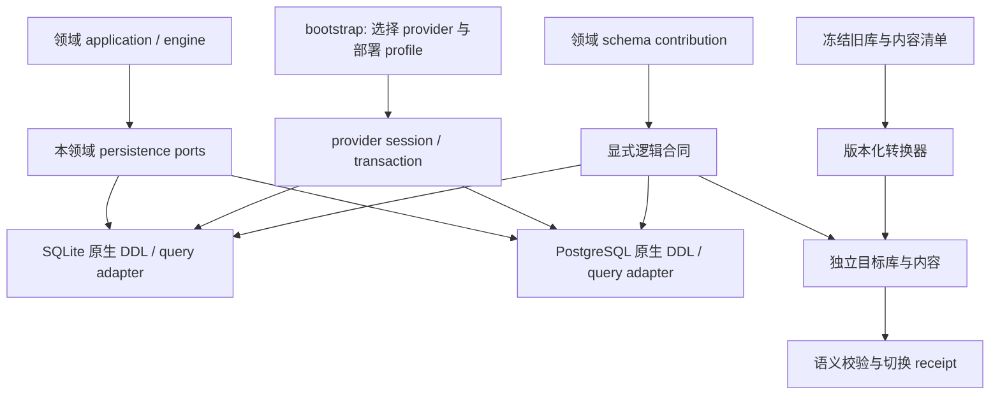

# RFC-395 技术设计

## 1. 阶段终态与职责

目标是一个业务数据库、两个受支持 provider、一份业务算法。表按领域贡献 schema，迁移器统一注册和生成依赖顺序。数据内容可以在文件系统、数据库字节列或对象存储中，业务行通过明确的内容引用访问。



新增生产代码按 RFC-294 落位：

| 层 | 职责 | 不承担的工作 |
| --- | --- | --- |
| `modules/<context>/domain` | 角色、选择、快照、引用等纯规则 | 数据库类型、路径或 provider 分支 |
| `modules/<context>/application/ports` | 场景持久化与事务 participant 合同 | 暴露任意表操作或万能 repository |
| `modules/<context>/infrastructure/persistence` | 本模块 schema contribution、读写适配、投影 | 修改他域表 / 私有 schema |
| `platform/persistence` | 语义类型、事务、原生 provider 能力、schema 注册、迁移机制 | 根据表名前缀猜 owner、业务状态转换 |
| `platform/atomic-apply` | 共用持久状态机、claim 与恢复调度机制 | 领域幂等键与可用性规则 |
| 领域迁移 contribution + 独立迁移入口 | 识别已支持旧版本、转换及历史读取 codec | 正常新写入双写旧列 |
| `bootstrap/` | 一次选择与装配 session / 模块 / 迁移运行图 | 逐表业务转换、从其他入口导入实现 |

所有权精确列在 [table-mapping.md](./table-mapping.md)。例如 `workgroups` / `workgroup_members` 的定义属于 resource-catalog，运行中的 assignments / messages 属于 task-execution；开发自动化旧配置 `digital_employees` 属于 development-automation，不因名字类似就与 OS `employee_definitions` 合表。

## 2. 显式 schema 合同与 provider

### 2.1 合同来源

每个 contribution 显式声明 `tableId, ownerContext, version, columns, keys, constraints, indexes, retention, migrationPolicy`；每列声明语义 codec、可空条件、默认值来源及 provider 表达。没有 owner / codec 的列不能靠 default owner 或列名推导进入注册表。

`db/schema.ts` 不再是全域源码唯一入口。最终领域持久化只导入本模块 contribution；跨领域业务协作通过 `public` participant / query。全局聚合仅用于 DDL、迁移、诊断与测试，不能回流成业务可任意访问的 mega schema。已有外键先保留语义，新增跨域物理外键必须说明生命周期；不为消除 import 而悄悄删除引用约束。

### 2.2 语义类型

| 类型 | SQLite | PostgreSQL | 合同 |
| --- | --- | --- | --- |
| ID / 不透明文本 | TEXT | text | ID 不承担时间排序；保留原字节语义 |
| 有界计数 / epoch-ms | INTEGER | bigint 或已证明足够的 integer | 公共 JS number 只接受安全整数；identity / 大计数用 bigint codec，禁止静默截断 |
| 布尔 | INTEGER + CHECK | boolean | 无 `0` / `false` / NULL 互换的业务回退 |
| 业务枚举 | TEXT + CHECK | text + CHECK | 领域联合与数据库约束来自同一声明；不使用难收缩的原生 enum |
| 结构化 JSON | TEXT + 有效性约束 / codec | jsonb（需结构语义）或 json（需保留文本） | 显式声明是否保留原始文本、对象顺序及摘要算法；不能全部改为 jsonb |
| 原始 JSON / 带摘要原文 | TEXT / BLOB | text / bytea | 原始 bytes + schemaVersion / digest，与解析后的投影分开 |
| 二进制内容 | BLOB | bytea | byte-for-byte；base64 仅允许出现在迁移或传输边界 |
| 逻辑序号 | INTEGER | bigint / identity | 分配与业务行同事务；无连续无缺口承诺；历史负数合法 |

唯一键中允许 NULL 的语义必须显式定义。需要“缺失也是同一身份”的槽位用确定的结构化 `slot_key`，不能依赖两个 provider 对 NULL 的默认唯一性行为。排序用同一 collation / byte ordering 合同；列表查询必须提供稳定 tie-breaker。不能为了过迁移检查统一填空串、0 或空 JSON。

### 2.3 查询与事务

替换 `ProviderNeutralDatabase = BaseSQLiteDatabase<...>`、`sqlite-proxy` 承载 PostgreSQL、进程级 active provider 表门面及 SQL 字符串修补链。使用生成的原生表定义与各 provider 原生 driver/query builder。允许共用纯查询规格、投影和映射器；不新造覆盖任意 SQL 的 ORM，不把业务状态机复制两份。

高层 transaction / participant 合同不变：一个操作绑定一个 session / tx，跨模块 participant 在调用者事务内工作；事务重试只重放无外部副作用的闭包，提交后 effect 走现有持久队列。错误分类、锁粒度、返回行、冲突返回值和提交后事件语义需要双 provider 行为测试。不能用 SQLite 通过证明 PostgreSQL 等价。

### 2.4 provider 差异的目标裁决

SQLite 迁移重放结构与合同（即 PostgreSQL）之间的已审差异（§12.1 等价证明第 3 条的账本），在目标 baseline 中逐条裁决为两 provider 一致的原生表达（II-0，2026-10-21）：

| 项 | 目标裁决（两 provider 一致） | 转换器 |
| --- | --- | --- |
| `rfc328_tasks_lineage_after_insert` | 删除；lineage 推导留在任务创建 participant（领域函数），`task_launch_contexts.execution_lineage_id / lineage_slot_path_json` NOT NULL；结构守卫「只有一个任务创建 participant」（替代 `rfc359-w7-task-insert-lineage-completeness`） | 源行 NULL 时按 0210 的规则补齐，记 `legacy-derived` |
| `trg_tasks_launch_origin_inherit_child` | 删除；子任务继承父任务 launch origin 由创建 participant 保证，NOT NULL | 校验父子一致；不一致记证据，在途任务阻塞 |
| `runtime_session_leases_reset_pending_*` | 删除触发器，改为两侧原生 CHECK（`reset_pending` 为 bool codec；`reset_pending = false OR lease_node_run_id IS NOT NULL`） | 无 |
| `trg_collaboration_gate_operations_committed_immutable` | 保留不变量：合同新增类型化行级规则 `immutableOnceSet(columns, when)`，两侧编译为原生触发器（PG 触发器函数），错误统一映射为 `human-gate-committed-receipt-immutable` | 无 |
| `user_access_audit_no_update / _no_delete` | 保留不变量：类型化规则 `appendOnly(table)`，两侧原生 | 无 |
| `development_missions.reopened_from_mission_id` | 两侧 FK，NO ACTION | 悬空引用记证据、阻塞 |
| `memories.supersedes_id / superseded_by_id` | 两侧 FK，`ON DELETE SET NULL`：PostgreSQL 部署删除记忆后，其他记忆中的引用由悬空改为置空，与 SQLite 一致（用户 2026-10-21 确认） | PG 源中的悬空指针置空并记证据 |
| `node_runs.container_run_id` | 两侧 FK，NO ACTION（同任务内；任务删除整体级联） | 按依赖拓扑插入或校验后启用；悬空 → history-only + 证据，在途阻塞 |
| `repo_group_nodes.child_group_id` | 两侧 FK，NO ACTION（应用先解除引用） | 悬空引用按应用的解除规则（清空挂载字段）处理并记证据 |
| `task_collaborators.added_by` | 两侧 FK，规范为 NO ACTION（原声明 SET NULL 与 NOT NULL 矛盾，实际效果等同拒绝删除） | 悬空引用阻塞 |
| `tasks.owner_user_id`、`users.created_by` | 两侧 FK，`ON DELETE SET NULL`（无生产硬删，声明性一致） | 悬空引用阻塞 |
| `tasks.name` | 两侧 NOT NULL | NULL / 空串按 0021 的回落规则 `'task-' \|\| substr(id, -10)` 补齐，记 `legacy-derived` |
| `intent_turn_events` 唯一 | 两侧部分唯一索引 `(turn_id, source, external_event_id) WHERE external_event_id IS NOT NULL`，合同显式声明 NULL 语义 | 无 |
| `code_work_observations` 唯一 | 表归档，目标无表 | 归档 |
| 列序 / 唯一的物理表示 | 由 contribution 单一声明编译，两侧同序同形 | 按列名转换 |

新 baseline 不含无类型触发器。行级不可变规则只有 `immutableOnceSet` 与 `appendOnly` 两种，由合同声明并在两 provider 上编译为原生实现，错误映射与行为对拍。插入兜底类触发器的不变量由唯一的领域写入者与 NOT NULL 约束承担。转换器规则同见 [migration §4.7](./migration.md)。

## 3. Task：主体、定义与生命周期分离

### 3.1 表与不变量

| 表 | 主键 / 关键字段 | 不变量 |
| --- | --- | --- |
| `tasks` | `id`；状态、时间、错误摘要、恢复状态、owner、可见性、生命周期 revision；工作区根引用、prune 状态、来源终止 fence / effect revision、树结构列 | 热生命周期与聚合树的唯一写入口。除生命周期列外，含与生命周期 CAS 同句读写的可变状态：`workspace_root_ref`（NULL = 未绑定）、`workspace_pruning_at / workspace_prune_cause / workspace_pruned_at`、`source_termination_fence / source_termination_effect_rev`，以及树结构列（§3.4）。不含工作流必填、主仓镜像或执行定义。 |
| `task_definitions` | PK/FK `task_id`；`subject_kind`、`source_id`、`source_name`、`source_revision`、`definition_origin`、`engine_kind`、`definition_revision`、冻结执行定义、资源闭包、inputs、预算 | 正常任务恰好一个定义。`subject_kind ∈ {workflow, agent, workgroup, digital-employee, code-round}`；`source_id` 不 FK 到可变资源；digital-employee 的 `source_id` 为 NULL（由 `task_launch_contexts.digital_employee_round_id` 标识）；`definition_origin ∈ {authored, platform}` 启动时冻结；定义可在生命周期 CAS 内修订（见 §3.3） |
| `task_launch_contexts` | PK/FK `task_id`；启动来源、触发上下文、父 run（`parent_node_run_id`）、lineage、来源回执、`source_termination_binding / source_termination_launch_rev`（冻结） | 冻结启动事实；与可变生命周期分开。父子关系与 root 留在 `tasks`（§3.4）；lineage 的历史查询语义沿用现有合同 |
| `task_workspaces` | PK/FK `task_id`；`space_kind`、repo group 快照、git 身份、`auto_commit_push`、`working_branch`、`requested_source`、`task_branch` | 冻结的工作区来源与 Git 执行策略；`space_kind` 只在延后准备结算时按聚合根写协议重盖一次；内部工作区不伪装为外部仓库 |

`task_definitions` 保存冻结的 Workgroup 启动配置，只含启动时不变的部分（mode、workgroup id / name、goal、leader）；运行中的成员调整、轮次、message/cursor 仍由对应运行表拥有，运行中改配置写 `workgroup_task_state` 的运行期配置（§3.3）。不能把当前可变 Workgroup 行作为恢复时的定义。

Agent / Workgroup / 数字员工 / code-round 允许由引擎编译出内部图，它是执行定义，不是 resource-catalog 的隐藏 Workflow。停止创建、查询四个宿主数据行（`00000000000000AGENTHOST00`、`00000000000000WORKGROUP00`、`00000000000000DIGEMPHOST0`、`00000000000000CODEROUND00`）。

`definitionAnchorId(subject)`（task-execution domain）为非 workflow 主体返回上述常量、为 workflow 主体返回 `source_id`。它是执行定义命名空间，只用于：线上 `Task.workflowId` 与 `ReviewSummary.workflowId` 投影、调用闭包的冻结源与取用键、记忆 workflow 作用域键（启动 intent 的请求哈希与载荷沿用同值）。它不写入任何 catalog 表，不建 FK，不得被解析为工作流行。线上 `workflowName` 对非 workflow 主体投影常量宿主名，对 workflow 主体投影实时名称（已删为 null）。读时排版由冻结的 `definition_origin='platform'` 决定，不再读 `workflows.builtin`。手动执行与同步守卫按主体判定，错误码与今天一致。

主体与宿主的其余规则（II-0，2026-10-21）：

- **记忆作用域**：Agent / 工作组 / 数字员工任务继续共用以常量为键的 workflow 记忆作用域，现有记忆原样迁移，注入与蒸馏结果不变（用户 2026-10-21 确认）；作用域的资源解析对四个常量返回内建公共 workflow 作用域结果，与宿主内建行今天的可见 / 管理结果一致。
- **显示**：首页任务行与评审列表对非 workflow 任务继续显示宿主名，本 RFC 只做等价投影，不改显示（用户 2026-10-21 确认）。
- **`source_id`**：workflow / agent / workgroup / code-round 主体分别取工作流、agent、工作组、code round 的 id（RFC-175 之前的 agent 历史行可空，保留 `source_name`）；digital-employee 为 NULL。数字员工的 workflow 实现启动的是真实工作流主体，只有 agent / program 实现合成宿主图。
- **评审**：评审子系统不再 join `workflows`，改用 task-execution 公开查询 `taskSubjectProjection(taskIds)` 取 `{workflowId, workflowName}`。今天「authored 工作流被删后其评审从列表消失 / 详情 404」的行为原样保留，列入另立修复候选，不在本 RFC 改变。
- **子任务与启动**：call-workgroup 子任务不再要求 catalog 锚行，call-workflow 维持「被调用工作流须存在」；内部启动类型按主体分型，非 workflow 臂不再构造带宿主 id 的 `StartTask`，HTTP `StartTaskSchema` 不变；`runCallWorkflowNode` 显式读取 `definitionAnchorId`，删除 `as unknown as { workflowId? }` 松散转换。

### 3.2 旧 `tasks` 70 列去向

以下按旧数据库列名列举；目标可使用更清晰的列名，映射不得遗漏来源。II-0（2026-10-21）按写入耦合（§3.3）与任务树（§3.4）重新划线后，70 列恰好各有一个去向：

| 目标 | 源字段 | 列数 |
| --- | --- | --- |
| `tasks`（生命周期、与生命周期 CAS 同句的可变状态、树结构） | `id, name, status, started_at, running_ms, running_since, finished_at, error_summary, error_message, failed_node_id, auto_recovery_attempts, auto_recovery_suspended, auto_recovery_window_started_at, expires_at, deleted_at, owner_user_id, catalog_visibility, lifecycle_event_revision`；`worktree_path`（→ `workspace_root_ref`，`''` → NULL）；`workspace_pruning_at, workspace_prune_cause, workspace_pruned_at`；`source_termination_fence, source_termination_effect_rev`；`parent_task_id, root_task_id, invocation_depth, branch_started_at` | 28 |
| `task_definitions` | `workflow_id`、`workgroup_id`、`source_agent_id`、`code_round_id`（→ `subject_kind + source_id`；subject = code-round 时其值即 `source_id`）、`source_agent_name`（→ `source_name`）、`workflow_snapshot`、`workflow_version`（→ `source_revision`）、`inputs, max_duration_ms, max_total_tokens, schema_version, ref_closure_json`、`workgroup_config_json`（不可变部分；运行期部分 → `workgroup_task_state.runtime_config_json`）；新增 `definition_origin, engine_kind, definition_revision` | 13 |
| `task_launch_contexts` | `launch_origin, scheduled_task_id, webhook_trigger_id, webhook_fire_id, event_subscription_id, event_delivery_id, digital_employee_round_id, digital_employee_case_id, parent_node_run_id, execution_lineage_id, lineage_slot_path_json, trigger_context_json, platform_input_paths_json, source_termination_binding, source_termination_launch_rev` | 15 |
| `task_workspaces` | `repo_group_id, repo_group_name, git_user_name, git_user_email, auto_commit_push, space_kind, working_branch`；新增 `requested_source, task_branch` | 7 |
| `task_repository_mounts` / `requested_source` / `task_branch`（按 §4「主仓字段投影」的规则；延后准备占位任务零挂载） | `repo_path, repo_url, cached_repo_id, base_branch, branch, base_commit` 与 `task_repos` 联合转换，按 migration §4.2 的冲突决议生成一个权威值；两个旧值都留在迁移证据 | 6 |
| 派生，不持久镜像 | `repo_count`（`max(1, 挂载数)`）；旧主仓 API 字段由 §4「主仓字段投影」产出 | 1 |
| 合计 | | 70 |

`task_source_termination_states` 不再作为目标表（§3.1、§3.3）。`idx_tasks_event_delivery_unique`（事件启动任务恰好一次的线性化点）随 `event_delivery_id` 移到 `task_launch_contexts`，与任务行同事务写入。

字段映射的实施合同须标出每列 `immutable / CAS mutable / derived`，不得简单把整张启动 / 工作区表标成只读。来源终止 fence / effect revision 留在 `tasks`，由原有业务 owner 以 `lifecycle_event_revision` 为键推进，保留 effect 与 fence 的关联。

### 3.3 Task 聚合写协议

只写 `tasks` 的生命周期迁移与 prune 认领是单行 CAS，谓词与今天相同。同时写 `tasks` 与 `task_definitions` / `task_workspaces` 的事务（同步工作流、动态工作流批准、延后准备结算）先调用 `lockAggregateRoot(tasks, taskId)`，再读从属行、由领域函数判定、写从属行、最后以原谓词 CAS `tasks`。全部生命周期写入收敛到 task-execution 的单一写程序；其他上下文（source-control 的 prune 认领与自愈）经 task-execution participant 写入，不直写 `tasks`。工作组房间运行中改配置写 `workgroup_task_state` 的运行期配置（revision CAS），`task_definitions` 只保存启动时冻结的工作组配置。

划线理由（II-0 对原拆分的调整，只改表划分、不改功能）：与生命周期 CAS 同句读写的可变列（工作区根引用、prune 三列、来源终止 fence / effect revision）留在 `tasks`，只把冻结事实拆出，生命周期 CAS 因此保持单语句、单行，不引入新的跨表谓词。若照原拆分把这些列移到从属表，PostgreSQL READ COMMITTED 下跨表谓词没有 EvalPlanQual 重检，所有守卫都得改成锁根；全部改用 SERIALIZABLE 又有实测的高冲突率。这与 §5.1「按写入频率、适用角色与冻结边界拆分」的原则一致。`lifecycle_event_revision` 只由生命周期迁移推进，prune 认领不推进（同今天）。来源终止的 binding / launch revision 是启动时冻结事实，进入 `task_launch_contexts`，并建 `(source_termination_binding, source_termination_launch_rev)` 索引，webhook MR 终止目标查询改为 join；fence / effect revision 只经来源终止的两条路径以 `lifecycle_event_revision` 为键推进，留在 `tasks`。

### 3.4 任务树

`tasks` 保留树结构列：`parent_task_id`（自引用 FK，`ON DELETE CASCADE`）、`root_task_id`、`invocation_depth`、`branch_started_at`（子树 `max(started_at)` 的物化值，任务列表 keyset 排序与终态维护的 topology revision）。删除只删根行，子树与各任务的从属行（定义、启动来源、工作区、挂载、运行等）全部经 FK 级联删除，语义与今天相同。`task_launch_contexts` 只放启动来源事实（`parent_node_run_id`、lineage、launch origin、触发上下文、调度 / webhook / 事件来源、数字员工来源、平台输入路径、终止绑定），不再承载父子关系。

## 4. 工作区与仓库 checkpoint

`task_repos` 转成 `task_repository_mounts`：PK `(task_id, repo_key)`，唯一 `(task_id, ordinal)` 和任务内规范化 `mount_path`；`repo_key` 是稳定身份，不能因重新排序变化。迁移器按原 task / repo_index 建立稳定映射并保存映射 receipt。

**主仓字段投影**：线上主仓字段不是持久镜像，由 `projectTaskRepositorySurface` 产出：`worktreePath` 取 `tasks.workspace_root_ref`（NULL 投影为 `''`）；有挂载时其余字段取 ordinal 0，`branch` 在挂载分支名为空时取 `task_workspaces.task_branch`；无挂载（延后准备占位、物化失败）时取 `task_workspaces.requested_source` 与 `task_branch`，并合成一条 `repos[0]`；`repoCount = max(1, 挂载数)`。请求来源对所有任务冻结在 `requested_source`，准备描述符、重试、引用计数与过期制品回收只读它。工作区写者总是落最小目录树，正常读取不推导目录节点。补充（II-0）：`requested_source` 的 codec 为 `requestedSource@v1`，按今天 StartTask 的来源字段记录来源种类（URL / cached repo / 仓库组 / scratch / 内部 / 继承）、`cachedRepoId`、脱敏 URL、请求 ref 与 `repoGroupId / repoGroupName`；`task_branch` 是任务级工作分支（`workingBranch ?? 'agent-workflow/{taskId}'`），与挂载的实际分支状态分开；无挂载时合成的 `repos[0]` 为 `repoIndex 0`、`mountPath ''`、`worktreeDirName ''`，与今天的回落一致；CAS 谓词中的 `worktree_path = ''` 改为 `workspace_root_ref IS NULL`，`taskWorkspacePhase` 判据不变（未绑定 + 有 `__repo_prep__` 行 = preparing）。

| 字段组 | 目标语义 |
| --- | --- |
| `repo_path, repo_url, cached_repo_id` | 来源与本地 materialization 引用；不能把机器绝对路径当跨部署身份 |
| `base_branch, branch, working_branch, base_commit` | 带版本的 Git 起点与发布目标；显式 `branch / detached / unborn / none` 状态，适用字段按状态存在 |
| `worktree_path, worktree_dir_name, mount_path, subdir` | 工作区内容 root 引用 + 唯一 mount 相对路径 + subdir；删除 `worktree_dir_name` 重复身份 |
| `readonly, readonly_dirty_count, workspace_profile_version, workspace_profile_digest, has_submodules, submodule_init_ok, submodule_init_error, schema_version` | 原功能保留，区分冻结挂载配置、准备结果与可变运行状态 |

**2026-10-24 更正（`requested_source` 的精确性）**：上文 II-0 补充中的 `requestedSource@v1` 是 II-a 的内存兼容视图，从未落库，而且有损：local 并入 internal；经缓存解析的 URL 与 cached repo 请求无法区分；请求 ref 实为解析后的 `base_branch`（plan §6.11「留给 II-b 的事项」第 3 条）。落库的 `requested_source` 改用 V2-T 定义的新版本 codec，无损记录今天的全部请求事实：种类含 `local` 及其仓库路径，URL 按存储值保留，另有 cached repo id、仓库组 id / 名称，以及标明来源为「解析后的 base_branch」的请求 ref。II-a 的视图由它映射得到，投影结果与今天的 DTO 逐字段相等。

**2026-10-24 更正（detached 挂载的 `base_branch`）**：`detached` 状态的 `base_branch` 允许为 NULL 或等于 `base_commit`。今天 internal 工作区把基线 sha 记作起点 ref（`modules/task-execution/composition/actionExecutionEnvironment.ts:46-48`），投影原样透传 `baseBranch`；空串转为 NULL。状态判定：分支名非空为 `branch`；分支名为空且有基线提交为 `detached`；无 git 状态为 `none`；epoch 1 的数据不会产生 `unborn`。其他组合按 migration §4.2「未解释冲突」处理。

`node_run_repo_checkpoints`：PK `(node_run_id, repo_key)`，FK 到同任务挂载；保存 `pre_snapshot, isolation_base, node_tree, submodules`。每个字段三态：NULL（未记录）、`''`（干净树标记）、提交 / 树 id。行存在性区分「该运行没有记录任何仓」与「只记录了部分仓」。一仓一行、多仓多行；`merge_state` 与运行级 `isolation_root_ref` 不在本表（见 §5.1）。每仓 iso 目录由 `(appHome, taskId, isoKey, mount_path)` 推导。`pre_snapshot` 在目标模型只承载迁移写入的值，铸行继承时复制被继承运行的 checkpoint 行（§10 D3）。

工作区 preparation、source-control 的 source / snapshot / preparation operation 保留各自职责：准入准备可以发生在 Task 创建前，不能强制 FK 到尚不存在的任务。`task_workspace_preparations`、托管工作区命令与回执和新的挂载通过稳定身份关联，复用现有租约 / effect 恢复协议。

## 5. NodeRun 身份、选择与数据分层

### 5.1 目标表

| 表 | 键与内容 | 约束 |
| --- | --- | --- |
| `node_runs` | `id, task_id, seq, role, synthetic_owner, node_id, historical_parent_id, container_run_id, generation_seq, attempt_index, scope_path, shard_key, operation_generation`；`slot_key`（版本化槽位编码，铸行时确定，不可变）、`envelope_nonce`（见 §5.6）、`inputs_recorded`、`review_iteration`；状态 / 开始结束 / 错误 | seq 非空，`UNIQUE(task_id,seq)`；role 区分 node-attempt / container / synthetic；task synthetic 无伪 host；容器、历史 parent 与 selected 分开；`review_iteration` 为 CAS 可变属性（§5.5） |
| `task_execution_generations` | PK `(task_id,generation_seq)`；原因、前代、操作引用、创建时间 | 逻辑重跑代，独立于尝试序号与进程 execution ownership generation |
| `node_run_selections` | PK `(task_id, slot_key)`；`selected_run_id, revision, generation_seq, cause, selected_at` | 每槽位一行「当前选中」；所选 run 属于同任务且其 `slot_key` 等于本行；变更只经 `RunSelectionParticipantInTx.apply` 以 revision CAS 在 owner 事务内提交；attempt 历史由 `node_runs(task_id, slot_key, seq)` 给出，不另存选择历史 |
| `node_run_inputs` | PK `(consumer_run_id, ordinal)`，唯一 `(consumer_run_id, input_kind, producer_node_id, producer_shard_slot)`；`producer_run_id, input_kind ∈ {frame-input, wrapper-parameter, aggregator-shard, review-source, gate-open}`；不设端口列（无读者、历史不可证） | 记录实际消费到源节点（及 shard）粒度，含聚合输入；不从当前最新 producer 倒推；`node_runs.inputs_recorded = false` 的迁移行保持「未记录视为新鲜」 |
| `node_run_configs` | PK/FK `node_run_id`；runtime / binary / params、资源 inventory、prompt ref、注入记忆、override | 冻结执行配置；不恢复到当前 mutable agent 默认值 |
| `node_run_runtime_states` | PK/FK `node_run_id`；pid / launch nonce / session、启动验证、`merge_state`、`isolation_root_ref`、`wrapper_progress_json` | 只为有进程、会话、隔离或 wrapper 状态的运行建行；行缺失等价于 `merge_state` 为 NULL（从未隔离）；`merge_state` 的 CAS 与 iso 根、wrapper 进度同行 |
| `node_run_results` | PK/FK `node_run_id`；token 计数、校验失败、commit/push、rollback / review 结果 | 可增量更新的结果与主身份分开；保留观测系统独立账本 |
| `node_run_repo_checkpoints` | 见 §4 | 单仓 / 多仓统一 |
| `execution_legacy_evidence` | `(record_kind,record_id,source_contract)`；原记录内容引用、推导质量、缺失字段 | 仅迁移写与历史读；不成为正常执行 fallback |

不因“62 列中 52 列可空”机械拆所有列。运行前、非 agent 节点、无输出等合法状态天然可空；本次按写入频率、适用角色与冻结边界拆分。角色条件、record mode 和可空条件一起声明。

历史记录的公共身份 `id/task_id/seq` 保留；确实不能证明 role / scope / config 的记录显式 `record_mode=history-only`、`provenance_quality=unknown`，相关字段可空，原值进 evidence。正常 mint 只产生 `record_mode=executable`，其角色条件必须完整；恢复入口只接收通过迁移检查的 executable 记录。历史列表仍可显示缺失事实。不得给未知历史造一个 synthetic owner 或当前 agent 配置。

### 5.2 排序、世代与选择

继续用 `node_run_seq_allocations` 在 caller-owned transaction 内先分配再 mint。保留分配器高水位，允许回滚产生序号空洞；禁止 `MAX(seq)+1`、热 Task 自增计数器与依赖 ULID 字典序。旧负序号是合法回填值；目标不加 `seq > 0`。

`generation_seq` 只由显式操作推进：retry 级联、resume、同步工作流、评审重跑、澄清重跑、运维修复、动态工作流批准；每次写一行 `task_execution_generations`，并盖在该操作改动的选择与新铸运行上。`attempt_index` 是同一槽位的 retry 编号；`operation_generation` 与既有 lineage operation fencing 原样保留（铸行时确定，带继承的铸行 +1），两轴独立填充，历史 `generation_seq` 统一为 0（legacy-derived），不从 `operation_generation` 推导。`runtime.generationId` / daemon ownership 是第三条轴，不复用其值。

selected-run 变更由现有操作 owner 同事务提交。槽位种类为 `node / container / shard / aggregator / synthetic / workgroup-host`（§5.4）。规则保留今天的结构语义：选中无 shard 的 node 运行时清空同节点、同迭代的 shard 选中；父容器被取代时子槽位失效；shard 选中可来自更早 wrapper 代；聚合可重放当且仅当其 `node_run_inputs` 记录的 shard 运行集合等于当前 shard 选中集合；call 节点续接只读选中运行的 `child_task_id`。任务内唯一排序是 seq；`retry_index` 是 attempt 编号。迁移器用现有 picker 组成的 oracle 适配器一次性写出选择；正常读者全部经 `RunSelectionReader` 消费，不再各自计算 SQL / JSON / ID 顺序。今天不含帧的选择口径由 `familyHistory` 原样保留并登记口径差异账本，不在本 RFC 改变。

运行时不能因顶层 `running` 与 parent 语义混淆而拒绝合法角色。mint 检查改为角色与容器不变量；现有禁止非法 top-level 的保护意图由新正向 / 反例测试保留。

> 2026-10-23（II-a 交付）：K1 / K3 / K6（稳定 role 与 canonical slot）推迟到 II-b，规则表见 plan §6.11；II-a 的 oracle 不推导标签，生产选择与 HEAD 相同。聚合行重放判据「记录的已消费 shard 集合 == 当前 shard 选择」与今天「聚合行比所有参与 shard 新」并非无条件等价（反例见 plan §6.11），II-b 物化前须由用户裁决。

> 2026-10-23（用户裁决，见 plan §6.12）：II-b 保持今天的聚合行重放判据。`node_run_inputs` 中的消费集合只记录、不参与判定。上文「聚合可重放当且仅当其 `node_run_inputs` 记录的 shard 运行集合等于当前 shard 选中集合」改为另行立项的后续目标。

### 5.3 旧 `node_runs` 62 列去向

| 目标 | 源字段 |
| --- | --- |
| 身份 / 生命周期 | `id, task_id, node_id, parent_node_run_id, container_run_id, scope_path, iteration, shard_key, retry_index, wg_round, review_iteration, status, started_at, finished_at, exit_code, error_message, failure_code, force_activated, rerun_cause, child_task_id, continuation_slot_key, lineage_slot_path_json, operation_generation, seq, envelope_nonce`；原 iteration / review / wg 维度保留，不压成一个计数 |
| `node_run_configs` | `prompt_text, prompt_path, runtime, runtime_binary, runtime_params_json, inventory_snapshot_json, runtime_inventory_json, injected_memories_json, agent_override_name, agent_override_id, shard_value_hash` |
| `node_run_runtime_states` | `pid, spawn_binary_path, spawn_launch_nonce, opencode_session_id, startup_verification_json, wrapper_progress_json, iso_worktree_path`（→ `isolation_root_ref`）、`merge_state`；session ID 命名中立化但不更换其值 |
| `node_run_results` | `tok_input, tok_output, tok_cache_create, tok_cache_read, tok_total, port_validation_failures_json, commit_push_json, superseded_by_review, rolled_back` |
| `node_run_repo_checkpoints` | `pre_snapshot, pre_snapshot_repos_json, iso_base_snapshot, iso_base_snapshot_repos_json, iso_node_tree, iso_node_tree_repos_json, iso_submodules_json, iso_submodules_repos_json` |
| `node_run_inputs` | `consumed_upstream_runs_json` → 源节点粒度的 `frame-input` 边（`legacy-derived`）；JSON 为 NULL 的行 `inputs_recorded = false`；目标不设端口列（§5.1） |

`node_run_outputs` 保留输出端口语义，改用统一内容引用；`node_run_events`、托管事件来源 / 归档仍保留流与分片职责，不与选择表合并。

### 5.4 选中运行端口

领域模型位于 `modules/task-execution/domain/runSelection/`（纯函数、无 provider），端口位于 `modules/task-execution/application/ports/runSelection.ts`。

| 槽位种类 | 结构（版本化规范编码 `rs1`） | 「当前选中」含义 | 唯一写者（同事务） |
| --- | --- | --- | --- |
| `node` | `nodeId` + 帧 `(containerRunId \| null, iteration)` | 该帧该节点的当前顶层 attempt | 调度铸行与收养、retry、resume、sync、评审重跑、澄清重跑、修复 |
| `container` | wrapper `nodeId` + 帧 | 当前 wrapper 代行 | `WrapperRunLedgerPort.openGeneration / settle` |
| `shard` | 内部 `nodeId` + `iteration` + `shardKey`（与今天复用候选同键：**不含**容器代行 id，也不含外层帧） | 该 shard 当前选中运行，可来自更早 wrapper 代（跨代复用显式化） | fanout 派发（复用 / 原地重跑 / 新铸） |
| `aggregator` | 聚合 `nodeId` + `iteration`（子行、无 shard，与今天同键） | 当前聚合运行；其实际消费的 shard 运行记在 `node_run_inputs` | fanout 聚合 |
| `synthetic` | owner（task 或所属 attempt）+ 合成种类（repo-prep / commit-push / commit-session / merge-resolve / dw-gate / wg-gate…）+ 判别值 | 该合成槽当前运行 | 对应 runner |
| `workgroup-host` | host `nodeId` + `shardKey`（assignment / `msg:*` / batch） | 当前 host 运行；`wg_round` 作为属性维度保留 | 工作组轮次引擎经 task-execution participant |

```ts
interface RunSelectionReader {
  current(taskId: string, slot: RunSlot): Promise<SelectedRun | null>
  currentInFrame(taskId: string, frame: Frame): Promise<ReadonlyMap<string, SelectedRun>> // frontier
  shardSet(taskId: string, wrapper: WrapperSlotRef): Promise<ShardSetView> // shards + aggregator + aggregator 输入
  slotHistory(taskId: string, slot: RunSlot, filter?: HistoryFilter): Promise<readonly RunRef[]> // seq 序
  familyHistory(taskId: string, family: FamilyRef, filter?: HistoryFilter): Promise<readonly RunRef[]> // 显式跨帧
  consumed(runId: string): Promise<readonly ConsumedEdge[]>
}
interface RunSelectionParticipantInTx<Tx> {
  apply(tx: Tx, changes: readonly SelectionChange[]): Promise<readonly SelectionRevision[]> // CAS on revision
}
```

- **排序合同**：任务内唯一全序是 `seq`（非空、唯一，历史可为负）。`retry_index` 是槽内 attempt 编号，不是排序键。业务选择不得按 id / startedAt / retryIndex 排序。选择变更规则与聚合可重放判据见 §5.2。
- shard / aggregator 槽位刻意沿用今天不含外层帧的键：若改为含帧，fanout 位于嵌套 loop 内时复用结果会变化，属于行为变更，只登记进口径差异账本。
- `review_iteration` 不进槽位键：评审槽位就是 node 槽位，按轮历史在 `doc_versions`，线上语义不变。
- 读者经 `task-execution/public/queries.ts` 暴露、participant 经 `public/participants.ts` 暴露，替换 collaboration / memory / resource-catalog 对 `node_runs` 的直读。`familyHistory` 用于今天「不含帧」的选择口径，原样保留这些口径（G3），不在 RFC-395 内改为含帧；它们登记进「选择口径差异账本」，留待后续功能评审。

**持久化**：`node_runs.slot_key`（铸行时由适配器计算，不可变）+ 索引 `(task_id, slot_key, seq)`；`node_run_selections` 主键 `(task_id, slot_key)`，列 `selected_run_id, revision, generation_seq, cause, selected_at`。理由：热路径（每个调度 tick 的 frontier）要的是「每槽位当前选中」，按 `(task, generation, slot)` 存需要「每槽位取最大代」的分组查询；attempt 历史已由 `node_runs` 按槽位与 seq 给出，不需要每代一份选择行。

### 5.5 NodeRun 写协议

状态与 `review_iteration` 的 CAS 在 `node_runs` 上单行执行；`merge_state` 的 CAS 在 `node_run_runtime_states` 上单行执行，iso 根引用与 wrapper 进度为同行伴随列。CAS 命中后，同一事务再写 results / runtime_states / checkpoints / inputs；未命中整体回滚。被取代收为 abandoned 时不写伴随项。会话租约这类谓词跨 `node_runs.status` 与运行态的写入保持在 serializable 事务中。

从属表除自身 revision 外不承担 CAS 守卫；读取来源终止 fence 时读 `tasks`（fence 留在 `tasks`，join 不变）。结构守卫：从属表的 UPDATE 只允许出现在对应写协议文件内（沿用 rfc053 / rfc097 / rfc144 的白名单守卫形式）。

### 5.6 envelope nonce

`node_runs.envelope_nonce` 在铸行时生成并与身份一起写入，此后不可变；同会话续跑铸新行时复制前一行的非空值。`record_mode = executable` 的行必须非空（CHECK）；迁移来的 RFC-200 之前的行允许为 NULL，读取时使用 envelope 协议的无 nonce 变体，仅用于解释历史输出。`node_run_runtime_states` 只为有进程、会话、隔离或 wrapper 状态的运行建行。

nonce 对所有角色生成的今日行为保持（工作组 host 账本等跨上下文消费者依赖它）；无 nonce 变体是协议版本，不是 schema 回退。

## 6. 澄清、资源依赖与 JSON 边界

### 6.1 澄清

`clarify_rounds` 保留轮次、角色、asking / intermediary / consumer 关系、状态、只增的版本化问题集（`questions_revision`）、directive、提交事实与警告。新增：

- `clarify_answers`：PK `(round_id,question_id)`；最终答案 value、attribution、revision、更新时间。
- `clarify_answer_drafts`：PK `(round_id,question_id)`；草稿 value、编辑者 attribution、revision、更新时间。保持当前一份共享草稿的语义，不擅自变成每用户隔离草稿。

**2026-10-24 更正（重复题目）**：两表主键改为 `(round_id, question_id, occurrence)`，与 agent 引用表同法，唯一 ordinal 保留。新写入的题集 question ID 唯一，`occurrence` 恒为 0；它只承接存量数据中的重复题目与重复答案。理由：migration §4.4 不允许截断或合并重复项，而今天的数组投影保留每一次出现（`modules/collaboration/domain/clarifyAnswers.ts`）。等待中的轮次若有无法消歧的重复，迁移阻塞。

**2026-10-24 更正（归属与旧形状答案）**：

- 归属不再挂在答案与草稿行上，改为独立的逐题关系 `clarify_answer_attributions`：主键 `(round_id, question_id, occurrence)`，`(round_id, ordinal)` 唯一，`value_json` 保存原值。上文两表的 attribution 列删除。理由：今天的写者在封口时保留归属并清空草稿（`modules/collaboration/infrastructure/clarifyAnswerWrite.ts:90`），reopen 只清答案（同文件:114），因此「既无答案也无草稿」的归属是正常产物，必须独立表示。
- `clarify_rounds.attributions_recorded` 区分「从未记录」（SQL NULL 或 JSON `null`）与空 map。
- `clarify_rounds.legacy_answers_json` 逐字保存非数组形状的旧答案文本（仅这类轮次写入）。今天的 REST 详情与记忆提炼 prompt 都会显示这类值（`modules/collaboration/infrastructure/clarifyRounds.ts:384`、`clarifyAnswerCodec.ts:95`），投影须照旧还原。

questions snapshot 内 question ID 唯一，稳定顺序保留。脑图 follow-up 只在当前题集末尾追加，以 `questions_revision` CAS 推进；既有题目不可改写或删除。答案与草稿写入时校验题目存在于当前题集；封口冻结 `sealed_question_set_key`。答案值维持现有类型合同；引用 question 必须在该版本快照中。修改以 row revision CAS 进行；round 封口在同事务中冻结有效答案集合、记录 submitted/answered 元数据并调用现有协作 participant。单题更新不再锁 Task 聚合或整体重写答案 map；封口与编辑的竞态由 round 状态 / revision 与事务合同决定。API 可继续返回 JSON map 投影。

`task_questions` 是人工交互 / 分发 / 续跑账本，不与 clarify answer 合表；`doc_versions` 归 collaboration，保留文档版本与内容；不复活已经删除的脑图物化表。

### 6.2 资源依赖

独立编辑的引用列表形成 typed 关系：`agent_skill_refs`、`agent_mcp_refs`、`agent_plugin_refs`、`agent_dependencies`，分别来自 `agents.skills / mcp / plugins / depends_on`。键由 parent ID + 引用目标 ID 构成，另有 ordinal（以及原合同需要的参数）；同一 parent 的 ordinal 唯一。当前支持的落库路径已经使用稳定 ID，不能把 schema 中旧的 name 注释当成当前行为。旧版本若需名称解析，遇到同名冲突不能任取第一项。

Workflow 的 canonical definition JSON 继续是创作真相源，节点 / 边不做机械关系化。新增 `workflow_dependency_index`，以 `(workflow_id,revision,reference_path)` 标记资源类型、`selector_kind`、原 selector 值及其查找 namespace；只由定义解析器在同事务重建，不对外单独编辑。ID selector 索引 ID；现有 call-workflow / call-workgroup 的 name selector 按原有 namespace 和名称索引，在原有解析时点解析，不把解析缓存 ID 变成新的权威。资源改名、同名创建 / 删除和延迟解析行为保持原合同。删除 / 依赖查询使用索引，避免 `LIKE` 扫 JSON。其他持有冻结快照的表不 FK 依赖可变当前资源而丢失历史。

Agent 的传递依赖、必选项与闭包顺序沿用当前语义；需要不同字段的关系不得塞成无类型 `resources(kind,payload)`。可移植导入 / 导出的名称边界和 runtime 注册名选择保留，不能为 schema 统一关闭。资源包与 Intent 使用同一 mutation participant 写依赖及正文。

## 7. 内容存储与 AtomicApply

### 7.1 内容引用

共用 `ContentRef` 是版本化判别联合：inline / local-file / database-bytes / object，带 `contentId, contentVersion, sha256, size, mediaType`；location 是 provider 内部定位符，不作为业务身份。独立引用、发布与释放生命周期由领域 participant 和内容机制协作。

新增中立 `content_objects` 元数据表与可选 `content_bytes` 字节表（PK `content_id`）。小 prompt 允许 inline；只有实际在多处引用或外置的内容进入对象目录，避免为每条短文本增加 IO。发布状态复用现有 `hosted_object_publications` 的 owner / logical_key / attempt / epoch / pending-ready-releasing-released 语义，迁成中立 `content_publications`。它是同一账本演进，不能再造平行 journal。

`skill_content_entries` 保留 skill / tree / relative path 索引与 live、version、staging、trash 语义，content 改为内容引用；`skill_versions` 保留版本事实。SQLite BLOB / PostgreSQL bytea 只负责字节，文件 / 对象后端继续由 profile 选择；数据库不强制吸收所有大文件。含 BOM、非法 UTF-8、空文件的迁移均按 bytes 比较。

`hosted_task_artifacts`、archive entries、node outputs、doc/review body、development / employee artifact 表是各域业务索引，保留独立角色，只替换内容地址格式。既有对象发布、release重试、引用保持与备份恢复职责都须接到同一个内容机制；清理不能删掉仍被历史或备份持有的对象。

### 7.2 Apply

`intent_apply_journal` 与 `resource_bundle_applies` 保留各自物理表及幂等唯一键，由同一 AtomicApply 状态机驱动 `prepared → applying → committed/failed` 与恢复。scene adapter 提供准备、领域提交、artifact codec 与 receipt 映射；迁入时把旧 prepared artifact 形状转换为明确 codec version。

合并的是重复机制，不合并事务意义不同的账本：`task_execution_effects`、`development_effects`、审批 saga、webhook MR effect 与事件 delivery 继续由各域恢复。外部 effect 不在重试数据库事务中直接执行。

### 7.3 载荷版本

持久化载荷的 schema 版本独立于表结构。改动表结构不得改写既有载荷字节；需要回插被重塑表的在途载荷在切换前收敛，切换后只产生新版本。被重塑表的写入只接受对象字面量或精确类型构造器（drizzle 对非字面量对象中多余字段静默丢弃）。逐类规则见 [migration §4.6](./migration.md)。

## 8. 必须保留的领域边界

- `committed_events` 是业务事务提交事件，aggregate heads 管顺序、deliveries 管消费者；`event_records` 是观察 / 采集事实，不能合成同一张“大事件表”。
- Employee Case、Reaction、Task 分别承载业务案例、响应回合和执行；不以共用状态列为由合并。
- `development_missions` 的可空字段大多与 source、delivery、终态有关；本 RFC 保留聚合和 typed 条件，转换内容引用及显式 owner，不根据 nullable 数量强拆。
- observation 三表保留现有调用 / 模型用量 / 价格版本；不增加 Task 级联删除 FK，历史费用可独立保留。
- identity、session、外部身份、grant、审计保留不同生命周期；本 RFC 不改变权限功能。
- `digital_employees` / `digital_employee_revisions` 与新的 `employee_definitions` 系列都有消费者；旧命名不能作为删除依据。
- 浏览器 IndexedDB / localStorage 草稿是客户端缓存 / 编辑会话，不并入服务端业务表。旧键含 host ID 或 workflow 结构时只做版本化边界映射，不清空用户未提交草稿。

**API 兼容投影合同**（II-0，2026-10-21）：现有 shared zod 合同（`TaskSchema`、`TaskSummarySchema`、`TaskListItemSchema`、`NodeRunSchema`、`TaskCatalogListItemSchema`）是投影的验收标准；除 `NodeRunSchema.seq` 收紧为非空外不改合同。投影函数位于 task-execution（Task / NodeRun）与 collaboration（Clarify）的 domain，DTO 映射器只调用它们。

| 字段 | 投影规则 |
| --- | --- |
| `Task.workflowId / workflowName / workflowVersion / workflowSnapshot` | `workflowId = definitionAnchorId(subject)`；`workflowName` 对 workflow 主体取实时名称（已删为 null），对其余主体取常量宿主名（显示不变，用户 2026-10-21 确认）；`workflowVersion` 取冻结的 `source_revision`（宿主为 1）；`workflowSnapshot` 由冻结执行定义投影；读时排版由 `definition_origin` 决定（§3.1） |
| `codeRoundId / workgroupId / sourceAgentName / sourceAgentId` | 由 `subject_kind / source_id / source_name` 还原，保证 `taskExecutionKind` 优先级不变；agent 主体 `sourceAgentName` 必非空 |
| 主仓字段、`repos[]`、`repoCount`、`spaceNodes` | §4「主仓字段投影」 |
| `TaskRepo.worktreeDirName` | 投影为 `mountPath`（所有写者两值相等）；`mountPath` 逐字节保留 |
| `failureCode` | 失败节点当前选中运行（顶层），两份实现合一 |
| `NodeRun.parentNodeRunId` | `node_runs.historical_parent_id`，由各铸行点照今天的写法给出（shard → wrapper 运行、commit-push 容器 → 触发运行、commit 会话 → 容器、自澄清 park 行 → 提问者的 parent、loop 内为 null），**不**由 container / role 推导 |
| `NodeRun.seq` | 非空；`NodeRunSchema.seq` 收紧为 `z.number().int()`（前端不解析，仅类型变化）；历史回填复刻「NULL 在前、ULID 兜底」全序 |
| node-runs 列表顺序 | `startedAt NULLS FIRST, seq ASC`（seq 唯一后去掉 id 兜底，结果与今天相同） |
| `NodeRun.retryIndex / reviewIteration / opencodeSessionId / commitPush / supersededByReview / rolledBack` | 原值；新的 `attempt_index / generation_seq` 不上线 |
| Clarify `answers / draftAnswers / answerAttributions` | 由逐题表投影为今天的 map / 数组；部分封口时 `answers` 含已封子集、归属仍为草稿编辑者；草稿保存仍逐题 LWW、不新增客户端令牌 |
| Agent `skills / dependsOn / mcp / plugins` | 关系表按 ordinal 原样回放，含 kind、仅名称的项目技能、悬空 id |
| `TaskCatalogListItem` | 键集合不变（strict） |

**2026-10-24 更正（seq 历史回填）**：上表 `NodeRun.seq` 一行的「历史回填复刻『NULL 在前、ULID 兜底』全序」改为：按今天每次启动都会执行的 RFC-374 回填规则一次回填。启动入口见 `modules/task-execution/application/bootExecutionRecovery.ts:13`，规划见 `modules/task-execution/domain/nodeRunSeqBackfill.ts`。全为 NULL 的任务用初始公式；已有分配序号时，较旧的行排在最小序号之下，较新的行在源高水位之上分配。oracle 在回填后的行上计算选择。理由：这正是当前二进制下一次启动会做的事，迁移后的选择结果因此与今天相同。

## 9. 历史层与约束策略

6 张既有 ARCHIVE 表双 provider 都进入离线历史包；6 张旧 code work 表及 link 转入同样可查询的版本化历史读服务，在线业务命令不继续写。若真实源仍有未完成旧工作项，预检必须阻塞，先证明可转换到受支持模型或完成原工作；不能静默删掉或取消。Demo seed 也改成目标模型 fixture，不再偷偷写回退役表。

`committed_event_family_cutovers` 是仍有语义的家族路由配置：保留目标路由、删除仅用于旧 writer 的阶段值。`employee_os_writer_state` 的历史 drain 状态进入切换 receipt；目标启动直接使用已确认 OS active 的配置，不再反复扫旧 Mission 等待 drain。约束是未完成工作如何交接的功能正确性，不等价于“DEFER 全删”。目标 `committed_event_family_cutovers` 只保存 `(producer, family, epoch, changed_at, change_ref)`，新装种子取今天新装结果的同值；迁入库原值保留 epoch。

FK 由聚合删除语义决定：owned child 才 cascade，历史引用保持可追溯；外部 / mutable resource ref 可用稳定 ID + 冻结快照而不是级联 FK。普通新写入完整遵守目标约束。历史无法补齐的数据经明确 `history-only` 与证据包处理，不能全局放松 NOT NULL、把异常吞掉或默认造值。Task 的全部从属表对 `tasks(id)` 级联；任务树由 `tasks.parent_task_id` 自引用级联维持。

## 10. 旧路径删除清单

| 编号 | 必须删除或退出正常运行的形状 | 保留的真实能力 / 验收反例 |
| --- | --- | --- |
| D1 | 四个宿主 workflow 的播种（`ensureWorkgroupHostWorkflow`、Agent `ensureHostWorkflow`、`ensureDigitalEmployeeHostWorkflow`）、三个 `ensureHostWorkflow` 端口方法、六处重复常量；评审 / 手动执行 / 读时排版 / `workflowName` / 记忆作用域对宿主行的 join 或存在性依赖；子任务锚行检查对宿主行的要求 | 五类主体都能启动与恢复；评审列表与详情可见；画布排版不变；记忆注入与蒸馏结果不变；已冻结调用闭包连续可取；宿主节点 id 保持线上冻结值 |
| D2 | `tasks` 主仓物理镜像、`repo_count`、`worktree_dir_name` 双身份 | API 主仓字段从挂载投影；所有工作区种类；延后准备占位与物化失败任务的详情 / 列表 / 重试 / 引用计数；单仓重新启动仍按根仓物化 |
| D3 | NodeRun 单仓快照列 + `*_repos_json` 双读写；`gitStashSnapshot`；`rollbackNodeRunWorktrees` 的 retry 模式（`resetOnEmptySnapshot: true`）；`pre_snapshot` 的新写入可能性——它在目标模型只是迁移写入的只读 checkpoint 字段，铸行继承复制 checkpoint 行 | 单仓与多仓 rollback / merge / recovery；pre-snapshot 回滚只对存在该字段的行生效；铸行继承对单仓与今天等值，RFC-130 之前的多仓历史行由继承时丢失变为保留 |
| D4 | 新执行读取中的 nullable seq、ID fallback、各自 selected 判定；`compareNodeRunMintOrder` 的 NULL / ID 兜底与 `nodeRunOrderAnchor`；`services/freshness.ts` picker 与 `resolveSchedulerRunRow` / `resumeRollbackTargets` / `dagFrontier` / `wrapperMechanics` / collaboration / memory / 工作组中服务新执行的各自选择（II-0 研究 T6a §3.A 的 NX 组），只作为迁移 oracle 存在于迁移模块；supersession 的 SQL 孪生与 ID 分支；启动期 seq 回填（`bootExecutionRecovery` → `nodeRunSeqBackfill*`），改为转换器一次性回填并标 `legacy-derived` | 历史负序号；deleted anchor；fanout / retry / review |
| D5 | 用 parent 是否为空猜 role / 拒绝合法 synthetic 的逻辑；启动期 frame 回填（`frame-backfill` 启动步骤、`composition/frameBackfill`、`cli/frameBackfill` 与 doctor 入口），改为转换器一次性物化 | task synthetic、container、普通 attempt 的正反例 |
| D6 | 澄清逐题更新中的整 map read/modify/write 与 Task 锁 | 并发编辑、封口、代理归属、草稿恢复 |
| D7 | 旧版落库名充当 ID 的回退与 `resourceRefs` JSON LIKE 扫描 | 原有 name selector / 导入导出仍有效；明确歧义拒绝、依赖闭包顺序、资源删除提示 |
| D8 | 正常数据库技能内容 utf8/base64 编码分支、多套 artifact 定位推断 | bytes 原样、inline prompt、对象发布恢复 |
| D9 | Intent / 资源包各自通用 Apply 状态机与旧 artifact shape fallback | 幂等、失败前滚 / 补偿、领域提交原子性 |
| D10 | 从 SQLite 反射作为唯一合同、owner / JSON 名称猜测、PG SQLite proxy / SQL 修补；`providerTraits.migrationRole` 及以 provider 判定迁移角色的全部分支 | 两个原生 provider、一个业务算法 |
| D11 | clean target boot 的旧 writer drain 和旧 code work 写入口 | 当前事件路由、历史读取、未完任务迁移前显式处置 |
| D12 | 新库启动重放全部历史迁移链；SQLite 的 drizzle-kit 迁移生成与「整链重放后比对」准入；启动期旧数据升级步骤（见 D4 / D5 增补）：所有启动期旧数据升级步骤由 T1 逐项分类（旧数据升级 / 在途恢复），前者进入转换器 | 新 baseline 直接建库；epoch 2 内按合同历史的类型化边增量演进（§13）；准入比较头合同编译 plan；旧迁移不可变保存于转换 / 历史包 |
| D13 | 正常运行时对被重塑表的 v1 在途回放载荷（clarify-open / review-open 清单、强转为 `MaterializedSpace` 的准备回执）的解码与回插；把非字面量载荷对象直接传给被重塑表的 insert / update | 冻结前收敛 + 新操作写 v2；已提交清单作为历史可读；结构守卫 |

结构守卫应锁意图而非旧字面量。RFC-374 / 376 / 391 / 392 相关测试、migration journal 和 binary initialization 测试须随最终结构改指；不以删除保护测试获得“归零”。

## 11. 验证策略

验证矩阵、故障点和实施依赖见 [plan](./plan.md)。本设计要求先完成全部实现和测试编写，再集中执行功能验证。至少包括：旧写法反例、双 provider 行为对拍、非空多版本迁移、并发协作、恢复及 effect 不重复、制品字节校验、完整用户旅程、备份恢复和三平台二进制启动。

迁移后性能的判断以同一真实样本、同一查询、同一机器的前后结果为准：Task 列表 / 当前 run 选择 / 资源反向引用 / 单题修改 / 启动恢复记录 rows examined、SQL 次数、耗时分布和锁等待。新增索引来自这些访问路径；不要求每个 FK 列都机械加索引，也不许靠扩大超时掩盖回归。

## 12. 阶段 I 技术方案（2026-10-21 接手会话补充）

阶段 I 在现有物理 schema 上完成，不产生 schema epoch，现有双引擎测试即行为判据（plan §6.2，用户已确认单独落地）。分两次交付：
I-a（T1 + T2a）与 I-b（T3）。依据是接手会话的只读研究（合同与迁移机制、provider 查询面）。

### 12.1 I-a：显式 contribution 与等价证明

- **落位**：
  - `platform/persistence/schema/`：contribution DSL、codec 目录、表达式 AST、registry 校验、合同 / SQLite plan / PostgreSQL plan 编译器、
    drizzle 物化。platform 不 import modules，registry 以参数注入；platform 内现有对 `buildLogicalSchemaContract()` 的默认值调用改为注入。
  - `modules/<ctx>/infrastructure/persistence/schema.ts`：本域 contribution 与本域 drizzle 表；`modules/<ctx>/composition.ts` 导出
    `schemaContribution`。平台自有表（committed events、内容发布、迁移元数据、维护）放在对应 `platform/*` contribution。
  - `bootstrap/persistenceSchema.ts`：唯一汇集点，供 DDL、迁移、诊断与测试使用；业务模块不得 import。
- **contribution**：每表显式声明 `id, owner, columns（有序；codec 描述符含物理列名、可空、默认值）, primaryKey, migrationKey, unique
  （声明 NULL 语义）, foreignKeys（目标用逻辑表 id 字符串，注明生命周期）, checks / indexes（类型化表达式 AST + 带理由的按 provider
  raw 逃生口）, retention, migrationPolicy`。owner 与 codec 无兜底；I-a 的 owner 取 table-mapping 的目标 owner，`migrationPolicy`
  取今日合同的 disposition。目标 baseline 的 contribution 另声明 `seeds`（`install-only`）：只在新装、测试 baseline 与托管安装执行；
  转换器不套用种子，只校验必需种子存在（缺失则阻塞）。种子为 identity-access 的 `users` 中 `__system__` 行（`created_at` 取安装时刻）
  与 `auth_login_policy` 单例默认值、platform/committed-events 的 4 条家族路由（`epoch = 2`，`changed_at / change_ref` 取今天新装的
  常量）；`employee_os_writer_state` 退役不建表；启动期幂等 ensure 的内建数据不是 schema 种子（II-0）。
- **codec 目录**：`id / text / enum / bool / int / bigint / epochMs / durationMs / real / jsonText / jsonDoc / rawJson / bytes / seq /
  identity / slotKey`，SQLite 与 PostgreSQL 的物理表达见 §2.2。I-a 只用重述今日声明所需的 codec，不改任何列的物理类型。
- **`@/db/schema`**：改为转出编译出的表与现有 facade，336 个引用方不改。
- **等价证明（验收）**：
  1. legacy v2 合同投影（冻结的旧 `ownerFor / codecFor` 规则移入 `platform/persistence/migration/legacy/`）与今日
     `buildLogicalSchemaContract()` 的 canonical JSON 相等，目标是 digest `sha256:8e6510…` 逐字节相等；做不到时以 t19g 的规范化相等为准并在
     RFC 记录原因，下面两条物理证明兜底。规范化只作用于 SQL 表达式文本（CHECK 表达式、索引表达式与部分索引谓词、SQL 默认值表达式），
     使用 t19g 的 `normalizeSqlText`；表 id、owner、codec、可空性、默认值种类、枚举值、键、列序等其余字段在 canonical JSON 中必须
     逐字节相等。落到兜底档时，RFC 记录逐项差异清单。冻结的 v2 投影位于 `platform/persistence/migration/legacy/`（该目录已被
     `tests/architecture/rfc349-schema-contract.test.ts:132` 的归档消费者普查预留）；
  2. 编译出的 PostgreSQL plan 与今日 plan 逐条相等，真引擎上编译 plan 建的库与历史迁移 replay 建的库 catalog 相等；
  3. 编译出的 SQLite DDL 在内存库执行后的物理结构，与迁移 replay 结构的差异等于已审账本：7 个仅 SQLite 的 trigger、8 条仅 SQLite
     的 FK、`tasks.name` 可空性、42 张表列序、2 处 partial 与 full unique 差异；账本中各项的目标裁决见 §2.4；
  4. 两套 drizzle 表与今日 SQLite 表、PostgreSQL 运行时投影逐列相等（列名、类型、notNull、主键、默认值、枚举值）；
  5. 负例：缺 owner / codec、`jsonDoc` 用于有原文摘要合同的列、identity 无高水位策略、跨域 FK 目标不存在，均编译失败。
- **结构锁**：新表必须经 contribution 声明；`db/schema.ts` 不得再直接声明表；以后新增表的 RFC 须同时提供 contribution。

### 12.2 I-b：原生 provider（方案 B）

- **选择**：显式合同生成 SQLite 与 PostgreSQL 两套原生表；会话提供本 provider 的表集；业务代码写在窄中立查询接口
  `PersistenceDb / PersistenceTx` 上，只收录实测用到的约 25 个 builder 方法，结果类型复用 drizzle 根层类型；运行时是原生
  bun-sqlite / bun-sql 的 drizzle 对象，不包一层。不采用「每模块两份适配器」与「底层换驱动、上层仍 sqlite 类型」。
- **辅助**：`first / affectedRows / rawRows / rawFirst / rawExec`，原始行按合同 codec 解码（统一 int8 字符串、布尔 0/1 与 true/false）。
- **方言差异**：继续只走 `EngineCapabilities`，签名改为中立类型；`instr` 收为能力；新增方法须附两侧测试，保持闭集。
- **开发顺序**（作为一次交付集中验证）：
  - S0 PostgreSQL 表固化为显式表并与运行时投影等价；
  - S1 中立类型改名；
  - S2 清除 SQLite 专属终端与原始执行，加守卫；
  - S3 会话提供表集（先给全表集，收紧到本模块表留给 T11），删除进程级投影与切换调用，SQLite 与 PostgreSQL 客户端可同进程并存；
  - S4 PostgreSQL 改原生 bun-sql 会话，写闸、世代围栏与首写标记只做语句分类、不改写 SQL，删除 sqlite-proxy 与 SQL 编译链；
  - S5 业务 SQL 不再依赖 PostgreSQL 同名函数（CHECK / 默认值里的保留到新 baseline）。
- **已裁决的风险**：
  - 单行 INSERT 往返合并今日靠 SQL 改写；改为会话内原生构造的带围栏写入，保持一次往返，性能对拍不得退化（实测基线 p95 约 5.6ms）；
  - 省略列：两侧数据库默认值必须等于合同声明，加对拍用例；
  - Bun.SQL 事务：先 reserve 再在其上构造会话，保持不嵌套 reserve，reserve 等待遥测覆盖 begin；
  - 类型系统不阻止跨方言混用表：由会话提供表集，并加守卫禁止模块直接导入方言表模块；
  - drizzle 升级可能破坏中立接口可赋值性：类型级一致性测试进 CI；
  - 预编译与缓存键按会话方言区分。
- **必须继续成立**：`describeEachProvider` 给用例的 harness 形状（仅 `db` 类型改为中立句柄）；用例体看不到 provider 名；PostgreSQL 客户端
  行为合同（`tests/rfc349-postgresql-database-client.test.ts`）；语句录制改为包装 bun-sql 实际调用的 client，性能形状测试不失去被测面；
  `explain()`；SQLite 侧写者租约、`BEGIN IMMEDIATE` 重试与变更计数归一；CI 中 PostgreSQL 分片不得降级为 skip。
- **改指向而非删除的守卫**：`postgresqlSurface`、`rfc349-postgresql-surface-guard`、`rfc349-provider-cutover`、
  `rfc359-w5-adapter-production-consumer`、`rfc359-w5-identical-provider-twins`、`rfc359-w5-t17-provider-file-location`、
  `rfc359-w5-t18-bare-transaction`、`rfc359-w5-t19-provider-branch`、`rfc359-w5-t19f-*`、`rfc359-w5-t19g-schema-contract-reconciliation`、
  `rfc359-w5-t20-dialect-completeness`、`architectureReport`。

I-b 完成后，D10 中「查询与执行」一半销账；「合同来源」一半由 I-a 销账。

## 13. 目标 epoch 之后的 schema 演进

II-0 裁决（2026-10-21）：两 provider 统一采用「合同历史 + 类型化边」机制。头合同即 registry 编译结果，历史是不可变的合同版本链，每条边按类型编译出两侧原生 DDL，准入比较物理结构与头合同编译 plan；SQLite 增加重建表边，drizzle-kit 不再生成迁移。

- 机制在 `platform/persistence/schema/history/`；工件在 `db/schema-history/epoch2/NNNN_<slug>.{contract,sqlite-plan,postgresql-plan}.json`，内嵌进二进制；由 `scripts/schema-history.ts --append <edgeKind>` 从 contribution 差异生成；CI 守卫「头合同 digest = registry 编译 digest」（沿用今天 `verifyPostgresqlMigrationHistory` 的形式）。
- 边类型（封闭列表）：add-table、add-column（可空或类型化默认值）、add-index（含部分索引）、replace-check、add-fk、retire-table、rebuild-table（SQLite 走官方重建步骤，PG 走 ALTER 序列）、seed-delta、data-transform（两侧 SQL、幂等、带回执、须评审）、owner-metadata。
- 应用：SQLite 单事务、FK 关闭、提交前 `foreign_key_check`；PG advisory 锁；两侧都写 schema 历史元数据行（版本、合同 digest、两份 plan digest、时间）。
- 准入：两侧都比较「物理目录 = 头合同编译 plan 的物理结构」（按 plan digest 缓存），不再重放历史。旧二进制遇到更新的 epoch-2 库：只在新版本是「只扩展后继」时继续服务（把 `expandOnlySuccessorOf` 推广到两 provider），否则拒绝。
- 自本 RFC 的激活提交起，drizzle-kit 不再生成迁移、`drizzle.config.ts` 删除（此前 epoch-1 迁移照旧生成）；`db/migrations/*.sql`（epoch 1）与 PG 历史冻结在迁移包内，只供源识别与离线前滚。

激活提交之前新增 epoch-1 迁移的过渡规则见 [migration §3](./migration.md)。

## 14. II-b 的跨域收口与 RFC-294 演进（2026-10-23）

II-b 先在现有表结构上收口 39 处被重塑表的跨域访问，再由各 owner 换表；任务分解、逐条去向与新增依赖边见 plan §6.13「跨域收口（O）」。用户 2026-10-23 确认该方案。

- **落位**：模块间访问以 RFC-294 consumer-owned required SPI 收口（消费方 `composition/required-ports.ts` 声明，owner `application/adapters/` 实现，bootstrap 注入），新增 7 对实现边，另在已有的 collaboration ⇢ task-execution 上增加合同；不新增 offered 边，不改变 RFC-376 结构门基线。code-capability（非目标 context）与 system-operations 中不属于它的事实，由 bootstrap 把 owner 查询注入窄端口，不加边。模块外文件的业务 SQL 迁入 owner，platform 只留中性端口。
- **承担的演进**：RFC-294 S5 中「工作区 GC 策略归 source-control / task-execution」与「任务生命周期写入序列迁回 task-execution」两步由本 RFC 完成。
- **偏离（用户 2026-10-23 确认）**：webhook 触发记录清理保留单条 DELETE，task-execution 以 public 同语句片段供 integration 使用，新增 `PUBLIC_SURFACE_DEBT` 条目，与 II-a 的 38 条同类，后继随 RFC-294 S5 / S6 处理。人工门 journal 的任务锁（M17）暂以 required SPI 承接，S5 解开值依赖环后改用 task-execution 的 offered participant。
- **行为说明**：缓存仓库列表的「被任务引用」筛选与计数改为两步查询（用户 2026-10-23 裁决），列表与计数不再出自同一快照（计数本就缓存 5 秒）；task-execution 一侧走索引探测，T18 做前后性能对比。
