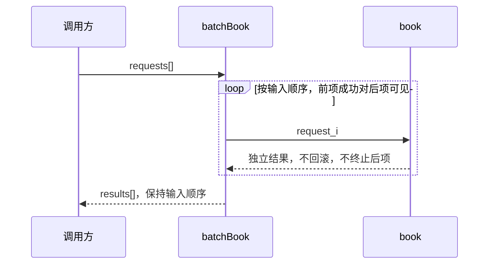

# RFC-396 自适应组合与固定组合对照

本记录使用三个真实模型案例已经审阅的同一份语义文档，比较不同视图投影。它回答“固定种类会漏掉什么表达、留下哪些无依据的图位”，不是独立模型 A/B 实验，也不是用户理解时间研究。固定策略只存在于验收脚本，不进入生产选择器或失败回退。

## 对照方法与证据

- 自适应组：读取设计中 `status=current` 的视图及其模型。候选由真实 `opencode-go/deepseek-v4.1-flash` 生成，过程中发生过超时、无效候选和人工修正，详见 [真实验收](./real-model-acceptance.md)。
- 固定三类组：只展示 flow、state、decision-table。固定五类组再加入 sequence、data。每组均调用现有 `renderGraphModel` 渲染完全相同的模型；缺失种类只记录为空位，不编造模型以填满模板。
- 数字统计来自渲染结果与模型 ID，见 [原始对照数据](./adaptive-comparison.json)。渲染字节数不等于阅读负担或理解时间。模型声明的 coverage 不作为独立质量评判。
- 原始渲染与执行脚本分别在 `/tmp/rfc396-live-evidence/fixed-comparison/` 和 `/tmp/rfc396-compare-views.ts`。通过对应 Case 的设计导出也可重新读取原材料；这些临时路径不承诺永久保留。

| 场景与依据                                                                                    | 自适应组合                                              | 固定三类投影                    | 固定五类投影                                | 逐项审阅结论                                                                                                                                                   |
| --------------------------------------------------------------------------------------------- | ------------------------------------------------------- | ------------------------------- | ------------------------------------------- | -------------------------------------------------------------------------------------------------------------------------------------------------------------- |
| 预约 revision 5，basis `320c5f1c9e50c64e28cac3b896a16a7d2c5ee3a566c24177d86b427c2571a951`     | state + decision-table + sequence；3 个模型，2204 bytes | 2 个模型，1598 bytes；flow 空位 | 同样 3 个模型；flow/data 两个空位           | 新增批处理的输入顺序、前项写入可见和逐项结果返回由 sequence 明确呈现；固定三类没有展示这段模型。业务文字仍在，不能把图中遗漏直接说成实现错误。                 |
| 通知 revision 7，basis `86e0a0a4bbc9cb8485a62acbf5cc4fb581e055e3ff685dd820f6104eaf3b1420`     | state + decision-table；2 个模型，3536 bytes            | 同样 2 个模型；flow 空位        | 同样 2 个模型；flow/sequence/data 三个空位  | 状态机承担版本生命周期，规则表承担重复、旧版本、同版本终态、重试与次数门控。这次固定三类与自适应的有效内容相同，没有观察到内容优势；多余图位缺乏新增问题依据。 |
| 已有模块 revision 8，basis `a4524d9492df4e92e6ea03407b000dd71a800bb9b411a7f33d26d34ddbded697` | decision-table + flow；2 个模型，959 bytes              | 同样 2 个模型；state 空位       | 同样 2 个模型；state/sequence/data 三个空位 | 同步纯函数需要分支规则与 consumer 调用依赖；材料中没有状态生命周期或跨参与方消息协议。不为种类齐全增加模型。                                                   |

三个 Case 分别是 `01M5H550KMNV5RQX7S9RP7S5GX`、`01M5H59S2462BFFJBJWGMF4SY9`、`01M5H59TF3767SKWW9T280J4K3`。一个 composite 视图可以包含多个语义模型，表中模型数不是 UI 卡片数。

## 同一需求变化前后

预约原来选择规则表，后补生命周期，再因 `batchBook` 增加时序模型。当前状态/规则模型继续负责幂等、重叠和取消；新增序列只解释批内顺序。旧视图被归档，原始回答保留，没有把整套图固定为每个新需求的默认输出。

通知原本选单状态图，加入“三次 accepted attempts 上限”后改为状态与规则组合。人工审阅发现“第三次 failed 仍接受、第四次才拒绝”的歧义并修正了模型。该修正是实际人工工作，不能记为模型自动正确。后续缺 error 的分支以文字规则和真实测试补充；图的状态迁移本身不能证明错误留存正确。

已有模块曾同时选中单独规则表、单独调用流和复合表达。策略 v1 将同一关注点的部分覆盖累加，制造了虚假的完整覆盖；策略 v2 对同一关注点取最大值，回放真实候选后只保留 `cand-dt-flow-recommended`。另一个更便宜的复合候选在空串与兼容两项的声明贡献各低 0.05，因此不能称为等价替代。等覆盖时优先更低成本的行为另由程序回归证明。六项部分覆盖/责任缺口仍保留。

## 质量判断与未覆盖的结论

逐项审阅保留了以下限制：预约原模型文字把成熟度项数写错，按六条真实来源修正；通知候选 coverage 元数据漏项，规则语义虽已审阅，不能宣布分数表示全部覆盖；已有模块曾给范围外 concern 声明覆盖而被拒绝。代码生成还出现平台材料伪追溯、平台待办误写为实现缺口以及未测分支，均进入正常反馈/再审核流程，原失败未删除。

本次额外对照只做确定性投影，没有新模型调用；不从累计 token 推算费用。端到端模型调用耗时和失败记录见真实验收，不把超时排除后计算“平均更快”。没有招募真人、没有测量理解时间，也没有独立盲评，因此不宣称降低认知负担的普遍效果。

生产实现是有预算与固定视图约束的启发式选择：模型提出候选，程序校验引用和表达能力、计算边际覆盖、删除冗余并尝试有限替换；最终仍允许人接受、拒绝或补充。它不保证所有可能图组合中的数学全局最优。AC17 的完整旅程结论仍必须另有真实候选、独立执行、人工验收和交付证据，本对照本身不能将 RFC 标为 Done。
