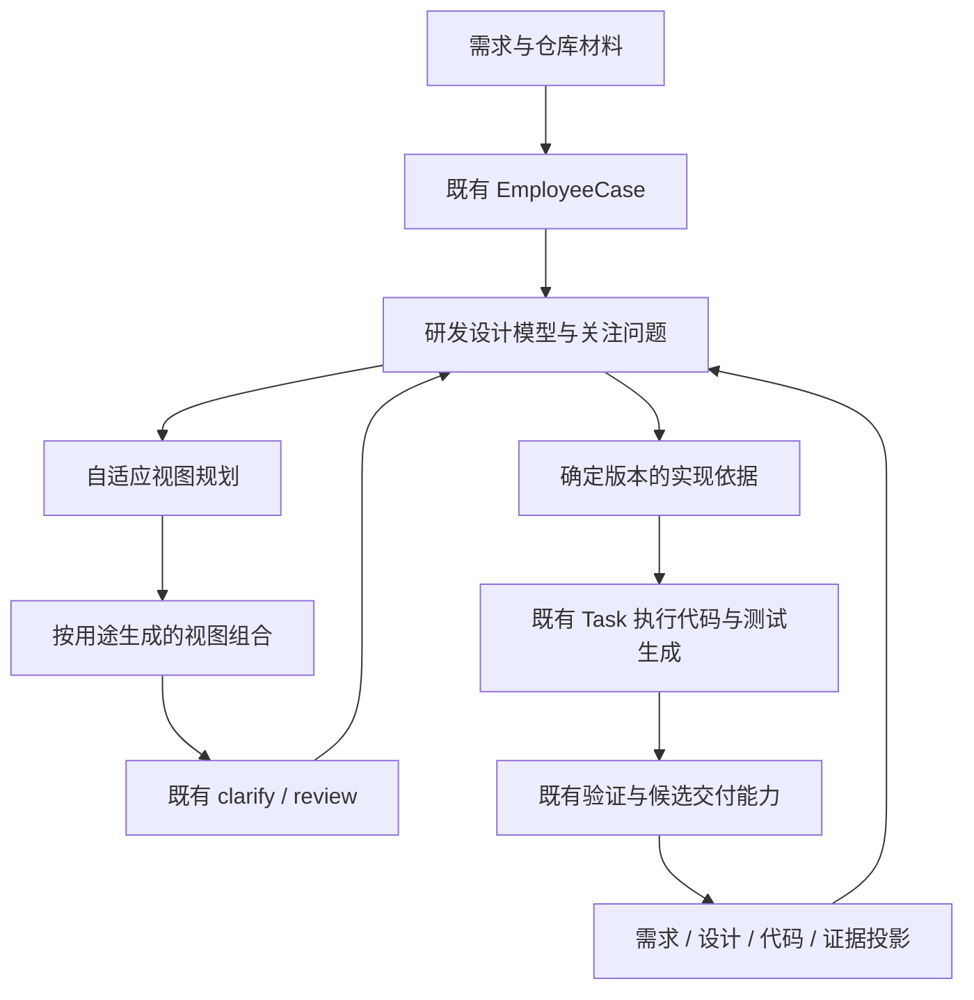

# RFC-396 技术设计：自适应图驱动研发数字人

> 状态：In Progress；调研基线 `3fcb14dbf8ab27cf451934942ea6b9cd647077f8`（2026-10-21）。
> 本文保留设计阶段的架构合同与研究基线；实际实现落点见 §1.1，发布与运行证据见 [validation](./validation.md)。不能将下列历史基线行号当作当前 HEAD 行号。
> 产品范围、裁决及 AC 见 [proposal](./proposal.md)，工程任务与证据状态见 [plan](./plan.md)。
> 2026-10-22 增补：MR 全生命周期、版本兼容、同 Case 工作区交接、修复后图验证和全面回顾修复合同见 [review-and-mr-parity](./review-and-mr-parity.md)。这是当前实施范围，优先于下文历史上“内部提交即完成”的表述。

## 1. 基线与接入依据

下列行号按已提交 blob 核对；实现前重新核对移动中的装配根，不按历史 CLI 路径写新代码。

| 当前源码                                                                                                             | 已证实的接点                                                   | 设计影响                                           |
| -------------------------------------------------------------------------------------------------------------------- | -------------------------------------------------------------- | -------------------------------------------------- |
| `packages/shared/src/schemas/clarifyMindmap.ts:13` / `:46`                                                           | categories/instructions、父问题/分类追问                       | 保留轻量协议；图引用通过关联合同补充               |
| `packages/shared/src/schemas/clarifyDecision.ts:4`                                                                   | decided/provisional、理由/代价/未知/验证安排                   | 不把确认答案等同事实验证                           |
| `packages/backend/src/modules/digital-employee/public/types.ts:31` / `:60` / `:143`                                  | 类型注册、runtime codec、Case 详情投影                         | 新类型沿公开扩展点进入                             |
| `packages/backend/src/bootstrap/daemonModules/digitalEmployee.ts:205` / `:227`                                       | 当前装配数组只有 development 类型与 codec                      | 注册第二类型；装配一次，不按 provider 复制         |
| `packages/backend/src/modules/task-execution/composition/digitalEmployeeExecution.ts:110`                            | 旧 humanReview 仅认 development 的两种合同                     | 不直接追加 graph 字面量继续扩大特殊分支            |
| 同上 `:523`                                                                                                          | Workflow 工具按确切 revision 使用现有 Task 执行                | 新设计阶段优先走 Workflow，组合既有 clarify/review |
| `packages/backend/src/modules/development-automation/application/verificationRunner.ts:66`                           | VerificationProfile 的真实执行回执                             | 复用程序执行，新增需求/图义务映射                  |
| `packages/backend/src/modules/development-automation/application/missionDeliveryChain.ts:104`                        | 绑定 candidate tree 的验证与交付                               | 复用内容身份及已有交付机制                         |
| `packages/backend/src/modules/development-automation/composition/digitalEmployeePlatformWorkItems.ts:1535` / `:1616` | prepare-change / publish-mr 的业务接线仍读 development Context | 不能把 graph Context 直接喂给旧解析器；见 §3.3     |
| `packages/frontend/src/lib/employee-case-detail-tabs.ts:1`                                                           | Case 页签为固定集合                                            | 增加设计工作区入口，工作区内部视图目录动态化       |
| `packages/frontend/src/components/review/MermaidBlock.tsx:129`                                                       | 现有 Mermaid 渲染                                              | 复用渲染基础；元素语义映射另有显式数据             |

RFC-393 已将模块组迁到 `bootstrap/daemonModules/`。正在进行的 RFC-394 修改部署 profile；本 RFC 文档不修改其生产代码，实施时使用完成后的唯一应用图。

### 1.1 已实现的主要入口（发布候选 `bcdfdc366`）

| 能力 | 实际落点 | 关键约束 |
| --- | --- | --- |
| 共享传输合同 | [graphDesign.ts](../../packages/shared/src/schemas/graphDesign.ts) | 前后端共享 schema；语义选择仍属于研发领域 |
| 自适应组合 | [selectViews.ts](../../packages/backend/src/modules/development-automation/domain/graph-development/selectViews.ts)、[viewPlanning.ts](../../packages/backend/src/modules/development-automation/application/graph-development/viewPlanning.ts) | 模型生成候选，程序按有效引用、覆盖增益、预算与固定项选择；policyVersion 2 对同一 concern 取最大贡献，不累加重复表达 |
| 冻结依据与真实输入 | [implementationBasis.ts](../../packages/backend/src/modules/development-automation/domain/graph-development/implementationBasis.ts)、[executionConsumption.ts](../../packages/backend/src/modules/development-automation/application/graph-development/executionConsumption.ts) | 保留完整语义、原始答案与未知；消费实际最终节点结果，校验来源与代次 |
| 实际验证 | [verification.ts](../../packages/backend/src/modules/development-automation/application/graph-development/verification.ts)、[behaviorVerification.ts](../../packages/backend/src/modules/development-automation/application/graph-development/behaviorVerification.ts) | profile 和有限模型程序实际运行，证据绑定 basis / tree / profile，人工义务单独结算 |
| 类型与岗位 | [employeeType.ts](../../packages/backend/src/modules/development-automation/application/graph-development/employeeType.ts)、[builtinResources.ts](../../packages/backend/src/modules/development-automation/application/graph-development/builtinResources.ts) | `graph-development@1` 与新岗位 v2；既有员工保持冻结版本 |
| 唯一装配 | [digitalEmployee.ts](../../packages/backend/src/bootstrap/daemonModules/digitalEmployee.ts) | 接入现有应用图、执行合同与 Case；不另建调度器 |
| Case 设计与证据页 | [GraphDesignWorkspace.tsx](../../packages/frontend/src/components/digital-employees/GraphDesignWorkspace.tsx)、[GraphDesignEvidence.tsx](../../packages/frontend/src/components/digital-employees/GraphDesignEvidence.tsx) | 动态目录、图引用、原生人工门、候选与原始证据的现有组件入口 |

相较下方设计路径草图，实际前端复用了 `components/digital-employees/`；实现依据、版本影响与证据投影按实际职责合并在上述 domain/application 文件中。完整行为与兼容结论以测试和实际旅程为准，单有文件不能证明接线完成。托管自定义 script 的 path 类型审核缺口与实际 inline Markdown 夹具分开记录于 [真实验收](./real-model-acceptance.md)，不在这里隐藏或宣称已修复。

## 2. 总体结构与对象边界



三种图分别承担不同职责：

1. `DesignModel` 是研发业务内容及关系，包含多种类型化子模型。
2. `ViewSpec` 是为某个问题表达模型的投影，不拥有第二份规则真值。
3. Workflow/职责图是执行拓扑，由原 Task/EmployeeCase 机制推进。

设计模型中的一百个节点不生成一百个 NodeRun；新增视图不改变工作流连线。内容版本不是新的运行生命周期。Case 状态归 digital-employee，Task 状态归 task-execution，人工回答和决定归 collaboration。

## 3. 领域与层次落位

### 3.1 唯一 owner

| Owner                        | 本次新增或复用                                                                                  |
| ---------------------------- | ----------------------------------------------------------------------------------------------- |
| development-automation       | 新类型的业务描述/codec、DesignModel、Concern、ViewPlan、实现依据、追溯与验收义务、对应命令/查询 |
| digital-employee             | TypePackage 注册、员工配置、Case/Context/Reaction、版本冻结、既有任务目录与活动流               |
| collaboration                | 原 clarify 问题/草稿/确认/提交与 review 决定；仅增加中立的材料/锚点关联能力                     |
| task-execution               | Workflow/Agent/Program 执行、已有人工门宿主、模型调用材料准备、恢复/取消、执行与产物读取适配器  |
| execution-contract           | 新工作项的输入输出、语义校验与 fixture 回执，沿现有合同注册                                     |
| source-control / integration | 既有仓库基线、候选内容、代码平台及发布能力                                                      |

development-automation 不直接 import collaboration 或 task-execution 内部。它声明窄的 required SPI；task-execution 提供执行/材料适配器，人工门继续经过 task-execution 已有 collaboration required port。Task 执行不反向 import 新研发 domain。

### 3.2 设计阶段的路径分工

```text
modules/development-automation/
  domain/graph-development/
    model.ts                 # 内容合同与纯校验
    viewCapabilities.ts      # 表达能力描述与版本
    selectViews.ts           # 有界组合选择、覆盖与解释
    impact.ts                # 版本依赖与影响
    implementationBasis.ts   # 实现材料及验收义务
  application/graph-development/
    employeeType.ts          # 类型注册适配与职责合同
    employeeCodec.ts         # 既有数字人协议适配
    toolContracts.ts         # 执行合同注册与结果 schema
    builtinResources.ts     # 内置代理/工作流材料
    builtinCatalog.ts       # 资源初始化与版本核对
    designCommands.ts        # 内容命令、提案应用、实现依据预览
    viewPlanning.ts          # 调用端口、解析候选、选择与生成
    designQueries.ts         # Case 工作区投影
    executionBinding.ts      # 原执行引用与设计消费回执
    evidenceProjection.ts    # 证据关联、覆盖与有效性
  application/ports/
    graphDesignStore.ts
    graphDesignExecution.ts
    graphDesignAssist.ts
    graphDesignArtifacts.ts
  infrastructure/graph-development/
    designStore.ts
    designArtifacts.ts       # 复用本域现有产物 provider
  infrastructure/http/graphDesignRoutes.ts
  public/{commands,queries,types,operations}.ts  # 按实际用例增加精确导出
  composition.ts             # 只构造和注入
  composition/required-ports.ts
```

shared 只放前后端共同传输的 DTO/schema 与纯视图值；领域选择算法仍归 development-automation。前端工作区建议落 `features/graph-development/`，复用 Dialog、Form、状态组件、Markdown/Mermaid 和 WS invalidation 模式。

### 3.3 本 RFC 承担的架构演进

新增的类型描述、模型算法、验证投影不放进旧的巨型 `composition/employeeTypePackage.ts`。将注册所需的纯公共形状提到其已有 owner；两种类型各自描述业务。

旧 platform work-item 提供方含 development 私有 Context 解析，不能靠假冒 `typeId=development` 复用。只抽取两个真实 consumer 共有的候选准备、VerificationProfile 执行和交付调用为本域 application 用例；development 与 graph 类型各有显式输入适配器。旧路径保留行为回归，删除被抽取的重复主体，composition 留连接。graph 的平台工作项由确切 typeRef/workItemRef 的注册表分发，不扩大通用 OS 的业务 switch。

不新增 DA→COL、DA→TE 的同步内部依赖，不绕过现有执行设施。required SPI 及其 provider adapter 的新边按 RFC-294 记录。已有全仓环与其他 composition 债不作为本次已偿还项；本 RFC 不承担整体架构迁移。

## 4. 业务内容与版本合同

### 4.1 最小公共骨架

```ts
type ContentRef = { id: string; revision: number; digest: string }

interface Concern {
  id: string
  statement: string
  purpose: 'understand' | 'decide' | 'implement' | 'verify'
  priority: 'required' | 'important' | 'optional'
  disposition: 'open' | 'addressed' | 'deferred' | 'out-of-scope'
  sourceRefs: ContentRef[]
  resolutionRefs: ContentRef[]
  dispositionReason?: string
}

interface DesignDocument {
  schemaVersion: 1
  id: string
  caseRef: { id: string }
  revision: number
  concerns: Concern[]
  elements: DesignElement[]
  relations: DesignRelation[]
  views: ViewSpec[]
  sourceRefs: SourceRef[]
}

interface ViewSpec {
  id: string
  revision: number
  title: string
  purpose: string
  concernIds: string[]
  capabilityRef: { id: string; version: number }
  elementRefs: ContentRef[]
  relationRefs: ContentRef[]
  semanticSpec: unknown // 由 exact capability schema 解码，不能绕过类型校验
  presentationRef: ContentRef
  status: 'current' | 'needs-update' | 'archived'
  pinned: boolean
}
```

`addressed` 只表示已有明确处置，不表示事实已验证。必需 concern 改为 deferred/out-of-scope 必须进入范围变更预览；隐藏/删除视图不能消除对应实现义务。

`DesignElement` 使用共同的 id、revision、来源、依据和显示名称，再按类型附带 payload。首版区分 requirement、decision、assumption、entity、behavior、interface、scenario、constraint；实现与证据主要通过引用关联。关系明确区分 containment、depends-on、implements、verifies、related-to，不能把所有链接解释成依赖。

`SourceRef` 是可解析的判别联合，分别定位用户材料版本、代码 commit/path/blob（可带 symbol）、clarify round/question/confirmedBasis、review receipt、模型 invocation 和证据 artifact。引用解析失败显示缺失，不能降级为模型记忆。

### 4.2 类型化子模型

| 表达语义  | 必须保留的结构                              |
| --------- | ------------------------------------------- |
| 流程/关系 | 节点、带类型的关系、分支条件与场景范围      |
| 时序      | 参与者、消息、先后/并行片段、条件、失败分支 |
| 状态      | 初始/终止状态、事件、迁移、条件、动作引用   |
| 数据      | 实体、字段类型、键与基数、约束              |
| 决策表    | 输入轴、条件、结果、优先级或冲突处置        |

语义模型是引用、校验和实现材料的来源；渲染图源是派生产物。人工修改渲染源只自动接受可证明为展示的变化；涉及语义时提出结构化变更。不能解析的源作为解释附件保留，不覆盖共享语义模型，也不宣称具有自动测试能力。

### 4.3 来源与人的判断

人的回答仍以 collaboration 中的已提交版本为权威。DesignModel 保存精确来源和只读投影；在图上编辑原话跳回原回答编辑入口。模型整理保存为 proposal，采纳记录引用来源，不复制一个可独立编辑的“人答”。

答案确认、用户标记的决定成熟程度、证据验证是三个独立维度。`provisional`、未标记、未知负责人/时机保持原样。确认父节点不自动确认后代，不要求对每个展示节点签署。

### 4.4 版本与依赖

语义修改增加内容 revision；布局、折叠和缩放只增加 presentation revision。重生成图使用稳定语义 ID，不按标题或节点位置重新认领身份。

每次模型调用保存实际读取的版本集合及范围。结果应用时相关语义版本变化则标为 stale；无关分支或布局变化不使结果失效。候选组合变更保存 added/updated/merged/archived 及原因，归档不删除历史。

改变决定时沿显式 depends-on 反向传播影响，包含关系不默认使全树失效。若依赖读取不完整，显示影响范围待核对，不能声称精确局部失效。

## 5. 自适应视图规划

### 5.1 表达能力目录

`ViewCapability` 记录 exact id/version、支持的关注点与语义、输入 schema、输出 schema、renderer、结构检查、可选代码/测试投影器及限制。目录随产品版本发布；Case 冻结所用版本。图种可以增加，需求级组合不硬编码。

首版具备关系/流程、时序、状态、数据关系、决策表表达器。规划器可以为任意业务问题定义 scope、标题和投影；同一表达器可支持多张不同用途的图，也可组合为一个业务视图。没有可信表达器时返回解释性视图或材料缺口，并明确不具备哪些校验能力。

### 5.2 规划输入与输出

输入包含当前需求范围、Concern、相关语义内容、代码事实、受众与阶段、用户固定视图、表达能力版本、阅读/调用预算及已有图组合。当前阅读窗口不等于全部设计范围。

模型输出候选 `ViewProposal`：用途、覆盖 concern、确切 capability、元素/关系选择、所需材料、补充价值、代价、与旧视图的关系、未解决的问题。候选只能引用输入中可定位的依据；新发现对象明确标为 proposal/assumption。

先生成候选说明，再生成选中视图的完整内容。复杂需求使用分页/分范围规划；候选预算限制单次成本，不是全项目视图数量上限。预算不足时保留未规划范围，不能将其记作已覆盖。

### 5.3 组合选择算法

首版采用可重放的启发式组合选择，不引入新的求解器服务：

1. 校验候选结构、能力版本、引用、范围和用户固定项；不合法候选返回具体原因。
2. 将候选的 concern 覆盖映射与类型能力检查结合，形成待人核对的覆盖矩阵。模型声称覆盖不自动等于内容已解释清楚。
3. 在单次预算内逐步选择边际收益较高的候选，再做一次删除/替换检查，减少重复。
4. 收益按 concern 重要性、支持判断/实现/验证的价值累计；同一问题的重复覆盖收益饱和。扣除阅读、重复、切换和维护成本。
5. 对未覆盖的 required concern 明确列缺口；不能靠降低分数把它从义务中删除。图不适用时可用文本/表格表达并保留理由。
6. 输出组合及解释，包含被舍弃候选的简短原因。模型/提示词/目录/策略版本和实际候选集进入规划记录。

权重是版本化的产品策略，不是已实测科学常数；原型和真实评估后调整。相同候选输入与策略应得到同一选择结果；模型候选生成本身不保证相同文本。自动验收断言覆盖、有效性和调整行为，不锁定唯一图名。

2026-10-22 实测修正：选择策略 version 2 对同一 concern 取各视图声明贡献的最大值，不再累加。现有候选合同没有可证明互斥的子问题覆盖集合，无法从多个 0.6 推出完整覆盖；需要互补解释时，先将可独立回答的问题拆为不同 concern。不同 concern 仍能选择不同表达并组合，不限制图的固定种类或数量。旧 version 1 计划保留可读，新规划记录 version 2；缺口不因重复表达消失，固定视图仍保留。该策略是保守的有界推荐，不保证全局最优或模型声明的正确性。

冗余清理后再做一次有界代价替换：候选必须保留每项 concern 的已得覆盖、满足两个预算，并降低与初选一致的阅读/生成加权代价，不能替换用户固定视图。回归用例另设相同覆盖而代价不同的复合表达，避免一次贪心替换顺序留下较贵的等价组合；真实已有模块候选的两个复合表达覆盖并不相同，不能仅凭价格判定较贵者冗余。

### 5.4 持续调整与停止

用户作答、采纳设计变化、代码基线改变、验证发现反例时重新评估受影响 concern。仅表达变化可局部更新；替换/归档已固定或已确认相关视图先展示差异。保留人的来源和布局偏好，无法迁移的布局明确重置提示。

新增图必须说明额外价值；合并图必须保持原关注问题仍可定位。没有新增价值、存在足够实现依据且验收义务可落实时允许收敛。没有问题或预算用尽都不替用户提交实现批准。

## 6. 数字人类型与执行接线

### 6.1 职责与工作项

| 工作项               | 输入/输出合同建议                                                          | 执行与完成条件                                                |
| -------------------- | -------------------------------------------------------------------------- | ------------------------------------------------------------- |
| `understand-request` | `graph-development.intake@1` → 初始材料/Concern/模型提案                   | 复用材料与仓库读取，输出来源，不推定用户决定                  |
| `design-and-clarify` | `graph-development.design@1` → DesignDocument ref、澄清回执                | 默认 Workflow 工具承载分析、clarify 与结果；辅助图动作见 §6.3 |
| `review-design`      | `graph-development.review-basis@1` → 绑定基线的 review receipt             | 既有 review 节点；拒绝后回设计，批准后才接受实现请求          |
| `implement-change`   | `graph-development.implement@1` → candidate ref、trace proposals、测试清单 | 复用代码执行与工作区能力，完成本次完整代码及测试              |
| `verify-change`      | `graph-development.verify@1` → verification/evidence refs                  | 平台确定性执行已登记检查，模型意见单列                        |
| `deliver-result`     | `graph-development.deliver@1` → 设计/代码/证据索引及发布回执               | Case 可读取完整产物；正式发布按既有策略另记                   |

这些工作项固定职责和输入输出，不固定视图组合。模板可更换符合合同的工具；设计与 review 默认使用 Workflow，Agent/Program 只能绑定到合同允许的相应位置，不假装所有位置互换。

### 6.2 澄清和审核宿主

默认设计 Workflow 使用已支持的 Agent、clarify 和 output 节点。Workflow 作为数字员工工具已有正式执行分支，进入既有 TaskEngine；不使用仅支持 development Agent 的 `humanReview` 特殊字段。实现前 review 同样由一个明确的 Workflow 承载。

新增 `GraphDesignExecutionPort` 由 DA 消费、TE adapter 实现，提供四个窄用途：读取绑定宿主的已提交设计产物、读取权威人工输入来源、读取 review 回执、读取候选执行产物。它不允许 DA mint NodeRun 或设置 Task 状态。TE 若缺少已提交人工输入查询，则扩展其消费的 collaboration required port，不跨域读表。

设计 Agent 的结构化提案通过已提交 node output/artifact 导入 DA；导入记录保存 task/run/output/digest。宿主在等待 clarify 时，工作区可展示这一已提交提案；不能等整个 Task done 才显示图。输出读取和 schema 导入是本 RFC 必须接通的生产消费点。

工作项受理时按 caseId 幂等创建或取得 designId。导入由现有 Case/执行事件消费点触发，仅处理已绑定宿主的提交产物，以 task/run/output/digest 去重。事件到达时未能导入的结果通过既有 Case 对账重读；不新增后台轮询调度器。读取工作区不会偷偷消费尚未提交的临时文件。

每个问题的图锚点是中立的 `{artifactRef, elementIds, relationIds, viewId?}` 来源关联；collaboration 不解码研发图模型。宿主适配器保证锚点与同一问题/轮次可重读。用户修改答案继续走原 clarify 命令；原提交后，由同一宿主输出/回执更新设计提案与来源。

设计工作区修改的语义内容保存于 DA。下一次设计调用显式读取当前模型版本和准确问答来源，而不是依赖原生会话恰好记得。实现基线由 DA 确定性生成，review 材料只引用该基线；review 通过只表示此基线获准用于实现。

### 6.3 图内短动作

解释、重新选图、局部更新等调用通过 `GraphDesignAssistPort` 使用 TE 已选择的模型执行与材料准备，参照现有 clarify follow-up 的短调用方式。它们不创建业务工作流节点、不结束人工门、不修改 Case 执行状态，也不在 HTTP 中直接启动 CLI。

DA 保存 requestId、action kind、read set、invocation ref、结果/proposal ref 和错误；运行控制、用量与取消复用既有执行设施。一个请求的技术重试保留身份，用户改变输入形成新请求。进程重启后的未完成短动作显示 interrupted 并允许明确重试，不创建第二个自动续跑队列。

图内只读调用使用设计材料与只读仓库事实；实现动作仍由 `implement-change` 工作项承载。生成只产生 proposal，语义变更经同一 DA command 应用。已有内容保存失败、调用失败或取消均不丢弃之前版本。

### 6.4 Case 与业务内容引用

Case 的 graph Context 保存 designId、当前已消费版本、基线/实现/验证引用及阶段所需业务事实。DA 是设计内容唯一 writer，Context 中的读侧摘要由同一版本的事件/结算投影更新；显示时带 revision，落后则提示刷新，不把摘要当另一份权威模型。

启动/恢复/终止、Reaction 排队与预算仍走 DE。批准的实现请求通过原 Case 命令/事件受理，映射到既有 Reaction；同一基线/目标/请求的响应重放返回原 executionRef。请求受理与实际执行分开显示，不能在图 HTTP 路由再次 launch Task。

### 6.5 人工门结束后的继续设计

现有 review 的 rejected/iterated 默认会重跑上游，不能直接用作独立基线审核的返回值。本 RFC 为通用 review 配置增加显式的 `decisionHandling: rerun-upstream | return-decision`，默认保持 `rerun-upstream`。新审核 Workflow 选择 `return-decision`：三种决定都以原人工门回执提交，完成当前 review 节点并输出决定、理由和材料版本；拒绝或迭代不重跑冻结基线的上游。Case 的类型 settlement 按决定转回设计或等待实现请求。B1 的拒绝只结束 B1 审核，修改后的 B2 必须生成新审核请求。人工门响应丢失仍按原 request/receipt 重放；其他 review 保持原有语义。新增配置、执行分支、输出合同和前端文案都纳入回归。

图上追问按宿主状态处理：

| 当前状态             | 明确行为                                                                                                                                                                           |
| -------------------- | ---------------------------------------------------------------------------------------------------------------------------------------------------------------------------------- |
| 有可写 clarify round | 通过原 draft/follow-up/submit 命令编辑或追加，保持 round 身份。                                                                                                                    |
| 原 round 已提交      | 原回答只读；“补充/修正回答”产生新的 clarification request，引用旧 round/question/confirmedBasis 与当前图锚点，由 Case 受理新的设计 Workflow 和新 round。原回答不覆盖、不重新打开。 |
| 正在审核             | 请求先明确撤回此基线审核，经原 Task 取消与 Case 结算后进入新设计；保留旧审核及撤回记录。                                                                                           |
| 正在实现             | 新请求进入既有 Case 待办，界面说明在途实现继续使用旧基线；在其结束后处理，或由用户显式取消旧执行。                                                                                 |
| Case 已终结          | 通过既有新工作入口创建后续 Case，引用前序设计/回答和候选，不复活终态 Case。                                                                                                        |

新的澄清请求是业务工作项受理，不能走 §6.3 的只读短动作。语义修正保存为新提案并引用旧回答，不改写人的原话。相同 requestId 重放返回同一受理结果，刷新后可从 Case 查回宿主。

## 7. 实现依据、代码和回写

### 7.1 ImplementationBasis

基线包含 schemaVersion、designId/revision/digest、采用的元素版本、范围内需求与明确排除项、决定及假设、接口/数据/行为子模型、场景与验收义务、代码基线和引用、相关图索引、生成工具/合同版本。

导出至少包含 `design.json`、`implementation.md`、`views/` 下的图源/表格、`acceptance.json` 与 manifest。文件是内容快照，不是独立可编辑的答案库。Markdown 从结构化内容确定性投影；未采纳提案放在明确附录，不能成为实现要求。

基线预览检查：本次 required concern 有明确处置、没有阻碍本次实现的未解决矛盾、验收义务存在验证安排、必要材料可被选定运行时读取。允许有界假设，但用户需在基线中看到其影响；不得自动补负责人或把暂定改为已决定。

### 7.2 实际消费

review receipt 绑定 basis digest，执行输入冻结为同一 artifact manifest。实施开始、材料准备、输出完成各有原 executionRef 可查；只组装 prompt 不能算已生成代码。

基线预览本身不启动审核。用户提交审核请求后，DA 保存所选不可变基线并经既有 Case 受理 `review-design`；回执只对该 digest 有效。批准后工作区提供“开始实现”，其实现请求携带同一基线和决定回执。只有有效批准与实现请求同时具备时，Case 才推进 `implement-change`。如提供“批准并开始实现”的合并操作，界面必须明确动作，后端仍保留两项事实并可幂等恢复。

运行期间的新设计版本不修改在途输入。旧执行结果绑定原基线，工作区可以同时显示“旧基线结果”和“当前设计待实现”。再次实现是显式请求，不复活已完成 clarify round。

### 7.3 追溯与代码反向影响

实现工具输出 `TraceLink` 提案，将需求/规则/场景映射到候选文件、符号或测试。平台核对路径、候选 blob 与实际测试引用存在；语义充分性通过设计检查和实际验证判断。仅存在一个链接不计为实现完成。

代码变化可提出模型更新建议；已确认业务决定保持原样，必须说明是实现偏差、设计修订还是来源失效。不能反向把测试通过解释为需求已经改变。

### 7.4 已登记空仓库

空仓库不是一个不存在的 commit。source-control 的共享候选接点显式接受 `RepositoryBaseline = {kind: commit, commitSha, treeOid} | {kind: unborn, targetBranch, emptyTreeOid, materializationCommitSha}`；持久化、实现依据与产物均保存 kind。无 commit 且无可解析分支时才判定 unborn，普通未知分支不降级为空仓库。

为复用已有运行时 checkout，source-control 在对象库内创建内容为空的确定性内部提交，作为材料准备锚点；不移动用户分支，不把它展示为用户已有提交。候选 tree 仍从实际生成内容派生、验证和绑定。正式生成第一个业务 commit 时 unborn 基线使用无父提交，不带内部锚点作为 parent；有 commit 的现有仓库维持原 parent。导出或提交候选不要求创建代码托管项目；配置的发布沿既有 source-control 端口执行，目标分支应仍未创建，若期间出现真实提交则提示重新基线，不能覆盖。

材料准备、候选派生、首个提交及发布统一消费该判别合同；类型专属 Context 不靠空字符串 SHA 表示 unborn。空仓库与普通仓库、单机与托管分别覆盖；现有 development 调用保持 commit 基线行为。内部材料锚点是 Git 机制，不是新业务生命周期。

## 8. 验证与证据合同

### 8.1 四类结果

| 类型          | 来源                                          | 结论边界                     |
| ------------- | --------------------------------------------- | ---------------------------- |
| structure     | schema、引用、子模型规则、渲染检查            | 通过已声明结构规则           |
| design-review | 可判定跨模型约束、模型建议、人审              | 分列确定性冲突与待核实意见   |
| execution     | VerificationProfile、实际测试、确切 SHA 的 CI | 该候选在指定条件下的实际结果 |
| acceptance    | 人的场景走查或明确验收记录                    | 指定业务目标的实际确认       |

结果统一有 `passed / failed / not-run / inconclusive`，freshness 单列 `current / stale / unknown`，避免将旧 passed 覆盖成新 passed。AI 输出“测试通过”不能产生 execution 结果。

### 8.2 EvidenceBinding

必须记录 basis digest、覆盖的义务/场景 ID、candidate treeOid（已提交时再带 commit SHA）、验证 profile/revision/digest、执行环境摘要、真实 run/job/step 引用、原始证据 artifact/digest、结果与时间。CI 结果另保存 workflow 和 exact SHA；部署和人工验收各有自己的目标版本。

复用现有 EvidenceArtifact 和 VerificationProfile 执行器，新增绑定与读投影。为每项义务区分关联存在、覆盖经核对、实际执行、目标验收四种事实。没有可执行检查的义务明确列人工验证安排，不能静默跳过。

### 8.3 有限行为模型

状态/决策表适配器可生成测试输入与路径，但必须具备事件/动作执行绑定与断言。边界包括探索深度、路径数量、输入取值域、时间模型和环境。达到上限标 partial/inconclusive，保留未覆盖列表。

图自洽不能证明实现正确；从同一生成器导出的代码和测试还须由独立需求场景/已有回归校验，避免只验证生成器自己的假设。首版不要求引入 XState/TLA+ 等运行依赖，具体适配器选型在原型/实现批准前锁定。

### 8.4 变化后的有效性

- 仅布局改变：语义依据与执行结果保持。
- 部分设计依据改变：反向依赖到的证明需要复核，未受影响的旧运行事实保留。
- 候选代码内容改变：旧执行回执仍是历史，默认不能充当新候选通过；目标检查需重新执行或有明确的内容等价证明。
- 验证程序/profile/依赖环境改变：同一代码也可能需要新证据，展示原因。
- 无关 HEAD 前进但本任务候选内容未变：复用有效候选检查，不追着 SHA 重跑全量；远端最终结论仍单独绑定 exact SHA。

## 9. 持久化、命令和故障

### 9.1 持久化

DA 持有设计文档当前版本指针、不可变版本、proposal/规划记录、实现基线与 Trace/EvidenceBinding。建议使用 `development_designs`、`development_design_revisions`、`development_design_proposals`、`development_design_baselines`、`development_design_links` 五组业务存储；具体迁移编号在实现时分配。

大模型/图源/原始证据通过现有 artifact provider 保存，数据库持 ref/digest 与必要索引。节点和关系索引只服务范围查询/反向依赖，能够由内容重建。SQLite/PostgreSQL 经同一 Store port 实现同一算法，不维护两份内容规则。

无旧数据回填要求；旧类型不自动变成新类型。新 Case 冻结类型/合同/表达器版本；升级不改运行中基线。旧版本能力暂不可用时仍能读取已有导出与历史，执行说明具体缺少的版本。

### 9.2 对外命令草案

以下是新 DA inbound 的资源路径建议；现有 Case/clarify/review 路由继续由原 owner 处理。

| 方法与路径                                                      | 语义                                                        |
| --------------------------------------------------------------- | ----------------------------------------------------------- |
| `GET /api/development-designs/:id`                              | 读取版本、视图目录、待办与原 Case/Task/人工门引用           |
| `GET /api/development-designs/:id/views/:viewId`                | 读取确切视图及分页语义范围                                  |
| `POST /api/development-designs/:id/changes`                     | 应用人的结构化修改，携带 expectedRevision 与 requestId      |
| `POST /api/development-designs/:id/actions`                     | 接受规划/局部生成/检查请求；返回 request 与 invocation 状态 |
| `POST /api/development-designs/:id/proposals/:proposalId/apply` | 按 read set 应用提案，返回 accepted/stale 及差异            |
| `POST /api/development-designs/:id/baseline-previews`           | 确定性形成实现依据预览；不代替原 review 决定                |
| `POST /api/development-designs/:id/review-requests`             | 引用预览的不可变基线，经 Case 受理既有 review Workflow      |
| `POST /api/development-designs/:id/implementation-requests`     | 引用已批准基线，经 Case 受理，不直接创建 Task               |
| `GET /api/development-designs/:id/evidence`                     | 按义务/版本读取执行、人工与发布证据                         |

另增 `POST /api/development-designs/:id/clarification-requests`：图锚点与前序回答引用进入既有 Case 受理；已封口 round 保持不可变，具体行为见 §6.5。

所有命令通过模块公开 application 合同。受影响版本冲突时返回当前版本及可重试说明，保留客户端输入。WS 只发送已提交变更提示，刷新回读事实源；不依赖浏览器在线维持工作。

### 9.3 故障与恢复

| 情况                     | 用户行为与恢复                                                          |
| ------------------------ | ----------------------------------------------------------------------- |
| 候选协议/图语法错误      | 保留原版本，显示失败位置和该候选；有限修复后仍失败则允许重试/改表达     |
| 生成期间相关内容改变     | 结果作为 stale proposal 保存，不自动覆盖；无关修改不误伤                |
| 保存冲突                 | 保留本地输入，展示差异；不得用旧版本整体覆盖共享模型                    |
| 短调用取消/进程重启      | 原内容可读，调用显示 canceled/interrupted，明确重试；迟到结果不应用     |
| review 响应丢失          | 查询原决定回执，复用已有 Case continuation，不再次执行                  |
| 已批准基线相关内容改变   | 旧批准仅对旧基线有效；新请求须说明采用哪个版本                          |
| 程序验证失败             | 保存实际日志与未执行项，按原因修复代码或重新审视设计                    |
| 证据或表达器版本不可读   | 显示缺失/不可用；不能以缓存文字宣称完成                                 |
| 托管执行无法读取本机路径 | 通过原 artifact/materialization provider 处理；不把绝对路径当跨部署资源 |

## 10. 前端与性能

Case 顶层增加“设计”入口，内部按 ViewPlan 呈现业务视图目录，不为每个图种添加固定页签。视图解释、缺口、关键决定和下一步动作优先于技术 JSON。技术详情与原始证据可展开。

选中节点/边/路径能定位同一语义在其他图、问题与证据中的位置。Mermaid 元素映射使用自己的稳定索引及可点击的元素列表，不能依赖 SVG 偶然生成的 DOM id。图内定位作为增强；键盘与目录路径必须独立可用。

大图读取按实际 scope 和分页返回，完整性标记包含范围/digest/是否截断。只渲染当前视图/可见范围；上下文压缩必须保留来源和遗漏范围。测试包含至少 1,000 个语义元素、多视图及深依赖；耗时、内存和交互延迟记录实际环境，未经测量不承诺时延数值。

## 11. 验证策略与批准边界

先完成 prototype 和功能设计审查，再批准实现。设计/实现审查均只审功能正确性、功能完整性、用户可见行为及回归；安全相关一律不扫描、不分析、不验证、不提问、不提 findings、不提建议、不转任务。

全部生产实现、双 provider 接线与测试编写完成后集中验证。纯规则使用确定性 fixture；选择质量用带可接受组合集合/必要关注点的真实需求案例；语义改动、依赖变化、旧流程、恢复与实际消费需要集成回归。真实模型与真实 UI 完整旅程另记证据，不能用 mock 代签。

不以本文合同已写完宣称设计门通过。所有开放准备项、实现依赖、测试矩阵与正式退出条件见 [plan](./plan.md)。

### 实现接线补充：先提交设计，再进入原生澄清

既有 TaskAgentRun 严格要求 workflow-output 与 workflow-clarify 二选一；澄清轮不会写业务输出。内置 design-and-clarify Workflow 因而采用“designer 提交 design-model → clarifier 消费已提交设计并进入原生 clarify → 返回最终 agent-result”的顺序。等待人工时显示上游已提交版本，后续问题仍属于原生循环；最终修改导入与并发编辑保持 read-set 检查，不把尚未提交的模型文本显示成正式设计。图内短调用仍只产生待应用提案。

显式图工作请求在原 Event Center/Case inbox 受理；该类型的 reaction 声明 preemptsContinuation 和可选 resumesBlocked，只有已进入 inbox 的明确请求才经既有 Case resume 转换恢复失败案例。活动 round 保持执行，审核撤回仍调用原 Task cancel，结束后再处理排队请求。旧类型未声明 resumesBlocked，保持既有行为。

### T06 实施接点澄清

候选 derive/stage/commit 已是 source-control 的正式 public participants，旧 development 与新 graph-development 均注入这些 owner 接点；profile 执行复用同一 `runVerificationProfileWithEffects`。因此无需再新增只转发参数的候选/交付 facade。图领域只增加冻结依据、追溯核对和证据编排，不复制 Git 或命令执行引擎。实现报告的 limitations 阻止自动交付，并回写待用户明确应用的 code-feedback 提案。

## 14. CI 后接线澄清

HTTP 入口依旧由唯一应用图挂载；其传输对象不作为 public DTO 暴露。SourceControl 对外声明无执行函数的候选/工作区请求与结果合同，具体 Git/文件操作仍由原 composition 选择。内置类型注册、codec 与执行合同适配属于 application；纯图语义、组合选择、影响分析继续位于 domain。内置资源 catalog 的异步内容初始化由 application 负责，组合根只注入完整参与者。

图辅助调用将完整 request/document/catalog/outputSchema 放进既有 SystemAgentRunFamily 的 `seedFiles`，在实际执行工作区生成 `graph-design-request.json`，模型按短提示读取该文件。单机和托管沿各自已有材料 owner；不按 Windows 分叉、不截断 schema、不新建执行通道。
